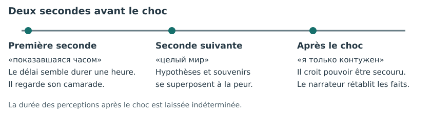

# ENS · B/L · Russe, oral commun · 26 juin 2025 · Corrigé guidé

*Corrigé rédigé par IA, non officiel. Signalez toute erreur.*

**Rédaction** · GPT-6.2 Astra Ultra · vitesse non renseignée · 26 novembre 2026

L’oral commun prévoit un seul texte, 1 h 30 de préparation, 20 minutes d’exposé en russe et 10 minutes de questions. La traduction française accompagne le travail sur le texte. Le commentaire qui suit constitue la proposition pour l’oral. Le sujet est celui de l’unique candidat de russe B/L décrit dans le rapport de session. [Index des oraux, 26 juin](https://www.ens.psl.eu/sujets-des-epreuves-orales-du-concours-bl-session-2025-0) · [Épreuves de la session B/L](https://www.ens.psl.eu/rapports-et-sujets-du-concours-2025-section-des-lettres-groupe-bl) · [Sujet du 26 juin](https://www.ens.psl.eu/sites/default/files/russe_26_juin.pdf) · [Rapport du jury](https://www.ens.psl.eu/sites/default/files/2025_bl_rapport_russe_oral_tc.pdf)

Le feuillet porte « XI. ». Dans le tome IV de l’édition russe des Œuvres complètes en 90 volumes, le même passage de *Sébastopol en mai* se lit à la section 12. Juste avant la coupe initiale du billet, Pest annonce la mort de Praskoukhine à Kalouguine. Le lecteur du récit entier aborde donc la scène en connaissant déjà son issue. [Texte de référence, tome IV](https://tolstoy.ru/online/90/04/)

## Organiser les vingt minutes

Partir de l’expérience du lecteur qui découvre le passage sur le billet. Garder à portée de main trois citations courtes, une pour chaque mouvement. À l’oral, faire entendre le rythme des hypothèses, puis comparer la dernière phrase avec le temps que le récit accorde aux impressions du personnage. Pour répondre à une question sur le récit intégral, revenir au contexte rétabli ci-dessus.

## Traduction française du passage

Les deux coupes signalées par des crochets appartiennent au sujet. La note du jury donne « un obus » pour *Маркела*. Les numéros renvoient aux lignes imprimées sur les deux pages.

### Lignes 3–18. Un instant de répit

> [!INDICATION]
> **Lire les marques d’incertitude.** Entre les lignes 11 et 16, relever *не напрасно ли*, *может быть*, *ему только казалось*. Donner pour chacune une traduction et préciser qui doute. Les doutes du personnage préparent la différence entre sa connaissance de la situation et celle du narrateur.

[…] Praskoukhine, qui marchait à côté de Mikhaïlov, venait de croiser Kalouguine. Comme il approchait d’un endroit moins dangereux, il commençait déjà à reprendre un peu vie, lorsqu’il vit un éclair briller vivement derrière lui. Il entendit le cri de la sentinelle, « Un obus ! », et les mots d’un des soldats qui suivaient, « Il va tomber droit sur le bataillon ! »

[…] « À terre ! » cria une voix effrayée. Mikhaïlov se jeta à plat ventre. Praskoukhine se plia malgré lui jusqu’à terre et ferma bien fort les yeux. Il entendit seulement l’obus retomber avec un bruit mat sur le sol dur, quelque part, tout près. Une seconde passa, qui lui parut une heure. L’obus n’explosait pas. Praskoukhine eut peur de s’être laissé effrayer pour rien. Peut-être l’obus était-il tombé loin et se figurait-il seulement que la fusée sifflait tout près. Il ouvrit les yeux et constata avec une satisfaction d’amour-propre que Mikhaïlov, à qui il devait douze roubles et cinquante kopecks, était allongé sur le ventre, beaucoup plus bas que lui, presque à ses pieds, immobile et tout contre lui. Mais au même instant son regard rencontra fugitivement la fusée lumineuse de l’obus qui tournait à un archine de lui.

Une terreur froide, une terreur qui excluait toute autre pensée et tout autre sentiment, s’empara de son être tout entier. Il se couvrit le visage de ses mains et tomba à genoux.

### Lignes 19–36. La seconde qui contient toute une vie

> [!INDICATION]
> **Mettre en voix le monologue.** Souligner *А коли*, *а ежели*, *А может быть*, puis lire le dernier *меня* après une pause. Les phrases envisagent des issues incompatibles. Justifier la première personne et les variations de longueur sans transformer chaque réplique en affirmation de l’auteur.

Une autre seconde passa, une seconde durant laquelle tout un monde de sentiments, de pensées, d’espoirs et de souvenirs défila dans son esprit.

« Qui est-ce que ça va tuer, moi ou Mikhaïlov ? Ou tous les deux à la fois ? Et si c’est moi, où est-ce que ça va me toucher ? À la tête, alors tout est fini. Et si c’est à la jambe, on me la coupera, et je demanderai à tout prix qu’on le fasse au chloroforme. Je peux encore m’en tirer vivant. Ou peut-être que ça ne tuera que Mikhaïlov. Alors je raconterai comment nous marchions côte à côte, comment il a été tué et comment j’ai été éclaboussé de son sang. Non, c’est plus près de moi, c’est moi. »

À ce moment-là il se rappela les douze roubles qu’il devait à Mikhaïlov, puis une autre dette, à Pétersbourg, qu’il aurait dû régler depuis longtemps. Un air tsigane qu’il avait chanté le soir lui revint à l’esprit. La femme qu’il aimait lui apparut en imagination, coiffée d’un bonnet à rubans lilas. Un homme qui l’avait offensé cinq ans auparavant et à qui il n’avait pas rendu l’offense lui revint en mémoire. Et cependant, mêlé à ces souvenirs et à mille autres, inséparable d’eux, le sentiment du présent, celui de l’attente de la mort et de la terreur, ne le quitta pas un seul instant. « Après tout, peut-être que ça n’éclatera pas », pensa-t-il. Avec une résolution désespérée, il voulut ouvrir les yeux. Mais à cet instant, alors qu’il avait encore les paupières closes, une lueur rouge lui frappa les yeux. Dans un craquement terrible, quelque chose le heurta en pleine poitrine. Il courut on ne sait où, buta contre un sabre qui se trouva sous ses pieds et tomba sur le côté.

### Lignes 37–55. Ce que le personnage croit et ce que le récit sait

> [!INDICATION]
> **Identifier une représentation subjective.** Aux lignes 50–53, distinguer la tournure *ему показалось* de ce qui lui appartient grammaticalement. C’est l’impression du personnage que les soldats lui posent des pierres dessus. Dans la dernière phrase, relever l’absence de verbe d’apparence.

« Dieu merci ! Je suis seulement commotionné », telle fut sa première pensée. Il voulut porter les mains à sa poitrine, mais elles lui semblaient attachées et une sorte d’étau lui serrait la tête. Des soldats passaient comme des apparitions devant ses yeux et, machinalement, il les comptait. « Un, deux, trois soldats, et voilà un officier aux pans de capote relevés », pensait-il. Puis un éclair brilla devant ses yeux, et il se demandait d’où venait ce coup, d’un mortier ou d’un canon. Sans doute d’un canon. En voilà encore un, et encore des soldats, cinq, six, sept soldats, qui passent toujours devant lui. Tout à coup il eut peur qu’ils ne l’écrasent. Il voulut crier qu’il était seulement commotionné, mais il avait la bouche si sèche que sa langue lui collait au palais, et une soif terrible le tourmentait.

Il sentait que tout était mouillé autour de sa poitrine. Cette sensation d’humidité lui rappelait l’eau, et il aurait même voulu boire ce qui le mouillait ainsi. « J’ai dû me blesser jusqu’au sang en tombant », pensa-t-il. Et, cédant de plus en plus à la peur d’être écrasé par les soldats qui continuaient de défiler devant lui, il rassembla toutes ses forces et voulut crier « Emmenez-moi ! » Mais au lieu de cela il poussa un gémissement si terrible qu’il prit peur en s’entendant lui-même. Puis des lueurs rouges se mirent à danser devant ses yeux. Il lui semblait que les soldats posaient des pierres sur lui. Les lueurs dansaient de plus en plus rarement, les pierres qu’on empilait sur lui pesaient de plus en plus. Il fit un effort pour les écarter, s’étendit de tout son long et, dès lors, il ne vit plus, n’entendit plus, ne pensa plus et ne sentit plus rien. Un éclat l’avait tué sur le coup, en pleine poitrine.

## Комментарий к отрывку из «Севастопольских рассказов»

### Вступление. Кто знает, что произошло?

В июньском билете дан отрывок из рассказа Льва Толстого «Севастополь в мае». Над отрывком в билете напечатано «XI.», а в девяностотомном собрании сочинений он находится в двенадцатом разделе. Действие происходит во время Крымской войны. Толстой сам служил в Севастополе, однако этот опыт не превращает эпизод в записку очевидца. Ни один очевидец не мог бы рассказать, что думал человек в последние секунды своей жизни. Именно здесь возникает литературный вопрос. **Как Толстой даёт читателю пережить время Праскухина и в какой момент отделяет наше знание от знания самого героя?** Я сначала покажу, как личное самолюбие вмешивается в восприятие опасности, затем рассмотрю устройство второй секунды, а в конце разберу перемену точки зрения.

### I. Рядом с другими, наедине со своим страхом

Первое предложение начинается почти с облегчения. Праскухин идёт рядом с Михайловым и приближается «к менее опасному месту». Слово «менее» очень важно. Оно обозначает относительную безопасность, которую герой преждевременно принимает за повод ожить. Действие ещё продолжается, герой только «начинал уже оживать немного», когда сзади появляется молния и раздаётся крик. Опасность сначала существует для него как набор впечатлений. Он не видит того, что происходит за спиной. Присутствующие улавливают разные признаки и по-разному их называют. Часовой предупреждает одним словом, солдат предполагает, куда прилетит снаряд, чей-то голос кричит: «Ложись!» Говорящий даже не назван. На мгновение несколько людей соединяет общий страх.

И всё-таки даже сейчас Праскухин думает о взгляде товарища. Он боится «не напрасно ли он струсил». Это уже страх перед собственной трусостью. Он открывает глаза и с удовольствием замечает, что Михайлов лежит ещё ниже. Физическое положение другого человека превращается в сомнительное доказательство собственного превосходства. Особенно выразительно неожиданное уточнение суммы долга: двенадцать рублей с полтиной. Товарищ, с которым герой делит опасность, одновременно его кредитор. До войны и вне общей военной роли у этих двух людей была частная жизнь, в которой они связаны деньгами. Сразу после этого короткого удовольствия появляется точная мера другого рода. Между героем и бомбой всего один аршин. Теперь измеряется уже не долг, а расстояние. Оба числа делают эпизод конкретным, но смысл второго превращает удовлетворение первого взгляда в ужас.

### II. Что умещается во вторую секунду?

Первую секунду герой воспринимает как час. О второй повествователь говорит иначе: в неё уместился «целый мир». Снаружи оба отрезка времени равны, внутри они устроены по-разному. Толстой сначала даёт почти рассудочное дерево возможностей. Праскухин задаёт вопросы, уточняет, возражает себе, строит фразы с «а коли», «а ежели», «а может быть». Он пытается распределить неизвестное между двумя людьми и несколькими исходами. Если погибнет Михайлов, можно будет потом рассказать, как они шли рядом. Будущему рассказчику уже видится собственная роль. Но короткое «Нет, ко мне ближе — меня» обрывает вымышленное будущее. У героя нет достаточного знания, чтобы предсказать исход. Рассуждение нужно ему прежде всего для того, чтобы ещё оставаться человеком, у которого есть будущее.

Затем привычная логическая связь уступает место памяти. Сначала возвращается долг Михайлову, потом другой долг в Петербурге. Эти две мысли ещё можно соединить по смыслу. Но что связывает с ними напев, женщину в чепце с лиловыми лентами, давнюю обиду? Перечень не даёт красивой, заранее составленной биографии. Память выделяет случайный цвет, звук, незаконченный счёт. Рядом оказываются нежность, самолюбие, стыд и удовольствие. Понятна и разница между двумя упоминаниями долга: впервые сумму сообщает повествователь с полтиной, затем герой вспоминает двенадцать рублей. В воспоминании сохраняется главное для него, а не обязательно вся точность первоначального наблюдения.

Можно было бы решить, что прошлое на время спасает его от настоящего. Однако повествователь прямо говорит, что ожидание смерти не оставляло Праскухина ни на мгновение. Слова «вместе, нераздельно» важнее простой последовательности воспоминаний. Прошлое не заслоняет страх, оба переживания сосуществуют. Текст вынужден располагать образы один за другим, но словами указывает на их одновременность. Так художественное повествование передаёт состояние, для которого недостаточно обычного хронологического отчёта.

### III. Когда прекращается внутренний рассказ?

После удара Праскухин вновь становится толкователем собственного положения: «Слава Богу! Я только контужен». Частица «только» сразу предлагает утешительное объяснение. Читателю доступны те же признаки, но их последовательность заставляет иначе отнестись к выводу героя. Он хочет дотронуться до груди, но не может. Ему кажется, что руки связаны, голову сжимают тиски. Впечатление дано с физической убедительностью, тогда как его причина остаётся для Праскухина неясной. Толстой очень точно разделяет способность чувствовать и способность правильно объяснять ощущение.

Счёт солдат — ещё одна попытка придать происходящему порядок. Праскухин успевает заметить даже подвёрнутую шинель офицера. Однако после «один, два, три» появляются «пять, шесть, семь». У счёта пропущено звено. Вместе с повторением «а вот» это создаёт прерывистый ритм, в котором взгляд лишь временами схватывает отдельные фигуры. Затем ощущение влаги вызывает мысль о воде, а тяжесть передаётся образом камней. Нельзя утверждать, что солдаты действительно кладут камни: сказано «ему показалось». Даже собственный голос перестаёт ему повиноваться. Герой собирается произнести обращённые к другим слова, а слышит стон, который пугает его самого. Язык, позволявший прежде сочинить будущий рассказ, в решающий миг уже не позволяет его начать.

В конце четыре отрицания по очереди отнимают зрение, слух, мысль, чувство. После этой границы появляется короткое сообщение: «Он был убит на месте». Между ним и длинным потоком восприятий нет необходимости искать медицинское противоречие. Последняя фраза сообщает исход в масштабе внешнего события; предыдущие абзацы дают длительность проживаемого мгновения. В пределах отрывка объяснение задержано, пока герой надеется спастись. В полном тексте читатель ещё до появления Праскухина слышит от Песта, что тот убит. Начальная купюра в билете меняет порядок, в котором читатель узнаёт о смерти. В рассказе целиком внимание сосредоточено на том, как погиб человек, о смерти которого уже сообщили. Теперь он возвращает читателя к общему миру, где уже невозможно спросить самого Праскухина, что он испытал.

### Заключение

Военный рассказ часто связывает поступок человека с его местом в общем деле. В этом отрывке группа действительно присутствует с самого начала, но о том, что происходит с отдельным человеком, окружающие почти ничего не знают. Возможно сопоставление с князем Андреем на поле Аустерлица в «Войне и мире»: там тоже восприятие раненого меняет масштаб события. Но Праскухину не дан образ высокого неба, который собирал бы мысли воедино. Его последняя секунда остаётся множеством незавершённых частных переживаний. Нравственное действие эпизода заключается именно в том, что читатель успел увидеть за одним коротким сообщением о смерти жизнь, которую это сообщение само по себе вместить не может.

## Вопросы для собеседования

**Почему деньги снова появляются во второй части?** Первый раз названа точная сумма, а второй раз долг возвращается в ряду воспоминаний. Деньги связывают отдельную сцену рядом с Михайловым с прежней жизнью героя. Перечисление объединяет разные по значению вещи по законам памяти.

**Почему Праскухин хотел бы потом рассказать о гибели Михайлова?** Он допускает, что переживёт товарища, и на мгновение видит себя будущим рассказчиком. Это может обнаруживать самолюбие, но одновременно показывает его отчаянное желание представить себе хоть какое-нибудь будущее.

**Как вы понимаете выражение «на месте»?** Оно подводит итог событию с внешней точки зрения. До этого Толстой показывает, как долго может длиться для сознания один краткий миг. Различие этих масштабов и даёт силу последнему предложению.

**Можно ли назвать сцену героической?** Герой испытывает страх, дорожит мнением товарища и ошибается в собственном состоянии. Это усложняет привычный образ бесстрашного воина. Однако из изображения одной смерти нельзя вывести все взгляды Толстого на войну в этот период.

**Как рассказчик обозначает момент, когда герой теряет речь?** Он сначала передаёт желаемую реплику «Возьмите меня», затем противопоставляет ей действительный стон. Праскухин сам слышит этот чужой ему звук. Читатель узнаёт, чего человек хотел, хотя люди рядом не могут узнать этого из его голоса.
