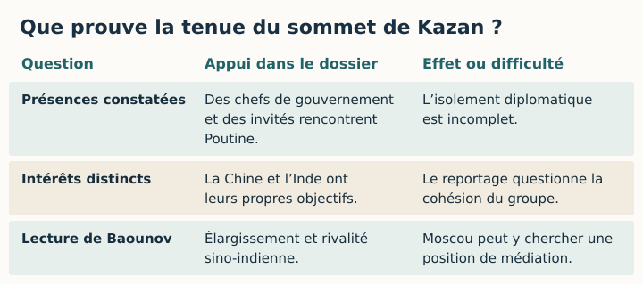

# BEL B/L — Russe 2025 · Corrigé brut

*Corrigé rédigé par IA, non officiel. Signalez toute erreur.*

**Rédaction** · GPT-6.2 Astra Ultra · vitesse non renseignée

**Révision (tour 1)** · GPT-6.2 Astra Ultra · vitesse non renseignée

[Sujet officiel](https://www.ens.psl.eu/sites/default/files/2025_blses_epreuve_a_option_sujet_russe.pdf) · [Rapport du jury](https://www.ens.psl.eu/sites/default/files/2025_bl_rapport_russe_ecrit_option.pdf)

## Казанская фотография и политический вес БРИКС: кто выигрывает от расширения?

Изображение индийского премьер-министра, обнимающего российского президента, хорошо передаёт парадокс казанского саммита октября 2024 года. Для Москвы это убедительный ответ тем, кто рассчитывал на её международную изоляцию. Для Индии тот же жест вовсе не равнозначен обязательству поддерживать российскую внешнюю политику. Репортаж Русской службы Би-би-си от 23 октября и статья Александра Баунова, опубликованная «Медузой» 27 октября со ссылкой на Carnegie Politika, предлагают проверить, насколько прочен переход от фотоснимка к союзу. Они расходятся прежде всего в оценке способности России превратить разнородность участников в собственный политический ресурс.

**Победа, для которой достаточно присутствия гостей.** Би-би-си напоминает, что в 2023 году российский президент выступал перед саммитом в Йоханнесбурге по видеосвязи после выдачи ордера Международным уголовным судом. В Казани он принимает руководителей государств и генерального секретаря ООН. Здесь существенно различать участников БРИКС и приглашённых: присутствие, например, представителя Турции не означает, что государство уже стало членом объединения. Даже такой ограниченный жест имеет политический вес. В Казань приезжают и представители государств, находящихся под западными санкциями, и партнёры США. Россия выступает хозяйкой встречи, но цели приехавших определяют их собственные правительства. Поэтому сам факт встречи доказывает невозможность полностью исключить Россию из международных контактов. Он не доказывает ни одобрения войны против Украины всеми гостями, ни готовности договориться о совместных действиях. Напротив, поставив вопрос о материальном результате, корреспондент выявляет границу того, что способна засвидетельствовать дипломатическая церемония.

Баунов также видит выгоду для Кремля, но считает недостаточным объяснение через престиж организатора. Пока участники и наблюдатели обсуждают общую фотографию, увеличение числа членов, по его мнению, постепенно изменяет саму группу. Москва может добиться политического эффекта ещё до того, как ей удастся согласовать программу с каждым из партнёров. Важен сдвиг в том, какие правительства и какие представления о мировом порядке оказываются представлены чаще.

**Две разные причины сидеть за одним столом.** В репортаже Би-би-си смена собеседников меняет масштаб оценки. С точки зрения Пекина БРИКС позволяет добиваться устройства мира, в котором суверенное государство меньше подвергается внешнему давлению из-за своей политики в области прав человека. Близость Си Цзиньпина к Путину не отменяет асимметрии: российская зависимость от Китая растёт, а у большого экономического партнёра есть и собственные интересы. Для Индии же участие означает возможность говорить от имени развивающихся стран и сохранять отношения и с Москвой, и с западными государствами. Тесное рукопожатие не требует выбрать единственного партнёра. Чем шире круг приехавших, тем убедительнее российский ответ на вопрос об изоляции, но тем труднее ответить утвердительно на вопрос о единой повестке.

Баунов меняет направление того же рассуждения. Соперничество Китая и Индии, которое должно было бы ослаблять организацию, даёт Москве пространство для посредничества: она может предлагать двум азиатским державам временно вынести их разногласия за скобки. В этой интерпретации размеры экономики сами по себе не определяют роль страны. Вполне возможно зависеть от китайского рынка и при этом извлекать политическую выгоду из того, что Китай не единственный крупный участник. Репортаж осторожнее оценивает результаты этого манёвра; Баунов выявляет потенциальный механизм российского влияния, а не приводит доказательства того, что Москва способна диктовать решения всем остальным.

**Меняется ли содержание слова «незападный»?** Исторический экскурс Баунова объясняет, почему сегодняшняя претензия не была изначальной целью объединения. В раннем БРИК четырёх государств внимание привлекали масштабы и рост развивающихся экономик. Прибавление их совокупного веса в значительной мере обеспечили Китай и Индия. Россия оставалась участницей «Группы восьми» и могла представлять себя мостом к Западу. Вступление Южной Африки дало объединению африканское измерение и было связано также с символическим значением преодоления расовой сегрегации. Прежние расширения тоже нельзя объяснить одним показателем ВВП.

Теперь, утверждает Баунов, с расширением увеличивается доля авторитарных режимов и консервативных обществ. Отсутствие принадлежности к западному миру начинает пониматься как готовность ему противостоять. Однако это именно тенденция в составе объединения и желаемое для Кремля направление, а не формальное обязательство каждого государства. Вопрос Би-би-си о собственных целях гостей не позволяет превратить это различие в простую игру слов. Индия может ценить самостоятельность своего голоса именно потому, что не хочет принадлежать к очередному лагерю.

В результате казанский саммит даёт три неравнозначных ответа. Москва сумела принять иностранных лидеров, получила возможность выступать посредником и стремится придать расширению политическое направление. Только первый результат виден непосредственно. Второй зависит от отношений между Пекином и Дели, третий — от готовности новых участников вкладывать одинаковое содержание в своё дистанцирование от Запада. Различие между этим снимком настоящего и прогнозом на будущее делает сопоставление двух текстов особенно содержательным.

