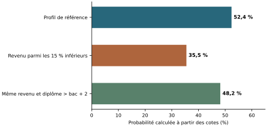

# BEL BL — Sciences sociales 2025 · Corrigé brut

*Corrigé rédigé par IA, non officiel. Signalez toute erreur.*

**Rédaction** · modèle exact non renseigné (famille GPT-6) · effort non renseigné · vitesse non renseignée

**Révision (tour 1)** · modèle exact non renseigné · effort non renseigné · vitesse non renseignée

**Révision (tour 2)** · GPT-6.2 Astra Ultra · vitesse non renseignée

**Révision (tour 3)** · GPT-6.2 Astra Ultra · vitesse non renseignée

**Révision (tour 4)** · GPT-6.2 Astra Ultra · vitesse non renseignée · 26 novembre 2026

**Sujet officiel** · « L’alimentation : à quels prix ? »

**Problématique** : comment des prix capables d’organiser les échanges peuvent-ils simultanément compromettre l’accès à la nourriture ou masquer certains de ses coûts ?

En 2008, les émeutes alimentaires évoquées par Alessandro Stanziani ont rappelé que le prix du pain ou des céréales ne représente pas seulement une information commerciale. Lorsque le revenu ne suit pas, une hausse des prix peut remettre en cause l'accès à un besoin vital et menacer la stabilité politique. Pourtant, une alimentation bon marché n'est pas nécessairement peu coûteuse pour ceux qui la produisent, pour la santé ou pour l'environnement. Demander à quels prix nous nous alimentons oblige ainsi à distinguer les montants versés lors de l'échange et les charges que cet échange répartit, parfois sans les rendre visibles.

L'alimentation désigne ici un ensemble de pratiques de production, de distribution et de consommation. Le prix est d'abord la contrepartie monétaire d'un bien ; au pluriel, il renvoie aussi aux différences entre produits, circuits, pays et moments. L'expression « à quels prix ? » interroge enfin les sacrifices consentis pour assurer la subsistance. Ces significations se croisent sans se confondre : une faible dépense peut résulter d'une efficacité productive, d'une contrainte qui réduit la consommation ou du report d'un coût sur autrui. Il faut donc comprendre comment les prix alimentaires se forment et comment leurs effets se distribuent, plutôt que d'opposer abstraitement nourriture chère et nourriture bon marché.

La difficulté tient à ce que l'alimentation doit rester accessible aux consommateurs tout en procurant un revenu aux producteurs et en préservant les conditions de sa reproduction. Comment des prix capables d'organiser les échanges peuvent-ils simultanément compromettre l'accès à la nourriture ou masquer certains de ses coûts ? Nous examinerons d'abord les contraintes et les usages socialement différenciés des prix, puis les institutions et les rapports économiques qui les façonnent, avant d'étudier les conditions d'une prise en charge de leurs coûts collectifs.

* * *

Le prix alimentaire est d'abord rencontré à travers un budget. Une même hausse ne représente pas le même effort pour tous les ménages. Le document 1, tiré de l'enquête *Budget de famille* de l'Insee de 2017, indique que l'alimentation hors alcool occupe une part plus importante de la consommation des ménages du premier quintile de niveau de vie que de celle du dernier quintile. À la lecture des barres, on passe d’environ 18 % dans le premier quintile à environ 14 % dans le cinquième. Cette observation est cohérente avec la loi d'Engel : à mesure que le revenu augmente, la part du budget consacrée à l'alimentation tend à diminuer. Elle n'implique pas que les ménages aisés dépensent moins d'euros pour manger ; leur dépense totale est plus élevée et leur alimentation peut être plus diversifiée. Le document mesure des parts de consommation, et non les prix unitaires auxquels les groupes font leurs achats. Il montre néanmoins pourquoi un renchérissement des biens alimentaires pèse relativement davantage sur les budgets modestes, à consommation et revenu initialement donnés.

La nécessité de manger limite les possibilités d'ajustement. Un ménage peut changer de marque, de magasin ou de composition des repas, mais il ne peut indéfiniment réduire les quantités ou la qualité sans dommage. D'autres dépenses contraintes limitent encore ses marges de manœuvre. Le document 1 donne ainsi au logement une part de 22,1 % pour les ménages les plus modestes, contre 12,2 % pour les plus aisés. Il serait donc trompeur de déduire d'un achat peu coûteux une préférence librement exprimée pour le bon marché : l'arbitrage dépend d'un ensemble de ressources et de contraintes.

Cette contrainte ne supprime pourtant pas la capacité de calcul. L'ethnographie d'Ana Perrin Heredia, issue d'une thèse soutenue en 2010 et présentée au document 2, décrit les pratiques d'Émilie : comparaison des prix au kilogramme, attention aux marques, choix entre magasins, achats en quantité et préparation des repas. Émilie peut acheter sept kilos de rôti à 2,30 euros le kilo, soit 16,10 euros à avancer pour cet achat. Une autre cliente peut apprécier tout autant ce produit et manquer ce jour-là de liquidités ou de place pour le conserver. La disposition à payer pour le lot dépend ainsi des conditions matérielles qui permettent de profiter du prix au kilo. La liste de courses et la somme confiée à son frère encadrent la dépense à venir. Le ménage construit donc des instruments de prévision que l'accompagnement budgétaire peut ne pas reconnaître. Les calculs populaires ne se réduisent ni à l'ignorance des prix ni à une irrationalité que corrigerait l'expert. Ils constituent un travail domestique, qui mobilise du temps, une connaissance des produits, des possibilités de déplacement et parfois de stockage. Un prix avantageux au kilogramme peut d'ailleurs nécessiter une avance de trésorerie inaccessible à un ménage moins doté.

Le montant dépensé n'épuise pas non plus le sens de la consommation. Dans *La Distinction* (1979), Pierre Bourdieu montre que les goûts se forment dans des conditions sociales différentes : les façons de manger participent à la définition des styles de vie. Le document 3, présenté par Sophie Dubuisson-Quellier, Séverine Gojard et Marie Plessz, en fournit un autre éclairage à partir de l'achat biologique. Pour les variables introduites dans le modèle, les ménages dont les revenus appartiennent aux 15 % inférieurs ont une cote d'achat d'au moins un produit biologique égale à 0,50 fois celle du groupe des 15 % supérieurs. Un diplôme supérieur à bac + 2 est associé à une cote de 1,69 fois celle du groupe de diplôme inférieur au baccalauréat. Ces rapports portent sur les cotes, et non directement sur les probabilités. Ils indiquent des associations conditionnelles, pas l'effet causal isolé du revenu ou du diplôme. Surtout, acheter au moins un produit biologique dans l'année ne signifie pas avoir une alimentation entièrement biologique. Les écarts observés invitent néanmoins à articuler moyens matériels, information, dispositions et offre accessible, sans réduire les pratiques alimentaires au seul pouvoir d'achat.

Le tableau permet de chiffrer l’articulation du revenu et du diplôme pour des profils autrement identiques. Pour une femme seule de 20 à 29 ans en zone rurale, de niveau inférieur au bac et dans les 15 % de revenus les plus élevés, la cote de référence de 1,10 correspond à environ 52,4 % de probabilité prédite d’au moins un achat bio sur douze mois. Pour le même profil situé dans les 15 % de revenus les plus faibles, le coefficient 0,50 ramène la prévision à 35,5 %. Si cette personne a en outre un diplôme supérieur à bac + 2, le coefficient 1,69 la porte à 48,2 %. Ces profils calculés sur les données de 2007 permettent de discuter des effets associés de ressources économiques et scolaires. Ils n’indiquent ni la fréquence des achats ni le montant consenti, et ne prouvent pas qu’un changement de diplôme ou de revenu produirait cet effet causal.

Ainsi, les prix ne rencontrent jamais un consommateur abstrait. Ils prennent sens dans des budgets, des savoirs pratiques et des styles de vie. Mais les ménages ne choisissent pas les conditions générales auxquelles la nourriture leur est proposée : les prix eux-mêmes résultent d'une organisation économique et politique.

* * *

Les prix coordonnent les décisions des producteurs et des consommateurs, mais leurs mouvements ne sont ni spontanément équilibrés ni indépendants des institutions. La production agricole demande du temps ; une récolte ne s'ajuste pas immédiatement à une demande nouvelle. Les aléas climatiques et les coûts des intrants déplacent l'offre, tandis que la demande des aliments essentiels réagit souvent peu au prix à court terme. Une variation relativement limitée des quantités disponibles peut alors s'accompagner d'une forte variation des cours. Entre le produit agricole et l'aliment acheté interviennent aussi la transformation, le transport, la distribution et leurs marges. Prix à la production et prix à la consommation ne doivent donc pas être confondus.

Le document 5 de Samuel Pinaud montre comment la Politique agricole commune, mise en œuvre à partir de 1962, a organisé cette coordination dans le secteur laitier. Le rachat public du beurre et de la poudre de lait à un prix d'intervention sécurisait les débouchés des industriels et rendait possible un prix indicatif du lait payé aux éleveurs. Si le prix garanti dépasse celui auquel se rencontrent l’offre et la demande privées du produit stockable, les quantités offertes excèdent les quantités demandées. L’organisme public achète la différence, engage des fonds et doit conserver ou écouler le stock. Le prix indicatif du lait cru et le prix d’intervention sur les produits transformés jouent ainsi des rôles distincts. Il ne s'agissait donc pas seulement de corriger un prix déjà formé : les instruments publics contribuaient à définir la distribution de la valeur au sein de la filière. Dans la perspective de Karl Polanyi, développée dans *La Grande Transformation* (1944), cette histoire rappelle que l'organisation marchande dépend de règles et de décisions collectives. Il n'est pas nécessaire, pour le montrer, de classer l'alimentation parmi les marchandises fictives : cette catégorie désigne chez Polanyi le travail, la terre et la monnaie.

Les effets de ces instruments sont cependant ambivalents. Pinaud souligne que les aides favorisaient les exploitations livrant de grandes quantités aux circuits industriels. La concentration et les excédents ont accru les dépenses de stockage et d'exportation ; les quotas laitiers, instaurés en 1984, ont ensuite limité la production. Soutenir les prix agricoles protège certains revenus, mais peut imposer des dépenses publiques et encourager une production dont le débouché reste artificiellement assuré. Le prix accessible au consommateur et le prix rémunérateur pour le producteur ne coïncident donc pas toujours. La question politique est aussi de savoir qui finance l'écart et quels producteurs bénéficient effectivement du soutien.

La transformation de la PAC a renforcé l'articulation avec les marchés mondiaux. Les réformes des instruments commerciaux décrites par Pinaud ont modifié les possibilités de stockage, d'écoulement et d'anticipation. Stanziani insiste, au document 8, sur le développement des investissements financiers dans les matières premières et sur la concentration des opérateurs du commerce des céréales. Les anticipations peuvent transmettre ou amplifier un choc et rendre la formation des cours moins intelligible aux producteurs. Cependant, un contrat à terme peut aussi couvrir un risque : un agriculteur peut fixer à l'avance un prix de vente et un transformateur un prix d'achat. La faible proportion de contrats donnant lieu à livraison physique ne suffit donc pas à mesurer la spéculation déstabilisatrice. Les positions peuvent être dénouées avant livraison tout en assurant une couverture. Pour attribuer une hausse particulière à la finance, il faut examiner les positions des acteurs, les stocks, la récolte, la demande et les politiques commerciales. L'analyse des émeutes de 2008 gagne ainsi à distinguer le choc de prix et les mécanismes qui transforment ce choc en crise d'accès à l'alimentation.

L'ouverture commerciale répartit également de façon inégale les bénéfices et les risques. Le document 7 de FranceAgriMer fait apparaître, entre juillet 2020 et juin 2021, un solde français de 12 707 millions d'euros pour les vins et spiritueux, contre un déficit de 6 541 millions pour les fruits et légumes. Ces soldes sectoriels, qui agrègent valeurs exportées et importées, n'indiquent ni un prix unitaire ni une autosuffisance générale. Ils montrent des spécialisations différentes. La théorie ricardienne des avantages comparatifs explique les gains possibles de l'échange par les coûts d'opportunité relatifs, non par la seule supériorité absolue de productivité d'un pays. Mais un gain agrégé n'assure ni une répartition équitable à l'intérieur des pays ni la sécurité de chaque filière. Hélène Tordjman, au document 6, souligne les risques de concurrence asymétrique lorsque des producteurs aidés affrontent des agricultures moins soutenues. Une importation bon marché peut améliorer immédiatement l'accès urbain à la nourriture tout en fragilisant certains revenus agricoles et en accroissant l'exposition future aux cours mondiaux.

Les prix alimentaires dépendent donc d'institutions qui répartissent protection, concurrence et risques. Les supprimer ou les augmenter n'offre pas à soi seul une solution : il faut encore prendre en compte ce qui ne se règle pas entièrement dans l'échange.

* * *

Le premier coût que le prix marchand ne résume pas est sanitaire. Le document 4, reproduit dans un rapport de France Stratégie de 2021 à partir des données du *Global Burden of Disease* pour 2019, donne une mortalité principalement imputable au régime alimentaire de 39,8 pour 100 000 habitants en France, contre 101,0 dans le monde, après correction des différences de structure par âge. Cette standardisation permet de comparer les risques sans attribuer mécaniquement un taux élevé à une population plus âgée. Elle ne démontre en revanche ni que le prix d'un aliment particulier cause la mortalité observée, ni que l'agriculture industrielle explique à elle seule l'écart entre pays. Les habitudes, les revenus, les conditions sanitaires et l'accès aux soins interviennent aussi. Le tableau établit l'importance de l'enjeu, pas une causalité unique.

Le coût privé et le coût social doivent alors être distingués. La maladie représente d'abord une perte pour la personne atteinte ; la part de ses conséquences supportée par d'autres, par exemple certaines dépenses collectives de santé, peut constituer un coût externe. De même, une pratique agricole qui pollue l'eau sans prendre en charge les dommages impose une externalité négative. Dans l'analyse d'Arthur Cecil Pigou, notamment dans *The Economics of Welfare* (1920), un prix qui omet ces dommages peut conduire à produire ou consommer davantage que ne le justifierait le coût social complet. Un produit peu cher n'est pourtant pas nécessairement nuisible : le diagnostic dépend du procédé et du dommage, et non de la seule étiquette de prix.

Tordjman invite précisément à examiner les ressources mobilisées par les systèmes agricoles : terres, eau, énergie, capital et travail. Son texte critique la concentration des exploitations et la place des productions qui ne sont pas directement destinées à l'alimentation humaine. Il met ainsi en discussion la définition même de l'efficacité : un rendement commercial ou une productivité du travail ne renseigne pas à lui seul sur la préservation des sols, la diversité biologique, l'emploi ou la résilience. Les chiffres comparatifs repris dans le document dépendent toutefois du périmètre de l'agriculture paysanne et de la manière de mesurer la nourriture produite. Ils ne permettent pas, sans hypothèses supplémentaires, de déduire qu'un transfert uniforme de terres doublerait les ressources alimentaires. La pertinence de la critique des coûts cachés n'exige pas de transformer ces extrapolations en lois générales.

Faire supporter les dommages à ceux qui les provoquent peut rapprocher coût privé et coût social, par une taxe adaptée, des normes ou une modification des aides. Mais une hausse du prix payé à la caisse, sans compensation ni possibilité de substitution, aggraverait les difficultés des ménages déjà contraints. L'internalisation doit donc s'articuler à une politique distributive : aides ciblées à l'accès à une alimentation satisfaisante, restauration collective, information fiable et soutien à la transition des producteurs. Le transfert de revenu traite une difficulté d'accès ; la règle environnementale traite un dommage ; le soutien agricole doit éviter de rémunérer indifféremment tous les procédés. Aucun de ces outils ne remplace les autres.

Enfin, la sécurité alimentaire ne suppose ni l'abandon de tout échange ni la dépendance à un fournisseur unique. Les échanges peuvent compenser une mauvaise récolte locale ; ils deviennent une source de vulnérabilité si un territoire perd ses capacités productives et ses marges de financement. Diversifier les approvisionnements, préserver des capacités agricoles et organiser les stocks permet de réduire ce risque. Comme le montre Amartya Sen dans *Poverty and Famines* (1981), la disponibilité globale ne garantit pas l'accès effectif : il faut aussi pouvoir obtenir la nourriture par la production, l'échange ou des droits reconnus. Un système alimentaire soutenable doit ainsi considérer simultanément quantités, revenus, santé et capacité d'adaptation aux chocs.

* * *

Les prix de l'alimentation expriment des coûts de production et des conditions d'échange, mais aussi des rapports sociaux et des choix institutionnels. Les ménages les affrontent avec des ressources inégales ; les politiques agricoles et les marchés répartissent les revenus et les risques ; certains dommages sanitaires ou écologiques demeurent hors de la transaction. Ni le prix le plus bas ni le prix le plus élevé ne garantit donc une bonne alimentation pour tous. **L'enjeu est d'organiser des prix rémunérateurs et des pratiques soutenables sans faire de l'accès à la nourriture la variable d'ajustement.** Cela suppose de distinguer les objectifs et leurs instruments, puis de rendre explicite qui supporte chaque coût, aujourd'hui et à l'avenir.

[Sujet officiel](https://www.ens.psl.eu/sites/default/files/2025_blses_sujet_composition_sciences_sociales.pdf) · [Rapport du jury](https://www.ens.psl.eu/sites/default/files/2025_bl_rapport_ecrit_sciences_economiques_et_sociales.pdf)

## Vérification sur le sujet

Les huit documents du sujet imprimé ont été comparés aux deux éditions, y compris les suites des extraits de Perrin Heredia, Pinaud, Tordjman et Stanziani. Les notes sur les quintiles, les cotes, les taux de mortalité et les soldes commerciaux ont été vérifiées sur les pages 2, 4, 5 et 10. L’introduction du rapport du jury compte sept documents. Sa page 15 présente le huitième, consacré aux marchés financiers, qui figure aux pages 10 et 11 du sujet.

Le document 7 permet de faire dialoguer le prix payé par les ménages et la spécialisation productive sans les confondre. De juillet 2020 à juin 2021, le solde « vins et spiritueux » est de +12 707 millions d’euros et celui des fruits et légumes de −6 541 millions. Leur somme algébrique vaut +6 166 millions pour ces deux secteurs réunis. Cette somme laisse invisibles les autres filières et la répartition de la valeur ajoutée. Pour expliquer le prix des fruits en magasin, il faudrait aussi observer les coûts et les marges le long de la chaîne, comme le suggère, pour le lait, l’analyse de la PAC au document 5.
