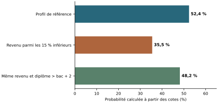
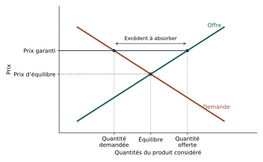

# BEL BL — Sciences sociales 2025 · Corrigé guidé

*Corrigé rédigé par IA, non officiel. Signalez toute erreur.*

**Rédaction** · modèle exact non renseigné (famille GPT-6) · effort non renseigné · vitesse non renseignée

**Révision (tour 1)** · modèle exact non renseigné · effort non renseigné · vitesse non renseignée

**Révision (tour 2)** · GPT-6.2 Astra Ultra · vitesse non renseignée

**Révision (tour 3)** · GPT-6.2 Astra Ultra · vitesse non renseignée

**Révision (tour 4)** · GPT-6.2 Astra Ultra · vitesse non renseignée · 26 novembre 2026

## Présentation du sujet

**Sujet : « L’alimentation : à quels prix ? »** Épreuve commune ENS Ulm, Lyon, Paris-Saclay et ENSAE/INSEE/ENSAI ; durée : **6 heures**. Le dossier officiel comporte **11 pages et huit documents**, dont plusieurs occupent deux pages. Il faut rédiger une dissertation de sciences sociales qui mette les documents au service d'un raisonnement, en articulant économie et sociologie. Pour suivre une même question en économie et en sociologie, précisez comment les prix se forment, puis qui les paie. Le document 8, consacré aux marchés financiers, commence à la page 10 et se poursuit à la page 11.

Le pluriel « prix » porte la difficulté : prix de marché, différences entre prix à la production et à la consommation, disparités selon les produits et les territoires, mais aussi coûts sanitaires, sociaux et environnementaux. Le sujet n'appelle ni une simple description de l'inflation, ni un plaidoyer moral détaché des mécanismes économiques.

Le parcours proposé est **une solution possible** : usages sociaux des prix, formation institutionnelle, puis coûts collectifs et instruments de régulation. Une gestion indicative des six heures consiste à réserver 1 h 15 à l'analyse du sujet et du dossier, 45 minutes au plan détaillé, 3 h 30 à la rédaction et 30 minutes à la relecture. Ces durées ne sont pas un barème officiel.

## Partie I — Construire le problème et lire les documents

### Étape 1 — Définir les termes sans restreindre le sujet

> [!INDICATION]
> Relevez les sens du mot « prix » qui permettent de relier des documents apparemment éloignés : budget familial, commerce et santé.

> [!INDICATION]
> Distinguez ce qui apparaît au moment de l'achat de ce qui est supporté par d'autres personnes ou à une autre date.

#### Solution

Un **prix monétaire** est la somme versée pour acquérir un bien. Il se distingue du **coût de production**, de la **dépense alimentaire totale** et de la **part de l'alimentation dans un budget**. Le prix au kilogramme est unitaire ; la dépense dépend aussi de la quantité et de la composition des achats. Le coût social comprend les conséquences pour des tiers lorsqu'elles existent, sans se réduire au paiement du consommateur.

L'alimentation est une chaîne : production agricole, transformation, transport, distribution, préparation et consommation. Le prix payé au producteur ne se confond pas avec celui payé à la caisse ; un consommateur est souvent aussi travailleur, contribuable et bénéficiaire d'un système de santé. Une mesure peut donc déplacer un coût sans l'annuler.

La réflexion peut prendre principalement appui sur la France et l'Europe, très présentes dans le dossier, tout en s'élargissant aux échanges mondiaux et aux inégalités internationales. Il n'est pas nécessaire de prétendre couvrir tous les pays.

> [!PIEGE]
> Une hausse de la part alimentaire du budget ne mesure pas directement une hausse des prix : elle peut aussi résulter d'une baisse du revenu, d'un changement de quantité ou de gamme de produits. Le document 1 compare des groupes en 2017, pas une série chronologique d'inflation.

### Étape 2 — Lire le dossier en entier et associer chaque document à une fonction

> [!INDICATION]
> Pour chaque pièce, identifiez son genre : enquête statistique, ethnographie, analyse historique ou texte critique. Les usages possibles de la preuve diffèrent.

> [!INDICATION]
> Notez séparément l'information du document, l'interprétation de son auteur et l'argument que vous pouvez défendre à partir de cette information.

#### Solution

| Document et pages du PDF | Source | Ce qu'il apporte au raisonnement | Précaution de lecture |
|---|---|---|---|
| 1, p. 2 | Insee, enquête *Budget de famille* 2017 | Structure de consommation selon le niveau de vie ; poids alimentaire relativement plus élevé pour les ménages modestes | Parts en pourcentage, pas montants en euros ni prix unitaires ; ne pas confondre quintile de niveau de vie et quintile de dépense alimentaire |
| 2, p. 2–3 | Ana Perrin Heredia, thèse *Logiques économiques et comptes domestiques en milieux populaires*, 2010 | Calculs, savoirs et instruments de contrôle du budget dans un ménage populaire | Une ethnographie éclaire des mécanismes, elle ne mesure pas la fréquence de ces pratiques dans toute la population |
| 3, p. 4 | Sophie Dubuisson-Quellier, Séverine Gojard, Marie Plessz, « Dispositifs et dispositions de la consommation. Retour sur une enquête contemporaine articulant méthodes qualitatives et quantitatives », *Les Études Sociales*, 2019/1, no 169 | Associations entre achat biologique et caractéristiques sociales, à partir des données Kantar 2007 ; tableau présenté en 2010 | Rapports de cotes d'avoir acheté au moins un produit biologique dans les douze derniers mois ; pas parts du budget ni probabilités relatives |
| 4, p. 5 | France Stratégie, *Pour une alimentation saine et durable*, 2021, données GBD 2019 | Dimension sanitaire de l'alimentation, comparaisons de taux standardisés par âge | Ne démontre pas la causalité d'un prix bas ou d'un procédé de production particulier |
| 5, p. 6–7 | Samuel Pinaud, « Libéraliser l'économie agricole européenne. Une analyse polanyienne », 2022 | Organisation institutionnelle de la filière laitière, prix d'intervention, aides, quotas et libéralisation | Séparer effets protecteurs et effets de concentration ; les mécanismes publics ont plusieurs bénéficiaires et plusieurs coûts |
| 6, p. 8–9 | Hélène Tordjman, *La croissance verte contre la nature. Critique de l'écologie marchande*, édition 2024, ouvrage paru en 2021, p. 372–373 | Critique des systèmes productifs, de la spécialisation et des coûts écologiques ou sociaux | Argumentation critique à discuter ; les catégories agricoles et les dénominateurs des chiffres demandent examen |
| 7, p. 10 | FranceAgriMer, données DGDDI, novembre 2021 | Soldes du commerce extérieur par filière en juillet 2020–juin 2021, comparés à la période précédente | Millions d'euros ; solde exportations moins importations, et non exportations brutes ; ne pas confondre fruits et légumes avec produits d'épicerie |
| 8, p. 10–11 | Alessandro Stanziani, *Les guerres du blé*, 2024, p. 310 | Concentration des échanges, essor de la finance, volatilité et crises alimentaires | Distinguer la thèse causale de l'auteur et ce que les chiffres établissent directement ; ne pas réduire toutes les crises à une cause financière |

**Le document 6 se poursuit à la page 9 : il n'existe pas de « document 9 ».** De même, le document 2 occupe une partie de la page 2 puis la page 3 ; il ne faut pas attribuer le tableau du document 3 à son autrice.

> [!METHODE]
> Un document n'est pas une autorité à recopier. Il fournit une observation ou un argument dont vous devez préciser la portée. La fidélité au dossier autorise une discussion de ses hypothèses ; elle n'impose pas d'adopter toutes ses conclusions.

### Étape 3 — Sécuriser les lectures statistiques et les mécanismes économiques

> [!INDICATION]
> Avant toute phrase chiffrée, relevez l'unité, la population, la période et la catégorie de référence.

> [!INDICATION]
> Demandez-vous si le chiffre exprime un niveau, un rapport, un solde ou une relation causale.

#### Solution

**Structure du budget.** Les 22,1 % et 12,2 % cités dans la note du document 1 concernent le **logement**, respectivement dans les premier et cinquième quintiles de niveau de vie. Ils ne doivent pas être réattribués à l'alimentation. La barre claire du premier quintile atteint environ 18 % pour l’alimentation hors alcool, contre environ 14 % pour la barre sombre du cinquième quintile. Ces valeurs sont lues sur l’échelle du graphique. Elles n’ont pas la précision des deux valeurs de logement données dans la note.

**Rapport de cotes.** Si la probabilité d'achat est $p$, sa cote est $p/(1-p)$. Un rapport de cotes de 0,50 signifie que cette cote est divisée par deux par rapport à la référence, pour les autres variables du modèle maintenues constantes. À titre d'illustration mathématique, et non de donnée du dossier, une probabilité de référence de 0,60 correspond à une cote de 1,50 ; une cote divisée par deux vaut 0,75, soit une probabilité d'environ 0,429. Elle ne vaut donc pas 0,30. Dans le tableau, la référence de revenu est le groupe des **15 % supérieurs**, celle du diplôme est **inférieur au bac**, celle de l'âge **20–29 ans**. Les coefficients ne prouvent pas que le prix du biologique cause les écarts : aucun effet-prix propre n'est estimé par ce tableau.

**Reconstituer trois profils du document 3.** Le tableau donne la constante exponentiée 1,10 pour les catégories de référence. Dans le modèle logistique présenté sans interaction, on multiplie les cotes par les rapports des modalités qui changent. Le profil à bas revenu a une cote de $1{,}10 \times 0{,}50 = 0{,}55$, soit $0{,}55/1{,}55 \simeq 35{,}5$ %. Avec en outre un diplôme supérieur à bac + 2, la cote devient $0{,}55 \times 1{,}69 = 0{,}9295$, soit environ 48,2 %. Le profil de référence atteint $1{,}10/2{,}10$, soit 52,4 %. Le passage de 52,4 % à 35,5 % représente 16,9 points. Ces prévisions conditionnelles, arrondies, ne sont pas les proportions brutes des trois groupes dans les 6 946 observations.

**Mortalité.** Les taux du document 4 sont standardisés par âge. Les 39,8 décès pour 100 000 habitants en France et 101,0 dans le monde ne sont ni des pourcentages ni des effectifs bruts. On ne peut en déduire directement le nombre exact de décès observés en France en multipliant le taux standardisé par la population réelle.

**Commerce extérieur.** Le solde des vins et spiritueux vaut **+12 707 millions d'euros** ; celui des fruits et légumes **−6 541 millions** ; celui des produits d'épicerie **−4 037 millions**. Il faut convertir correctement millions et milliards et conserver les signes. Un solde négatif ne prouve pas à lui seul une faiblesse productive : il dépend aussi de la demande intérieure, des quantités et des prix échangés.

**Répartition de la production.** Le document 6 donne notamment 4 %, 23 %, 9 % et 24 % pour plusieurs destinations de la production industrielle. Ces parts ne forment pas une répartition exhaustive de 100 % et leurs bases demandent clarification. Il faut signaler cette limite, sans modifier silencieusement le 4 % imprimé. Le raisonnement retenu peut s'appuyer sur l'existence d'usages non alimentaires et de pertes sans refaire un bilan global invérifiable.

**Marchés à terme.** Un contrat sans livraison physique finale peut couvrir une vente ou un achat réel. L'affirmation du document 8 sur 98 % de transactions sans échange de produits réels ne permet donc pas de mesurer 98 % d'activités inutiles ni de déduire mécaniquement l'ampleur d'une bulle. On peut discuter le rôle de la finance dans la transmission des anticipations et l'amplification des chocs sans cette inférence.

**Lecture du schéma.** Au prix d’intervention, prolonger l’horizontale jusqu’à chacune des deux courbes. La distance entre les quantités demandée et offerte figure les achats que l’organisme public devrait effectuer si aucun autre débouché ne se présente. Les frais de stockage s’ajoutent à la dépense immédiate. Un quota agit sur la production admissible et ne crée pas le même engagement de rachat.

> [!PIEGE]
> « Toutes choses égales par ailleurs » décrit ici un ajustement statistique dans un modèle. Ce n'est pas une expérience contrôlée qui aurait rendu identiques tous les ménages et supprimé tout facteur omis.

## Partie II — Construire une démonstration

### Étape 4 — Problématiser et organiser la progression

> [!INDICATION]
> Comparez les objectifs des consommateurs et des producteurs, puis cherchez les charges que le paiement marchand ne prend pas entièrement en compte.

> [!INDICATION]
> Évitez de faire du prix élevé une solution avant d'avoir examiné l'accès des ménages à la nourriture.

#### Solution

**Problématique retenue :** comment des prix capables d'organiser les échanges peuvent-ils simultanément compromettre l'accès à la nourriture ou masquer certains de ses coûts ? Elle articule trois questions : pour qui le prix est-il contraignant, comment est-il formé, et qui assume les conséquences non réglées dans l'achat ? Une autre formulation possible serait : à quelles conditions peut-on concilier accessibilité alimentaire, rémunération des producteurs et coût social de l'alimentation ?

La progression choisie n'est pas une succession sociologie/économie/écologie indépendantes : chaque partie précise le conflit distributif entre les différents agents.

- **I — Des prix inégalement supportés et socialement pratiqués.** Poids budgétaire et loi d'Engel ; expertise domestique ; différenciation des pratiques et du biologique. Documents 1 à 3, notion de contrainte budgétaire, Bourdieu.
- **II — Des prix construits dans les filières, les institutions et les échanges.** Contraintes de l'offre agricole ; PAC et partage de la valeur ; marchés mondiaux et finance ; distinction gains agrégés et répartition. Documents 5, 7 et 8, prolongement du document 6, Polanyi et avantages comparatifs.
- **III — Des coûts collectifs qui imposent de combiner les instruments.** Santé et limites de l'inférence ; externalités et ressources ; contradiction possible entre hausse correctrice des prix et accessibilité ; sécurité alimentaire. Documents 4 et 6, retour aux documents 1 et 8, Pigou et Sen.

**Transition I–II :** les ménages arbitrent sous des contraintes dont ils ne maîtrisent pas la formation générale ; il faut passer des usages sociaux du prix à son organisation productive et politique.

**Transition II–III :** rémunérer les agents présents dans une transaction ne suffit pas à prendre en charge tous ses effets ; l'efficacité de marché doit être confrontée aux coûts pour les tiers et aux risques futurs.

> [!METHODE]
> Dans chaque paragraphe, enchaînez une proposition, son mécanisme, une preuve documentaire et une conséquence pour la problématique. L'auteur ou le document ne doit pas tenir lieu de mécanisme.

### Étape 5 — Choisir des références précises et les utiliser à bon escient

> [!INDICATION]
> Associez à chaque référence une seule contribution nécessaire au raisonnement ; écartez les noms qui n'ajoutent rien.

#### Solution

| Référence | Contribution | Limite à conserver |
|---|---|---|
| Loi d'Engel | Relation entre niveau de revenu et part du budget alimentaire | Ne dit pas que la dépense alimentaire absolue diminue ; ne mesure pas l'inflation |
| Pierre Bourdieu, *La Distinction*, 1979 | Formation sociale des goûts et styles de vie | Ne permet pas d'attribuer à chaque ménage le comportement supposé de sa classe |
| Karl Polanyi, *La Grande Transformation*, 1944 | Rôle historique des institutions dans l'organisation des marchés | Les marchandises fictives sont le travail, la terre et la monnaie ; l'alimentation ne devient pas une quatrième catégorie par analogie |
| David Ricardo, théorie des avantages comparatifs | Gains possibles de la spécialisation selon les coûts relatifs | Gain agrégé n'est pas équité distributive ni absence d'externalités |
| Arthur Cecil Pigou, *The Economics of Welfare*, 1920 | Écart entre coûts privés et sociaux, justification d'une correction | Tout dommage sanitaire privé n'est pas automatiquement une externalité |
| Amartya Sen, *Poverty and Famines*, 1981 | Écart entre disponibilité alimentaire et capacité effective d'accès | Les droits d'accès comprennent plus que le revenu monétaire et varient selon les institutions |

Il est préférable de paraphraser exactement ces contributions plutôt que d'introduire une citation littérale non vérifiée. Le devoir proposé ne cite aucune parole de jury.

> [!PIEGE]
> Le modèle ricardien ne conseille pas simplement de produire « ce que l'on produit mieux que les autres ». L'avantage comparatif dépend d'un coût d'opportunité relatif ; un pays peut avoir intérêt à échanger même s'il est moins productif dans tous les secteurs.

## Partie III — Rédiger et relire

### Étape 6 — Rédiger la dissertation complète

> [!INDICATION]
> Dans l'introduction, faites apparaître le problème d'accès avant d'énumérer les sens du prix ; l'annonce du plan doit promettre une démonstration.

> [!INDICATION]
> À la fin de chaque partie, explicitez la question que la suivante doit résoudre. La conclusion doit répondre au conflit entre accessibilité, rémunération et coût social.

#### Solution

En 2008, les émeutes alimentaires évoquées par Alessandro Stanziani ont rappelé que le prix du pain ou des céréales ne représente pas seulement une information commerciale. Lorsque le revenu ne suit pas, une hausse des prix peut remettre en cause l'accès à un besoin vital et menacer la stabilité politique. Pourtant, une alimentation bon marché n'est pas nécessairement peu coûteuse pour ceux qui la produisent, pour la santé ou pour l'environnement. Demander à quels prix nous nous alimentons oblige ainsi à distinguer les montants versés lors de l'échange et les charges que cet échange répartit, parfois sans les rendre visibles.

L'alimentation désigne ici un ensemble de pratiques de production, de distribution et de consommation. Le prix est d'abord la contrepartie monétaire d'un bien ; au pluriel, il renvoie aussi aux différences entre produits, circuits, pays et moments. L'expression « à quels prix ? » interroge enfin les sacrifices consentis pour assurer la subsistance. Ces significations se croisent sans se confondre : une faible dépense peut résulter d'une efficacité productive, d'une contrainte qui réduit la consommation ou du report d'un coût sur autrui. Il faut donc comprendre comment les prix alimentaires se forment et comment leurs effets se distribuent, plutôt que d'opposer abstraitement nourriture chère et nourriture bon marché.

La difficulté tient à ce que l'alimentation doit rester accessible aux consommateurs tout en procurant un revenu aux producteurs et en préservant les conditions de sa reproduction. Comment des prix capables d'organiser les échanges peuvent-ils simultanément compromettre l'accès à la nourriture ou masquer certains de ses coûts ? Nous examinerons d'abord les contraintes et les usages socialement différenciés des prix, puis les institutions et les rapports économiques qui les façonnent, avant d'étudier les conditions d'une prise en charge de leurs coûts collectifs.

* * *

Le prix alimentaire est d'abord rencontré à travers un budget. Une même hausse ne représente pas le même effort pour tous les ménages. Le document 1, tiré de l'enquête *Budget de famille* de l'Insee de 2017, indique que l'alimentation hors alcool occupe une part plus importante de la consommation des ménages du premier quintile de niveau de vie que de celle du dernier quintile. À la lecture des barres, on passe d’environ 18 % dans le premier quintile à environ 14 % dans le cinquième. Cette observation est cohérente avec la loi d'Engel : à mesure que le revenu augmente, la part du budget consacrée à l'alimentation tend à diminuer. Elle n'implique pas que les ménages aisés dépensent moins d'euros pour manger ; leur dépense totale est plus élevée et leur alimentation peut être plus diversifiée. Le document mesure des parts de consommation, et non les prix unitaires auxquels les groupes font leurs achats. Il montre néanmoins pourquoi un renchérissement des biens alimentaires pèse relativement davantage sur les budgets modestes, à consommation et revenu initialement donnés.

La nécessité de manger limite les possibilités d'ajustement. Un ménage peut changer de marque, de magasin ou de composition des repas, mais il ne peut indéfiniment réduire les quantités ou la qualité sans dommage. D'autres dépenses contraintes limitent encore ses marges de manœuvre. Le document 1 donne ainsi au logement une part de 22,1 % pour les ménages les plus modestes, contre 12,2 % pour les plus aisés. Il serait donc trompeur de déduire d'un achat peu coûteux une préférence librement exprimée pour le bon marché : l'arbitrage dépend d'un ensemble de ressources et de contraintes.

Cette contrainte ne supprime pourtant pas la capacité de calcul. L'ethnographie d'Ana Perrin Heredia, issue d'une thèse soutenue en 2010 et présentée au document 2, décrit les pratiques d'Émilie : comparaison des prix au kilogramme, attention aux marques, choix entre magasins, achats en quantité et préparation des repas. Émilie peut acheter sept kilos de rôti à 2,30 euros le kilo, soit 16,10 euros à avancer pour cet achat. Une autre cliente peut apprécier tout autant ce produit et manquer ce jour-là de liquidités ou de place pour le conserver. La disposition à payer pour le lot dépend ainsi des conditions matérielles qui permettent de profiter du prix au kilo. La liste de courses et la somme confiée à son frère encadrent la dépense à venir. Le ménage construit donc des instruments de prévision que l'accompagnement budgétaire peut ne pas reconnaître. Les calculs populaires ne se réduisent ni à l'ignorance des prix ni à une irrationalité que corrigerait l'expert. Ils constituent un travail domestique, qui mobilise du temps, une connaissance des produits, des possibilités de déplacement et parfois de stockage. Un prix avantageux au kilogramme peut d'ailleurs nécessiter une avance de trésorerie inaccessible à un ménage moins doté.

Le montant dépensé n'épuise pas non plus le sens de la consommation. Dans *La Distinction* (1979), Pierre Bourdieu montre que les goûts se forment dans des conditions sociales différentes : les façons de manger participent à la définition des styles de vie. Le document 3, présenté par Sophie Dubuisson-Quellier, Séverine Gojard et Marie Plessz, en fournit un autre éclairage à partir de l'achat biologique. Pour les variables introduites dans le modèle, les ménages dont les revenus appartiennent aux 15 % inférieurs ont une cote d'achat d'au moins un produit biologique égale à 0,50 fois celle du groupe des 15 % supérieurs. Un diplôme supérieur à bac + 2 est associé à une cote de 1,69 fois celle du groupe de diplôme inférieur au baccalauréat. Ces rapports portent sur les cotes, et non directement sur les probabilités. Ils indiquent des associations conditionnelles, pas l'effet causal isolé du revenu ou du diplôme. Surtout, acheter au moins un produit biologique dans l'année ne signifie pas avoir une alimentation entièrement biologique. Les écarts observés invitent néanmoins à articuler moyens matériels, information, dispositions et offre accessible, sans réduire les pratiques alimentaires au seul pouvoir d'achat.

Ainsi, les prix ne rencontrent jamais un consommateur abstrait. Ils prennent sens dans des budgets, des savoirs pratiques et des styles de vie. Mais les ménages ne choisissent pas les conditions générales auxquelles la nourriture leur est proposée : les prix eux-mêmes résultent d'une organisation économique et politique.

* * *

Les prix coordonnent les décisions des producteurs et des consommateurs, mais leurs mouvements ne sont ni spontanément équilibrés ni indépendants des institutions. La production agricole demande du temps ; une récolte ne s'ajuste pas immédiatement à une demande nouvelle. Les aléas climatiques et les coûts des intrants déplacent l'offre, tandis que la demande des aliments essentiels réagit souvent peu au prix à court terme. Une variation relativement limitée des quantités disponibles peut alors s'accompagner d'une forte variation des cours. Entre le produit agricole et l'aliment acheté interviennent aussi la transformation, le transport, la distribution et leurs marges. Prix à la production et prix à la consommation ne doivent donc pas être confondus.

Le document 5 de Samuel Pinaud montre comment la Politique agricole commune, mise en œuvre à partir de 1962, a organisé cette coordination dans le secteur laitier. Le rachat public du beurre et de la poudre de lait à un prix d'intervention sécurisait les débouchés des industriels et rendait possible un prix indicatif du lait payé aux éleveurs. Si le prix garanti dépasse celui auquel se rencontrent l’offre et la demande privées du produit stockable, les quantités offertes excèdent les quantités demandées. L’organisme public achète la différence, engage des fonds et doit conserver ou écouler le stock. Le prix indicatif du lait cru et le prix d’intervention sur les produits transformés jouent ainsi des rôles distincts. Il ne s'agissait donc pas seulement de corriger un prix déjà formé : les instruments publics contribuaient à définir la distribution de la valeur au sein de la filière. Dans la perspective de Karl Polanyi, développée dans *La Grande Transformation* (1944), cette histoire rappelle que l'organisation marchande dépend de règles et de décisions collectives. Il n'est pas nécessaire, pour le montrer, de classer l'alimentation parmi les marchandises fictives : cette catégorie désigne chez Polanyi le travail, la terre et la monnaie.

Les effets de ces instruments sont cependant ambivalents. Pinaud souligne que les aides favorisaient les exploitations livrant de grandes quantités aux circuits industriels. La concentration et les excédents ont accru les dépenses de stockage et d'exportation ; les quotas laitiers, instaurés en 1984, ont ensuite limité la production. Soutenir les prix agricoles protège certains revenus, mais peut imposer des dépenses publiques et encourager une production dont le débouché reste artificiellement assuré. Le prix accessible au consommateur et le prix rémunérateur pour le producteur ne coïncident donc pas toujours. La question politique est aussi de savoir qui finance l'écart et quels producteurs bénéficient effectivement du soutien.

La transformation de la PAC a renforcé l'articulation avec les marchés mondiaux. Les réformes des instruments commerciaux décrites par Pinaud ont modifié les possibilités de stockage, d'écoulement et d'anticipation. Stanziani insiste, au document 8, sur le développement des investissements financiers dans les matières premières et sur la concentration des opérateurs du commerce des céréales. Les anticipations peuvent transmettre ou amplifier un choc et rendre la formation des cours moins intelligible aux producteurs. Cependant, un contrat à terme peut aussi couvrir un risque : un agriculteur peut fixer à l'avance un prix de vente et un transformateur un prix d'achat. La faible proportion de contrats donnant lieu à livraison physique ne suffit donc pas à mesurer la spéculation déstabilisatrice. Les positions peuvent être dénouées avant livraison tout en assurant une couverture. Pour attribuer une hausse particulière à la finance, il faut examiner les positions des acteurs, les stocks, la récolte, la demande et les politiques commerciales. L'analyse des émeutes de 2008 gagne ainsi à distinguer le choc de prix et les mécanismes qui transforment ce choc en crise d'accès à l'alimentation.

L'ouverture commerciale répartit également de façon inégale les bénéfices et les risques. Le document 7 de FranceAgriMer fait apparaître, entre juillet 2020 et juin 2021, un solde français de 12 707 millions d'euros pour les vins et spiritueux, contre un déficit de 6 541 millions pour les fruits et légumes. Ces soldes sectoriels, qui agrègent valeurs exportées et importées, n'indiquent ni un prix unitaire ni une autosuffisance générale. Ils montrent des spécialisations différentes. La théorie ricardienne des avantages comparatifs explique les gains possibles de l'échange par les coûts d'opportunité relatifs, non par la seule supériorité absolue de productivité d'un pays. Mais un gain agrégé n'assure ni une répartition équitable à l'intérieur des pays ni la sécurité de chaque filière. Hélène Tordjman, au document 6, souligne les risques de concurrence asymétrique lorsque des producteurs aidés affrontent des agricultures moins soutenues. Une importation bon marché peut améliorer immédiatement l'accès urbain à la nourriture tout en fragilisant certains revenus agricoles et en accroissant l'exposition future aux cours mondiaux.

Les prix alimentaires dépendent donc d'institutions qui répartissent protection, concurrence et risques. Les supprimer ou les augmenter n'offre pas à soi seul une solution : il faut encore prendre en compte ce qui ne se règle pas entièrement dans l'échange.

* * *

Le premier coût que le prix marchand ne résume pas est sanitaire. Le document 4, reproduit dans un rapport de France Stratégie de 2021 à partir des données du *Global Burden of Disease* pour 2019, donne une mortalité principalement imputable au régime alimentaire de 39,8 pour 100 000 habitants en France, contre 101,0 dans le monde, après correction des différences de structure par âge. Cette standardisation permet de comparer les risques sans attribuer mécaniquement un taux élevé à une population plus âgée. Elle ne démontre en revanche ni que le prix d'un aliment particulier cause la mortalité observée, ni que l'agriculture industrielle explique à elle seule l'écart entre pays. Les habitudes, les revenus, les conditions sanitaires et l'accès aux soins interviennent aussi. Le tableau établit l'importance de l'enjeu, pas une causalité unique.

Le coût privé et le coût social doivent alors être distingués. La maladie représente d'abord une perte pour la personne atteinte ; la part de ses conséquences supportée par d'autres, par exemple certaines dépenses collectives de santé, peut constituer un coût externe. De même, une pratique agricole qui pollue l'eau sans prendre en charge les dommages impose une externalité négative. Dans l'analyse d'Arthur Cecil Pigou, notamment dans *The Economics of Welfare* (1920), un prix qui omet ces dommages peut conduire à produire ou consommer davantage que ne le justifierait le coût social complet. Un produit peu cher n'est pourtant pas nécessairement nuisible : le diagnostic dépend du procédé et du dommage, et non de la seule étiquette de prix.

Tordjman invite précisément à examiner les ressources mobilisées par les systèmes agricoles : terres, eau, énergie, capital et travail. Son texte critique la concentration des exploitations et la place des productions qui ne sont pas directement destinées à l'alimentation humaine. Il met ainsi en discussion la définition même de l'efficacité : un rendement commercial ou une productivité du travail ne renseigne pas à lui seul sur la préservation des sols, la diversité biologique, l'emploi ou la résilience. Les chiffres comparatifs repris dans le document dépendent toutefois du périmètre de l'agriculture paysanne et de la manière de mesurer la nourriture produite. Ils ne permettent pas, sans hypothèses supplémentaires, de déduire qu'un transfert uniforme de terres doublerait les ressources alimentaires. La pertinence de la critique des coûts cachés n'exige pas de transformer ces extrapolations en lois générales.

Faire supporter les dommages à ceux qui les provoquent peut rapprocher coût privé et coût social, par une taxe adaptée, des normes ou une modification des aides. Mais une hausse du prix payé à la caisse, sans compensation ni possibilité de substitution, aggraverait les difficultés des ménages déjà contraints. L'internalisation doit donc s'articuler à une politique distributive : aides ciblées à l'accès à une alimentation satisfaisante, restauration collective, information fiable et soutien à la transition des producteurs. Le transfert de revenu traite une difficulté d'accès ; la règle environnementale traite un dommage ; le soutien agricole doit éviter de rémunérer indifféremment tous les procédés. Aucun de ces outils ne remplace les autres.

Enfin, la sécurité alimentaire ne suppose ni l'abandon de tout échange ni la dépendance à un fournisseur unique. Les échanges peuvent compenser une mauvaise récolte locale ; ils deviennent une source de vulnérabilité si un territoire perd ses capacités productives et ses marges de financement. Diversifier les approvisionnements, préserver des capacités agricoles et organiser les stocks permet de réduire ce risque. Comme le montre Amartya Sen dans *Poverty and Famines* (1981), la disponibilité globale ne garantit pas l'accès effectif : il faut aussi pouvoir obtenir la nourriture par la production, l'échange ou des droits reconnus. Un système alimentaire soutenable doit ainsi considérer simultanément quantités, revenus, santé et capacité d'adaptation aux chocs.

* * *

Les prix de l'alimentation expriment des coûts de production et des conditions d'échange, mais aussi des rapports sociaux et des choix institutionnels. Les ménages les affrontent avec des ressources inégales ; les politiques agricoles et les marchés répartissent les revenus et les risques ; certains dommages sanitaires ou écologiques demeurent hors de la transaction. Ni le prix le plus bas ni le prix le plus élevé ne garantit donc une bonne alimentation pour tous. **L'enjeu est d'organiser des prix rémunérateurs et des pratiques soutenables sans faire de l'accès à la nourriture la variable d'ajustement.** Cela suppose de distinguer les objectifs et leurs instruments, puis de rendre explicite qui supporte chaque coût, aujourd'hui et à l'avenir.

> [!METHODE]
> Relisez les liens logiques autant que les noms propres : « associé à » n'est pas « causé par » ; « solde commercial » n'est pas « prix » ; « coût social » n'est pas « dépense publique ». Les distinctions conceptuelles rendent le raisonnement plus solide qu'une accumulation de chiffres.

## Bilan

Le sujet se résout en faisant tenir ensemble trois niveaux : la position des ménages devant les prix, l'organisation économique et politique des échanges, puis la répartition de leurs conséquences. Les huit documents jouent chacun un rôle ; aucun ne dispense de justifier un mécanisme.

Les acquis transférables sont la lecture des unités et des catégories de référence, la distinction corrélation/causalité, le passage du prix privé au coût social et l'articulation d'une politique correctrice avec ses effets distributifs. À revoir : contrainte budgétaire, loi d'Engel, élasticités, avantages comparatifs, marchés à terme, externalités et conditions sociales de la consommation.

Un plan différent est recevable s'il traite le pluriel du sujet, mobilise le dossier avec précision et répond à la question de savoir **qui paie quoi**. L'objectif n'est pas de définir un unique « vrai prix », mais d'expliciter les arbitrages que différentes institutions peuvent organiser.

[Sujet officiel](https://www.ens.psl.eu/sites/default/files/2025_blses_sujet_composition_sciences_sociales.pdf) · [Rapport du jury](https://www.ens.psl.eu/sites/default/files/2025_bl_rapport_ecrit_sciences_economiques_et_sociales.pdf)

## Vérification sur le sujet

Les huit documents du sujet imprimé ont été comparés aux deux éditions, y compris les suites des extraits de Perrin Heredia, Pinaud, Tordjman et Stanziani. Les notes sur les quintiles, les cotes, les taux de mortalité et les soldes commerciaux ont été vérifiées sur les pages 2, 4, 5 et 10. L’introduction du rapport du jury compte sept documents. Sa page 15 présente le huitième, consacré aux marchés financiers, qui figure aux pages 10 et 11 du sujet.

Le document 7 permet de faire dialoguer le prix payé par les ménages et la spécialisation productive sans les confondre. De juillet 2020 à juin 2021, le solde « vins et spiritueux » est de +12 707 millions d’euros et celui des fruits et légumes de −6 541 millions. Leur somme algébrique vaut +6 166 millions pour ces deux secteurs réunis. Cette somme laisse invisibles les autres filières et la répartition de la valeur ajoutée. Pour expliquer le prix des fruits en magasin, il faudrait aussi observer les coûts et les marges le long de la chaîne, comme le suggère, pour le lait, l’analyse de la PAC au document 5.
