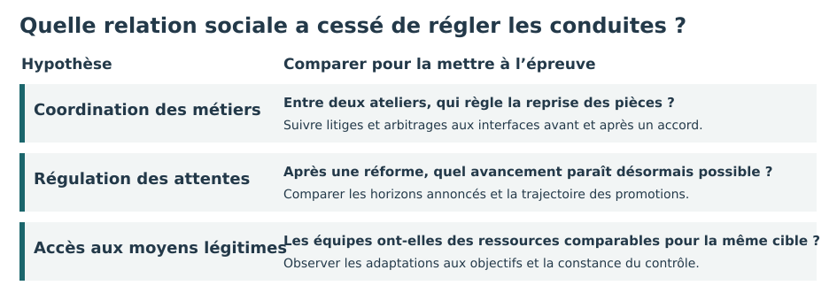

# BEL · B/L · Sociologie, oral à option 2025 · L’anomie · Corrigé guidé

*Corrigé rédigé par IA, non officiel. Signalez toute erreur.*

**Rédaction** · GPT-6.2 Astra Ultra · vitesse non renseignée

**Autocontrôle** · GPT-6.2 Astra Ultra · vitesse non renseignée

Le rapport du jury cite « L’anomie » dans la liste des sujets secs posés, p. 4. L’exposé porte sur cet intitulé individuel. Le feuillet de ce tirage et son second choix restent à retrouver.

## Construire l’exposé

Le jury demande un sujet sec et dispose de quinze minutes pour discuter l’exposé. Préparez une situation assez concrète pour que les trois lectures du concept ne se confondent pas. Une même entreprise peut rencontrer des difficultés de coordination, modifier brutalement sa grille de promotion ou imposer un résultat que certains services ont peu de moyens réguliers d’atteindre. Ce choix de terrain permet de tenir l’objet constant et de faire varier l’hypothèse.

### Partir d’une relation à expliquer

Dans une introduction, dites ce qui vous oblige à utiliser le concept. Un grand nombre d’incidents ne suffit pas. Si les incidents s’accumulent au passage d’un service à l’autre et que les responsabilités ne sont pas réglées, l’hypothèse durkheimienne de la division anomique du travail devient précise. Pour l’éprouver, comparez deux interfaces où les volumes et la difficulté technique sont proches mais où les possibilités d’échange diffèrent. Cherchez si les équipes possèdent une règle commune, qui l’applique en cas de contestation et ce qui se passe quand on la modifie. Un règlement dans chaque atelier ne répond pas à ces questions.

**Un conflit disparaîtrait-il nécessairement si les contacts devenaient réguliers ?** Une procédure d’arbitrage peut suffire pour imputer une pièce défectueuse. Si le désaccord porte sur les salaires ou sur l’accès des ouvriers aux postes d’encadrement, il a d’autres ressorts. Ce contre-exemple empêche de transformer une explication de la coordination en théorie universelle du conflit.

### Comparer la régulation et l’intégration

Imaginez que tout le personnel appartienne à une même association professionnelle. Cette affiliation renseigne sur le réseau de relations. Elle ne dit pas quel horizon d’avancement chacun juge légitime après une réforme. Demandez à des personnes en position comparable d’expliquer les règles qu’elles comprennent, leurs attentes et les expériences qui les ont formées. Vérifiez dans les accords et les dossiers quelle règle s’appliquait réellement. Vous pourrez distinguer une incertitude provisoire sur une procédure et un déplacement plus durable des limites collectives de l’attente.

Dans *Le Suicide*, la comparaison entre crises de sens différent fait travailler cette distinction. Un commentaire doit expliquer pourquoi un bouleversement ascendant peut aussi déstabiliser des repères. Il doit en même temps maintenir le bon niveau de preuve. Une différence de taux entre des contextes ne permet pas d’assigner à chaque personne le mécanisme supposé au niveau collectif. Les définitions et l’enregistrement des cas méritent eux aussi d’être comparés.

### Tester le déplacement proposé par Merton

Reprenez l’exemple d’une organisation qui fait du volume vendu une mesure publique de réussite. Demandez quels clients, quels délais et quelles ressources sont attribués à chaque équipe. Une hausse des ventes irrégulièrement enregistrées pourrait tenir à la récompense exclusive du résultat, à l’inégale disponibilité des voies légitimes, à un contrôle devenu plus actif ou à plusieurs de ces facteurs. Pour décider, comparez aussi les règles d’audit et les équipes où l’aller-retour entre contrôle et objectifs a changé. Une pression structurelle peut augmenter la fréquence d’une adaptation sans rendre cette conduite inévitable.

**Le ritualisme est-il simplement la conformité ?** Le conformiste continue de reconnaître le but et les moyens institutionnels. Dans le ritualisme, la conduite demeure réglée et les procédures sont respectées, mais l’ambition culturellement proposée a été rabaissée ou abandonnée. Il faut observer les orientations de la conduite autant que sa forme extérieure.

**Quel est l’intérêt de placer les deux auteurs dans un même exposé ?** Le premier raisonnement interroge les règles qui peuvent coordonner des positions devenues interdépendantes et borner les attentes. Le second permet de partir de fins très fortement valorisées et d’expliquer pourquoi des normes relatives aux moyens perdent de leur autorité. Le changement de question importe davantage qu’une formule commune sur « la perte des valeurs ».

Pour terminer, donnez un critère qui pourrait vous faire renoncer au diagnostic. Si des procédures stables font l’objet d’un conflit explicite sur leur justice, vous étudierez peut-être une bataille pour redéfinir la règle. Si les écarts constatés suivent uniquement un changement de détection, vous reprendrez la mesure avant d’invoquer une transformation normative. Le jury peut ainsi voir ce qui, dans votre raisonnement, relève d’une preuve, d’une hypothèse ou d’une objection.

[Rapport du jury de l’option de sociologie 2025, liste p. 4](https://www.ens.psl.eu/sites/default/files/2025_bl_rapport_oral_sociologie_option.pdf#page=4)
