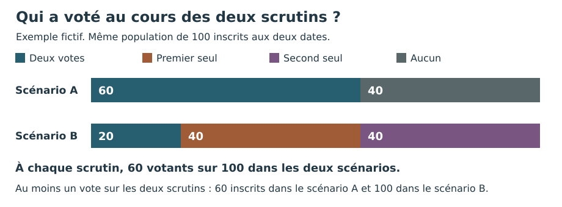

# BEL · B/L · Sociologie, oral à option 2025 · Corrigé brut

*Corrigé rédigé par IA, non officiel. Signalez toute erreur.*

**Rédaction** · GPT-6.2 Astra Ultra · vitesse non renseignée

**Autocontrôle** · GPT-6.2 Astra Ultra · vitesse non renseignée

Le billet demande de choisir entre « Déshériter » et « La dépolitisation ». Les deux exposés correspondent chacun à un choix possible.

## Déshériter

Lorsque l’enfant qui a repris une entreprise familiale la reçoit en héritage et que sa sœur reçoit une somme d’argent, tous deux peuvent avoir reçu leur part au regard des comptes établis. Que signifie alors entendre la sœur dire qu’elle se sent déshéritée ? Cela oblige à distinguer l’éviction juridique, l’inégalité de valeur entre biens et la signification d’une transmission. Le verbe *déshériter* suppose une attente préalable. Encore faut-il qu’un groupe reconnaisse à quelqu’un la qualité d’héritier, que la personne qui transmet puisse choisir et qu’une institution fasse tenir ou conteste cette décision. Je partirai de ces conditions pour montrer comment une exclusion peut se produire dans un partage apparemment régulier, puis examinerai ce que le conflit révèle de l’appartenance familiale.

### Qui peut retirer quoi à qui ?

L’héritage met en rapport trois instances. Le disposant souhaite répartir des biens, les proches ont des attentes façonnées par leur statut et leurs relations, et le droit fixe les effets du testament et de la donation. Le droit civil français actuel rend visible ce troisième terme. En présence d’enfants, une part de la succession leur est réservée. Avec deux enfants, dans le cas simple d’un parent veuf, sans donation antérieure et dont les deux enfants acceptent la succession, la réserve globale représente les deux tiers. Sur 300 000 € nets, chacun a vocation à une réserve de 100 000 €, et le tiers disponible de 100 000 € peut avantager l’un ou être légué à un tiers. Un testament qui prétend tout donner à un enfant ne suffit donc pas à garantir l’éviction de l’autre, qui peut demander la réduction de la libéralité excessive. Une menace de « rayer du testament » dit quelque chose de l’autorité que revendique le parent, même quand ses effets patrimoniaux sont limités.

Il faut encore que l’on sache ce qui entre dans ce calcul. Un logement tenu en indivision, l’outil de travail de l’entreprise ou des donations déjà consenties déplacent le litige vers la propriété, la date et la valeur des biens. L’adulte qui s’est éloigné de sa famille n’a pas nécessairement perdu sa qualité d’héritier. Celui qui renonce à une succession peut, de son côté, chercher à éviter le poids d’un passif. L’effet observé sur le patrimoine ne révèle pas à lui seul qui a voulu la rupture. Pour le déterminer, le sociologue doit suivre la chronologie des arrangements autant que le dernier acte du notaire.

### Une exclusion peut se préparer bien avant l’ouverture de la succession

Céline Bessière et Sibylle Gollac, dans *Le Genre du capital* (2020), étudient les arrangements familiaux et les pratiques professionnelles qui organisent l’accumulation et la transmission du patrimoine. Une interrogation traverse leur enquête. Comment se fait-il que le maintien du patrimoine dans la famille profite inégalement aux femmes et aux hommes, alors que l’égalité entre enfants est une norme revendiquée ? Préserver une exploitation entière ou le contrôle d’une entreprise est une fin collective à laquelle les proches peuvent tous dire souscrire. Reste à savoir qui sera préparé à reprendre le bien, qui en touchera les revenus et comment seront évaluées les compensations versées aux autres.

Revenons à la sœur du début. Si l’entreprise est sous-évaluée au moment de fixer la compensation, deux parts égales dans le décompte peuvent masquer un avantage économique. Même à valorisation correcte, un actif professionnel et une somme liquide n’offrent ni les mêmes risques ni les mêmes possibilités futures. Détenir le bien confère aussi la capacité de le transmettre à la génération suivante. Il serait pourtant imprudent de conclure à une spoliation en se fondant sur une hausse de sa valeur survenue vingt ans plus tard. Il faut reconstituer les informations disponibles au moment du partage, les coûts repris avec le bien et les apports de chacun. C’est en comparant les évaluations proposées, les papiers de famille et les récits des différents membres qu’une enquête pourrait établir si l’équivalence était vraisemblable.

Cette capacité à faire valoir des droits est elle-même distribuée inégalement. Connaître la composition du patrimoine, accéder au notaire, avancer des frais ou accepter le risque d’une rupture affective sont autant de conditions pour contester. Une action qui n’est jamais engagée peut conserver une importance dans les disputes familiales. À l’inverse, la coexistence d’un parent fragile et d’un enfant proche peut produire des transmissions importantes en reconnaissance d’une aide effective. Identifier une inégalité appelle l’étude des relations de dépendance et de soin qui lui ont donné un sens.

### Pourquoi l’accusation de déshéritement fait-elle conflit ?

Dans *Hériter* (1988), Anne Gotman examine ce que l’on fait des biens reçus et des obligations qui leur sont associées. Garder une maison ou un objet, c’est parfois assumer une continuité familiale. Un carnet ou un bijou de faible valeur marchande peut donc faire l’objet d’un conflit durable. En être privé peut signifier que l’on n’est plus jugé digne de représenter une lignée, ou que le parent privilégie une autre définition de la proximité. L’expression « il m’a déshérité » peut porter simultanément sur de l’argent, une reconnaissance et une place dans l’histoire de la famille.

Ces dimensions invitent à comparer les milieux sociaux. Pour une famille disposant d’une entreprise ou de plusieurs biens immobiliers, la transmission peut reconfigurer durablement la position des descendants. Pour des familles qui ont peu de patrimoine à partager, l’aide fournie du vivant des parents et la valeur biographique de quelques objets peuvent rester décisives. Il faut aussi considérer ce que les enfants ont déjà reçu en formation, en relations et en temps de soutien. Ces ressources incorporées peuvent prolonger l’avantage familial même si une libéralité est retirée. Elles ne constituent toutefois pas des biens dont le juge pourrait ordonner le partage.

Déshériter relève ainsi d’un pouvoir qui s’exerce sous conditions. Le droit borne ce que l’on peut ôter aux proches, l’organisation des familles distribue inégalement ce qu’ils pourront effectivement recevoir et revendiquer, et l’interprétation du partage engage la définition de la parenté. Une enquête convaincante partirait des successions contestées pour formuler ces mécanismes, puis étudierait également des transmissions ordinaires. Les dossiers judiciaires surreprésentent les conflits que les protagonistes ont les moyens et la volonté de porter devant un tiers.

## La dépolitisation

Lors d’une réunion d’association, une proposition peut être écartée par la formule « ici, on ne fait pas de politique ». Il a pourtant fallu décider ce qui pouvait être dit au nom du groupe. Cette scène rend ambigu le diagnostic de dépolitisation. Il peut désigner le retrait d’une personne de la vie politique, l’évitement public d’un désaccord ou le traitement d’un choix collectif comme une affaire technique. Il implique toujours de préciser qui s’éloigne de quoi, dans quelle arène et par rapport à quel moment. Comment distinguer un affaiblissement de la participation d’un déplacement des lieux, du langage et des acteurs du conflit ?

### Mesurer un retrait et ses conditions sociales

Une première manifestation est l’abstention. Mais une élection isolée ne dit rien de sûr sur l’évolution des pratiques d’une personne. Une moindre participation peut provenir de l’offre électorale du moment, d’une difficulté d’inscription, d’un déménagement, d’un sentiment d’incompétence ou d’un rejet explicite des choix proposés. Dans *Le Cens caché* (1978), Daniel Gaxie montre que la compétence politique et le sentiment d’être habilité à donner un avis sont socialement distribués. La maîtrise des codes de la discussion a ainsi des chances inégales de se manifester au moment où l’on demande aux citoyens de formuler un choix. L’égalité juridique du suffrage peut coexister avec de fortes différences d’aisance devant ses usages.

L’enquête de Céline Braconnier et Jean-Yves Dormagen, *La Démocratie de l’abstention* (2007), combine le travail sur un quartier populaire, l’étude de l’inscription et des observations sur les pratiques électorales. Elle permet de déplacer la question vers les conditions concrètes du vote. Une personne inscrite loin de son domicile actuel peut manquer un scrutin de faible mobilisation. Une discussion familiale, une campagne où l’issue est perçue comme ouverte ou un proche qui entraîne au bureau de vote peuvent modifier son comportement. Le même taux d’abstention parmi les inscrits peut donc correspondre à des histoires différentes. La non-inscription oblige encore à changer de population de référence.

### Une opinion peut rester privée ou se dire dans un autre langage

Dans *Avoiding Politics* (1998), Nina Eliasoph observe les conversations et les réunions de groupes bénévoles aux États-Unis. Ses terrains permettent de suivre un décalage entre des préoccupations exprimées entre proches et les modalités de prise de parole devant le groupe. Face à un public plus large, présenter un problème comme une aide concrète à apporter peut apparaître plus approprié qu’en discuter les causes collectives. Le silence public résulte alors aussi d’une règle de sociabilité. Il peut toucher des personnes attentives aux affaires communes et qui passent déjà du temps à agir ensemble.

Prenons deux suites possibles à la fermeture d’un service local. Un collectif peut organiser des trajets pour les habitants privés d’accès, ou demander une délibération publique sur la répartition territoriale des moyens. La première activité prend en charge une conséquence. La seconde identifie des responsables, des intérêts divergents et des décisions à modifier. Des habitants peuvent participer aux deux. Mesurer leur seule adhésion à un parti ferait disparaître une partie du déplacement qui s’est opéré. Inversement, toute entraide n’est pas en elle-même une mobilisation politique. Pour la qualifier, l’enquête doit écouter comment les participants définissent le problème et observer à qui ils adressent une revendication.

### L’apparente neutralité d’un choix a aussi ses producteurs

La dépolitisation peut enfin être le résultat d’un travail institutionnel. Supposons qu’une municipalité hiérarchise des équipements à partir de leur coût par visite. Les calculs peuvent être exacts. Leur adoption comme critère unique laisse néanmoins hors du classement le temps de trajet des usagers ou l’absence de solution pour les personnes peu mobiles. Présenter l’ordre de fermeture comme la simple conséquence du chiffre réduit la possibilité d’un débat sur ces choix. Le transfert de la discussion à une commission d’experts peut aussi modifier qui a accès aux données et qui est reconnu comme interlocuteur légitime.

Dans ce cas hypothétique, pour établir la dépolitisation, il faudrait comparer les arènes avant et après le changement. Le conseil municipal discutait-il jusque-là des priorités ? Les associations peuvent-elles mettre d’autres critères à l’ordre du jour ? Les élus gardent-ils la possibilité de modifier la décision ? Des collectifs peuvent à leur tour produire une carte des temps de trajet, donner une visibilité à des usagers évincés et rouvrir une controverse. L’expertise peut donc aussi donner de nouvelles prises à la critique. Seul le suivi des usages du savoir permet de trancher entre ces effets.

La dépolitisation est un processus relationnel et réversible. Elle se démontre lorsque des pratiques, des prises de parole ou des choix autrefois ouverts à la contestation s’en éloignent dans un cadre identifié. Un relevé de participation renseigne sur les comportements électoraux, une observation de réunion sur les règles du dicible et l’étude d’une décision publique sur la distribution de l’autorité. Les réunir permet aussi de repérer les cas où le conflit a changé de lieu et les situations où certaines personnes ont véritablement perdu une voie d’expression.

[Feuillet de l’option, p. 1](https://www.ens.psl.eu/sites/default/files/sujet_oraux_sociologie_option_bl.pdf#page=1) · [Rapport du jury de l’option de sociologie 2025](https://www.ens.psl.eu/sites/default/files/2025_bl_rapport_oral_sociologie_option.pdf)
