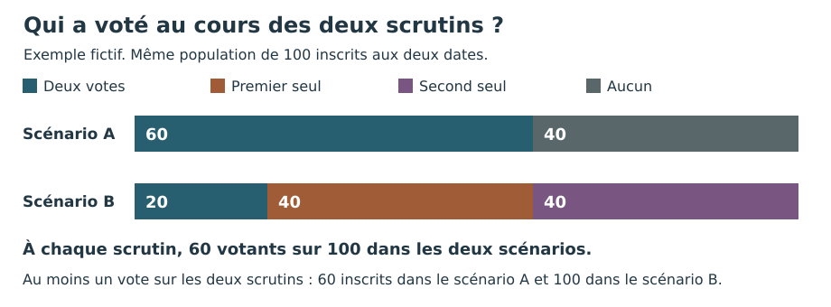

# BEL · B/L · Sociologie, oral à option 2025 · Corrigé guidé

*Corrigé rédigé par IA, non officiel. Signalez toute erreur.*

**Rédaction** · GPT-6.2 Astra Ultra · vitesse non renseignée

**Autocontrôle** · GPT-6.2 Astra Ultra · vitesse non renseignée

## Choisir sur le billet

Le feuillet propose deux sujets secs. À l’oral, on en choisit un. Après une heure trente de préparation, quinze minutes d’exposé ouvrent sur quinze minutes de questions. Pour choisir, essayez de formuler pour chaque intitulé une observation précise, une question sociologique et une manière de départager deux interprétations. Le premier sujet met en jeu le droit et les relations familiales. Le second demande de définir l’arène politique et le point de comparaison qui permettra d’y observer un changement.

## Déshériter

### Transformer le verbe en question de recherche

Au brouillon, écrivez qui déshérite qui, de quoi, et à quel moment. Un testament annoncé, un bien donné du vivant du parent et le règlement d’une succession ne sont pas trois observations équivalentes. L’expression employée par un enfant peut décrire une exclusion juridiquement effective, une inégalité de ressources ou un désaveu familial. Une bonne introduction peut raconter sobrement le désaccord de deux enfants sur l’attribution de l’entreprise parentale. Demandez ensuite ce qui donne à un membre de la famille le pouvoir de transmettre et à un autre les moyens d’obtenir ce qu’il pense lui revenir.

### Éprouver le pouvoir du testateur

Dans le cas simplifié de la figure, le parent est veuf, ses deux enfants acceptent la succession, l’actif net est de 300 000 € et il n’y a eu aucune donation antérieure. La règle de la réserve protège chacun à hauteur de 100 000 €. Si le parent lègue la quotité disponible à l’aînée, elle peut recevoir 200 000 € et le cadet 100 000 €. S’il la lègue à un tiers, chacun des enfants peut faire valoir sa réserve de 100 000 €. Voilà pourquoi le nombre d’enfants et les règles applicables importent pour apprécier la portée d’une volonté d’exclusion. En cas de libéralité excessive, il faut aussi observer qui exerce l’action en réduction. [Code civil, articles 912, 913 et 921](https://www.legifrance.gouv.fr/codes/texte_lc/LEGITEXT000006070721/2025-06-01/)

Utilisez cet exemple pour passer du droit à la sociologie. Pourquoi des héritiers qui disposent du même droit auraient-ils des chances différentes de l’exercer ? L’un connaissait les comptes, travaillait avec le parent et assiste seul à un premier rendez-vous. L’autre habite loin et apprend tardivement la valeur des biens. Ce scénario hypothétique donne une hypothèse observable. Il faudrait vérifier les dates d’information, les documents consultés et les démarches effectuées avant d’attribuer l’écart final à une préférence parentale.

### Suivre la transmission sur deux générations

Appuyez la deuxième partie sur l’enquête de Bessière et Gollac, *Le Genre du capital*. Suivez ce qui arrive au patrimoine productif, aux logements et aux compensations financières. Supposons une entreprise familiale évaluée à 160 000 € au moment du partage, attribuée à un enfant, tandis que l’autre reçoit 160 000 € liquides. Rien dans ces chiffres ne démontre une injustice. Demandez quels futurs revenus et quels risques sont attachés à chaque part, qui a été formé pour reprendre, quelles évaluations concurrentes existaient et qui pouvait imposer la sienne. Faire intervenir le genre requiert que l’on compare les situations de filles et de garçons sur plusieurs transmissions. Un exemple inventé illustre le mécanisme, il n’en établit pas la fréquence.

Pour la troisième partie, déplacez l’enquête vers la signification d’un bien. Les travaux d’Anne Gotman dans *Hériter* invitent à étudier les usages des objets et les obligations dont les héritiers se sentent chargés. Un objet sans grande valeur au marché peut cristalliser un conflit sur la responsabilité d’entretenir la mémoire familiale. Écoutez les justifications de chacun. Celui qui le garde invoque le soin donné au parent, un autre une promesse ancienne. L’objet fait alors apparaître plusieurs manières de définir l’égalité entre proches.

**Relance possible — Une personne sans héritage a-t-elle été déshéritée ?** Il faut d’abord établir ce qu’il y avait à transmettre et qui pouvait raisonnablement s’attendre à le recevoir. L’absence de patrimoine, une renonciation volontaire et une éviction ont le même résultat comptable pour l’intéressé et des causes différentes.

**Relance possible — Où trouver des contre-exemples ?** Comparez les familles passées par une procédure contentieuse avec celles où le partage s’est réglé sans procès. Dans les secondes, recherchez aussi les désaccords tus. Cela évite de prendre le silence pour un accord réel ou le contentieux pour le mode habituel de transmission.

On peut conclure que le pouvoir de déshériter se construit à plusieurs moments. Le droit délimite les prétentions possibles, les relations entre proches préparent l’accès aux biens, puis le partage leur donne une portée économique et affective dont les héritiers peuvent contester la légitimité.

## La dépolitisation

### Préciser l’unité qui change

Le verbe suggère une transformation. Faites trois lignes au brouillon. Un individu peut voter plus rarement, un groupe peut écarter certains débats de ses réunions et une institution peut retirer une question de la délibération collective. Pour chaque ligne, ajoutez une observation qui montrerait la transformation et une autre qui pourrait démentir votre interprétation. Une introduction peut partir d’un bénévole qui critique un choix municipal en privé et demande publiquement aux participants d’éviter les sujets politiques. Posez alors le problème. Qu’est-ce qui s’est retiré de la scène publique, et par quel mécanisme ?

### Comparer des conduites dans le temps

La figure suppose un groupe inchangé de 100 inscrits et deux scrutins. Dans le premier scénario, 60 personnes votent deux fois et 40 s’abstiennent deux fois. Dans le second, 20 votent deux fois, 40 seulement au premier scrutin et 40 seulement au second. Dans les deux scénarios, on enregistre 60 % de participation à chaque date. Pourtant 60 personnes différentes ont voté sur toute la période dans le premier et 100 dans le second. Ce calcul fictif montre pourquoi une série de taux agrégés ne renseigne pas directement sur les parcours. Il ne donne ni les raisons des abstentions ni l’attitude des non-inscrits.

Reliez le calcul à deux travaux d’enquête. Gaxie analyse dans *Le Cens caché* la distribution inégale des compétences et du sentiment d’avoir qualité pour intervenir. Braconnier et Dormagen étudient dans *La Démocratie de l’abstention* les conditions d’inscription et les mobilisations ordinaires. Expliquez ce que chacune de ces perspectives permet de tester. Si un éloignement du bureau de vote suffit à expliquer certains manquements, faciliter l’inscription locale peut modifier ces comportements. Si une situation de parole met les personnes en position de se juger incompétentes, le refus de répondre à un questionnaire ne mesure pas toute leur attention aux affaires communes.

### Comparer des arènes

Nina Eliasoph étudie dans *Avoiding Politics* (1998) des groupes bénévoles américains. Suivre les échanges publics et les conversations entre proches permet d’observer comment des bénévoles apprennent ce qu’il convient de dire au nom du collectif. Une personne peut critiquer l’injustice d’une situation chez elle et présenter son action publique comme une aide concrète. Demandez-vous si la discrétion tient à une perte d’intérêt, au souci de conserver l’unité du groupe, à son rapport aux financeurs ou à plusieurs de ces contraintes. Des observations répétées sont nécessaires pour trancher.

Travaillez enfin sur une décision. Une administration annonce la fermeture d’un guichet à partir du seul coût par visite. Qui a défini l’unité de coût ? Les usagers ont-ils été invités à discuter leurs temps de déplacement ? Les responsables politiques peuvent-ils encore réviser l’ordre des fermetures ? Si les critères ont été débattus, votés et publiquement contestés, la simple présence d’un calcul ne démontre aucune dépolitisation. Si les choix de critères sortent durablement de la discussion et que la décision prend l’apparence d’une nécessité administrative, on dispose d’indices. Un collectif qui rend visibles les temps d’accès peut rouvrir l’arbitrage et fournir un cas de repolitisation.

**Relance possible — Le retrait peut-il être politique ?** Un boycott public destiné à changer les règles du jeu fait de la non-participation un moyen d’action. Pour l’identifier, cherchez une revendication, des interlocuteurs et des signes de coordination. Un même comportement observable peut avoir une autre signification pour une personne restée chez elle sans participer à cette action.

**Relance possible — Une différence entre classes d’âge prouve-t-elle une évolution ?** Interroger deux classes d’âge une seule fois laisse mêlés les effets de l’âge et de la génération. Il faudrait des observations répétées et des indicateurs stables, ainsi qu’une attention aux formes d’engagement que l’instrument mesure mal.

Pour conclure, revenez à la situation de départ. Les propos d’un bénévole, un taux de participation et le vocabulaire d’une expertise portent sur trois phénomènes distincts. C’est quand on peut documenter la réduction des possibilités de prendre part au choix, d’en discuter les causes ou d’en contester l’issue qu’un diagnostic de dépolitisation devient explicatif.

[Feuillet de l’option, p. 1](https://www.ens.psl.eu/sites/default/files/sujet_oraux_sociologie_option_bl.pdf#page=1) · [Rapport du jury de l’option de sociologie 2025](https://www.ens.psl.eu/sites/default/files/2025_bl_rapport_oral_sociologie_option.pdf)
