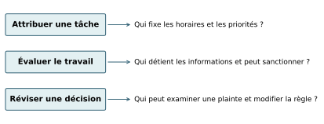
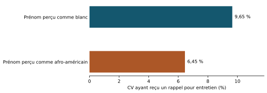

# ENS B/L · Sociologie, oral à option 2025 — Travailler sans hiérarchie / Les discours et les actes · Corrigé guidé

*Corrigé rédigé par IA, non officiel. Signalez toute erreur.*

**Rédaction** · GPT-6.2 Astra Ultra · vitesse non renseignée · 26 novembre 2026

Le billet propose deux sujets au choix. Le candidat prépare un seul exposé pendant 1 h 30, puis dispose de quinze minutes devant le jury, suivies de quinze minutes de discussion.

## Travailler sans hiérarchie

**Préparation.** Dessiner l’atelier de Crozier en mettant la maîtrise, les agents de production et l’entretien à des endroits distincts. Tracer d’abord qui a autorité sur qui, puis qui dépend de qui pour redémarrer. Chercher ensuite un collectif où l’autorité circule autrement. Cette double carte fournit l’entrée et évite de traiter le titre comme une question de préférence personnelle.

En 2012, les salariés d’Hélio-Corbeil reprennent leur imprimerie en coopérative. Le lendemain de la reprise, les machines requièrent toujours des compétences différentes, les clients attendent leurs commandes et il faut décider qui engagera les dépenses. La propriété de l’entreprise a changé de mains. Qu’est-il arrivé au pouvoir de commander ? Par hiérarchie, on peut entendre un classement stable des positions qui donne à certains le droit de donner des ordres, d’évaluer le travail ou de sanctionner. Diviser le travail demande que des personnes se coordonnent. Cela ne détermine pas à soi seul qui aura le dernier mot.

À quelles conditions les travailleurs peuvent-ils se passer d’une chaîne de commandement, et comment reconnaître les hiérarchies qui se reconstituent ? Partons de la coordination effective du travail, suivons ensuite les pouvoirs qui échappent à l’organigramme, puis examinons ce qui permet à un collectif de gouverner les délégations nécessaires.

### Coordonner une activité laisse ouvertes plusieurs formes d’autorité

> [!INDICATION]
> Dans le cas d’une panne, quels acteurs supportent le coût de l’arrêt ? Expliquer comment cette dépendance fournit un moyen de négociation.

Dans le type idéal de la bureaucratie construit par Max Weber, l’autorité s’attache à une fonction définie par des règles. Un supérieur dispose d’une compétence sur certaines décisions, une décision peut remonter à un échelon supérieur et le titulaire d’un poste peut être remplacé. Dans un service qui doit rendre compte de l’usage de fonds, cette forme de hiérarchie rend identifiable la personne autorisée à engager une dépense. Elle peut aussi protéger les salariés lorsqu’un ordre est contestable et qu’une procédure de recours existe. À l’inverse, la concentration de toutes les décisions au sommet peut retarder la résolution de problèmes que les exécutants sont les premiers à connaître.

Michel Crozier l’observe dans l’un des terrains du *Phénomène bureaucratique* (1963), un monopole industriel français. Le règlement et la chaîne de commandement y décrivent très finement les tâches. Pourtant, une panne arrête la production et les ouvriers d’entretien disposent du savoir qui permet de la faire repartir. Les ouvriers de production, comme la maîtrise, doivent composer avec eux. L’autorité formelle d’un chef et le pouvoir de négociation du spécialiste reposent ainsi sur des ressources distinctes. La même personne peut diriger le travail quotidien et dépendre d’un autre groupe face à un imprévu. [Michel Crozier, *Le Phénomène bureaucratique*](https://catalogue.bnf.fr/ark:/12148/cb36270150t)

Un tel constat permet d’imaginer le travail sans supérieur permanent. Dans un atelier fictif, l’opératrice qui connaît le mieux une machine peut coordonner sa remise en marche, puis rejoindre les autres pour décider de l’ordre des commandes. L’autorité qu’on lui reconnaît pour une intervention est limitée par son objet et sa durée. Pour décider s’il existe une hiérarchie, il faudrait observer si cette opératrice peut aussi attribuer les horaires, imposer une cadence ou exclure un collègue. Le contenu du pouvoir compte autant que le titre porté.

### Une organisation sans chef désigné peut concentrer le pouvoir

> [!INDICATION]
> Pour comparer la plateforme et le collectif, identifier séparément l’accès à l’information et le moyen de sanction.

Au début des années 1970, Jo Freeman s’appuie sur l’expérience de collectifs féministes américains qui tenaient à travailler sans dirigeantes permanentes. Dans certains de ces groupes, les amitiés font circuler l’information et permettent de préparer une décision avant la réunion. Une nouvelle venue peut voter avec les autres tout en arrivant après les discussions décisives. Si le groupe considère que personne n’y exerce d’autorité, il devient difficile de demander des comptes à celles qui en ont acquis. L’analyse invite à rechercher concrètement qui sait qu’une réunion aura lieu, qui peut y rester jusqu’au bout et qui parle ensuite au nom du groupe. Elle ne transforme pas toute relation amicale en domination. [Jo Freeman, *The Tyranny of Structurelessness*](https://www.jofreeman.com/joreen/tyranny.htm)

Comparer cette situation à celle d’un chauffeur de plateforme fait apparaître un autre pouvoir que l’absence de face-à-face peut dissimuler. Alex Rosenblat et Luke Stark ont enquêté pendant neuf mois sur l’expérience de chauffeurs Uber. Dans le dispositif étudié, accéder par l’application aux demandes des passagers, recevoir leurs évaluations et disposer d’informations inégalement partagées structurent les choix de travail. Le chauffeur décide quand se connecter. La plateforme garde cependant la main sur des règles déterminantes et sur une partie des informations qui permettraient de les discuter. Ici, le pouvoir qui s’exerce sans chef présent tient à la maîtrise de l’intermédiation économique. Il peut aussi se disperser entre l’entreprise qui règle l’application et les usagers dont les évaluations y sont enregistrées. [Alex Rosenblat et Luke Stark, 2016](https://ijoc.org/index.php/ijoc/article/view/4892)

Ces deux enquêtes invitent à suivre des dépendances plutôt qu’à compter les échelons. Le réseau d’amitiés d’un collectif et la plateforme qui attribue les courses ne disposent toutefois ni des mêmes moyens financiers ni des mêmes pouvoirs de sanction. On doit demander dans chaque cas à qui le travailleur peut s’adresser en cas de désaccord, avec quelles informations et au risque de perdre quoi.

### Organiser le contrôle de ceux qui coordonnent

> [!INDICATION]
> Dans la coopérative, repérer ce que la reprise a effectivement changé, puis une décision de gestion qui reste à prendre.

L’enquête au long cours de Maxime Quijoux sur Hélio-Corbeil, appuyée sur l’immersion et les archives, permet de revenir à l’exemple initial. En 2012, la reprise de l’imprimerie en société coopérative sous l’impulsion de militants de la CGT préserve 80 emplois. L’expérience syndicale fournit des ressources de mobilisation, des savoirs de négociation et une connaissance de l’outil de travail utilisables pour construire un projet de reprise. Des ouvriers peuvent désormais prendre part à des choix auparavant réservés à la direction. Cette conquête est mesurable même si tous les salariés n’acquièrent ni la même expertise de gestion ni la même disponibilité pour siéger ou représenter l’entreprise. [Maxime Quijoux, *Adieux au patronat*, 2018](https://cdft.cnam.fr/Record.htm?idlist=21&record=19149737124919679199)

Une délégation limitée, assortie d’un mandat explicite, de la publication des décisions et d’une possibilité effective de renouveler les mandataires, permet au collectif de garder prise sur les orientations. Freeman insiste aussi sur la circulation du savoir. Faire tourner la conduite des réunions donne peu de prise aux nouveaux si l’information reste entre les mains des anciens. À l’inverse, former plusieurs personnes à établir un devis ou à lire les comptes rend la rotation moins coûteuse et la contestation mieux informée. Les contraintes de délai, le temps dont chacun dispose et les compétences nécessaires déterminent jusqu’où ces pratiques sont soutenables.

Travailler sans hiérarchie peut donc vouloir dire supprimer un poste de supérieur, réduire l’étendue de ses pouvoirs ou soumettre les décisions à ceux qui les exécutent. Ce sont trois transformations observables, d’ampleur différente. Pour les départager dans une enquête, je suivrais une dépense contestée ou un changement d’horaire depuis la première proposition jusqu’au recours éventuel. On verrait alors qui peut proposer, décider, faire appliquer la décision et obtenir sa révision.

### Relances du jury

**Si le jury demande si l’expertise est toujours une hiérarchie.** L’expertise crée une dépendance locale. Une hiérarchie durable apparaît lorsque ce pouvoir se stabilise ou s’étend à d’autres domaines et que les personnes concernées ne peuvent pas le remettre en cause. Chercher un exemple où la compétence change de main avec le problème.

**Si le jury demande comment enquêter.** Prendre plusieurs réunions ordinaires et un conflit. Comparer les statuts à la distribution effective de la parole, identifier les personnes absentes et suivre la mise en œuvre des décisions. Observer aussi une proposition écartée.

## Les discours et les actes

**Préparation.** Noter trois types d’énoncés sur le brouillon, une opinion recueillie par questionnaire, une promesse publique et une déclaration institutionnelle. Pour chacun, préciser qui parle, qui entend et ce qui change. Conserver une colonne distincte pour ce que le chercheur a effectivement observé.

Un employeur se déclare attaché à l’égalité des chances. Une candidate reçoit-elle pour autant la même réponse qu’un autre candidat à dossier comparable ? La tentation est de départager les déclarations sincères et les autres. Mais une réponse à une enquête, une prise de position publique et une phrase prononcée par une personne habilitée à recruter sont déjà trois actes différents. Le sujet demande donc d’étudier comment des paroles et des conduites s’accordent, divergent ou se produisent mutuellement. Comment comparer ce que les acteurs disent et ce qu’ils font, et dans quelles conditions leur parole modifie-t-elle la situation ? J’examinerai d’abord le problème de la comparaison, puis ce que font les paroles, avant de construire une enquête qui puisse saisir les deux dimensions.

### Un écart entre une déclaration et une conduite a des conditions de production

> [!INDICATION]
> Comparer exactement les deux unités observées par LaPiere, puis proposer une explication concurrente d’un apparent changement d’attitude.

Dans une étude publiée en 1934, Richard T. LaPiere parcourt les États-Unis avec un couple chinois. Au cours du voyage, ils sont presque toujours accueillis dans les hôtels et restaurants sollicités. Un questionnaire envoyé ultérieurement aux établissements leur demande s’ils accepteraient cette clientèle. Parmi les 128 établissements visités qui répondent, les refus de principe sont largement majoritaires. La question abstraite recueille une orientation déclarée envers une catégorie. L’accueil confronte un employé à des personnes présentes, accompagnées, dans une interaction commerciale. La façon dont une catégorie entre dans une question ne reproduit donc pas mécaniquement les conditions d’une décision concrète. [Richard T. LaPiere, *Attitudes vs. Actions*, 1934](https://doi.org/10.2307/2570339)

Il serait excessif d’en conclure que les hôteliers mentent, ou que les préjugés n’ont aucun effet pratique. Tous les établissements visités n’ont pas répondu au courrier. La personne qui a rempli le questionnaire n’est pas nécessairement celle qui a reçu les voyageurs. Enfin, ces deux observations ont eu lieu à des moments différents. Dire qu’un établissement a fourni deux réponses discordantes et dire que le même individu a caché son intention sont deux affirmations dont la seconde demande d’autres preuves. La scène de réception, la formulation de la question et la sélection des répondants appartiennent au résultat à expliquer.

Une difficulté symétrique existe lorsqu’une conduite paraît conforme à la norme déclarée. Deux membres d’une association peuvent effectuer le même don, l’un pour honorer un engagement public pris en réunion, l’autre pour aider une personne qu’il connaît. Le montant versé ne suffit pas à départager leurs raisons. Un entretien aide à restituer les sens qu’ils donnent à leur geste, à condition de préciser devant qui ils parlent et à quel moment. Une justification rétrospective peut contenir à la fois un souvenir, une norme collective et une tentative pour conserver l’estime de ses pairs.

### Certaines paroles attribuent des droits ou engagent celui qui les prononce

> [!INDICATION]
> Tester l’exemple de l’assemblée avec deux locuteurs différents. Quelle différence dans les conséquences de la même phrase ?

Le travail de Pierre Bourdieu sur le langage autorisé, dans *Ce que parler veut dire* (1982), amène à examiner qui a le droit de parler, dans quel cadre et avec quelle reconnaissance. Prenons une assemblée dont le règlement confie l’ouverture de séance à sa présidente. Avant la réunion, un membre qui répète « la séance est ouverte » peut faire rire ses collègues. Lorsque la présidente prononce ces mots devant l’assemblée régulièrement convoquée, ils marquent le début de la séance et permettent d’engager les délibérations prévues. Une même phrase tire des actes institutionnels qui la précèdent et de la position de son auteur des effets très différents. Il faut donc reconstituer les prérogatives de celui qui parle, le déroulement de la procédure et la réception de sa parole. [Pierre Bourdieu, *Ce que parler veut dire*, 1982](https://www.fayard.fr/livre/ce-que-parler-veut-dire-9782213012162/)

Les paroles ordinaires peuvent également peser sur l’action attendue. Lorsqu’un porte-parole s’engage publiquement à présenter une revendication, les membres ont ensuite un propos précis à lui rappeler. Cet engagement change le coût d’un renoncement si un compte rendu existe, si les personnes concernées y ont accès et si des moyens de sanction ou d’interpellation sont disponibles. À l’inverse, une promesse générale sans échéance ni interlocuteur identifié est difficile à faire valoir. Le résultat se joue dans une séquence où la parole crée des attentes, qui peuvent être reprises ou tomber dans l’oubli. Cette distinction rend intelligible aussi bien l’effet d’un engagement que l’échec d’une déclaration.

### Faire varier les méthodes pour isoler ce qui est effectivement observé

> [!INDICATION]
> Calculer la différence en points avant le rapport relatif. Vérifier à quel moment du recrutement l’observation s’arrête.

Marianne Bertrand et Sendhil Mullainathan envoient des CV fictifs en réponse à des offres d’emploi publiées à Boston et à Chicago. Les chercheurs font varier aléatoirement les noms associés aux dossiers. Pour les noms généralement perçus dans la société américaine comme blancs, le taux de rappel pour un entretien atteint 9,65 %, contre 6,45 % pour des noms généralement perçus comme afro-américains. L’écart absolu est de 3,20 points. Rapporté à 6,45 %, cela correspond à environ 50 % de rappels en plus. L’assignation aléatoire donne prise sur l’effet du signal associé au nom, à l’étape du rappel, dans le champ des offres étudiées. On ne dispose ici ni du taux final d’embauche ni du motif propre à chaque recruteur. [Marianne Bertrand et Sendhil Mullainathan, 2004, tableau 1](https://doi.org/10.1257/0002828042002561)

Le résultat éclaire les limites d’une enquête qui recueillerait seulement les déclarations de principe des entreprises. Il faut toutefois résister à la tentation inverse de faire du rappel le seul fait sociologique intéressant. Des entretiens avec les personnes qui trient les candidatures permettraient d’identifier leurs catégories de jugement. Observer une réunion de recrutement montrerait qui peut défendre un dossier ou imposer un critère. Relever les règles écrites, puis suivre le devenir de candidatures comparables, permettrait d’identifier des étapes où l’écart apparaît, se creuse ou se réduit. Pour articuler les matériaux, il faudrait conserver les dates, les postes, la position de celui qui a parlé et celle de celui qui a pris la décision.

Le rapport entre discours et actes devient ainsi une question d’enquête. Un écart peut tenir au passage d’une catégorie abstraite à une rencontre concrète. Une concordance peut refléter un engagement public devenu contraignant. Une parole, enfin, peut accomplir une partie de l’action qu’on croyait devoir lui comparer. Replacer chaque énoncé dans sa scène et chaque décision dans sa suite d’opérations permet d’expliquer ces différences sans prétendre lire les intentions à partir d’une seule trace.

### Relances du jury

**Si le jury demande si l’entretien est inutile.** Demander pourquoi une consigne est jugée juste renseigne sur les normes mobilisées. Observer la suite aide à comprendre les conditions de sa mise en pratique. Un entretien et une observation peuvent produire deux résultats différents tous deux pertinents.

**Si le jury demande ce que démontre le testing.** La variation aléatoire du nom autorise une inférence sur l’effet du signal transmis par ce nom au premier contact. L’expérience ne révèle pas directement comment chaque recruteur interprète ce signal.

[Billet officiel, page 54](https://www.ens.psl.eu/sites/default/files/sujet_oraux_sociologie_option_bl.pdf#page=54) · [Rapport du jury de l’oral à option](https://www.ens.psl.eu/sites/default/files/2025_bl_rapport_oral_sociologie_option.pdf)
