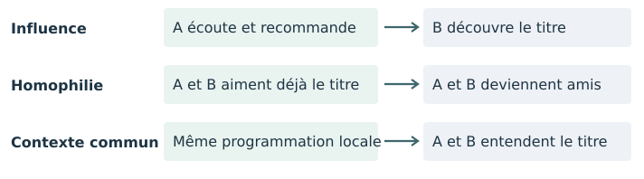
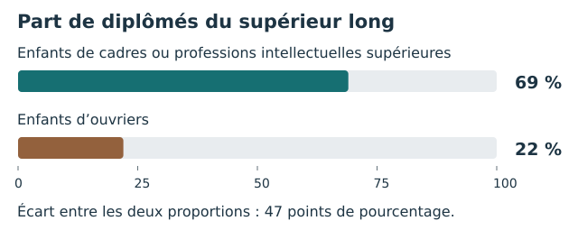

# ENS · B/L · Oral de sociologie à option 2025 · Corrigé brut

*Corrigé rédigé par IA, non officiel. Signalez toute erreur.*

**Rédaction** · GPT-6.2 Astra Ultra · vitesse non renseignée · 26 novembre 2026

Le billet propose deux sujets au choix. Le candidat en traite un seul, après 1 h 30 de préparation, devant un jury qui prévoit 15 minutes d’exposé puis 15 minutes de discussion. Les deux propositions ci-dessous se préparent indépendamment. [Billet officiel, page 51](https://www.ens.psl.eu/sites/default/files/sujet_oraux_sociologie_option_bl.pdf#page=51) · [Rapport de l’option 2025](https://www.ens.psl.eu/sites/default/files/2025_bl_rapport_oral_sociologie_option.pdf)

## Premier sujet · L’imitation

### Introduction

Un maître-nageur montre un mouvement de bras. Un élève le répète, puis un autre, qui n’a pas vu la démonstration, s’appuie sur le geste du premier. À la fin du cours, plusieurs corps se déplacent de façon analogue. Mais que faudrait-il observer pour attribuer cette ressemblance à l’imitation ? Deux nageurs peuvent aussi adopter le même geste parce que le règlement l’impose ou parce qu’il permet d’avancer efficacement. Un résultat commun peut avoir plusieurs histoires.

Imiter consiste à reprendre une manière de faire, de sentir ou de juger en prenant la conduite d’autrui pour modèle. L’observateur doit donc identifier une relation, sa direction et ce qui se transmet. **Comment la reprise d’une conduite singulière peut-elle faire naître une pratique collective et parfois renforcer des distinctions entre groupes ?** Nous partirons des conditions sociales de l’apprentissage, nous suivrons la circulation des modèles et nous examinerons comment isoler l’influence d’autrui parmi les causes possibles d’une ressemblance.

### I. Apprendre suppose de reconnaître un modèle et de pouvoir refaire son geste

Dans *Les Lois de l’imitation*, Gabriel Tarde fait de la transmission entre personnes un problème pour la sociologie. Une innovation peut d’abord n’engager que quelques individus. Elle devient une pratique répandue si d’autres la reprennent. La distinction entre invention et imitation permet de séparer deux questions. Comment une manière de faire apparaît-elle ? Par quelles relations se diffuse-t-elle, y compris auprès de personnes qui n’ont jamais rencontré son premier auteur ? Tarde permet de relier ces deux échelles sans supposer que tout un groupe invente simultanément la même chose. Il reste à identifier pourquoi tel modèle reçoit de l’attention. [Gabriel Tarde, *Les Lois de l’imitation*](https://classiques.uqam.ca/classiques/tarde_gabriel/lois_imitation/lois_imitation.html)

Marcel Mauss donne à cette question une matérialité dans sa conférence de 1934 sur les techniques du corps. Une manière de nager, de marcher ou de se servir d’un outil s’acquiert avec des postures et des rythmes qui finissent par sembler naturels. En évoquant sa propre expérience de la nage, il note des différences entre façons successives d’apprendre. L’histoire de l’enseignement se retrouve jusque dans le mouvement d’un corps. Son expression d’« imitation prestigieuse » attire l’attention sur le modèle choisi. L’enfant ou l’adulte voit accomplir avec succès un geste par quelqu’un à qui il accorde de l’autorité. Cette confiance oriente ce qu’il essaiera de reproduire. [Marcel Mauss, « Les techniques du corps »](https://classiques.uqam.ca/classiques/mauss_marcel/socio_et_anthropo/6_Techniques_corps/Techniques_corps.html)

Revenons au bord du bassin. Le geste du moniteur est visible de toute la classe, mais le débutant doit encore distinguer ce qu’il convient de reprendre, coordonner bras et respiration, recevoir une correction et recommencer. Un camarade plus avancé peut devenir un modèle plus accessible. Ce que chacun observe dépend également de sa place dans le groupe et du temps de pratique dont il dispose. L’imitation est ici un ressort de la socialisation. Celle-ci comprend aussi des injonctions, des exercices, des sanctions et une appropriation corporelle. Pour étudier leur articulation, on pourrait filmer plusieurs séances avec l’accord des participants, relever quel geste est montré par qui, puis observer si les élèves l’adoptent, le transforment ou l’abandonnent.

### II. La diffusion rapproche des semblables et déplace les frontières entre groupes

Le prestige ne se confond pas avec le rang le plus élevé dans la société. Un novice peut imiter une personne proche, un enfant un aîné, un musicien un interprète admiré. S’approprier un vêtement, un vocabulaire ou une façon de saluer peut signifier que l’on souhaite être reconnu parmi ses pairs. Pour étudier la direction de ces emprunts, il faut déterminer le groupe de référence du moment. Une tenue valorisée au sein d’une bande d’amis peut être écartée au travail. Une même personne dispose de plusieurs modèles et ajuste ses usages aux scènes où elle se présente.

Georg Simmel analyse cette relation à partir de la mode. Adopter un signe partagé permet d’afficher son appartenance à un cercle. Lorsque d’autres cercles s’en emparent, le signe perd une partie de son pouvoir de distinction pour ses premiers porteurs. Un groupe peut alors privilégier une nouvelle forme, une autre marque ou une manière plus discrète de porter la pièce. Le mécanisme explique pourquoi une dynamique d’uniformisation peut entretenir le changement. Il suppose des groupes qui attachent de la valeur à leur différence, ont connaissance des usages d’autrui et disposent des ressources nécessaires pour renouveler leurs pratiques. [Georg Simmel, « Fashion »](https://www.journals.uchicago.edu/doi/10.1086/222102)

Cette analyse suggère une distinction entre l’objet et son usage. Deux personnes portent le même vêtement. La coupe, l’association à d’autres accessoires, l’achat d’occasion, le lieu où on le porte et les réactions de l’entourage peuvent lui donner des significations différentes. Une diffusion à grande échelle n’entraîne donc pas nécessairement une égalité de reconnaissance. Un enquêteur qui relèverait seulement la marque possédée pourrait manquer ces différences. En observant les interactions et en demandant aux personnes de raconter l’acquisition et l’usage de leurs habits, il pourrait suivre les reprises, les ajustements et les refus. Il pourrait également éprouver le modèle de Simmel dans des cas où une innovation circule depuis un groupe peu doté vers des groupes dominants.

### III. Établir l’imitation demande de distinguer influence, sélection et exposition commune

Quand deux amis écoutent les mêmes morceaux, trois histoires au moins sont plausibles. Le premier a fait découvrir l’artiste au second. Les deux se sont liés autour de goûts qu’ils partageaient déjà, phénomène de sélection par ressemblance ou **homophilie**. Enfin, ils ont pu entendre le morceau au même endroit et au même moment. Connaître l’ordre d’adoption est utile pour identifier une direction d’influence, mais une campagne publicitaire commencée avant les deux écoutes peut toujours fournir une cause commune. Des observations répétées, les conversations sur les découvertes et l’histoire des liens permettent de mieux départager ces interprétations.

Une expérience de Matthew Salganik, Peter Dodds et Duncan Watts isole un mécanisme précis. Plus de 14 000 participants ont rencontré en ligne un même répertoire de 48 chansons peu connues. Dans une condition, ils pouvaient écouter et télécharger sans connaître les choix précédents. Dans d’autres, le nombre de téléchargements était visible, séparément dans plusieurs groupes évoluant en parallèle. L’affectation aléatoire permet de comparer ce qui advient avec ou sans cette information, et les groupes parallèles font varier l’histoire des premières écoutes. La visibilité des choix a rendu la distribution des téléchargements plus inégale et le succès d’un titre précis moins reproductible d’un groupe à l’autre. Les qualités propres des titres continuaient à compter, sans suffire à déterminer leur classement. [Salganik, Dodds et Watts, expérience de 2006](https://pubmed.ncbi.nlm.nih.gov/16469928/)

Un compteur élevé peut servir d’indice de qualité, susciter la curiosité ou simplement attirer le regard. L’expérience identifie un effet de l’information sociale sur les choix agrégés. Pour comprendre les motivations, il faudrait encore interroger les participants. Il faudrait aussi vérifier ce qui se passe hors de ce dispositif, auprès de personnes qui connaissent déjà les artistes ou à qui leurs amis recommandent personnellement une chanson. La preuve de la circulation d’une influence ne règle donc ni la question du sens donné à l’emprunt ni celle de sa généralisation à tous les publics.

### Conclusion

L’imitation explique une convergence lorsque l’on parvient à relier l’action observée à un modèle accessible et reconnu. L’apprentissage décrit par Mauss, la distinction analysée par Simmel et la comparaison expérimentale des choix musicaux montrent trois conséquences possibles. Les gestes deviennent partageables, des frontières sociales se déplacent, et un avantage initial peut s’amplifier. Le sociologue doit encore suivre ce que le destinataire fait du modèle, car une reprise peut être fidèle, sélective, détournée ou refusée.

## Second sujet · Peut-on prédire en sociologie ?

### Introduction

À partir de l’origine sociale, on peut anticiper des écarts de réussite scolaire entre groupes. Peut-on pour autant annoncer quel diplôme obtiendra une personne ? La difficulté vient autant de la question posée que de la quantité d’informations disponibles. Un pronostic sur un individu, une prévision sur la proportion de diplômés d’une génération et une projection sur ce qui se produirait après une réforme n’exigent ni les mêmes données ni la même épreuve de vérité.

Prédire consiste à formuler, avant d’en connaître le résultat, une attente assez précise pour que les observations puissent la mettre en défaut. Elle peut prendre la forme d’une probabilité ou d’un intervalle. Expliquer consiste à reconstruire le mécanisme qui produit le phénomène. **À quelles conditions une régularité observée fournit-elle une prévision valable, et comment son usage transforme-t-il parfois ce que l’on cherche à prévoir ?** Nous distinguerons les échelles de prévision, les moyens de tester une anticipation et les effets que peut produire sa circulation.

### I. Des positions sociales inégales rendent certaines issues plus probables

Un ordre de grandeur français fixe le problème. En 2021, parmi les 25–34 ans, 69 % des enfants de cadres ou de professions intellectuelles supérieures étaient diplômés du supérieur long, contre 22 % des enfants d’ouvriers. Le supérieur long correspond ici à un diplôme de niveau bac + 3 ou plus. L’écart est de 47 points et le rapport des proportions est un peu supérieur à trois. Un groupe de cent jeunes aux origines comparables aux premières connaîtrait, si les mêmes conditions se maintenaient, une répartition attendue très différente d’un groupe de cent jeunes aux origines comparables aux secondes. [INJEP, *Les chiffres clés de la jeunesse 2024*, données de 2021](https://www.bnsp.insee.fr/ark%3A/12148/bc6p0933v9r/f1.pdf)

Ce raisonnement repose sur une fréquence de groupe. Dans le premier groupe, près d’un tiers n’a pas obtenu ce type de diplôme, tandis qu’il a été obtenu par plus d’un cinquième du second. Une probabilité peut être correctement estimée sans identifier à l’avance les personnes qui réaliseront l’événement. Par ailleurs, les pourcentages cités décrivent des parcours déjà accomplis. Pour les utiliser comme prévision à une date ultérieure, il faudrait connaître la composition de la nouvelle génération et la stabilité des conditions de scolarisation. L’ouverture de places, la valeur d’un titre sur le marché du travail ou le coût du logement étudiant peuvent modifier ces proportions.

La sociologie de l’éducation peut enquêter sur les étapes intermédiaires. Des familles inégalement dotées en ressources économiques ou en familiarité avec les attentes scolaires n’affrontent pas les mêmes coûts lorsqu’il faut prolonger les études. Deux élèves de même niveau peuvent également formuler des choix d’orientation différents selon les informations dont ils disposent ou les conseils qu’ils reçoivent. Ces mécanismes donnent un sens social à l’association observée. Pour mesurer leur rôle, il faudrait suivre les vœux, les décisions des établissements et les ressources des familles à plusieurs étapes du parcours. Le seul écart de 47 points ne permet pas de répartir les responsabilités entre ces processus.

### II. Une prédiction se juge sur des observations qu’elle n’a pas servi à construire

Imaginons qu’une enquête cherche à anticiper la poursuite d’études de lycéens un an après le baccalauréat. Il faut fixer l’horizon, choisir une définition vérifiable de l’inscription et utiliser seulement des renseignements disponibles avant l’issue. Utiliser la rentrée universitaire déjà enregistrée pour prétendre prédire cette inscription rendrait l’épreuve circulaire. On peut estimer le modèle sur des générations antérieures, figer la règle, puis comparer ses probabilités aux résultats d’une génération plus récente. Une règle très simple, telle que la proportion d’inscrits précédemment observée, sert de point de comparaison.

Si un modèle assigne une probabilité proche de 70 % à un ensemble de personnes, on peut tester si la fréquence observée dans cet ensemble est effectivement proche de sept sur dix. C’est la calibration. Il importe aussi de savoir si des personnes auxquelles le modèle attribue des probabilités différentes ont des fréquences observées différentes. Une règle qui donnerait à tous la fréquence moyenne pourrait être correctement calibrée à l’échelle de toute la population, tout en étant peu informative pour distinguer les situations. Les erreurs doivent aussi être examinées groupe par groupe. De bonnes performances moyennes peuvent masquer des erreurs systématiques pour une petite sous-population.

Une enquête publiée en 2020 montre ce que permet une telle épreuve. Dans le *Fragile Families Challenge*, 160 équipes ont reçu les données d’une même cohorte de familles aux États-Unis et ont cherché à prédire six issues ultérieures, dont les résultats scolaires et les difficultés matérielles. Les réponses d’une partie des familles étaient réservées pour l’évaluation. Les meilleures propositions n’amélioraient que modestement la prévision par rapport à un modèle simple. L’erreur dépendait davantage de la famille dont on prédisait le résultat que de la technique employée. Une mesure imparfaite, un événement survenu entre deux vagues ou des facteurs absents du questionnaire sont des explications à examiner. Cette étude situe une limite pour ces variables, ces personnes et ces données. Elle ne mesure pas un degré universel de liberté individuelle. [Salganik et ses coauteurs, étude collaborative de 2020](https://pmc.ncbi.nlm.nih.gov/articles/PMC7165437/)

Un bon prédicteur peut, par ailleurs, être un mauvais levier d’intervention. Si un indicateur signale les élèves dont les ressources scolaires sont déjà faibles, modifier la valeur administrative de l’indicateur ne leur transmet pas ces ressources. Pour évaluer un accompagnement, il faudrait comparer les parcours avec et sans accompagnement dans des situations aussi comparables que possible. Ce changement de question fait passer de l’anticipation d’une issue à l’estimation de l’effet d’une action.

### III. Une anticipation rendue publique peut changer le cours des choses

Une projection repose sur des institutions durables. Une réforme des critères d’attribution de bourses ou des règles d’accès à une formation change les conditions qui soutenaient les régularités passées. Même si un modèle a bien fonctionné sur une génération tenue à l’écart pendant son estimation, son transport vers une autre institution ou une période de crise doit être éprouvé. Plutôt qu’annoncer un chiffre unique, on peut alors présenter plusieurs scénarios et expliciter quelles règles, capacités et décisions restent constantes dans chacun.

La prédiction peut elle-même entrer dans la situation. Robert Merton propose l’exemple d’une banque initialement solvable qu’une rumeur fait croire menacée. Des déposants retirent leurs fonds. En s’additionnant, leurs décisions peuvent créer la crise qu’ils redoutaient. C’est le mécanisme d’une prophétie autoréalisatrice. Il suppose que les acteurs apprennent l’annonce, lui donnent du crédit et disposent d’une capacité d’action suffisante pour peser sur l’issue. Une prévision de la météo ne rend pas le ciel pluvieux. Un jugement collectif sur la solidité d’une institution peut affecter sa solidité même. [Robert K. Merton, « The Self-Fulfilling Prophecy », 1948](https://doi.org/10.2307/4609267)

L’effet inverse est également possible. Si une collectivité anticipe une forte demande et augmente le nombre de places disponibles, la file d’attente annoncée peut disparaître. Son absence ne suffit alors pas à conclure que l’alerte était infondée. Il faut distinguer ce que prévoyait le scénario sans intervention de ce qui s’est produit après la décision. Dans un établissement scolaire, annoncer à un élève qu’il risque d’abandonner peut conduire à un soutien supplémentaire, mais aussi à des attentes plus faibles. L’orientation de l’effet doit être étudiée en suivant les usages concrets de l’information, les décisions prises, et les personnes qui y ont accès.

### Conclusion

La sociologie peut produire des anticipations probabilistes et conditionnelles, souvent plus solides sur une distribution collective que sur un destin singulier. Leur qualité se vérifie sur d’autres observations et à un horizon défini. Expliquer les mécanismes permet ensuite de savoir pourquoi une prévision pourrait cesser de tenir, ou quelle intervention mériterait d’être évaluée. Les sociétés ont enfin une propriété décisive pour cette question. Ceux qui prennent connaissance d’une prévision peuvent agir pour l’accomplir, pour la déjouer, ou pour changer les conditions dans lesquelles elle était raisonnable.
