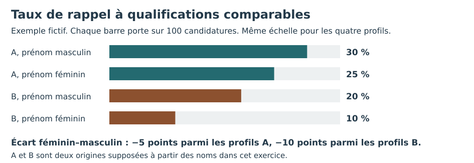

# BEL · B/L · Sociologie, oral à option 2025 · Sexe et race · Corrigé brut

*Corrigé rédigé par IA, non officiel. Signalez toute erreur.*

**Rédaction** · GPT-6.2 Astra Ultra · vitesse non renseignée

**Autocontrôle** · GPT-6.2 Astra Ultra · vitesse non renseignée

Le rapport du jury cite « Sexe et race » dans la liste des sujets secs posés, p. 4. L’exposé porte sur cet intitulé individuel. Le feuillet de ce tirage et son second choix restent à retrouver.

## Sexe et race

Dans un procès pour discrimination à l’embauche ou au licenciement, il semble raisonnable de comparer les femmes aux hommes, puis les personnes assignées à un groupe racial à celles d’un autre groupe. Ce double examen peut pourtant laisser hors de vue le traitement de certaines femmes. La juriste Kimberlé Crenshaw ouvre une enquête sur ce problème dans un article de 1989. Le sujet invite ainsi à étudier à la fois la construction des catégories et les effets de leur croisement. Comment des institutions attribuent-elles des places à partir de distinctions sexuées et racialisées, et comment en apporter la preuve sans prêter aux personnes des propriétés naturelles supposées communes ?

### Les classifications agissent à travers des institutions situées

Le sexe peut être une catégorie enregistrée à l’état civil ou dans une enquête, et le sexe que prête autrui à une personne peut aussi intervenir dans une interaction. L’analyse du genre porte sur les significations, attentes et hiérarchies attachées aux distinctions sexuées. Le mot « race » désigne ici un classement social et historique à travers lequel sont attribués une origine, des caractères ou une appartenance. La racialisation est ce processus d’attribution. L’apparence, l’accent ou le nom peuvent servir d’indices à un recruteur et être interprétés autrement par un autre interlocuteur. Une telle assignation peut avoir des conséquences durables, indépendamment de la manière dont la personne se définit.

Il faut donc préciser qui classe. Une catégorie administrative, une auto-identification et la perception d’un employeur ne permettent pas de répondre à la même question. Il faut aussi dater les catégories. Les catégories raciales des procédures judiciaires américaines s’inscrivent dans l’histoire de la ségrégation et du droit antidiscriminatoire aux États-Unis. Elles ne se transportent pas automatiquement dans une étude française de l’accès à l’emploi. La nationalité d’une personne et son pays de naissance ne définissent pas le traitement racial que peuvent lui imposer des personnes qui ignorent l’un et l’autre.

### Le croisement transforme les positions observées

Dans sa lecture de l’affaire *DeGraffenreid v. General Motors*, Crenshaw examine la manière dont des femmes noires ont dû faire valoir leur expérience de la discrimination. L’existence de femmes blanches employées par l’entreprise pouvait faire obstacle à une qualification générale de discrimination envers les femmes. Traiter leur plainte dans la seule catégorie de la discrimination raciale faisait, de son côté, perdre de vue leur situation propre comme femmes. Un système d’ancienneté pouvait produire des conséquences différentes selon les conditions antérieures d’accès à l’emploi. Au moment d’étudier des licenciements, regarder seulement la règle appliquée le dernier jour laisserait échapper l’histoire des recrutements.

C’est l’un des enjeux de l’intersectionnalité. Comparer des catégories trop larges peut prendre implicitement certaines de leurs membres pour représentatives de toutes. Le mécanisme n’exige pas une arithmétique universelle qui ajouterait deux handicaps constants. Il faut identifier un régime d’emploi, une décision et un groupe de comparaison. Un tribunal, une organisation syndicale et une enquête statistique peuvent chacun contribuer à rendre visible ou difficile à formuler le traitement d’un groupe particulier. [Kimberlé Crenshaw, article de 1989](https://chicagounbound.uchicago.edu/uclf/vol1989/iss1/8/)

Evelyn Nakano Glenn suit un autre mécanisme dans son étude historique du travail reproductif rémunéré aux États-Unis. Il s’agit du travail qui assure quotidiennement l’entretien des personnes et de leurs conditions de vie. Son enquête relie le service domestique et le développement des emplois de service dans des institutions. Le transfert d’une activité du foyer à un établissement peut la salarier ou la placer sous une nouvelle hiérarchie. Il ne répartit pas automatiquement le travail de nettoyage, d’entretien et de soin de la même façon entre tous les groupes de femmes. Pour expliquer qui réalise telle tâche, il faut étudier les débouchés ouverts, les qualifications reconnues, les possibilités de refuser et les modalités de recrutement. La question de classe intervient aussi. Le revenu d’un ménage employeur peut lui permettre de déléguer le travail domestique à une autre femme, elle-même chargée d’organiser le soin de ses proches. [Evelyn Nakano Glenn, *Signs*, 1992](https://doi.org/10.1086/494777)

### Faire la preuve d’un traitement différencié

Prenons un exercice hypothétique sur les réponses à des candidatures. Les qualifications sont rendues comparables. Des noms destinés à suggérer deux origines perçues A ou B et un genre féminin ou masculin sont assignés aléatoirement à des candidatures. Dans un exemple construit, sur 100 candidatures par case, une réponse positive va à 30 dossiers masculins A, 25 féminins A, 20 masculins B et 10 féminins B. L’écart entre dossiers féminins et masculins est de −5 points pour A et de −10 points pour B. Sur cette échelle, on observe une différence d’écarts de −5 points. Ce constat est plus précis qu’un taux moyen de rappel pour toutes les femmes. Il n’indique pourtant ni le motif conscient d’un recruteur ni le destin d’une personne au long de sa carrière.

Une véritable enquête devrait examiner ce que les noms font percevoir. Ils peuvent suggérer aussi une génération ou une appartenance de classe. Il faudrait répartir des noms variés, équilibrer les envois entre offres et estimer l’incertitude des écarts. Observer les entretiens qui suivent, étudier la division des tâches ou suivre des plaintes permettrait ensuite de tester d’autres mécanismes. Une interaction statistique est un résultat dépendant de la mesure choisie. L’intersectionnalité interroge en outre les institutions qui définissent les positions et rendent certaines expériences dicibles.

Sexe et race constituent ainsi des rapports de classement dont les effets se construisent dans des lieux et des histoires précises. L’analyse croisée permet de rendre compte de l’attribution d’un travail, de l’éviction d’une salariée ou de la recevabilité d’une revendication que deux moyennes séparées laisseraient mal expliquer. Sa force tient à sa capacité à dire qui a pris quelle décision, selon quelles catégories et avec quelles conséquences vérifiables.

[Rapport du jury de l’option de sociologie 2025, liste p. 4](https://www.ens.psl.eu/sites/default/files/2025_bl_rapport_oral_sociologie_option.pdf#page=4)
