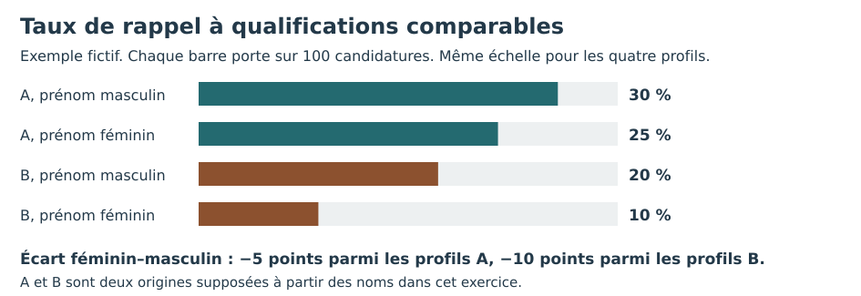

# BEL · B/L · Sociologie, oral à option 2025 · Sexe et race · Corrigé guidé

*Corrigé rédigé par IA, non officiel. Signalez toute erreur.*

**Rédaction** · GPT-6.2 Astra Ultra · vitesse non renseignée

**Autocontrôle** · GPT-6.2 Astra Ultra · vitesse non renseignée

Le rapport du jury cite « Sexe et race » dans la liste des sujets secs posés, p. 4. L’exposé porte sur cet intitulé individuel. Le feuillet de ce tirage et son second choix restent à retrouver.

## Préparer un exposé sur deux rapports sociaux

Commencez par une scène où les deux termes du sujet sont nécessaires pour comprendre le résultat. Dans l’affaire discutée par Kimberlé Crenshaw, la situation de femmes noires licenciées ne peut être examinée correctement si l’on réserve pour toute comparaison les femmes blanches ou les hommes noirs. La question devient alors précise. Quelles institutions contribuent à produire les groupes, à distribuer les positions entre eux et à reconnaître certaines expériences de discrimination ?

### Donner un sens vérifiable aux catégories

Distinguez trois fiches possibles pour une même personne. La première porterait les informations recueillies dans un fichier administratif. La deuxième lui demanderait les mots par lesquels elle se présente. La troisième noterait comment un employeur a interprété son nom au moment de lire son dossier. Une discordance entre les fiches peut être le résultat à expliquer. L’origine supposée par autrui peut intervenir avant même de connaître la nationalité. Une catégorie d’état civil peut de son côté être mobilisée pour établir une classification qui continue d’organiser les attentes professionnelles.

Enchaînez sur la notion de racialisation. Il s’agit de savoir comment des différences sont construites comme des signes d’appartenance réputés naturels et comment cette assignation devient efficace. De même, expliquer le genre suppose de préciser qui distribue les tâches, quelles compétences sont tenues pour acquises ou reconnues comme qualifications et comment des attributs individuels sont interprétés dans une situation donnée.

### Reconstituer deux enquêtes

**L’accès à une qualification juridique.** Replacez Crenshaw dans le droit antidiscriminatoire américain de la fin des années 1980. Retracez la chronologie d’un recrutement, de l’accumulation de l’ancienneté puis d’un licenciement. Comparez ensuite les points de référence possibles. Embaucher des femmes à certains postes ne permet pas de conclure que toutes les catégories de femmes y ont eu accès. Une décision apparemment uniforme à la dernière étape peut prolonger une fermeture antérieure. Posez enfin la question de la preuve. Quelles catégories de victimes le cadre judiciaire accepte-t-il de reconnaître, et quelles comparaisons laisse-t-il de côté ? [Article de Crenshaw](https://chicagounbound.uchicago.edu/uclf/vol1989/iss1/8/)

**La distribution du travail reproductif rémunéré.** Dans l’enquête historique d’Evelyn Nakano Glenn, suivez une tâche telle que l’entretien de l’espace de vie. Qui l’assume chez un particulier ou dans un établissement ? Qui contrôle son contenu et son rythme ? Qui a la possibilité d’accéder à un emploi mieux payé ou de faire reconnaître une qualification ? Vous réunissez ainsi le classement des personnes et l’organisation des tâches. Les différences de revenus entre employeuses et salariées comme les conditions juridiques d’emploi font intervenir la classe et l’histoire locale. Pour discuter l’action de celles qui exercent le travail, cherchez aussi les formes de négociation, d’entraide ou d’organisation collective. [Article de Glenn](https://doi.org/10.1086/494777)

### Passer d’une moyenne à une comparaison croisée

Les quatre groupes comptent chacun 100 dossiers fictifs. En regroupant les deux origines supposées, on obtient 50 réponses sur 200 pour les noms masculins, soit 25 %, et 35 sur 200 pour les noms féminins, soit 17,5 %. Cet écart de 7,5 points masque deux écarts différents. Pour les dossiers A, les réponses passent de 30 à 25 %, soit −5 points. Pour les dossiers B, elles passent de 20 à 10 %, soit −10 points. À écart féminin-masculin identique à celui de A, la valeur attendue pour les dossiers féminins B serait 15 %. L’exemple construit donne 10 %, soit cinq points de moins. N’employez pas le mot « significatif » en l’absence d’estimation de l’incertitude.

**Pourquoi ne peut-on pas conclure que l’origine B divise partout les chances par deux ?** Cette comparaison dépend du profil et de l’échelle. Pour les noms masculins, passer de A à B donne 20 rappels au lieu de 30, soit deux tiers du premier taux. Pour les noms féminins, 10 au lieu de 25, soit deux cinquièmes. Les moyennes décrivent ici les réponses aux candidatures dans l’exercice imaginaire. Elles ne donnent pas un risque général attaché aux personnes.

**Comment améliorer la preuve ?** Dans une enquête réelle, utilisez plusieurs noms par condition et vérifiez ce qu’ils évoquent, répartissez les profils entre offres comparables et contrôlez les versions des CV. Les dossiers adressés à une même entreprise peuvent avoir des résultats dépendants. Tenez-en compte dans la mesure de l’incertitude. Une analyse des offres et des entretiens permet ensuite d’étudier à quelle étape et dans quels métiers se construisent les écarts. Des récits de trajectoire éclairent d’autres moments que celui du premier rappel.

**Le mot « intersection » oblige-t-il à trouver un écart statistique supplémentaire ?** Non. L’effet mesuré dépend de la catégorie de référence et de l’échelle retenue. Une question peut être intersectionnelle parce qu’elle porte sur les conditions de reconnaissance juridique ou la formation historique d’un groupe, même si aucun tableau à quatre cases n’est disponible. L’enjeu est de comparer des explications et d’établir les mécanismes qui ont produit les positions observées.

[Rapport du jury de l’option de sociologie 2025, liste p. 4](https://www.ens.psl.eu/sites/default/files/2025_bl_rapport_oral_sociologie_option.pdf#page=4)
