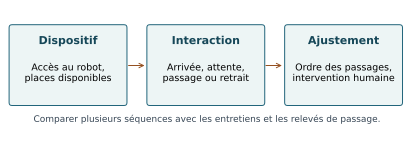
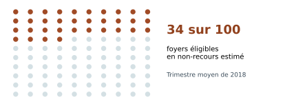

# La sociologie et les animaux / L’insécurité sociale · Corrigé brut

*Corrigé rédigé par IA, non officiel. Signalez toute erreur.*

**Rédaction** · GPT-6.2 Astra Ultra · vitesse non renseignée · 26 novembre 2026

ENS, concours B/L, oral à option de sociologie 2025. Le billet propose deux sujets au choix. Chaque exposé ci-dessous peut être présenté indépendamment.

## Sujet 1 · La sociologie et les animaux

### Introduction

Dans une exploitation laitière équipée d’un robot de traite, l’éleveur peut connaître le nombre de passages d’une vache et l’heure de sa dernière traite. Pourtant, ces informations ne lui disent pas à elles seules pourquoi cette vache attend à l’écart ou pourquoi il faut aller la chercher. Il doit observer les interactions dans le troupeau, tenir compte de la disposition des lieux et parfois modifier ses propres gestes. Qui fait fonctionner la traite ? Cette question apparemment technique déplace les frontières d’une discipline qui s’est largement constituée en expliquant les conduites humaines par les rapports entre humains.

Le « et » du sujet invite à suivre un déplacement. On peut faire la sociologie des catégories dans lesquelles les humains rangent les animaux. On peut ensuite examiner les relations dans lesquelles les conduites de plusieurs espèces se répondent. À quelles conditions la sociologie peut-elle rendre compte de la participation des animaux à la vie collective, alors qu’elle ne peut les interroger comme elle interroge les personnes ? J’examinerai d’abord la production sociale des statuts animaux, puis ce que l’observation d’un travail partagé ajoute à cette première approche. J’en tirerai des conséquences pour l’enquête et pour l’analyse des rapports de pouvoir.

### I. Classer les animaux, c’est aussi organiser des relations entre humains

Un lapin peut être élevé pour l’alimentation ou nommé, soigné et pleuré comme un compagnon. Les catégories auxquelles il appartient orientent l’usage que l’on peut en faire, les dépenses reconnues comme légitimes et les personnes chargées de s’en occuper. Comparer ces deux rapports sociaux au même animal permet de tenir à peu près constante l’espèce tout en faisant varier les institutions, les obligations et les attachements. Pour enquêter, on pourrait suivre la carrière d’un animal placé en refuge puis adopté. Qui peut décider de son transfert ? À quel moment acquiert-il un nom et un dossier de soins ? Les réponses renseignent autant sur le statut des bénévoles, propriétaires et vétérinaires que sur celui du lapin.

Une tradition classique invite déjà à prendre de telles classifications au sérieux. Dans *Les Formes élémentaires de la vie religieuse* (1912), Durkheim analyse notamment le totémisme australien à partir de descriptions ethnographiques. Le totem peut être une espèce animale ou végétale. Son emblème permet aux membres du clan de reconnaître une appartenance commune, que les assemblées et les rites rendent sensible. On comprend mal les prescriptions portant sur une espèce si on les réduit à l’utilité alimentaire de celle-ci. Durkheim formule un problème durable, celui des liens entre classement du vivant et classement des groupes humains. Les matériaux de seconde main et l’ambition de généralisation de l’ouvrage invitent toutefois à ne pas appliquer tel quel ce modèle à un refuge ou à un élevage. Et l’on sait davantage, par cette démarche, ce que signifient les animaux pour un groupe que ce qu’ils font dans une situation.

La protection des animaux a elle-même une histoire sociale. Dans son étude des mobilisations entre 1820 et 1980, Christophe Traïni montre combien la définition des mauvais traitements et les formes de compassion légitimes se transforment. Une protestation contre la violence publiquement infligée à un animal peut viser à la fois son sort et la réforme des mœurs humaines. La défense quotidienne des animaux recueillis place d’autres expériences et d’autres compétences au centre de l’action. Qui est autorisé à parler avec autorité de cruauté ? À qui reproche-t-on une sensibilité excessive ? Ces questions font apparaître des hiérarchies de genre et de position sociale jusque dans la façon d’exprimer une émotion. Les archives d’une association permettent de retracer ces luttes, mais ses porte-parole ne représentent ni tous les membres ni les animaux eux-mêmes.

### II. Suivre une interaction change ce qu’on explique

Revenons au robot de traite. Une statistique de rendement renseigne sur le produit du travail. Elle ne restitue ni les attentes d’un individu devant la machine ni la succession des ajustements qui rendent le passage possible. Dans leur enquête « Les vaches collaborent-elles au travail ? », publiée en 2010, Jocelyne Porcher et Tiphaine Schmitt observent les conduites d’un troupeau laitier, les relations avec l’éleveur, les interactions entre vaches et les usages du robot. Ce changement d’échelle fait entrer dans l’analyse le temps de l’apprentissage, les différences entre animaux et les initiatives qui facilitent ou compliquent la traite.

Pourquoi parler de collaboration ? Imaginons que l’organisation officielle prévoie que chaque vache se présente au robot et que l’éleveur intervient si une traite tarde. Deux descriptions sont alors possibles. La première enregistre l’écart au fonctionnement prescrit comme un incident. La seconde suit ce qui se passe avant cet écart et après lui. Une autre vache peut occuper le passage, un animal peut attendre, l’éleveur revenir à un autre moment. Ce scénario illustre une méthode d’observation. Il ne remplace pas une séquence effectivement relevée sur le terrain. En multipliant les observations sur les mêmes animaux, on peut chercher quels ajustements se répètent et dans quelles conditions ils cessent. Le résultat à expliquer devient la réalisation collective d’une tâche au fil du temps.

Le terme de travail est une hypothèse à discuter. Si l’on retient comme critère une participation régulière à une activité organisée, dont le déroulement dépend des initiatives des participants, elle mérite examen. Si le critère est un emploi salarié assorti d’un contrat et de droits, il ne s’applique pas aux vaches. Ces définitions visent deux dimensions historiquement souvent associées chez les humains. Les distinguer permet de soumettre une hypothèse empirique à l’épreuve, tout en conservant la spécificité du rapport salarial. Une routine stable ne suffit d’ailleurs pas à démontrer une intention de coopérer. Une contrainte matérielle, une habitude acquise ou un stimulus immédiat peuvent expliquer un passage. L’interaction devient un objet sociologique précisément parce qu’on peut comparer ces explications et étudier le sens que les travailleurs donnent aux conduites observées.

### III. Élargir l’enquête sans parler à la place des animaux

En entretien, un professionnel peut dire qu’un animal est volontaire, têtu ou inquiet. Cette qualification constitue une donnée sur la relation et sur l’expérience du professionnel. Elle ne suffit pas à établir un état mental. L’enquête peut revenir au même passage à différents moments, décrire qui se trouve où, relever la durée de l’attente, regarder si un changement de configuration entraîne un autre comportement. Les entretiens indiquent ce que les personnes ont appris à distinguer. L’observation peut confirmer une régularité, faire apparaître des désaccords entre professionnels ou révéler une séquence qui leur est devenue si familière qu’ils ne la mentionnent plus.

Il faut ici maintenir deux asymétries. La première concerne l’accès au sens. Même chez les humains, discours en entretien et pratiques observées peuvent diverger. Chez les animaux, le chercheur perd la possibilité de demander directement si son interprétation est juste. Dialoguer avec l’éthologie aide à choisir des indices pertinents pour l’espèce et à reconnaître les limites d’un dispositif. La seconde asymétrie concerne le pouvoir. L’animal peut contrarier ou faciliter l’activité. L’éleveur, la réglementation, le marché et les organisations professionnelles disposent, à des titres différents, du pouvoir de fixer les lieux, les horaires, la sélection du troupeau ou la destination de la production. Rendre visible l’initiative animale oblige donc aussi à étudier qui contrôle les conditions de cette initiative.

Le périmètre du social dépend finalement du problème posé. Si l’objet est la campagne d’une association, documents, porte-parole et institutions sont au premier plan. Si c’est le déroulement réel d’une traite, s’en tenir aux intentions du concepteur du robot et de l’éleveur ferait perdre une partie de l’explication. Entre ces deux échelles, l’enquête peut suivre la manière dont une connaissance pratique de l’animal devient une preuve publiquement recevable, par exemple lorsqu’un professionnel et une association discutent d’un indicateur de bien-être. Les protagonistes n’ont ni les mêmes intérêts ni les mêmes instruments. L’animal n’est pas réductible à ces porte-parole, mais le chercheur doit montrer par quelles observations il étaye une autre interprétation.

### Conclusion du premier sujet

L’entrée par les animaux conduit à trois questions sociologiques distinctes. Qui définit leur statut ? Comment leurs conduites modifient-elles une activité organisée ? Qui peut prétendre savoir ce qu’ils éprouvent et agir en conséquence ? La sociologie apporte une analyse des classements, des situations et des rapports de pouvoir. Les animaux l’obligent en retour à préciser ses critères de preuve. Décrire ce qu’une conduite change au déroulement d’une interaction est possible même lorsque son sens subjectif demeure incertain.

## Sujet 2 · L’insécurité sociale

### Introduction

Deux personnes perdent le même emploi. L’une dispose d’une indemnisation prévisible, d’un logement durable et de proches qui peuvent garder ses enfants. L’autre attend de connaître ses droits, doit payer seule le loyer et reporte un soin. L’événement déclencheur est identique. Ses conséquences sur le présent et sur la possibilité de faire des projets divergent. Ce cas construit permet de donner un contenu sociologique à l’insécurité sociale. Elle désigne l’exposition à une dégradation des conditions d’existence lorsque les ressources et les protections sur lesquelles on peut compter ne suffisent plus à y faire face.

La pauvreté monétaire se mesure à une date donnée. L’insécurité engage aussi une durée, une anticipation et la solidité des appuis. Une personne dont les ressources présentes excèdent le seuil de pauvreté peut ignorer si elle pourra payer son loyer le mois suivant. Inversement, un faible revenu stable peut ouvrir des possibilités de planification, tout en laissant très peu de marge devant une dépense imprévue. Comment une société qui a construit des protections collectives étendues produit-elle encore des trajectoires aussi inégalement exposées ? Je montrerai d’abord en quoi la sécurité est une institution collective. J’examinerai ensuite les mécanismes de cumul et, enfin, l’écart entre un droit institué, son usage et la sécurité ressentie.

### I. La sécurité ordinaire repose sur des institutions

Dans *L’Insécurité sociale. Qu’est-ce qu’être protégé ?* (2003), Robert Castel distingue protections civiles et protections sociales. La protection civile concerne notamment l’intégrité des personnes et des biens dans un État de droit. Les protections sociales répondent aux événements susceptibles de dégrader les conditions d’existence, comme la maladie, l’accident, la perte d’emploi ou la vieillesse sans ressources suffisantes. La crainte sociale qui nous intéresse peut exister dans un quartier où la personne se sent physiquement en sécurité. On comprend mieux l’expérience en demandant à la fois de quelle menace il s’agit et ce qui permettrait d’y faire face.

Historiquement, posséder une terre, un logement ou une épargne donne certains moyens de traverser un arrêt d’activité. L’accès à ces ressources dépend des patrimoines familiaux. Le développement des droits liés au salariat a permis à une partie croissante de la population de s’appuyer sur ce que Castel appelle la « propriété sociale ». Un droit à pension donne au salarié sans patrimoine privé une prise sur ses ressources au-delà de la période de travail. Un mécanisme de mutualisation déplace le coût d’un risque individuel vers un collectif qui peut le répartir. La sécurité qui en résulte contribue à l’autonomie de la personne parce qu’elle réduit la nécessité de solliciter chaque fois la bienveillance d’un employeur, d’un parent ou d’un donateur.

La généralisation reste inégale. Un droit contributif dépend d’une carrière et de conditions d’ouverture. Des périodes discontinues de travail, des interruptions liées au soin apporté à des proches et des dates de départ différentes peuvent se traduire par des droits différents. Les minima sous condition de ressources obéissent à une autre logique, de soutien lorsque les ressources du foyer sont insuffisantes. La famille est donc à la fois un appui concret et une unité dont les ressources sont prises en compte par certains dispositifs. À l’intérieur d’un même foyer, deux personnes ayant statistiquement le même niveau de vie peuvent ne pas disposer du même accès à l’argent. Une analyse des protections doit donc aussi examiner leur unité d’attribution et leur distribution effective.

### II. Un aléa devient insécurisant par ses enchaînements

Le contrat de travail est une entrée, mais la durée du contrat ne résume pas toute une trajectoire. Un emploi à durée indéterminée peut être peu rémunéré, à temps partiel subi, soumis à des horaires imprévisibles. Un contrat court peut être suivi d’un autre sans interruption et s’accompagner d’un réseau de soutien. Comparons deux situations où l’employeur annonce tardivement l’horaire d’une prise de poste. Pour une personne proche de son lieu de travail et libre de toute charge de garde, le coût peut rester limité. Pour une personne qui dépend d’un bus peu fréquent et doit organiser une garde payante, le même changement peut rendre la journée difficilement tenable. L’explication se trouve dans l’articulation entre organisation du travail, division familiale des tâches et équipement du territoire.

Les difficultés se renforcent parfois en chaîne. Une baisse de revenu réduit l’épargne disponible. Une panne de voiture, jusque-là réparable, menace alors l’accès à un emploi situé hors des transports collectifs. Un proche qui prête un véhicule interrompt cet enchaînement. Mais un réseau familial dont tous les membres ont déjà peu de ressources peut offrir beaucoup de présence sans pouvoir fournir durablement une voiture ou un logement. On comprend ainsi la notion de vulnérabilité chez Castel, à l’articulation d’une insertion professionnelle fragile et de soutiens relationnels incertains. Ces dimensions peuvent évoluer séparément. Une perte d’emploi ne mène pas mécaniquement à un isolement, et l’appui de la famille a lui-même des conditions et parfois un coût d’autonomie.

L’enquête de Serge Paugam à Saint-Brieuc, à l’origine de *La Disqualification sociale* (1991), déplace encore la question. À partir de dossiers de services sociaux et d’entretiens, il distingue notamment des rapports ponctuels, réguliers ou très distants à l’assistance. Une personne qui sollicite une aide pour la première fois peut craindre d’être identifiée à une catégorie dépréciée. Une autre peut négocier avec un intervenant une relation plus durable qui rende sa situation un peu plus prévisible. Ces positions ne sont ni des traits de personnalité ni des étapes obligées. L’institution qui soutient matériellement une personne peut aussi contribuer à la désigner publiquement comme dépendante. Cette enquête locale rend intelligible ce processus sans fournir sa fréquence actuelle dans toute la France.

### III. Mesurer l’écart entre protection prévue et protection effective

Compter les allocataires renseigne sur le versement des prestations. Pour savoir quelle part du public reste hors du dispositif, il faut aussi estimer le nombre de foyers qui y auraient droit. La DREES et ses partenaires ont rapproché l’enquête sur les revenus fiscaux et sociaux d’une simulation des règles du RSA. Pour un trimestre moyen de 2018, en France métropolitaine et dans les logements ordinaires, ils estiment que 34 % des foyers éligibles ne percevaient pas le RSA. Environ un cinquième des foyers éligibles seraient en non-recours durable, évalué sur trois trimestres consécutifs. Ce sont deux éclairages sur une même question. Les additionner compterait deux fois certaines situations. Une estimation fondée sur des règles simulées est sensible à la mesure des ressources et de la composition du foyer. Le champ écarte notamment les personnes sans logement ordinaire.

Que peut-on conclure de ce chiffre ? Un droit peut exister sans produire le revenu attendu au moment où l’on en a besoin. L’estimation ne fournit pas les motifs de chaque absence de versement. Une personne peut ignorer son éligibilité, anticiper une reprise d’activité, rencontrer une difficulté administrative ou redouter la stigmatisation. Pour confronter ces explications, il faudrait interroger des foyers estimés éligibles qui perçoivent et qui ne perçoivent pas la prestation, puis suivre leurs démarches dans le temps. Interroger seulement les personnes qui se présentent au guichet laisserait de côté une partie décisive du phénomène. On pourrait aussi comparer les délais de paiement et l’accès à un accompagnement en tenant compte de la situation de départ.

Enfin, un même montant annuel peut masquer des calendriers très différents. Des versements discontinus peuvent forcer à différer un paiement même lorsque la somme sur l’année paraît suffisante. Et la crainte de la prochaine interruption peut infléchir des décisions avant même qu’elle ne se produise. Un calendrier mensuel des ressources, des dépenses contraintes, des dettes et des aides reçues permettrait de restituer ces temporalités. Des entretiens répétés montreraient comment elles modifient la possibilité d’accepter une formation, de déménager ou d’engager une dépense. L’écart entre conditions mesurées et sentiment d’insécurité est alors lui-même un objet sociologique. Il peut tenir à des expériences antérieures de rupture, au soutien attendu des proches ou à l’incertitude sur les droits futurs.

### Conclusion du second sujet

L’insécurité sociale se comprend à partir du rapport entre les risques auxquels une personne est exposée et les appuis réellement mobilisables dans le temps. Le statut du travail, le logement, le patrimoine, les solidarités et les institutions contribuent ensemble à rendre un avenir prévisible, ou laissent les difficultés se cumuler. La question empirique décisive est celle du passage entre une protection annoncée et les moyens dont une personne dispose lorsqu’un aléa survient. Observer simultanément les trajectoires et les institutions évite de ramener une situation socialement produite à un défaut individuel de prévoyance.

## Sources

La page 50 du recueil réunit les deux intitulés en un seul billet. Le rapport de l’option détaille l’organisation de l’oral, commente en page 3 le déplacement du regard sociologique proposé par le premier intitulé et énumère les deux sujets en page 4. [Billet de l’ENS](https://www.ens.psl.eu/sites/default/files/sujet_oraux_sociologie_option_bl.pdf#page=50) · [Rapport de l’option](https://www.ens.psl.eu/sites/default/files/2025_bl_rapport_oral_sociologie_option.pdf)

### Travaux mobilisés dans le premier exposé

Émile Durkheim, *Les Formes élémentaires de la vie religieuse* (1912), pour le lien entre emblème, classification et groupe. Christophe Traïni, *La Cause animale* (2011), pour l’enquête historique sur les mobilisations. [Présentation de l’ouvrage par son éditeur en anglais](https://www.routledge.com/The-Animal-Rights-Struggle-An-Essay-in-Historical-Sociology/Traini/p/book/9789089648495)

Jocelyne Porcher et Tiphaine Schmitt, « Les vaches collaborent-elles au travail ? Une question de sociologie », *Revue du MAUSS*, 2010, pour la comparaison entre travail prescrit et participation observée d’un troupeau dans une exploitation équipée d’un robot. [Présentation de l’enquête par INRAE](https://www.inrae.fr/actualites/condition-ouvriere-vaches-laitieres)

### Travaux mobilisés dans le second exposé

Robert Castel, *L’Insécurité sociale. Qu’est-ce qu’être protégé ?* (2003), sur les protections civiles et sociales. Serge Paugam, *La Disqualification sociale* (1991), sur les relations entre les services sociaux et les personnes auxquelles ils s’adressent. [Compte rendu de Castel](https://www.persee.fr/doc/caf_1149-1590_2005_num_79_1_2136_t14_0150_0000_3) · [Compte rendu de Paugam](https://www.persee.fr/doc/rfsoc_0035-2969_1992_num_33_1_4131)

Cyrine Hannafi, Rémi Le Gall, Laure Omalek et Céline Marc, *Mesurer régulièrement le non-recours au RSA et à la prime d’activité*, Dossier de la DREES n° 92, 2022. L’estimation mobilisée porte sur le RSA en 2018. [Étude de la DREES](https://drees.solidarites-sante.gouv.fr/sites/default/files/2022-05/DD92_0.pdf)
