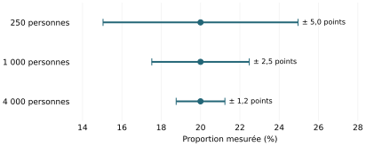
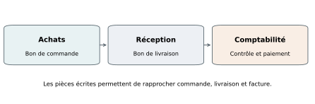

# BEL B/L · Sociologie à option 2025 · Sondages et bureaucratie · Corrigé guidé

*Corrigé rédigé par IA, non officiel. Signalez toute erreur.*

**Rédaction** · GPT-6.2 Astra Ultra · vitesse non renseignée · 26 novembre 2026

Le billet propose deux sujets au choix. Au concours, le candidat en traite un seul pendant quinze minutes, puis échange avec le jury pendant quinze minutes. Chaque exposé ci-dessous se lit indépendamment.

En préparation, consacrez les premières minutes à comparer les termes des deux sujets et à choisir celui dont vous pouvez défendre les exemples. Le rapport d’option prévoit une heure et demie de préparation. Pour chacun des deux parcours, prévoyez une introduction courte, trois temps de démonstration et une conclusion avant la discussion.

## Sujet 1 · Les sondages font-ils l’élection ?

### Introduction

Le 21 avril 2002, Jean-Marie Le Pen se qualifie pour le second tour de l’élection présidentielle française devant Lionel Jospin. Les derniers sondages et beaucoup de commentaires plaçaient Jospin devant lui. L’écart entre les deux candidats a finalement été inférieur à un point. Cet épisode pose deux questions distinctes. Pourquoi une enquête menée juste avant un scrutin peut-elle se tromper sur le classement final ? Et le classement rendu public a-t-il lui-même changé la conduite de certains électeurs ? La première interrogation porte sur la mesure. La seconde porte sur les effets sociaux de sa publication. Une erreur de classement, à elle seule, ne permet pas de trancher la seconde.

Un sondage préélectoral interroge un échantillon à une date donnée sur un choix déclaré, souvent conditionné par l’intention d’aller voter. « Faire l’élection » peut vouloir dire annoncer son issue, contribuer à définir les candidats perçus comme compétitifs ou produire des changements de vote et de participation. Pour distinguer ces trois propositions, il faut suivre le chiffre depuis sa fabrication jusqu’à ses usages, puis se demander comment on pourrait isoler ses effets sur les conduites.

### I. Une intention devient un chiffre au terme d’une série de choix

> [!INDICATION]
> Écrivez trois colonnes au brouillon pour les inscrits, les répondants et les répondants qui expriment un choix. Identifiez la population de chaque pourcentage avant d’en interpréter la précision.

Pour estimer un vote, l’institut délimite la population, recrute des répondants, établit une liste de candidatures et formule la question. Les personnes interrogées peuvent hésiter, taire leur préférence, changer d’avis ou renoncer à voter. La manière de compter les indécis et de repérer les votants probables change le dénominateur. Un score de 20 % parmi les répondants ayant exprimé un choix peut parfaitement coexister avec une proportion bien plus faible de l’ensemble des inscrits déjà décidée pour cette candidature.

L’échantillon crée une autre source d’incertitude. Même un tirage aléatoire rigoureux conduit à des estimations différentes lorsqu’on le répète. À titre d’illustration, pour une proportion de 20 % observée dans un échantillon aléatoire simple de 1 000 personnes, l’erreur-type est d’environ 1,3 point. Un intervalle approximatif à 95 % s’étend sur environ 2,5 points de part et d’autre. Ce calcul suppose un plan de sondage bien précis. Dans une enquête par quotas, les ajustements sur l’âge, la profession ou le vote antérieur corrigent la composition connue. Ils ne garantissent pas une même participation à l’enquête pour des personnes qui partagent ces caractéristiques. Dans un même échantillon, les scores de deux candidats sont aussi liés. La précision d’une différence demande son propre calcul.

L’enquête du *Literary Digest* lors de la présidentielle américaine de 1936 offre un précédent. Malgré plusieurs millions de réponses, elle donnait gagnant le républicain Alf Landon. Franklin Roosevelt a été largement réélu. Les listes utilisées pour contacter les personnes et la propension très inégale à retourner le questionnaire sont en cause. Accroître le nombre de réponses réduit certaines fluctuations. Accumuler des réponses sélectionnées de la même façon peut aussi stabiliser une estimation biaisée. Ainsi, prévoir un résultat suppose des hypothèses sur la population effectivement votante et sur le temps qui sépare l’enquête de l’urne.

### II. Une fois publié, le classement contribue à définir la compétition

> [!INDICATION]
> Suivez le même chiffre de l’institut à la rédaction, puis jusqu’au public. Précisez ce que chaque intermédiaire ajoute au résultat initial.

Un pourcentage ne circule pas seul. Une rédaction choisit d’annoncer un duel, de parler d’une progression ou de construire un récit de décrochage. Une avance de deux points peut devenir l’histoire politique du jour, même si l’enquête ne permet pas de départager sûrement les candidats. Répétées, les mesures assignent des positions publiques de favori, de concurrent ou de candidat marginal. Dans *Faire l’opinion* (1990), Patrick Champagne étudie les relations entre instituts, journalistes et professionnels de la politique qui donnent autorité à cette représentation de la compétition. Elle offre un langage commun aux éditorialistes, aux partis et aux publics, jusque dans leurs désaccords sur les chiffres.

Pierre Bourdieu, dans « L’opinion publique n’existe pas » (1973), interroge trois présupposés des sondages d’opinion. Toute personne serait également en mesure de produire un avis sur la question posée, tous les avis auraient le même poids social et la pertinence même de la question ferait consensus. La critique est particulièrement éclairante quand une question abstraite est étrangère aux préoccupations de nombreux enquêtés. Une intention de vote correspond plus étroitement à une décision institutionnelle identifiable. Mais une liste fermée de candidats, une relance des indécis et un calendrier d’enquête donnent encore une forme particulière aux réponses. Le bulletin et le questionnaire n’engagent d’ailleurs ni les mêmes obligations ni les mêmes conséquences.

Prenons le cas du scrutin présidentiel français à deux tours. La règle réserve l’accès au second tour aux deux premiers. Dans ce cadre, être classé deuxième ou troisième peut modifier la visibilité d’une candidature, les questions qu’on lui pose et les anticipations de soutiens potentiels. Ces effets se produisent à travers le fonctionnement des médias, des partis et du mode de scrutin. L’évolution d’une campagne sans publication de sondages serait difficile à reconstituer. Il reste cependant possible d’observer ces effets intermédiaires en suivant, par exemple, les titres des journaux avant et après la publication d’une même enquête et la façon dont ils en présentent l’incertitude.

### III. Des effets possibles sur les conduites, dont il faut établir le sens et l’ampleur

> [!INDICATION]
> Construisez deux explications d’une même corrélation. L’une fait intervenir le sondage, l’autre un événement qui agit à la fois sur l’enquête et sur le bulletin.

Un électeur qui croit sa candidature favorite trop éloignée de la qualification peut privilégier un autre choix pour le second tour. Son bulletin exprime alors à la fois une préférence et une anticipation des préférences d’autrui. Un classement peut donner envie de rejoindre un succès annoncé ou, au contraire, de se mobiliser pour un candidat jugé menacé. L’annonce d’une large avance peut rassurer un électeur au point qu’il s’abstienne, tandis qu’une course serrée peut renforcer son sentiment d’utilité. Ce sont des mécanismes qui peuvent se compenser. Leur simple possibilité ne dit ni combien de personnes ils concernent ni quel candidat en bénéficie.

Le modèle d’une transmission directe d’un chiffre au bulletin néglige aussi la sélection de l’exposition. Une personne déjà très politisée suit davantage les sondages et discute leurs résultats avec son entourage. Sa préférence préalable peut à la fois orienter ce qu’elle lit et expliquer son vote. Deux candidats peuvent enfin se rapprocher dans les sondages et dans les urnes parce qu’un débat ou un événement de campagne a modifié l’attention portée à un enjeu. Observer que ces deux séries évoluent ensemble ne fournit pas, en soi, un effet de publication.

Le panel suivi par Paul Lazarsfeld, Bernard Berelson et Hazel Gaudet dans le comté d’Erie, aux États-Unis, pendant la campagne de 1940, offre un repère méthodologique. Dans *The People’s Choice* (1944), les auteurs distinguent l’activation de dispositions antérieures, leur renforcement et la conversion d’un électeur. Les discussions interpersonnelles contribuent à la circulation de l’information. Cette distinction aide à interpréter un effet possible de sondage. Un même article peut conforter une préférence déjà formée chez une personne et informer le choix stratégique d’une autre. Cette enquête historique ne chiffre pas l’effet des sondages sur une présidentielle française.

Pour tester l’un de ces mécanismes, une enquête en panel interrogerait les mêmes personnes à plusieurs dates sur leurs préférences, leur perception des chances de qualification, leur exposition et leur intention de participer. Elle permettrait d’étudier l’ordre des changements, sous réserve des abandons en cours d’enquête et des événements concomitants. Un protocole expérimental peut présenter à des groupes répartis au hasard le même scénario électoral avec ou sans information chiffrée. Une différence moyenne renseignerait sur l’effet de cette information dans ce dispositif. Elle ne serait pas immédiatement transposable au bulletin secret d’une véritable élection. C’est en distinguant préférences initiales, anticipations et comportement que l’on peut donner un contenu vérifiable au verbe « faire ».

### Conclusion du sujet 1

Les sondages produisent des estimations imparfaites et datées. Leurs publications contribuent à faire la campagne en rendant certains classements visibles et en donnant prise à des anticipations. Elles peuvent, dans certaines conditions, infléchir des choix ou la participation. L’effet sur le résultat final reste une question empirique, qui demande de préciser le scrutin, les publics exposés et ce qu’ils auraient fait en l’absence de cette information.

### Pour la discussion du sujet 1

**Comment interpréter une hausse de deux points ?** Il faut connaître les dates, le champ, le questionnaire, le mode de recrutement, le degré d’incertitude et la comparabilité des deux vagues. S’il s’agit d’un panel, une partie des mêmes personnes répond deux fois. Si les échantillons sont distincts, l’aléa d’échantillonnage intervient aux deux dates. Une comparaison de chiffres publiés ne suffit pas à attribuer la hausse à un événement.

**Pourquoi interroger quelqu’un sur son vote avant de lui communiquer un classement ?** Cela permet de décrire sa préférence initiale et de distinguer un changement d’anticipation d’un changement de préférence. Pour imputer un effet à l’information, il faut également une comparaison appropriée, car les préférences peuvent évoluer pour d’autres raisons.

## Sujet 2 · « Le capitalisme requiert la bureaucratie »

### Introduction

Une entreprise peut changer de direction et continuer à verser les salaires, honorer ses contrats et répondre d’un litige conclu sous le dirigeant précédent. Cette continuité suppose des fonctions identifiables, des dossiers conservés et des règles de décision. Elle aide à comprendre la proposition attribuée à Max Weber dans *Économie et société*, paru à titre posthume en 1922. Le mot « bureaucratie » désigne couramment la lenteur ou l’abondance de formulaires. Chez Weber, il qualifie un type d’administration dont l’activité repose sur des compétences attribuées à des fonctions et exercées selon des règles.

Le capitalisme dont il s’agit d’expliquer les conditions de développement est, en particulier, celui de l’entreprise moderne qui engage du capital, organise durablement le travail et calcule ses perspectives de gain. « Requiert » est une proposition sur ses conditions de fonctionnement. Que doit-il pouvoir attendre d’une administration ? Pourquoi cette exigence se retrouve-t-elle à l’intérieur des firmes aussi bien que dans leurs rapports avec l’État ? Et jusqu’où peut-on lui donner une portée générale ?

### I. La calculabilité suppose une certaine prévisibilité des décisions

> [!INDICATION]
> Reliez chaque trait de l’idéal-type à un problème concret de l’entreprise. Un dossier conservé permet de reprendre une affaire après la mutation d’un agent.

Chez Weber, une entreprise capitaliste moderne doit pouvoir comparer des recettes espérées à des dépenses présentes. Elle consent une avance aujourd’hui pour un résultat à venir. Un propriétaire peut disposer de machines et de fonds sans savoir si un contrat sera exécuté, quelle autorité tranchera un litige ou à quelle règle sera soumise une marchandise. Une décision entièrement dépendante de la faveur personnelle du détenteur du pouvoir est difficile à anticiper. L’entreprise peut alors circonscrire une partie de l’incertitude grâce à des procédures identifiables.

La domination légale-rationnelle tire sa légitimité de la croyance en la validité des règles et en la compétence de ceux qu’elles habilitent. Dans son type bureaucratique, les attributions sont délimitées, les fonctions hiérarchisées, les agents qualifiés et les décisions consignées. La personne physique ne possède pas son poste ni les moyens d’administration. Le dossier demeure disponible après son départ. Pareille organisation facilite la continuité et la comparaison de situations analogues. L’*idéal-type* accentue ces traits pour construire un instrument de comparaison. Il ne s’agit ni d’une description exhaustive de chaque administration ni d’un jugement favorable sur elle.

Considérons une entreprise qui prête de l’argent à un client pendant douze mois. L’existence d’un juge compétent, de règles connues de preuve et de procédures d’exécution permet au créancier d’apprécier certaines conséquences d’un défaut. L’issue de l’affaire reste inconnue. La prévisibilité concerne les voies de recours et les règles selon lesquelles une décision sera prise. Une justice calculable n’est pas nécessairement équitable du point de vue de chaque partie. Cette distinction entre rationalité formelle et fins substantielles importe dès le premier pas du raisonnement.

### II. L’administration rationnelle se déploie dans l’État et dans la firme

> [!INDICATION]
> Pour chaque exemple, demandez qui fixe la règle, qui la fait appliquer et à quelle opération économique elle donne de la continuité.

La bureaucratie publique établit et fait fonctionner des cadres dont les opérateurs économiques dépendent. Des registres stabilisent des droits, une administration fiscale met en œuvre des prélèvements, des juridictions statuent sur des contrats. Pour une entreprise qui organise des opérations nombreuses et répétées, la continuité de ces activités facilite les prévisions. Ce raisonnement n’implique pas que tout prélèvement ou toute réglementation satisfasse les intérêts de l’entreprise. Une règle fiscale peut être à la fois prévisible et contestée par celui qui doit payer.

À l’intérieur d’une firme, un autre problème se pose. Comment commander, produire, livrer et facturer pour des milliers de transactions sans que le propriétaire décide lui-même de chaque opération ? La division des tâches et l’archivage permettent de déléguer un pouvoir limité et de vérifier ensuite comment il a été exercé. Un service d’achats passe la commande, un autre atteste la réception et la comptabilité rapproche les pièces avant paiement. Les personnes peuvent se remplacer et une erreur peut être localisée. La comptabilité calcule ici coûts et résultats. La bureaucratie organise les fonctions et les circuits qui produisent des informations utilisables pour ce calcul. Les deux mécanismes sont distincts et se renforcent.

Le développement de la grande entreprise accentue ainsi la demande de personnels spécialisés, de continuité et de mesures comparables. L’État moderne et la firme n’ont pourtant pas la même finalité. Un agent public exerce une compétence au nom d’une autorité instituée. Le directeur d’un service privé répond à une direction qui vise notamment la rentabilité. L’analogie concerne la forme d’organisation. Elle montre comment des entreprises en concurrence sur un marché peuvent, à l’intérieur de leurs frontières, coordonner le travail par une hiérarchie très précise.

### III. Les variations historiques et les tensions de la formalisation

> [!INDICATION]
> Mettez à l’épreuve le verbe « requiert ». Testez d’abord la nécessité à l’échelle d’une petite firme, puis à celle des institutions dont elle dépend.

Les formes de recherche du profit sont plus anciennes et plus variées que la bureaucratie moderne. Le commerce de longue distance a pu s’appuyer sur des liens de parenté, des réseaux de confiance ou des privilèges accordés par un souverain. Une petite entreprise familiale peut encore coordonner l’essentiel de ses activités à l’oral. Ces cas obligent à préciser l’échelle de la thèse. Une firme peu bureaucratisée en interne peut dépendre, autour d’elle, d’une banque organisée en services, de registres fonciers et d’un tribunal. Inversement, des administrations bureaucratiques servent des Églises, des États ou des organisations qui ne poursuivent aucun profit. On ne peut pas déduire la présence du capitalisme de la seule existence de bureaux.

L’efficacité attendue de la règle crée aussi des difficultés. Robert K. Merton montre dans « Bureaucratic Structure and Personality » (1940) comment la discipline nécessaire à l’application régulière des procédures peut conduire à un *déplacement des buts*. Le respect d’un formulaire devient une fin pour l’agent, même lorsqu’une situation imprévue exigerait de traiter autrement la demande. Dans une entreprise, un indicateur conçu pour suivre un délai peut encourager la clôture administrative d’un dossier avant que le client n’ait obtenu la prestation. La même formalisation rend alors les activités comparables et peut dégrader le service qu’elle devait permettre.

Dans *Le Phénomène bureaucratique* (1963), Michel Crozier analyse notamment des ateliers où la production est fortement réglementée. La panne d’une machine laisse subsister une incertitude importante pour les ouvriers de production comme pour la direction. Les ouvriers d’entretien qui disposent des connaissances nécessaires à la réparation peuvent en tirer des ressources dans leurs relations de travail. La hiérarchie écrite et le pouvoir effectivement exercé ne coïncident donc pas entièrement. Cet exemple précise la limite de la calculabilité. La formalisation déplace les sources d’incertitude et les relations de dépendance qui leur sont liées.

Les pratiques contemporaines de sous-traitance illustrent une autre tension. Confier une activité à un prestataire peut alléger la hiérarchie interne. Il reste à définir contractuellement la prestation, à consigner les incidents et à contrôler les engagements. La formalisation peut se déplacer de la relation salariale vers les frontières entre entreprises. Il faut donc enquêter sur les lieux où s’effectue le travail administratif et sur ceux qui en supportent le coût avant de conclure à la disparition de la bureaucratie.

### Conclusion du sujet 2

La thèse de Weber rend compte d’une dépendance du capitalisme moderne à l’égard de décisions prévisibles et d’une administration durable. Le droit et les bureaux publics assurent une partie de cette prévisibilité. La firme en produit une autre par ses propres fonctions et écritures. La relation est particulièrement nette pour les opérations répétées et conduites à grande échelle. Son intensité varie historiquement. L’analyse reste sociologique lorsqu’elle demande qui écrit les règles, qui les applique, à qui elles permettent de calculer et quels coûts elles font peser sur les autres.

### Pour la discussion du sujet 2

**Quel est l’intérêt sociologique de l’idéal-type ?** Il isole des traits pour comparer les formes d’organisation. Un recrutement par concours et une décision fondée sur des relations personnelles peuvent coexister dans la même institution. L’écart au type invite à observer les pratiques, les carrières et les justifications.

**Une entreprise familiale réfute-t-elle Weber ?** Étudiez séparément ses rapports internes et les institutions externes auxquelles elle recourt. Un accord verbal entre proches peut être épaulé par une comptabilité fiscale, un cadastre et une justice des contrats. La taille de la firme, la durée des opérations et les garanties disponibles précisent les conditions de l’argument.

**Comment enquêter sur le déplacement des buts ?** Suivre une demande depuis son dépôt jusqu’au service effectivement rendu, puis comparer le traitement des cas ordinaires et des cas imprévus. Des entretiens et des observations permettent d’identifier les obligations contradictoires des agents et de comprendre quand satisfaire à l’indicateur devient leur objectif.
