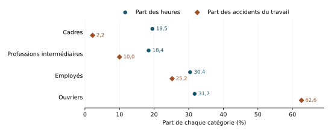
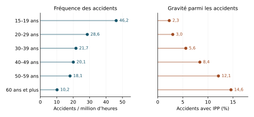

# Les accidenté.e.s du travail · Corrigé guidé

*Corrigé rédigé par IA, non officiel. Signalez toute erreur.*

**Rédaction** · GPT-6.2 Astra Ultra · vitesse non renseignée · 26 novembre 2026

ENS, filière B/L · Épreuve orale commune de sociologie, session 2025.

## Préparer le dossier en une heure trente

Consacrer un premier quart d’heure au titre, aux champs et à l’article de Lenoir. Relever deux propositions du texte susceptibles de modifier la lecture des tableaux, par exemple l’intérêt des entreprises à la déclaration et le rôle de la précarité. Pendant les trente minutes suivantes, construire une feuille à sept lignes, une par document. Inscrire à chaque ligne la population, le numérateur, le dénominateur, un résultat précis et une limite. Réserver ensuite vingt-cinq minutes à l’argumentation, dix minutes aux transitions et les dix dernières à une répétition de l’introduction et des passages chiffrés.

### Trois dénominateurs à écrire au brouillon

- **Part des ouvriers parmi les accidents du travail.** Diviser les accidents des ouvriers par tous les accidents du travail dans le même champ. Le résultat du document 3 est 62,6 %. Si les ouvriers représentent une grande part des heures, cette part doit aussi être prise en compte.
- **Fréquence chez les ouvriers.** Diviser les accidents avec arrêt des ouvriers par leurs heures rémunérées, puis multiplier par un million. On obtient 42,9 dans le document 3. Vérification mentale possible sans calculatrice. Les ouvriers représentent presque deux fois plus d’accidents que d’heures, et leur fréquence est proche du double de celle de l’ensemble, 21,8.
- **Proportion d’accidents graves chez les ouvriers.** Diviser leurs accidents avec IPP par leurs accidents avec arrêt et multiplier par cent pour lire le résultat en pourcentage. Les colonnes du document 3 affichent 5,1 % chez les ouvriers. L’encadré imprimé comporte un facteur « × 1 000 000 » sur la formule de cette proportion, incohérent avec l’unité du tableau. Pour le taux moyen d’incapacité, on fait la moyenne des taux individuels déjà exprimés en pourcentage. Le facteur par million a bien un sens pour les indicateurs calculés par heure, dont l’indice de gravité.

### Construire un exposé de quinze minutes

Prévoir une minute d’ouverture, trois minutes pour les unités des documents 1 et 2, six pour les comparaisons des documents 2 à 5, quatre pour la sous-traitance et la déclaration, puis une minute de conclusion. Le cas de la prime de sécurité donne un fil conducteur. L’incitation à prévenir l’accident peut devenir une pression à taire l’événement une fois celui-ci survenu. Revenir à ce mécanisme en conclusion permet de relier la situation vécue par l’accidenté aux séries présentées par la statistique publique.

## Introduction

Un ouvrier se blesse en accomplissant une tâche, s’arrête, puis reprend son poste. Que faudrait-il savoir pour le retrouver dans une statistique d’accidents du travail ? Il faudrait connaître le régime auquel il est affilié, savoir si l’événement a été déclaré et reconnu, et regarder ce que compte la série utilisée. Une même blessure importe au salarié qui éprouve des difficultés à travailler, au médecin qui les constate et à l’établissement dont les indicateurs de sécurité seront affectés. L’étude des accidentés commence par cette pluralité de points de vue.

Les six documents quantitatifs décrivent des accidents survenus dans des activités et des groupes sociaux différents, avec des champs et des dates distincts. Le texte de Rémi Lenoir invite à examiner ce qui rend ces événements visibles. Comment l’organisation du travail répartit-elle l’exposition aux accidents et les possibilités d’être reconnu comme accidenté ? Je partirai des règles de mesure, puis des divisions du travail qui exposent à des degrés divers. J’examinerai enfin comment les positions professionnelles interviennent jusque dans la déclaration et la réparation du dommage.

## I. De l’événement au risque mesuré

### Ce que l’on voit diminuer entre 2005 et 2016

Le document 1, attribué à l’Insee et à la Dares en 2021, suit les accidents avec arrêt reconnus au régime général en France hors Mayotte. En 2005, on en compte 697 960. Pour un million d’heures rémunérées, la fréquence s’établit à 24,7. En 2016, le premier indicateur se lit autour de 624 000 sur l’axe de gauche, le second autour de 20,6 sur celui de droite. Les deux courbes baissent sur la période, avec notamment un rebond vers 2011. Il serait trompeur de lire leur croisement comme une égalité, puisque l’unité change d’un axe à l’autre.

Pourquoi compter les heures ? Si un établissement travaille davantage dans l’année, il peut enregistrer plus d’accidents à fréquence constante. Rapporter les accidents aux heures rend les expositions plus comparables. Cette correction laisse cependant ouverte la question du travail fait pendant ces heures. Un déplacement sur chantier, la manutention d’une personne et une réunion n’engagent pas le corps de la même manière. La baisse moyenne est compatible avec l’amélioration de la prévention, un déplacement de l’emploi entre secteurs ou des changements dans les déclarations. La série agrégée ne permet pas de chiffrer leurs contributions respectives.

### Être exposé, subir un arrêt, conserver des séquelles

Il faut ensuite demander quelle conséquence on mesure. Dans le document 2 de la Dares, en 2019, le champ comprend des salariés du régime général ou agricole et des agents des fonctions publiques territoriale et hospitalière, en France hors Mayotte. Le tableau totalise 783 617 accidents avec arrêt, soit 20,4 par million d’heures. Parmi eux, 39 653 entraînent une incapacité partielle permanente (IPP), soit 5,1 pour cent accidents avec arrêt. Une IPP désigne une réduction durable de capacité évaluée médicalement. Un arrêt temporaire, même long, mesure une autre dimension. L’élargissement du champ empêche de raccorder directement le total de 2019 à la série du document 1.

La construction illustre ces distinctions. Ses 82 293 accidents avec arrêt représentent 33 accidents par million d’heures. Un accident avec arrêt entraîne en moyenne 73,8 jours d’arrêt. On dénombre aussi 164 accidents mortels, soit 65,8 par **milliard** d’heures. Un même secteur peut donc être décrit du point de vue du nombre de salariés ou d’équipes confrontés à l’événement, du temps de travail perdu et de la gravité des atteintes. Plus exactement, le tableau dénombre des événements. Une personne qui connaîtrait deux accidents pourrait y contribuer deux fois.

## II. Les risques suivent la division du travail

### Des tâches et des collectifs inégalement exposés

Le document 2 permet de préciser où les accidents se concentrent. L’intérim atteint 39,3 accidents avec arrêt par million d’heures, contre 18,5 dans les services hors intérim. La catégorie « services » mérite d’être ouverte. L’hébergement médico-social et social et l’action sociale sans hébergement atteignent ensemble 39,0, contre 21,1 dans l’administration publique figurant au tableau. L’assistance à une personne dépendante peut nécessiter de soulever, d’installer et de se coordonner avec un collègue dans un temps limité. C’est une hypothèse sur l’activité réelle que des observations de poste permettraient d’éprouver. Une étiquette sectorielle seule ne décrit ni ce geste ni les moyens disponibles pour l’accomplir.

Le classement change avec l’indicateur. En agriculture, sylviculture et pêche, 12,5 % des accidents avec arrêt entraînent une IPP, contre 5,0 % dans l’intérim, où la fréquence des accidents avec arrêt est pourtant supérieure. Dire quel secteur est « le plus dangereux » exige donc de préciser la conséquence étudiée. Le statut d’intérimaire soulève également la question de l’expérience du lieu et de l’accès aux consignes informelles. Pour tester cette explication, il faudrait comparer des personnes affectées à des tâches proches, en tenant compte du temps passé au poste et des équipements.

### Ce que révèlent la profession, le sexe et le trajet

Dans le document 3 de la Dares, en 2012, les ouvriers du régime général représentent 31,7 % des heures travaillées mais 62,6 % des accidents du travail et 66,0 % des accidents du travail mortels. Leur fréquence atteint 42,9 par million d’heures contre 2,5 pour les cadres, soit environ dix-sept fois plus. La comparaison des heures élimine une explication par la seule taille de ces catégories. Elle laisse entière la question de l’affectation aux postes, à la manutention ou à l’entretien des installations. Les cadres victimes d’un accident ont aussi des atteintes durables. Dans leur groupe, 7,0 % des accidents du travail sont graves, contre 5,1 % chez les ouvriers. Une proportion parmi les accidentés répond à une question différente de la fréquence dans l’ensemble des heures exposées.

Le trajet entre domicile et travail dessine une autre distribution. Les employés représentent 25,2 % des accidents du travail mais 39,4 % des accidents de trajet. Les ouvriers en représentent respectivement 62,6 % et 38,9 %. Les durées de déplacement, modes de transport et horaires seraient nécessaires pour étudier l’exposition sur le trajet. Les heures rémunérées ne fournissent pas ce dénominateur. Dans le document 4, sur le champ élargi aux salariés du régime agricole, les hommes représentent 58,9 % des heures, 68,2 % des accidents du travail et 92,2 % des accidents du travail mortels. Leur fréquence est de 25,4 contre 17,0 par million d’heures pour les femmes. Celles-ci représentent pourtant 51,8 % des accidents de trajet tandis que les hommes représentent 83,4 % des accidents de trajet mortels. Part des victimes et gravité dessinent ainsi des distributions différentes. Ces données par sexe invitent à étudier la répartition des métiers, des tâches et des déplacements. Une propension individuelle à prendre des risques n’y est jamais observée.

### La fréquence et les séquelles au cours de la vie professionnelle

Le document 5 porte lui aussi sur les salariés des régimes général et agricole en 2012. De 15 à 19 ans, la fréquence atteint 46,2 accidents du travail par million d’heures et 2,3 % de ces accidents sont graves. À partir de 60 ans, les valeurs sont respectivement de 10,2 et de 14,6 %. Les 20–29 ans représentent 27,8 % des accidents pour 21,3 % des heures. L’exposition des jeunes travailleurs mérite donc qu’on examine l’entrée dans le métier, la formation, les contrats courts et la possibilité de demander de l’aide. Chez les plus âgés, les arrêts reconnus entraînent plus souvent des séquelles permanentes. La proportion d’accidents de trajet graves passe elle aussi de 4,5 % chez les 15–19 ans à 17,8 % à partir de 60 ans.

On compare ici plusieurs groupes à une même date. On ne suit pas le vieillissement des mêmes travailleurs. Des personnes très exposées peuvent avoir quitté l’emploi avant 60 ans, d’autres avoir changé de poste. Un suivi des trajectoires professionnelles permettrait de distinguer ces effets de sélection, l’expérience acquise et l’histoire des atteintes à la santé.

## III. Les rapports entre entreprises et entre salariés pèsent sur la visibilité des accidents

### Le cas des établissements sous-traitants

Le document 6 de la Dares rapproche, pour 2018–2019, la dépendance vis-à-vis des donneurs d’ordres et les accidents avec arrêt reconnus par la Caisse nationale d’assurance maladie. Le champ se limite aux établissements privés à majorité d’ouvriers ou d’employés, en France métropolitaine, hors agriculture. Le numérateur est le nombre annuel moyen d’accidents et le dénominateur l’effectif salarié moyen en équivalents temps plein. Le point de lecture imprimé est de 2,9 accidents pour 100 équivalents temps plein chez les établissements sans donneur d’ordres. Les points suivants se lisent approximativement à 3,8–3,9 pour une part sous-traitée inférieure à 10 % du chiffre d’affaires, 5,2 entre 10 % et 49 %, puis 3,9 à partir de 50 %.

Un client peut fixer un délai tout en laissant l’organisation quotidienne et la responsabilité de la sécurité à une autre entreprise. Les temps de coordination, la spécialisation des tâches et les moyens de négocier un délai deviennent alors des objets d’enquête. Le maximum observé se situe dans la classe intermédiaire. Une relation de proportionnalité entre dépendance et accidents contredirait la forme du graphique. Les secteurs et les tailles d’établissements pourraient aussi varier d’une classe à l’autre. Des observations comparées de chantiers et des informations sur les contrats aideraient à identifier les mécanismes en jeu.

### Qui peut faire reconnaître une atteinte comme professionnelle ?

Dans le document 7 publié en 1980, Rémi Lenoir interroge la frontière même de l’accident du travail. Le trajet domicile-travail, une interruption du travail ou l’exercice d’un mandat syndical mettent en jeu des définitions concurrentes de ce qui relève de l’activité professionnelle. La qualification ouvre des droits pour la victime et peut peser sur les cotisations de l’entreprise. Les exemples de taux de cotisation cités dans l’article appartiennent à son contexte historique. L’enjeu sociologique porte sur les intérêts divergents attachés à la qualification du fait.

Lenoir précise comment ces intérêts interviennent. Un salarié précaire peut craindre les conséquences d’une déclaration sur son emploi ou sa rémunération. La menace peut aussi transiter par les collègues si leur prime de sécurité dépend du nombre d’accidents déclarés. Faire reconnaître l’origine professionnelle d’une atteinte suppose encore de pouvoir relier celle-ci aux conditions de travail et de faire entendre cette interprétation. Médecins, syndicats, inspecteurs et juristes offrent des appuis différents à cette démarche. C’est au terme d’une histoire collective que l’accident a pu être envisagé comme l’effet d’un système de travail et donner lieu à réparation.

Cette lecture change la question posée aux chiffres du dossier. Une fréquence faible peut résulter de tâches effectivement moins exposées, d’une prévention efficace, mais aussi d’obstacles à la déclaration. L’article établit des mécanismes possibles et leur histoire. Il ne fournit pas une mesure contemporaine des événements manquants. Pour la construire, on pourrait rapprocher, dans un même champ, un questionnaire confidentiel sur les événements de travail, les arrêts déclarés et les dossiers reconnus, puis enquêter auprès de salariés dont les récits ne se retrouvent pas dans les dossiers.

## Conclusion

Les accidentés du travail forment une population dont les contours dépendent de la division des tâches et des conditions de reconnaissance. La fréquence élevée chez les ouvriers et les jeunes, la gravité conditionnelle plus élevée chez les plus âgés et le profil particulier des accidents de trajet montrent ce que gagne l’analyse à changer de dénominateur. Le texte de Lenoir rappelle enfin qu’une personne blessée doit pouvoir nommer, déclarer et faire reconnaître ce qui lui est arrivé. Comprendre les inégalités face à l’accident exige de suivre cette personne depuis le poste de travail jusqu’aux institutions chargées de la réparation.

## S’entraîner à l’entretien

### « Y a-t-il 62,6 accidents pour cent ouvriers ? »

Changer l’ordre de la phrase change le dénominateur. Parmi cent accidents du travail enregistrés dans le champ du document 3 en 2012, environ 63 concernent des ouvriers. Pour passer à la proportion d’ouvriers ayant connu au moins un accident, il faudrait un effectif d’ouvriers et un compte de personnes distinctes. On dispose ici d’une fréquence par heure.

### « Comment concilier plus d’accidents chez les jeunes et davantage d’accidents graves chez les plus âgés ? »

Au même volume d’heures, les jeunes enregistrent davantage d’accidents. Une fois l’accident survenu, la part des cas avec IPP est plus élevée chez les plus âgés. Le document 5 donne aussi un indice de gravité qui combine fréquence, proportion de cas graves et taux moyen d’IPP de ces cas. Il atteint 23,8 chez les 50–59 ans puis 16,4 à partir de 60 ans. La part des cas graves, prise seule, continue de monter.

### « Les accidents mortels ont-ils la même distribution au travail et sur le trajet ? »

Dans le document 4, les hommes représentent 92,2 % des accidents du travail mortels et 83,4 % des accidents de trajet mortels. Chacune de ces parts porte sur l’ensemble des accidents mortels du type considéré. Elles ne donnent pas la probabilité de mourir parmi les hommes accidentés. Les heures ou kilomètres réellement passés en déplacement par mode de transport affineraient l’analyse des trajets.

### « Le recours à la sous-traitance double-t-il le risque individuel ? »

Le document 6 situe le groupe intermédiaire vers 5,2 accidents par an pour cent équivalents temps plein, contre 2,9 en l’absence de donneur d’ordres. La courbe redescend ensuite. L’unité d’analyse est l’établissement, la variable horizontale est la part de son chiffre d’affaires comme preneur d’ordres et les groupes peuvent effectuer des travaux différents. Des établissements comparables suivis avant et après un changement de contrat seraient plus instructifs sur un effet propre de la sous-traitance.

### « Le document 7 rend-il les données administratives inutilisables ? »

Les comptes reconnus renseignent sur les événements qui ouvrent effectivement des droits. Cette information est précieuse pour une sociologie de la réparation. Leur confrontation à d’autres sources permettrait aussi d’étudier ce qui échappe à la reconnaissance. Dans des entretiens, demander qui était présent, qui a qualifié l’événement, qui a rempli les papiers et quel interlocuteur le salarié a pu solliciter permet de reconstruire la séquence.

### « Une entreprise pourrait-elle voir ses indicateurs empirer après avoir amélioré son dispositif de remontée des accidents ? »

Oui, si davantage d’événements auparavant tus sont déclarés. C’est une hypothèse compatible avec le mécanisme décrit par Lenoir. Pour la vérifier, comparer les dates du changement de procédure, les récits des salariés, les déclarations et les types de blessures. Il faudrait aussi examiner si le nombre d’heures, les tâches ou la composition des équipes ont changé dans le même temps.

## Sources

Le fascicule officiel de 32 pages ouvre sur ce dossier, dont la garde et les sept documents occupent les pages 1 à 8. Les références Insee, Dares et Rémi Lenoir ainsi que les champs des tableaux figurent sur les pages reproduites par le jury. [Dossier de l’ENS](<https://www.ens.psl.eu/sites/default/files/sujets_socio_17_juin.pdf#page=1>)

Le rapport de Laure Flandrin et Benjamin Lemoine présente les conditions de l’oral commun et les attentes de lecture aux pages 1 à 4. Son répertoire final nomme le dossier. [Rapport du jury](<https://www.ens.psl.eu/sites/default/files/2025_bl_rapport_oral_sociologie_tronc_commun.pdf>)
