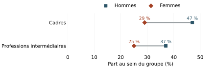
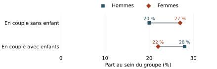

# BEL B/L · Épreuve orale commune de sociologie 2025 · Confinés et confinées · Corrigé brut

*Corrigé rédigé par IA, non officiel. Signalez toute erreur.*

**Rédaction** · GPT-6.2 Astra Ultra · vitesse non renseignée · 26 novembre 2026

## Introduction

Au neuvième jour du confinement du printemps 2020, Delphine peine à faire suivre à ses enfants les devoirs envoyés par le collège. Elle transforme le jardin en terrain de conversation anglaise et leur lit du théâtre. Que faut-il pour pouvoir répondre ainsi à une fermeture d’école ? Une résidence avec jardin, des savoirs que l’on peut transmettre et du temps. Il faut aussi que quelqu’un prenne en charge cette transmission. Chez Delphine, cette personne est une mère dont le tournage a été interrompu, tandis que son conjoint travaille toujours à plein temps.

Comment une même restriction des déplacements redistribue-t-elle le travail, les espaces et la possibilité de voir autrui selon le milieu social, le sexe et la composition du foyer ? L’enquête EpiCov permet d’examiner les situations professionnelles et le travail domestique aux deux confinements de 2020. L’enquête Coconel décrit les conditions de logement, les sorties et le sentiment de solitude en France métropolitaine. Le journal étudié par Élie Guéraut donne accès aux pratiques et aux interprétations d’une enquêtée. On examinera d’abord les ressources qui rendent possible le repli à domicile, puis leur répartition à l’intérieur du foyer, enfin les relations que la vie confinée permet de maintenir ou fait perdre.

## I. Le travail et le logement donnent des sens différents à la consigne de rester chez soi

Avant le confinement, le travail sur site concerne la majorité des femmes et des hommes de 20 à 65 ans du document 1. En mai 2020, 33,5 % des hommes et 25,3 % des femmes sont classés dans cette situation au cours des sept derniers jours, soit 8,2 points d’écart. La figure distingue le travail exclusivement sur site de l’alternance entre site et télétravail. On lit l’épaisseur de chaque segment du diagramme. Une autre partie des personnes télétravaille entièrement, connaît le chômage technique ou est inactive. La part du travail sur site remonte en novembre pour les deux sexes, pendant que le chômage technique occupe une place moindre. La modalité « congés » n’était pas proposée avant le confinement. Ces comparaisons portent sur tous les 20–65 ans interrogés et ne décrivent pas la trajectoire de chaque personne. Le recul du travail sur site peut signifier aussi bien l’installation d’un bureau au domicile que l’interruption d’un emploi.

Où se trouve ce domicile, et qui doit en partager l’espace ? Le document 2 rapporte la surface disponible au nombre de personnes qui occupent le logement. On lit 53 m² par personne dans les ménages à dominante cadre et 34 dans ceux à dominante ouvrière, soit 19 m² d’écart. Le tableau affiche 60 m² pour la catégorie distincte « composé d’un employé ou ouvrier ». Confondre cette ligne avec les ménages à dominante ouvrière effacerait le rôle possible de la composition du ménage. On relève aussi 41 m² dans l’agglomération parisienne contre 53 dans les espaces ruraux, et 36 m² chez les 18–24 ans contre 67 chez les 75 ans ou plus. Âge, taille du ménage et marché local du logement peuvent se combiner. Ces lignes séparées ne permettent pas d’estimer leur effet propre.

Le document 7 éclaire ce que recouvre un choix de lieu. Delphine et Christophe disposent d’un appartement parisien de 130 m² et d’une maison de campagne dont les emprunts sont remboursés. Delphine, intermittente du spectacle, conserve 70 % de son salaire brut au chômage partiel grâce à un contrat déjà signé. Christophe, cadre en CDI, continue de percevoir un revenu d’activité. La présence d’un jardin résulte ici d’une mobilité résidentielle permise par le patrimoine. Elle s’accompagne d’une asymétrie professionnelle entre les conjoints. Même lorsque le foyer dispose de place, reste à savoir qui peut s’y isoler et à quelles fins.

## II. Au sein du domicile, le temps de travail et la possibilité de s’isoler restent inégalement répartis

Le document 3 resserre la comparaison sur les cadres et professions intermédiaires en télétravail pendant la huitième semaine du confinement. Parmi les cadres, 47 % des hommes disposent d’une pièce dédiée au travail où ils peuvent s’isoler, contre 29 % des femmes. Chez les professions intermédiaires, les proportions sont de 37 % et de 25 %. La position de cadre s’accompagne donc d’un accès plus fréquent au bureau dédié pour les deux sexes, avec un écart de 18 points entre femmes et hommes cadres. Même les hommes des professions intermédiaires sont plus souvent dans cette situation que les femmes cadres. En sens inverse, 37 % des femmes cadres travaillent dans une pièce partagée, contre 22 % des hommes cadres. Une surface généreuse par personne et la maîtrise d’une pièce pendant les heures de travail mesurent deux choses distinctes.

Le document 4 permet d’examiner ce qu’implique la présence au domicile pour l’organisation du temps. Les points représentent les durées de travail domestique selon le niveau de vie, le diplôme et le groupe professionnel. Au premier décile de niveau de vie, en mai, on lit environ 2,8 heures pour les femmes et 1,9 heure pour les hommes. Au dernier décile, les points sont voisins de 2,5 et de 1,5 heure. L’écart de sexe apparaît également à niveau de diplôme ou groupe professionnel comparable, dans ces tris effectués séparément. Le profil selon le diplôme n’est pas uniformément décroissant. Entre mai et novembre, les points descendent dans les deux groupes de sexe et l’écart persiste. Les barres d’incertitude invitent à limiter la précision des comparaisons entre catégories voisines. Les écarts entre moyennes de groupes ne donnent pas le partage exact dans un même couple.

La scène du collège en ligne rend concrète la division du travail. Delphine assure la continuité de la scolarité, trouve les supports et sollicite ses enfants. Ses pratiques de lecture et sa familiarité avec les arts constituent un capital culturel qu’elle peut transmettre. Le temps ainsi occupé peut lui procurer du plaisir tout en exigeant une initiative et une disponibilité que son conjoint, encore au travail, mobilise ailleurs. Le journal montre à qui échoit cette activité dans cette famille. Il ne fournit ni relevé horaire des tâches ni point de vue du conjoint. Ce que l’on peut faire de son temps dépend aussi de la possibilité de franchir la porte du domicile.

## III. Sortir et se sentir entouré répondent à des logiques distinctes

Dans le document 6, le tableau 6a répartit les personnes en couple selon le nombre de sorties. Avec enfants, 54 % des femmes n’en déclarent aucune contre 37 % des hommes, soit 17 points d’écart. Sans enfant, les proportions sont de 54 % et 42 %, soit 12 points. Dans les limites des arrondis, le premier écart s’accroît parce que la proportion des hommes restés chez eux est plus faible en présence d’enfants, celle des femmes se situant à 54 % dans les deux groupes. Le tableau 6b ventile les motifs. Avec enfants, le travail est mentionné à hauteur de 38 % chez les hommes et de 30 % chez les femmes, le sport à hauteur de 13 % et de 5 %. Sans enfant, les chiffres correspondants pour le sport sont de 11 % et de 9 %. Les lignes peuvent dépasser 100 % quand on additionne les motifs. Une même personne peut en déclarer plusieurs. La page ne précise pas le dénominateur particulier du tableau des motifs. Les deux tableaux ne donnent donc pas directement la part de tous les parents sortis pour un motif donné. Le détail de la catégorie « autre motif » manque pour identifier les sorties de ravitaillement ou de soin.

Le document 5 distingue la solitude ancienne de celle ressentie comme nouvelle. Parmi les hommes en couple, 28 % avec enfants et 20 % sans enfant déclarent un sentiment nouveau. Chez les femmes en couple, les valeurs sont de 22 % avec enfants et de 27 % sans enfant. Le sens de l’écart entre sexes s’inverse selon la présence d’enfants. Pour l’ensemble des couples, la part signalant un sentiment nouveau atteint 24 % et 12 % disent que ce sentiment est ancien. Vivre avec quelqu’un n’épuise donc pas la question de l’isolement. Dans le groupe des hommes en couple avec enfants, les sorties sont plus fréquentes que chez les femmes en couple avec enfants, et la solitude nouvelle est également plus fréquente. Ces tableaux séparés ne permettent pas de dire comment se sentent les hommes qui sont effectivement sortis.

Le journal donne une dimension temporelle à ce rapprochement. Au jour 37, la pousse des petits pois procure à Delphine de l’émerveillement. D’autres passages disent le manque de son métier, des activités partagées et de la liberté d’aller d’un lieu à l’autre. Elle connaît peu de voisins. L’épisode du tracteur, raconté au jour 16, livre son interprétation d’une rencontre avec un agriculteur et la conscience d’être perçue comme « une Parisienne ». Le texte ne recueille pas le témoignage de cet agriculteur. Un jardin accessible et une famille présente peuvent ainsi coexister avec la perte des scènes de sociabilité auxquelles Delphine est attachée. L’écriture publique d’un journal presque quotidien est elle-même une pratique socialement située. Une telle source éclaire la coexistence de ces expériences sans en mesurer la fréquence.

## Conclusion

La même consigne rencontre des métiers inégalement exerçables à distance, des logements plus ou moins spacieux et des droits d’usage différents au sein de ces logements. La continuité de l’emploi de l’un peut s’accompagner de la prise en charge par l’autre de tâches scolaires et domestiques. Les écarts de sorties et de solitude montrent enfin que la coprésence familiale suffit mal à remplacer le travail ou les sociabilités perdues. Pour déterminer comment ces mécanismes s’articulent dans les mêmes foyers, il serait possible de croiser emplois du temps, occupation des pièces et entretiens répétés avec chacun des conjoints lors des deux périodes.
