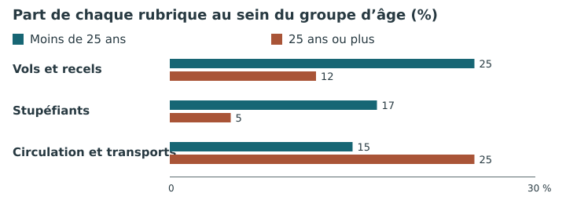
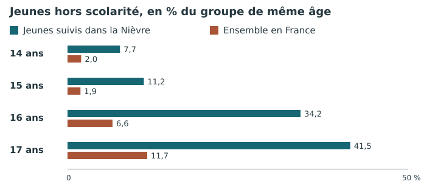

# BEL B/L — La délinquance juvénile · Corrigé guidé

*Corrigé rédigé par IA, non officiel.*

**Rédaction** · GPT-6.2 Astra Ultra · vitesse non renseignée

Épreuve orale commune de sociologie, session 2025. Le jury donne un dossier unique à commenter. La préparation dure 1 h 30, puis le jury prévoit quinze minutes d’exposé et quinze minutes d’échange. Les questions de discussion sont proposées pour l’entraînement.

## Introduction

> [!INDICATION]
> Sur le brouillon, distinguer le champ de chaque source, son année et son unité. Rapprocher ensuite les documents qui permettent une comparaison. Pour quinze minutes d’exposé, prévoir environ deux minutes pour introduire le problème, quatre minutes par partie et une minute pour répondre à la question de départ.

En France, en 2014, le nombre d’hommes de 21 ans impliqués dans une affaire pénale traitée par un parquet représente 13,4 % des hommes de cet âge. En 2015, pour 1 000 jeunes de 10 à 25 ans, les services de sécurité enregistrent 6,8 victimes de violences physiques dans cette tranche d’âge. Dans la première mesure, les jeunes entrent dans la statistique comme auteurs présumés, dans la seconde comme victimes. Les années, les âges, les unités et les institutions diffèrent. Pourtant les deux observations concernent la place de la jeunesse dans le monde pénal. Laquelle retient-on quand on parle de « délinquance juvénile » ?

La délinquance suppose une règle de droit qui qualifie certains actes d’infractions. La déviance, au sens sociologique, suppose des normes et des réactions à leur transgression. Des conduites réprouvées dans une classe ou un groupe d’amis peuvent rester étrangères au droit pénal. Quant à la jeunesse, elle a plusieurs frontières dans ce dossier. La majorité à 18 ans compte pour la réponse judiciaire, tandis que les statistiques du parquet permettent aussi d’étudier des jeunes adultes. Comment les pratiques, leur visibilité et le regard des institutions se combinent-ils pour donner à la délinquance enregistrée son profil d’âge, de sexe et de milieu social ? Je partirai de la composition des affaires, puis de leur traitement et des jeunes pris en charge, avant de revenir à l’expérience des jeunes, auteurs ou victimes.

## I. Ce qui parvient au parquet change avec l’âge et le sexe

> [!INDICATION]
> Sur la ligne « Vol et recel » du document 2b, donner chaque pourcentage dans une phrase en commençant par « Parmi… ». Si les trois phrases commencent de la même manière, retrouver la colonne où le dénominateur a changé. Pour le graphique 2a, choisir deux courbes dont les pics sont éloignés.

Dans le document 1, la courbe masculine monte rapidement pendant l’adolescence. En 2014, elle culmine autour de 19 ans, à près de 15 %, puis redescend jusqu’à 24 ans. La courbe féminine approche 2 % vers 15 ans et reste proche de ce niveau. L’écart varie donc lui-même avec l’âge. L’ordonnée rapporte les auteurs présumés dont l’affaire a été traitée au parquet à la population du même âge et du même sexe. Cette coupe montre différents groupes en 2014. Pour établir quand des individus commencent ou cessent un type de conduite, il faudrait pouvoir les suivre dans le temps.

Quels faits composent la courbe ? Le document 2a compte des personnes par âge et par type d’infraction. Les vols et recels atteignent leur plus fort effectif vers 16 ans. La courbe des infractions relatives à la circulation routière et aux transports s’élève surtout autour de l’entrée dans la vie adulte. Participer davantage à la circulation motorisée peut accroître les occasions de commettre une infraction routière. Il faudrait rapporter les cas au nombre de conducteurs ou aux distances parcourues pour éprouver cette explication. Le graphique permet de repérer les calendriers spécifiques de plusieurs catégories. La comparaison des effectifs dépend aussi de la taille des groupes d’âge.

Le tableau 2b permet deux lectures des mêmes faits. Parmi les auteurs présumés de moins de 25 ans, 25 % relèvent de la catégorie des vols et recels, contre 12 % chez les 25 ans ou plus. Les infractions à la circulation et aux transports occupent au contraire une place plus grande chez les seconds. La dernière colonne change de population de référence. Les moins de 25 ans représentent 55 % de l’ensemble des auteurs présumés de vols et recels, contre 36 % des personnes du tableau toutes catégories réunies. Le premier calcul décrivait de quelles affaires les jeunes répondaient. Le second établit leur place dans une catégorie d’affaires.

Rapportée à la population, la présence devant la justice peut varier parce que les pratiques diffèrent, mais aussi parce que certains faits sont davantage signalés, observés ou transmis au parquet. Les routines de déplacement, les lieux fréquentés et les attentes différentes envers filles et garçons fournissent des hypothèses à examiner. On pourrait confronter les statistiques à des enquêtes anonymes où les jeunes décrivent eux-mêmes leurs pratiques et à des observations du travail institutionnel. Le dossier donne déjà accès à une autre étape, celle du jugement.

## II. Le traitement judiciaire délimite une population socialement située

> [!INDICATION]
> Tracer quatre colonnes au brouillon pour la population générale, les personnes présumées au parquet, celles qui sont condamnées et les jeunes suivis localement. Y placer les documents correspondants. Avant de lire le document 5, vérifier que les deux dernières cases d’une même colonne totalisent 100 % et relever l’effectif local.

Dans le document 3, chaque colonne totalise 100 % des peines représentées pour les personnes condamnées de l’âge indiqué. Les mesures éducatives occupent une grande partie des colonnes des plus jeunes. À 17 ans elles ont encore une place importante. Dès 18 ans, la part des amendes augmente nettement et la prison ferme représente environ un cinquième de la colonne. Ce changement coïncide avec la frontière juridique de la majorité. Les données provisoires du casier judiciaire se rapportent aux condamnations de 2014, tandis que les documents précédents portent sur les affaires traitées au parquet. On ignore quelles personnes passent du premier fichier au second. L’infraction, sa gravité et les antécédents peuvent aussi différer entre âges. Pour comparer les réponses judiciaires à situations comparables, il faudrait disposer de ces éléments pour chaque affaire.

Qui rencontre-t-on dans une unité éducative de milieu ouvert de la protection judiciaire de la jeunesse ? Guillaume Teillet décrit 509 jeunes suivis dans la Nièvre (document 4). Pour 28,7 % des jeunes, le père est enregistré comme ouvrier, pour 2,6 % comme cadre ou membre d’une profession intellectuelle. Pour 22,6 %, sa profession reste sans renseignement. Ces proportions donnent la composition d’un public pris en charge à un stade particulier. Pour estimer les chances de suivi selon l’origine sociale, il faudrait connaître dans le même territoire les effectifs de jeunes de chaque milieu, puis les comparer à chaque étape judiciaire. Deux sélections pourraient se cumuler si, à pratique comparable, les probabilités d’être repéré puis orienté vers cette prise en charge varient avec les ressources familiales. Les tableaux permettent de poser cette hypothèse.

Le document donne même un indice sur la fabrication des données. Dans les dossiers de jeunes vivant avec leurs deux parents, 11,2 % des professions des pères sont sans renseignement, contre 28,9 % lorsque le jeune habite avec sa mère seule. Les pères décédés ou inconnus constituent encore une catégorie distincte. Une enquête sur dossiers dépend de l’information que l’institution peut recueillir. Attribuer le contraste de composition professionnelle à la configuration familiale seule reviendrait à négliger cette différence de mesure. Aucune des deux colonnes ne donne la fréquence des poursuites dans l’ensemble des jeunes élevés de cette façon.

Le document 5 fournit pour la scolarité une comparaison par âge avec la France en 2012-2013. À 15 ans, 52,5 % des jeunes suivis de l’enquête sont en troisième, préapprentissage compris, contre 23,8 % en France. En seconde générale et technologique, ces proportions sont de 5,0 % et 50,7 %. Les écarts portent donc déjà sur les positions dans le cursus. À 17 ans, parmi les 111 jeunes suivis de cet âge, 41,5 % sont hors scolarité, contre 11,7 % au niveau national. L’écart est de 29,8 points. Les groupes locaux à 14 et à 17 ans sont différents. Le graphique ne permet pas d’attribuer à un même jeune un décrochage intervenu entre ces âges.

Le contrôle de l’âge affine la comparaison. Il reste à comparer le territoire, les conditions matérielles et les trajectoires antérieures. Des difficultés scolaires peuvent précéder un suivi judiciaire, y être aggravées ou avoir en partie les mêmes causes que l’entrée dans le dispositif. Des dossiers datés et des entretiens permettraient de reconstituer l’ordre des événements. Ils permettraient aussi de comprendre ce que les classifications institutionnelles laissent de côté.

## III. Les expériences débordent les catégories pénales

> [!INDICATION]
> Pour préparer le passage du document 7 au document 6, relever successivement ce que l’observation d’un groupe apporte à la catégorie de « vol » et la place de la victime dans le fichier de police. Convertir ensuite les valeurs de la note de lecture du pour mille au pourcentage avant de les énoncer.

Dans « Les loubards » (1983), Gérard Mauger et Claude Poliak étudient comment certains jeunes de milieu populaire donnent sens à leurs conduites (document 7). Les auteurs invitent à examiner à la fois les pratiques et l’inégale intensité du contrôle. La qualification juridique de vol réunit ainsi des actes dont l’enjeu varie. Le regard du groupe et la reconnaissance entre pairs peuvent donner de la valeur à un défi. Dans d’autres récits, obtenir un bien ordinaire compte pour se déplacer et mener la vie attendue d’un jeune de son milieu. La catégorie « vol et recel » du document 2b, commode pour dénombrer les affaires, agrège des situations dont les cadres de socialisation et les significations restent à enquêter. Cette étude située n’autorise aucune généralisation à tous les jeunes ouvriers. Les chiffres de 1971 que cite l’extrait servent à discuter les représentations de l’époque. Les comparer directement au tableau de 2014 supposerait au moins des champs et des nomenclatures harmonisés.

Changeons aussi le rôle sous lequel les jeunes entrent dans la statistique. Le document 6 retient les personnes enregistrées comme victimes en 2015 par la police et la gendarmerie, en France et dans les collectivités d’outre-mer. Pour les violences physiques, 6,8 victimes pour 1 000 habitants de 10 à 25 ans, soit 0,68 %, placent cette tranche au-dessus des plus de 25 ans. Pour les vols sans violence, on lit environ 21 pour 1 000 chez les 10 à 25 ans, contre environ 25 pour 1 000 chez les plus âgés. L’ordre des âges dépend du préjudice observé. L’exposition dans les lieux de vie ou de déplacement et la propension à déposer plainte peuvent chacune faire varier le taux. Une enquête de victimation demanderait aux personnes de déclarer les faits subis et pourrait les interroger sur un éventuel signalement.

Peut-on dire que les victimes jeunes sont les victimes des auteurs jeunes du premier graphique ? Les chiffres de 2014 et de 2015 ne relient aucun auteur à aucune victime. Les classes d’âge diffèrent elles aussi, notamment à la borne de 25 ans. L’intérêt du rapprochement est sociologique. Selon la place qu’on leur reconnaît dans une affaire, les jeunes peuvent faire l’objet d’un contrôle, d’un soutien éducatif ou d’une protection. Une enquête sur leurs relations avec les institutions a besoin de ces différents points d’observation.

## Conclusion

> [!INDICATION]
> Revenir à deux résultats chiffrés qui écartent une explication par l’âge seul. Pour finir, choisir une comparaison réalisable en précisant le territoire, l’âge, l’ordre chronologique et le type de données qu’il faudrait recueillir.

La courbe d’âge résulte de pratiques dont la composition change, de leur visibilité et des décisions successives par lesquelles une institution enregistre une personne et traite son cas. Les documents mesurent précisément certaines de ces différences. Ils invitent aussi à réintroduire dans l’analyse les trajectoires scolaires et familiales, la signification des actes et les situations dans lesquelles des jeunes sont eux-mêmes victimes. Pour prolonger l’enquête, on pourrait comparer localement des jeunes du même âge et du même milieu scolaire, documenter leurs expériences par entretien et suivre les étapes judiciaires des affaires enregistrées. On saurait alors mieux à quel moment se creusent les écarts observés dans l’unité éducative.

## Discussion avec le jury

> [!INDICATION]
> À l’entretien, prendre quelques secondes pour annoncer le champ et le dénominateur, puis répondre à la question. S’entraîner à retrouver 113 à partir des effectifs du document 4 et 29,8 à partir des deux colonnes « 17 ans » du document 5 avant de consulter les réponses.

**Comment vérifier la différence entre 25 % et 55 % dans le document 2b ?** Les 25 % s’appliquent aux 629 764 personnes de moins de 25 ans, les 12 % aux 1 097 696 de 25 ans ou plus. Cela représente environ 157 000 et 132 000 auteurs présumés dans la rubrique des vols et recels. La fraction du premier groupe dans leur somme avoisine 54 à 55 %. Les deux pourcentages de départ étant arrondis, on revient à la dernière colonne du tableau pour donner le chiffre publié de 55 %.

**Les jeunes des deux types de foyers du document 4 sont-ils les 509 jeunes suivis ?** Les 223 jeunes vivant avec leurs deux parents et les 173 vivant avec leur mère seule représentent 396 jeunes. Les 113 autres correspondent à d’autres configurations, dont le placement en foyer et la garde par le père seul. Assimiler ces deux groupes à l’ensemble effacerait ces situations.

**Comment lire la dernière ligne du document 5 malgré la mention « en % de ligne » du titre ?** À âge fixé, le tableau juxtapose deux populations. À 17 ans, la colonne « population enquêtée » donne 58,5 % de scolarisés et 41,5 % de non-scolarisés, qui totalisent 100 %. Le dénominateur est donc l’ensemble des 111 enquêtés de 17 ans. Répartir les non-scolarisés entre les deux colonnes répondrait à une autre question.

**Quelle observation permettrait de départager les hypothèses sur la visibilité des pratiques ?** Pour une catégorie précisément définie, on peut demander à un échantillon de jeunes de rapporter anonymement leurs conduites sur une période donnée et le comparer à des données institutionnelles de même âge et de même territoire. Les réponses dépendent aussi de la mémoire et de la confiance accordée à l’enquête. Des observations du traitement des affaires aideraient à comprendre les écarts persistants.

**Comment interpréter une absence de plainte dans une enquête de victimation ?** Un fait peut être rapporté à un enquêteur tout en restant inconnu des services de sécurité. Il faudrait demander ce que la personne a vécu, à qui elle en a parlé et quelle suite elle souhaitait. Les données du document 6 ne donnent ni l’ensemble de ces expériences ni les raisons d’un éventuel silence.
