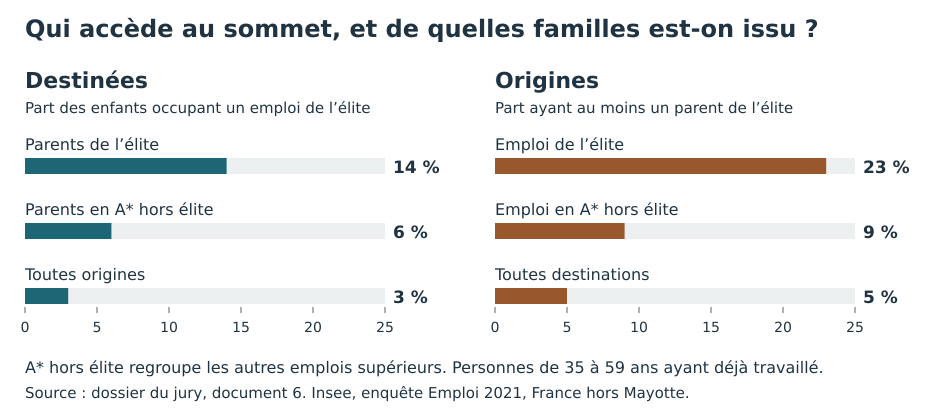

# BEL · B/L · Sociologie, oral commun 2025 · Corrigé brut

*Corrigé rédigé par IA, non officiel. Signalez toute erreur.*

**Rédaction** · GPT-6.2 Astra Ultra · vitesse non renseignée

**Autocontrôle** · GPT-6.2 Astra Ultra · vitesse non renseignée

**La catégorie socioprofessionnelle des « Dirigeants et professionnels de haut niveau »**

## Comment repérer le sommet du monde professionnel ?

Un directeur commercial et une médecin hospitalière peuvent appartenir à la même catégorie statistique, alors que deux directeurs commerciaux peuvent être classés différemment. Que cherche-t-on à saisir en les regroupant ainsi ? La rénovation des professions et catégories socioprofessionnelles (PCS) permet d’isoler les « dirigeants et professionnels de haut niveau ». Thomas Amossé et Milan Bouchet-Valat situent l’outil à une échelle que les enquêtes mesuraient mal. Entre quelques milliers de très grands décideurs et plusieurs millions de cadres, quelles positions ont suffisamment en commun pour que leur regroupement éclaire les inégalités ? Six tableaux de l’enquête Emploi et un texte des deux sociologues permettent de suivre trois opérations. Il faut définir les positions, éprouver la frontière du groupe, puis déterminer ce qu’elle révèle de la transmission entre générations.

### Construire une frontière professionnelle

Le **document 7** distingue trois manières d’identifier une élite. On peut faire désigner les personnes influentes par leurs pairs, observer qui a emporté un arbitrage, ou partir des postes occupés. La catégorie étudiée suit cette dernière démarche, dite positionnelle. Elle rapproche le pouvoir d’organiser le travail des autres et l’autonomie reconnue par une profession très qualifiée. Le poste donne des ressources pour agir, même si l’enquête ne reconstitue aucune décision individuelle. Cette définition permet d’interroger à la fois une administration, une entreprise et une profession libérale avec les outils d’une enquête nationale.

Le **document 1** montre comment passer du principe à l’enregistrement. Le libellé déclaré est codé avec ses compléments. Parmi les 1 203 observations de validation du premier trimestre 2021, 328 commencent par « directeur » ou « directrice », 228 par « médecin ». Elles forment ensemble environ 46 % des observations du groupe. Un avocat associé figure aussi dans ce tableau. L’étendue des responsabilités, la qualification ou le statut d’associé précisent ainsi ce que recouvre le nom d’un métier. Le tableau repose sur des données provisoires non pondérées. On peut y étudier le codage sans transformer chacun de ses effectifs en estimation nationale.

Cette manière de tracer une frontière soulève une objection. Comment savoir si une distinction entre libellés correspond à une différence de position ? Le **document 2** met à l’épreuve le classement à l’aide d’un autre indicateur. Dans le privé administratif et commercial, parmi les salariés à temps plein dont le libellé est « directeur », le revenu mensuel médian atteint 5 050 € pour les inclus et 3 500 € pour les exclus. L’écart vaut 1 550 €. Dans le privé technique, les médianes correspondantes sont 4 000 et 3 540 €. La taille et le secteur des établissements contribuent à donner des sens différents au même titre. Un seuil de 50 salariés est utilisé pour certains dirigeants, avec une exception documentée pour des indépendants de certaines entreprises de services très qualifiés de 11 à 49 personnes. Ce seuil est un choix de codage. On ne saurait déduire de ces médianes ce qu’une personne gagnerait si l’établissement embauchait son cinquantième salarié.

### Caractériser le groupe à plusieurs échelles

Le **document 3** porte sur les personnes en emploi de 15 à 89 ans en France hors Mayotte en 2023. Environ 909 000 sur 28,589 millions appartiennent à cet ensemble, soit 3,2 %. Le groupe est presque entièrement composé de cadres (95 %), et pourtant les cadres forment 22 % de toute la population en emploi. Isoler ce sommet rend donc visible une différence à l’intérieur d’une grande catégorie. Le diplôme supérieur long concerne 89 % du groupe contre 31 % des personnes en emploi. Un tiers de ses membres travaille en indépendant, contre 13 % de l’ensemble. L’autonomie d’un médecin libéral et la responsabilité hiérarchique d’un directeur salarié illustrent deux manières d’occuper une position supérieure.

Resserrez maintenant la comparaison. Le **document 4** oppose en 2021, parmi les personnes en emploi à temps plein, les membres du groupe aux autres titulaires d’emplois de niveau supérieur. Les premiers comptent 63 % d’hommes, les seconds 53 %. La rubrique « bac +8, grande école, etc. » regroupe 55 % des premiers contre 19 % des seconds. Les personnes de 60 ans ou plus représentent respectivement 15 % et 5 %. La durée des études et celle des carrières peuvent conditionner l’accès à certains postes. Les chiffres portent sur un instant. Ils ne suivent pas des promotions individuelles et ne permettent pas d’attribuer tout l’écart entre hommes et femmes à l’ancienneté. Pour tester ce mécanisme, il faudrait observer les carrières à métier, diplôme et génération comparables.

La hiérarchie professionnelle correspond-elle à une hiérarchie de revenu ? Dans le **document 5**, sur le même champ à temps plein en 2021, 11 % du groupe déclarent au moins 10 000 € nets mensuels, contre 1 % des autres titulaires d’emplois de niveau supérieur. Mais 6 % des premiers se situent sous 2 000 € et 31 % entre 2 000 et 3 999 €. Les distributions se recoupent. Une sélection des seuls revenus élevés écarterait donc certains membres du groupe et en inclurait d’autres. Le revenu mensuel individuel renseigne encore moins sur le patrimoine familial. Décrire comment le statut professionnel se convertit en ressources économiques suppose de tenir ensemble ces mesures et de conserver leurs différences.

### Observer la transmission sans transformer des chances en destins

Le **document 6** porte sur 20 604 personnes âgées de 35 à 59 ans ayant déjà travaillé. La classe retenue pour les parents est la plus élevée des positions parentales selon la grille du tableau. Chez les personnes ayant au moins un parent membre de l’élite socioprofessionnelle, 14 % occupent à leur tour cette position. La part est de 6 % pour les enfants dont la position parentale la plus élevée est un autre emploi supérieur, et de 3 % toutes origines confondues. La distinction à l’intérieur des emplois supérieurs fait donc apparaître une chance d’accès environ 2,3 fois plus forte pour les premiers que pour les seconds. Le mouvement reste ouvert dans les deux sens. La majorité des enfants de ce sommet exerce un autre type d’emploi.

En inversant la lecture, 23 % des membres du groupe ont au moins un parent qui en faisait partie, contre 5 % dans l’ensemble des personnes du tableau. Les 14 % et les 23 % se rapportent au même croisement, avec deux populations de référence différentes. Comment expliquer cette surreprésentation ? La possibilité de financer de longues études, la connaissance des concours et l’accès aux premiers stages constituent des mécanismes à enquêter. Leur plausibilité tient notamment au profil scolaire du document 4. Le tableau des origines ne mesure cependant aucune de ces ressources. Une enquête qui suivrait les cursus, les réseaux d’entrée et les trajectoires professionnelles pourrait départager leurs effets.

La catégorie répond ainsi à une difficulté précise. Elle rend possible une mesure commune de positions élevées dans plusieurs mondes du travail, conserve une différence sociale entre les membres de ces mondes et les autres emplois supérieurs, et rend cette différence observable entre générations. Les figures du chef d’entreprise et du spécialiste montrent aussi sa limite. Pour savoir qui siège dans le même conseil, fait reconnaître son autorité ou infléchit une décision, il faudrait changer de matériau et enquêter sur des relations effectives. C’est à ce prix qu’une statistique des positions peut nourrir une sociologie du pouvoir.

[Dossier du jury, pages 2 à 9 du PDF](https://www.ens.psl.eu/sites/default/files/sujet_oraux_sociologie_option_bl.pdf#page=2) · [Rapport du jury de sociologie du tronc commun 2025](https://www.ens.psl.eu/sites/default/files/2025_bl_rapport_oral_sociologie_tronc_commun.pdf)
