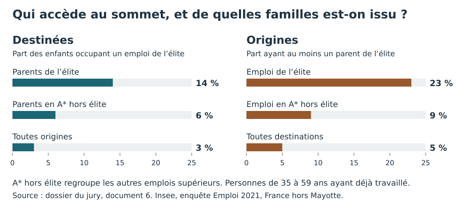

# BEL · B/L · Sociologie, oral commun 2025 · Corrigé guidé

*Corrigé rédigé par IA, non officiel. Signalez toute erreur.*

**Rédaction** · GPT-6.2 Astra Ultra · vitesse non renseignée

**Autocontrôle** · GPT-6.2 Astra Ultra · vitesse non renseignée

**La catégorie socioprofessionnelle des « Dirigeants et professionnels de haut niveau »**

## Préparer le commentaire du dossier

L’épreuve commune prévoit une heure trente de préparation, puis quinze minutes d’exposé et quinze minutes de discussion. Commencez par les pages imprimées 1 et 8. Le titre donne le groupe à expliquer. Le dernier document donne l’énigme qui organise les six tableaux. Quelle place manque-t-il entre les très grands patrons étudiés individuellement et la vaste catégorie des cadres ? Une problématique possible est la suivante. Que permet de découvrir un classement fondé sur la position professionnelle, quand on le confronte aux ressources et aux origines sociales des personnes classées ?

### Première étape — Refaire le geste de classement

**Document 7.** Imaginez une enquête sur les dirigeants d’un établissement hospitalier. Relever les fonctions dans un organigramme mesure des positions. Demander aux personnels qui exerce de l’influence mesure une réputation. Reconstituer qui a fait adopter le budget annuel renseigne sur une décision. Les trois listes pourraient différer. Amossé et Bouchet-Valat peuvent appliquer la première méthode dans toute l’enquête Emploi. Elle donne prise à des comparaisons, mais laisse ouverte la question des influences concrètes.

**Document 1.** Relevez le premier mot du libellé et un complément qui importe pour le coder. « Directeur » peut préciser une fonction et une taille d’établissement. « Avocat associé » distingue une position au sein de la profession. Vérifiez l’ordre de grandeur avec les effectifs de validation. $(328+228)/1\,203$ vaut environ 46 % pour les libellés de directeur et de médecin réunis. Les effectifs sont ceux de l’échantillon provisoire non pondéré. Une phrase telle que « il y avait 228 médecins de haut niveau en France » changerait d’échelle sans justification.

**Document 2.** Pour tester la pertinence du codage, fixez le secteur et le libellé avant de comparer les colonnes. Dans le privé administratif et commercial, comparez les directeurs inclus aux directeurs exclus. L’écart de médianes est de 1 550 €, soit environ 44 % des 3 500 € du groupe exclu. Dans le privé technique, la différence se réduit à 460 €. Expliquez ce qu’apporte cette comparaison à l’argument. Les titres précisés distinguent des situations de rémunération, avec un contraste plus ou moins marqué selon le secteur. Ni un salaire de 5 050 € ni une hausse de 44 % ne constituent une condition individuelle d’inclusion. Un tiret dans la ligne « responsable » ne correspond pas à un salaire nul.

### Deuxième étape — Construire les bonnes comparaisons

**Document 3.** En 2023, pour 100 personnes en emploi, environ trois appartiennent au groupe. Parmi les seuls membres du groupe, près de 95 sur 100 sont cadres et 89 sur 100 détiennent un diplôme supérieur long. Le premier dénominateur est l’ensemble des personnes en emploi. Les deux suivants portent sur le groupe. On peut aussi rapporter les quelque 373 000 femmes du groupe à ses 909 000 membres, soit environ 41 %. La valeur de 1,3 % figurant sur la ligne « Proportion parmi la population en emploi » rapporte ces femmes à l’ensemble des personnes en emploi, hommes compris.

**Document 4.** Restreignez le champ aux personnes à temps plein de l’enquête de 2021, puis comparez deux groupes de niveau professionnel élevé. Dans la catégorie étudiée, 55 % des personnes relèvent de la rubrique « bac +8, grande école, etc. », contre 19 % dans les autres emplois supérieurs. L’écart est de 36 points. Ce résultat s’accompagne d’écarts d’âge et de sexe. On peut proposer d’examiner si ces écarts persistent à diplôme et profession fixés. Les 2,9 % du document 4 et les 3,2 % du document 3 se rapportent à des années et des champs différents. Soustraire ces proportions pour annoncer une croissance du groupe laisserait confondus ces deux changements.

**Document 5.** Cherchez d’abord un indicateur de concentration, puis une observation qui en borne la portée. Le seuil de 10 000 € est atteint par 11 % des dirigeants et professionnels de haut niveau et par 1 % des autres emplois supérieurs. Inversement, 6 % du premier groupe déclarent moins de 2 000 € alors que 31 % déclarent de 2 000 à 3 999 €. Un titre élevé augmente la fréquence observée des hauts revenus sans fixer la rémunération de chacun. On ne peut déduire de ces tranches ni le patrimoine ni le revenu moyen exact. La dernière tranche est ouverte et les pourcentages sont arrondis.

### Troisième étape — Poser deux questions à la même case

**Document 6.** Cachez d’abord les nombres en haut à droite de chaque case. En lisant le nombre en bas à gauche sur la ligne « élite » et dans la colonne « élite », vous obtenez la destinée. Sur 100 personnes ayant au moins un parent de l’élite, environ 14 y appartiennent à l’âge observé. La même colonne donne 6 % de destinées vers ce sommet à partir des autres emplois supérieurs des parents (A* hors élite). Le rapport des proportions est d’environ $14/6 = 2{,}3$. Il s’agit d’une comparaison descriptive des chances d’accès.

Cachez ensuite les nombres en bas à gauche et lisez les valeurs en haut à droite. La même case indique que 23 % des personnes occupant un emploi de l’élite en sont originaires. Parmi les autres emplois de niveau supérieur, cette origine représente 9 %. Dans l’ensemble du tableau, la part d’origine « élite » est d’environ 5 %. Énoncez chaque phrase avec son dénominateur. Un même ensemble de personnes est à la fois enfant d’au moins un membre de l’élite et membre de l’élite, mais on le rapporte tantôt à toutes les personnes de cette origine, tantôt à toutes celles de cette destination.

Pour expliquer l’association, rapprochez la fréquence des très hauts diplômes du document 4 de la hiérarchie des destinées du document 6. L’accès à des filières longues et sélectives offre une piste. Une transmission directe d’entreprise en serait une autre. Pour les distinguer, il faudrait connaître les diplômes des parents et des enfants, la profession précise et les modalités de recrutement. Une emprise des parents sur les décisions de nomination ne se lit dans aucune case.

### Conduire l’exposé et répondre au jury

À l’oral, introduisez le dossier en montrant comment deux personnes portant le titre de directeur peuvent relever de groupes différents. Enchaînez sur la construction et la validation de la catégorie (documents 7, 1 et 2), ses propriétés par comparaison (3 à 5), puis son intérêt pour la mobilité sociale (6). Revenez au texte final pour expliquer pourquoi cette frontière fait progresser l’étude de la stratification. Une conclusion possible est qu’on peut mesurer la sélection des positions et leur reproduction avec une enquête nationale, tandis que l’exercice du pouvoir appelle l’observation d’autres relations.

**Pourquoi ne pas définir le groupe par le centile supérieur des revenus ?** Le centile fixe d’avance la fraction retenue et regroupe selon une ressource. Le classement du dossier part du métier et des positions institutionnelles. Leur croisement est précisément un résultat à examiner.

**Pourquoi parler de reproduction si seuls 14 % des enfants concernés accèdent à cette position ?** Parce que la reproduction est ici relative. Cette proportion dépasse celle des personnes issues d’autres emplois supérieurs, et l’origine « élite » est également surreprésentée parmi les individus arrivés au sommet. Fréquence supérieure et destin individuel certain sont deux propositions différentes.

**Une catégorie statistique suffit-elle à former un groupe mobilisé ?** Des individus peuvent partager un classement ou des conditions d’accès tout en exerçant dans des univers éloignés. Pour étudier une conscience commune ou des intérêts organisés, on chercherait des associations, des lieux de rencontre ou des prises de position collectives.

[Dossier du jury, pages 2 à 9 du PDF](https://www.ens.psl.eu/sites/default/files/sujet_oraux_sociologie_option_bl.pdf#page=2) · [Rapport du jury de sociologie du tronc commun 2025](https://www.ens.psl.eu/sites/default/files/2025_bl_rapport_oral_sociologie_tronc_commun.pdf)
