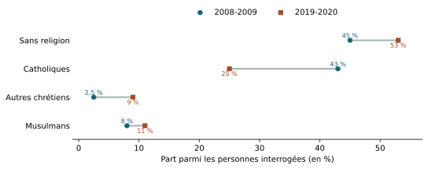
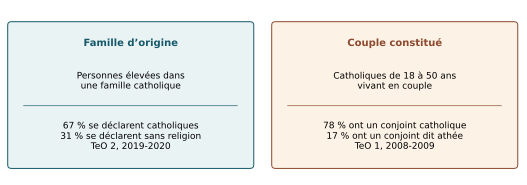

# ENS B/L · Sociologie, oral commun 2025 — La religion en France entre sécularisation et recomposition · Corrigé brut

*Corrigé rédigé par IA, non officiel. Signalez toute erreur.*

**Rédaction** · GPT-6.2 Astra Ultra · vitesse non renseignée · 26 novembre 2026

## Comment une appartenance perd-elle son évidence ?

En 2019-2020, un quart des enquêtés du document 1 se déclarent catholiques. Dans ce groupe, 6 % citent la religion parmi les dimensions qui les définissent. On peut donc se dire catholique à l’enquête, se rendre à un mariage religieux et choisir sa famille ou son métier pour dire qui l’on est. Chacune de ces réponses saisit une relation différente à la religion. J’appellerai ici sécularisation le recul du pouvoir des institutions religieuses d’encadrer les appartenances et les conduites. Le dossier renseigne surtout son versant individuel. La recomposition désigne les changements de composition des groupes et de sens des liens qui les constituent. Comment expliquer que l’affiliation catholique recule fortement, alors que certaines appartenances restent décisives dans les familles et les trajectoires ? Je partirai du changement observé dans les enquêtes, puis des relations sociales dans lesquelles se transmettent, se transforment ou se défont les appartenances.

## Un recul du catholicisme qui change la composition religieuse de la population

Les enquêtes *Trajectoires et Origines* de l’Ined et de l’Insee rendent visible la rapidité du changement (document 1). Entre 2008-2009 et 2019-2020, la part des personnes qui se déclarent sans religion passe de 45 à 53 %, soit huit points de plus. La part des catholiques passe de 43 à 25 %, soit dix-huit points de moins. Les autres chrétiens passent de 2,5 à 9 %, les musulmans de 8 à 11 %. L’affiliation catholique perd ainsi bien davantage de terrain que le seul gain de la catégorie sans religion. La succession de ces distributions autorise à parler de pluralisation. Pour décrire les passages d’une catégorie à l’autre, il faudrait connaître les trajectoires individuelles, les générations qui entrent et sortent du champ et les mouvements migratoires. Le tableau porte sur la France métropolitaine et le logement ordinaire. Sa note 2 rapporte la lecture des 7 % aux 18-49 ans, tandis que la ligne de champ du feuillet indique 18-59 ans. Je conserve la tranche d’âge de la note pour ce chiffre.

Que recouvre cette stabilité à 7 % ? La personne interrogée peut retenir jusqu’à quatre dimensions de son identité. La mesure porte donc sur la place de la religion relativement à d’autres caractéristiques proposées. Entre les deux dates, le taux de citation passe de 8 à 6 % parmi les catholiques, de 33 à 30 % parmi les musulmans, de 10 à 16 % parmi les autres chrétiens. Une moyenne d’ensemble dépend à la fois du poids de chaque groupe et du taux de citation en son sein. Son maintien au même niveau arrondi est compatible avec ces changements. Une appartenance plus rare à l’échelle nationale peut rester saillante pour ses membres.

Le document 2 permet de suivre une génération dans deux échantillons successifs. Parmi les musulmans âgés de 24 à 33 ans en 2008-2009, 34 % citent la religion. Onze ans plus tard, parmi les musulmans des mêmes générations, désormais âgés de 35 à 44 ans, la proportion atteint 28 %. Les lignes catholiques restent à des niveaux beaucoup plus bas et varient peu. Le cycle de vie est une piste. Au fil des études, de l’entrée dans le travail ou de la formation d’une famille, les dimensions que l’on privilégie pour se présenter peuvent changer. Entre les deux mesures, le contexte historique change aussi. Le dossier ne permet ni de suivre les mêmes personnes ni de départager à lui seul ces effets.

La pratique introduit une autre distinction. Parmi les catholiques déclarés du document 3, 8 % vont régulièrement à l’église, au moins une fois par mois, et 15 % prient au moins une fois par semaine. Une large part réserve la fréquentation des lieux de culte aux cérémonies familiales. Chez les musulmans déclarés, le graphique situe la fréquentation régulière du lieu de culte autour d’un cinquième et la prière hebdomadaire au-dessus de la moitié. Considérer seulement les offices ferait ainsi perdre de vue la prière privée et les rites de parenté. Les deux mesures ont des seuils différents et on ignore à quel point elles se recoupent chez les mêmes personnes.

## Des appartenances qui prennent forme dans les familles et les milieux sociaux

Comment se forment ces différents liens ? Le document 4 remonte à la famille d’origine. Parmi les personnes élevées dans une famille catholique, 67 % se déclarent catholiques et 31 % sans religion. Chez les personnes élevées dans une famille sans religion, le maintien dans cette catégorie est très fréquent. Dans les familles musulmanes aussi, une forte majorité reprend l’affiliation familiale. Les parents peuvent transmettre des récits, des fêtes ou des habitudes cultuelles et offrir des occasions de rencontrer d’autres membres. Les sorties observées du catholicisme rendent intelligible une partie de son recul. Le résultat dans les familles classées « mixtes » appelle de la prudence, car cette rubrique réunit des parents de religions différentes et des couples dont un parent est sans religion.

Le couple constitue un autre lieu de continuité. En 2008-2009, parmi les catholiques de 18 à 50 ans en couple, 78 % déclarent avoir un conjoint catholique, 2 % un conjoint d’une autre religion, 17 % un conjoint qualifié d’athée dans le document et 3 % ignorent sa religion (document 6). La fréquence de l’endogamie, union de deux personnes d’une même appartenance, peut tenir aux attentes familiales et au partage des rites. Elle dépend aussi des rencontres possibles dans un quartier, une école ou un milieu professionnel, et du poids numérique des groupes. Ces situations de couple sont observées à la date de l’enquête. Pour étudier une préférence matrimoniale, il faudrait reconstituer les appartenances avant la rencontre et la population des partenaires possibles.

Les pratiques varient également à l’intérieur de la société. Dans l’enquête publiée par l’Insee en 1998 (document 5), 19,6 % des femmes et 10,7 % des hommes déclarent une pratique régulière. On passe de 7,6 % chez les 15-24 ans à 27,5 % chez les 60 ans ou plus. Le tableau permet aussi d’interroger l’écart entre ruraux et urbains ou entre professions. Les agriculteurs exploitants comptent 23,8 % de pratiquants réguliers, les ouvriers 10 %. L’âge, le milieu de résidence et la profession sont liés. Ces tris séparés laissent leur contribution propre indéterminée. Ils portent en outre sur les personnes de plus de 14 ans en métropole, avec une question générale de pratique. Les rapprocher directement des 8 % de fréquentation mensuelle parmi les seuls catholiques du document 3 produirait une évolution artificielle.

L’enquête de Julien Beaugé (document 7) montre concrètement comment la classe sociale intervient. À Amiens, Assia, née en 1987, est une lycéenne assidue. Elle décrit comme injuste le traitement qu’elle subit lors de la première année d’application de la loi sur les signes religieux ostensibles à l’école publique. Entre les normes scolaires auxquelles elle satisfait et l’interprétation de son voile dans l’établissement, elle éprouve une contradiction. Dans son quartier, le « sérieux » d’une jeune femme associe assiduité, respect des adultes et pudeur. Son père, ouvrier du bâtiment formé comme imam avant sa migration, participe à la vie de la mosquée et enseigne le Coran à ses enfants. Ses savoirs religieux confèrent une estime à la famille. L’auteur relie la discipline d’Assia, ses études et l’entretien de cette honorabilité. Les entretiens répétés entre 2005 et 2012 éclairent un mécanisme situé, dont ils ne mesurent pas la fréquence.

## Conclusion

La sécularisation est particulièrement visible dans la baisse de l’affiliation catholique et la progression de la déclaration sans religion. Les rites familiaux, la prière, les unions et le cas d’Assia montrent comment des liens religieux continuent d’agir, y compris lorsqu’ils changent de signification selon le milieu. Pour connaître le chemin entre l’éducation reçue et l’identité adulte, on pourrait suivre des personnes au moment d’une mise en couple ou d’une naissance et observer avec elles quelles habitudes sont reprises, discutées ou abandonnées.

[Sujet officiel, pages 25 à 32 du recueil](https://www.ens.psl.eu/sites/default/files/sujets_socio_17_juin.pdf#page=25) · [Rapport du jury de l’oral commun](https://www.ens.psl.eu/sites/default/files/2025_bl_rapport_oral_sociologie_tronc_commun.pdf)
