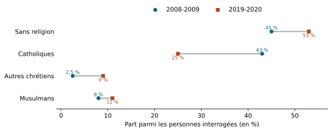
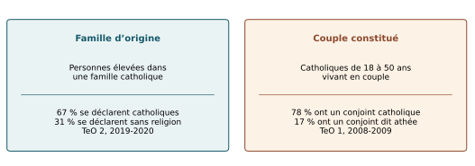

# ENS B/L · Sociologie, oral commun 2025 — La religion en France entre sécularisation et recomposition · Corrigé guidé

*Corrigé rédigé par IA, non officiel. Signalez toute erreur.*

**Rédaction** · GPT-6.2 Astra Ultra · vitesse non renseignée · 26 novembre 2026

## Préparer le dossier

Le jury laisse 1 h 30 pour préparer un exposé de quinze minutes, suivi de quinze minutes de questions. Pendant les vingt premières minutes, lire le cas d’Assia et relever les différentes façons de décrire un lien religieux. Consacrer ensuite trente minutes aux six documents chiffrés en écrivant sous chaque chiffre qui est compté, parmi qui et à quelle date. Réserver vingt-cinq minutes à la construction d’un raisonnement reliant les sources, puis quinze minutes à une répétition de l’ouverture, des transitions et de la conclusion.

## Ouvrir sur une situation où la religion compte

À Amiens, en terminale, Assia est à la fois une « fille sérieuse » aux yeux de son entourage et une élève dont le voile provoque un conflit à l’école publique. Les mêmes gestes prennent des significations différentes dans ces deux espaces. Comment une religion peut-elle orienter des conduites dans une société où une part croissante des enquêtés se déclare sans religion ? La sécularisation concerne ici le recul de l’emprise religieuse et la perte du caractère évident de certaines appartenances. La recomposition invite à rechercher les milieux, les situations et les formes sous lesquelles ces liens se maintiennent ou se transforment. Je vais distinguer trois questions. Combien de personnes se reconnaissent dans une religion ? Quelle place lui donnent-elles dans leur vie ? Comment cette place se construit-elle ?

## Compter les appartenances et comprendre ce que mesure une identité

*Première étape, environ quatre minutes.* Le document 1 juxtapose deux distributions d’enquête pour la France métropolitaine. De 2008-2009 à 2019-2020, la part des catholiques passe de 43 à 25 %, celle des personnes sans religion de 45 à 53 %. La première baisse de 18 points, la seconde augmente de 8 points. Les autres chrétiens passent de 2,5 à 9 %, les musulmans de 8 à 11 %. La perte de poids de l’appartenance naguère majoritaire s’accompagne d’une diversification. Une photographie répétée de la population agrège sorties et entrées dans le champ et histoires d’affiliation très différentes. Ainsi, on ne saurait conclure qu’un nombre de catholiques équivalent à l’augmentation d’un autre groupe s’y serait converti.

À la question de ce qui les définit, les répondants peuvent retenir jusqu’à quatre dimensions, dont la situation familiale ou le sexe. Aux deux dates, 7 % citent la religion. La note 2 du document 1 précise 18-49 ans pour la lecture du 7 % en 2019-2020, tandis que le champ imprimé indique 18-59 ans. Il est prudent de conserver la précision de la note en citant ce résultat. En 2019-2020, 6 % des catholiques citent la religion, contre 30 % des musulmans. Le dénominateur est ici l’ensemble des membres déclarés de chaque groupe. Une citation donne accès à l’importance accordée à une caractéristique dans une situation d’enquête où plusieurs réponses sont en concurrence. Elle ne dit pas tout de la croyance intime ou de l’attachement à des fêtes familiales.

Le document 2 suggère une variation selon le moment de la vie. La courbe des 35-44 ans désigne leur âge en 2019-2020. Parmi les musulmans de ces générations, 34 % citaient la religion en 2008-2009, lorsqu’ils avaient 24 à 33 ans. Ils sont 28 % à la citer onze ans plus tard. On retrouve une baisse dans d’autres cohortes musulmanes, tandis que les courbes catholiques sont basses et assez stables. Les données comparent deux échantillons. L’âge augmente en même temps que la période change, et des modifications de la composition du groupe demeurent possibles. Ces limites empêchent de lire la pente comme la trajectoire de chaque enquêté.

## Observer les conduites, de la cérémonie familiale à la discipline quotidienne

*Deuxième étape, environ quatre minutes.* La fréquentation régulière d’une église concerne 8 % des catholiques du document 3. Une proportion bien plus grande fréquente ces lieux pour des cérémonies familiales. Le catholicisme peut ainsi fournir un langage collectif pour les grands événements de parenté, même lorsque l’assistance mensuelle est peu fréquente. La prière hebdomadaire concerne 15 % des catholiques et, à la lecture du graphique, plus de la moitié des musulmans. Fréquenter un lieu de culte et prier sont deux conduites que l’enquête mesure séparément. On pourrait chercher qui prie sans se rendre régulièrement dans un édifice, mais il faudrait pour cela croiser les réponses individuelles.

Le document 5 élargit la question aux positions sociales. Pour l’ensemble des personnes de plus de 14 ans interrogées en métropole, le tableau publié en 1998 donne 19,6 % de pratiquantes régulières parmi les femmes et 10,7 % parmi les hommes. Les habitants des espaces ruraux sont 18,2 % à déclarer cette pratique, contre 14,7 % en milieu urbain. Les 60 ans ou plus sont 27,5 %, contre 7,6 % des 15-24 ans. Quelles expériences propres aux générations, quelles différences de socialisation et de possibilités de rencontrer d’autres pratiquants se combinent ici ? Pour isoler un effet de résidence, il faudrait notamment comparer des populations d’âge et de composition sociale similaires. Ce document plus ancien interroge l’ensemble de la population de son champ, tandis que le document 3 isole les personnes déclarant une religion et définit explicitement ses seuils. Leur rapprochement nourrit des questions de méthode et d’interprétation.

## Expliquer la continuité par les relations familiales, scolaires et locales

*Troisième étape, environ cinq minutes.* Le document 4 permet de partir de la famille où la personne a été élevée. Dans les familles catholiques, sur cent personnes environ, 67 se disent elles-mêmes catholiques et 31 sans religion. Une très large majorité de celles élevées dans une famille sans religion se déclarent également sans religion. L’absence d’affiliation peut donc, elle aussi, se transmettre. Les familles musulmanes présentent une forte continuité, tandis que la catégorie des familles mixtes rassemble plusieurs configurations. Pour comprendre leurs effets, on pourrait demander qui organise les fêtes, répond aux questions de l’enfant ou décide de son éducation religieuse.

L’union adulte peut ensuite entretenir une appartenance commune. En 2008-2009, 78 % des catholiques de 18 à 50 ans en couple déclarent un conjoint catholique et 17 % un conjoint qualifié d’athée par le document 6. Les 5 % restants se partagent entre conjoint d’une autre religion (2 %) et religion du conjoint inconnue (3 %). L’endogamie religieuse peut tenir aux préférences, aux cercles de rencontre, à la répartition géographique et à la taille des groupes. On observe des unions déjà constituées. Rien ici ne renseigne directement sur le moment d’éventuels rapprochements religieux.

Revenons au document 7. Entre 2005 et 2012, Julien Beaugé mène plusieurs entretiens avec Assia, fille d’un ouvrier marocain du bâtiment installé à Amiens. Formé comme imam au Maroc, son père connaît le Coran, l’enseigne à ses enfants et dispose d’un prestige local. La famille valorise conjointement la réussite scolaire et l’honorabilité religieuse. Dans le quartier, le sérieux d’une jeune femme engage à la fois son travail à l’école et une conduite tenue pour respectable. Le voile peut exprimer ces dispositions et la distance à certains styles de vie juvéniles. Dans le lycée public, en 2004-2005, la nouvelle règle concernant les signes ostensibles entre en conflit avec la façon dont Assia présente sa conduite scolaire. Le chercheur recueille son expérience d’une injustice et analyse la pluralité des ressources attachées à son nom de famille. Son étude de cas éclaire un sens possible du voile dans un lieu et une histoire sociale déterminés. Une enquête comparative serait nécessaire pour en mesurer l’extension.

## Conclure et poursuivre l’entretien

Les affiliations se diversifient, et l’absence de religion devient majoritaire dans le document 1. Pour comprendre la portée de cette sécularisation, il faut aussi regarder ce que font les personnes, avec qui elles vivent et à quelles expériences elles donnent un sens religieux. Cette attention permet de relier le changement d’échelle nationale aux transmissions familiales et aux différences de milieu.

**Comment 7 % peuvent-ils rester stables ?** Cette proportion agrège des taux propres à chaque groupe, chacun pondéré par la taille du groupe. Des changements distincts peuvent se compenser au degré d’arrondi publié. Le choix de quatre caractéristiques au maximum compte aussi pour interpréter le niveau observé.

**La mixité conjugale mesure-t-elle le rejet d’une prescription ?** Le document 6 porte sur des couples existants et laisse inconnues les affiliations au moment de la rencontre. Il faudrait étudier les rencontres possibles et les attentes exprimées, puis interroger les deux partenaires. La catégorie « athée » du graphique n’épuise pas les différentes manières de se déclarer sans religion.

**Comment approfondir le cas d’Assia ?** Comparer les récits de sœurs, d’amies ou de camarades de même milieu, reconstituer les socialisations scolaires et religieuses, puis chercher des cas où l’affiliation familiale reçoit d’autres significations. Cette démarche donnerait une portée comparative à l’explication proposée par Beaugé.

[Sujet officiel, pages 25 à 32 du recueil](https://www.ens.psl.eu/sites/default/files/sujets_socio_17_juin.pdf#page=25) · [Rapport du jury de l’oral commun](https://www.ens.psl.eu/sites/default/files/2025_bl_rapport_oral_sociologie_tronc_commun.pdf)
