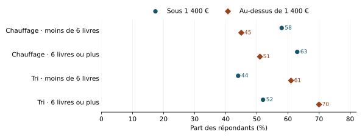
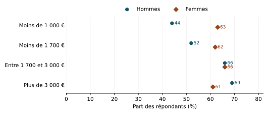

# Les ressorts sociaux de la conversion écologique des Français · Corrigé guidé

*Corrigé rédigé par IA, non officiel. Signalez toute erreur.*

**Rédaction** · GPT-6.2 Astra Ultra · vitesse non renseignée · 26 novembre 2026

ENS, filière B/L · Épreuve orale commune de sociologie, session 2025.

## Préparation de l’oral

Le jury de l’épreuve commune prévoit 1 h 30 de préparation, puis 15 minutes d’exposé et 15 minutes de discussion. Le dossier ne pose aucune question numérotée. Son titre invite à expliquer un processus. Pour construire l’introduction, partir d’un geste concret dont on ignore le motif. Un chauffage éteint peut exprimer une volonté de protéger le climat, une contrainte de budget, ou les deux. En tirer une question sur les conditions qui rapprochent conviction et pratique. Présenter brièvement les trois ensembles de preuves, puis annoncer les étapes du raisonnement.

**Pendant la préparation.** Lire les deux témoignages du document 7 dès le premier parcours des tableaux. Tracer trois colonnes sur le brouillon pour les convictions déclarées, les pratiques déclarées et les raisons d’agir. Inscrire dans la marge de chaque chiffre son unité, son champ et son année. Pour la mobilité, réserver une ligne aux automobilistes équipés et une autre aux voyages de plus de 80 km. Pour l’alimentation, recopier la note qui donne l’ordre des cinq barres. Il devient alors possible de choisir quelques comparaisons vérifiables au lieu d'énumérer tout le dossier.

**Pendant l’exposé.** Consacrer environ deux minutes à l’introduction et au plan, trois minutes aux baromètres, quatre minutes aux contraintes de consommation, cinq minutes aux conditions familiales et à l’interprétation des entretiens, une minute à la conclusion. Les exemples ci-après donnent de la matière pour ajuster l’exposé au débit de parole. L’enjeu est de parvenir au document 7 assez tôt pour discuter les mécanismes.

## Introduction

Éteindre le chauffage pour réduire sa facture, trier ses emballages et se dire convaincu de l’origine humaine du réchauffement sont trois manières très différentes d’entrer dans le dossier. Une même personne peut accomplir le premier geste, négliger le deuxième et donner une réponse hésitante à la troisième question. Que faudrait-il alors observer pour parler de « conversion écologique » ? Au sens fort, il faudrait voir une personne changer durablement ses pratiques et le sens qu’elle leur donne. Les documents permettent surtout d’étudier les conditions sociales qui rapprochent ou éloignent ces deux transformations.

Pourquoi les groupes qui reconnaissent le plus volontiers la norme écologique ne sont-ils pas toujours ceux qui consomment le moins ? Les deux baromètres de l’ADEME renseignent sur les opinions. Les enquêtes sur les styles de vie, les déplacements, les achats et les contacts avec la nature décrivent des pratiques. Les entretiens analysés par Matthieu Grossetête permettent d’en interroger les motifs. Je distinguerai la place de l’environnement dans les jugements publics, les conditions matérielles de l’action et les significations que la famille, les pairs et la position sociale donnent aux conduites.

## I. Comment l’environnement devient-il une priorité ?

### Une priorité dépend des autres choix proposés

Le document 1 suit, de 2011 à 2022, la question jugée la plus importante pour la France par les résidents de 15 ans et plus. Dans la 23ᵉ vague du baromètre de l’ADEME, la série sur l’environnement passe de 7 % en 2011 à 2 % en 2014, remonte à 16 % en 2019, puis revient à 10 % en 2022. En 2019 l’environnement arrive à égalité avec l’emploi. En 2022, il est loin derrière la hausse des prix, qui passe de 8 % à 38 % en un an. Un enjeu peut garder toute sa gravité aux yeux d’un enquêté et perdre la première place lorsque ses dépenses quotidiennes augmentent. Les chiffres expriment un arbitrage entre priorités. La liste des réponses change elle-même en 2020, lorsque la santé publique est introduite et obtient 21 %. Une case vide les années antérieures signale une question absente. Cette série de proportions ne retrace pas les conversions successives de mêmes individus.

### La certitude scientifique et la cause humaine suscitent des réponses distinctes

Le document 4 croise la profession des répondants avec deux jugements, sur la certitude du réchauffement pour les scientifiques et sur son attribution à l’activité humaine. Le baromètre ADEME d’octobre 2023 classe 46 % des répondants parmi les convaincus, 12 % parmi les sceptiques et 42 % parmi les hésitants. Ce dernier groupe réunit des combinaisons de réponses. On peut reconnaître un consensus scientifique et retenir une autre cause. L’enquête construit une typologie à partir de ces réponses et ne mesure ni connaissances individuelles détaillées ni comportements.

Les convaincus représentent 53 % des cadres et professions intellectuelles supérieures, autant parmi les professions intermédiaires, 41 % parmi les ouvriers et 19 % parmi les artisans, commerçants et chefs d’entreprise. Comparons ces derniers aux cadres. L’écart atteint 34 points pour les convaincus, mais la part des sceptiques est de 12 % contre 13 %. La différence tient surtout aux hésitants, 68 % contre 33 %. Assimiler les indépendants à des opposants effacerait ce résultat. Le tableau n’isole pas les effets du diplôme, de l’âge, du revenu ou des contraintes propres à chaque activité. Et la question de 2023 diffère de celle du document 1. Un ouvrier peut juger le réchauffement certain et d’origine humaine tout en plaçant les prix au premier rang des urgences.

## II. À quelles conditions peut-on agir ?

### Chauffer moins et trier davantage ne suivent pas le même gradient social

L’enquête *Style de vie et environnement* (SVEN, 2017) croise dans le document 2 le niveau de vie mensuel du ménage et le nombre de livres lus en douze mois. Parmi les personnes déclarant moins de six livres, 58 % sous le seuil de 1 400 euros éteignent le chauffage lors d’une absence de plus d’une journée, contre 45 % au-dessus du seuil. Chez celles qui déclarent six livres ou davantage, les proportions sont 63 % et 51 %. Une facture difficile à payer peut favoriser une économie d’énergie régulière. La présence d’un thermostat individuel, les caractéristiques du logement ou le temps d’absence peuvent aussi intervenir.

Le sens de la différence s’inverse pour le tri des déchets recyclables. À faible nombre de livres lus, les proportions passent de 44 % à 61 % lorsque l’on change de tranche de niveau de vie. À six livres ou davantage, elles passent de 52 % à 70 %. À niveau de vie donné, le tri est donc aussi associé à la lecture. Celle-ci constitue ici un indicateur de pratiques culturelles, imparfait pour saisir le capital culturel. Le questionnaire ne dit pas que lire provoque le tri. L’équipement collectif, l’accès aux consignes ou le désir de donner une réponse valorisée peuvent également compter. La coupure du chauffage et le tri ne sauraient être additionnés pour produire une note de vertu individuelle.

### Les possibilités de déplacement et leurs coûts diffèrent

Le document 3, également tiré de SVEN 2017, distingue la distance au travail, le kilométrage automobile annuel et le nombre de voyages à plus de 80 km du domicile. La distance moyenne au travail est proche pour les cadres et les ouvriers, 20,5 km contre 20,3. Parmi les ménages équipés d’au moins une automobile, la distance annuelle moyenne parcourue en voiture atteint respectivement 26 531 et 24 866 km, soit un écart de 1 665 km. La différence est beaucoup plus marquée dans les voyages en avion, 1,2 par an contre 0,2 en moyenne. C’est un rapport de six entre nombres moyens de voyages. Il ne renseigne ni sur la proportion de personnes ayant pris l’avion ni sur la distance de chaque vol.

Les petites unités urbaines présentent la distance moyenne au travail la plus élevée du tableau, 24,7 km, contre 14,6 dans les grandes unités urbaines. Les diplômés de niveau bac +3 et plus déclarent en moyenne 1,1 voyage en avion, contre 0,4 dans le groupe sans diplôme, BEP ou CAP. Emploi, infrastructures, ressources et formation peuvent structurer les occasions de partir. Les chiffres ne séparent pas voyages d’affaires et déplacements de loisir. Croiser mentalement ce document avec le précédent baromètre fait surgir une tension entre la reconnaissance de la norme et l’accès à des mobilités coûteuses. Les deux enquêtes portant sur des personnes et des années différentes, on ne peut imputer cette tension à chaque cadre ni calculer son bilan carbone.

## III. Qui peut donner un sens écologique à ses pratiques ?

### Les usages du temps et les responsabilités du ménage

Le graphique du document 5, issu de l’enquête CGDD/SDES *Les Français et la nature* de 2020, porte sur les personnes qui fréquentent forêts, espaces verts, jardins publics ou milieux aquatiques tous les jours ou plusieurs fois par semaine. Dans les foyers au revenu inférieur à 1 000 euros, le graphique donne 44 % pour les hommes et 63 % pour les femmes. Au-dessus de 3 000 euros, il donne 69 % et 61 %. Entre 1 700 et 3 000 euros, les deux barres atteignent 66 %. D’un extrême à l’autre, l’écart change donc de sens. Le groupe sous 1 000 euros est inclus dans celui qui est libellé « inférieur à 1 700 € ». On ne peut les additionner ou les traiter comme deux tranches disjointes.

Temps disponible, proximité des espaces verts, sorties avec les enfants et loisirs sportifs constituent des pistes à examiner. La fréquentation seule n’indique ni le motif d’une sortie ni une opinion sur le réchauffement. Dans le document 6 de SVEN, c’est l’achat alimentaire qui place la vie familiale au centre de l’observation. En couple avec enfant(s), 31 % déclarent prendre « tout à fait » en compte la santé. La barre du goût atteint environ 43 %, celle du label biologique environ 16 % et celle du label équitable environ 10 %. Pour les femmes seules, la santé se situe autour de 41 %, contre environ 16 % pour les hommes seuls. Le goût est le critère le plus fréquemment retenu dans l’ensemble, à environ 42 %. Sauf les 31 % donnés en clair, il s’agit de lectures graphiques approchées. Chaque critère est évalué séparément et plusieurs peuvent compter pour la même personne. À travers une préférence pour l’origine géographique, on peut chercher de la fraîcheur, soutenir une production locale ou raccourcir les transports. Sans les motifs d’achat, sans contrôle de l’âge, du revenu et de la répartition des courses, ces différences ne désignent aucune disposition écologique naturelle liée au genre ou à la parentalité.

### Une sobriété contrainte peut nourrir une critique de l’injonction

Le document 7 donne accès à ce que les tableaux laissent ouvert. Dans son article de 2019 sur la conversion des modes de vie, Matthieu Grossetête étudie notamment des personnes recrutées parmi les ouvriers du bâtiment. Un ancien intérimaire devenu animateur communal, père de deux enfants et rémunéré 1 200 euros, connaît les attentes écologiques de ses amis plus scolarisés. Il comprend l’intérêt d’une maison écologique et le prestige qui s’y attache, mais donne la priorité à la subsistance des siens. Sa proximité culturelle avec des personnes converties rend la distance économique particulièrement sensible. Elle permet de comprendre comment la maîtrise d’une norme peut s’accompagner d’une mise à distance de ceux qui la revendiquent.

Un autre enquêté, ouvrier en couple et locataire d’un appartement mal chauffé, connaît les conséquences d’un mégot jeté au sol. Il présente pourtant ce geste comme une protestation contre une répartition des devoirs qu’il juge injuste. Il faut prendre au sérieux à la fois sa connaissance de l’effet environnemental et le sens politique qu’il attribue au geste. Ces entretiens éclairent des mécanismes et des trajectoires singulières. Ils n’indiquent pas leur fréquence dans l’ensemble des classes populaires. Le texte attire enfin l’attention sur la possibilité de se projeter dans l’avenir. Lorsque l’emploi et les ressources du mois suivant restent incertains, un bénéfice collectif lointain et un investissement immédiat n’ont pas le même poids dans un choix présent.

## Conclusion

La conversion écologique prend plusieurs formes. Les contraintes économiques peuvent produire une faible dépense d’énergie avant toute revendication environnementale. Les ressources culturelles peuvent aider à s’approprier des prescriptions, tandis que les ressources économiques ouvrent aussi l’accès à des consommations plus intensives. Les responsabilités familiales et le jugement porté sur l’équité des efforts orientent le sens donné à ces pratiques. Pour étudier une conversion au sens d’un changement dans le temps, on pourrait suivre des ménages avant et après un déménagement ou un changement d’emploi. Associer relevés de consommation, pratiques de mobilité et entretiens répétés permettrait de distinguer le changement de possibilités matérielles de la réinterprétation d’un geste ancien.

## Discussion avec le jury

### La chute de l’environnement de 16 % à 10 % prouve-t-elle une déconversion ?

Non. Entre 2019 et 2022, l’écart est de six points dans la proportion qui place l’environnement en tête des urgences nationales. Il faudrait mesurer plusieurs priorités sans les mettre en concurrence, puis suivre les mêmes personnes à deux dates pour identifier celles qui modifient leurs jugements et leurs pratiques.

### Que suggère le croisement entre lecture et niveau de vie ?

Dans le document 2, regarder les lignes à niveau de vie donné. Parmi les personnes sous le seuil de 1 400 euros mensuels, le tri passe de 44 % pour les faibles lecteurs à 52 % pour ceux qui déclarent au moins six livres. L’écart est de neuf points dans la tranche supérieure, de 61 % à 70 %. Structure du ménage, diplôme, offre locale de collecte et dispositions acquises peuvent intervenir. Le tableau ne donne ni effectifs ni intervalles de confiance. Un écart d’un point entre les deux écarts ne suffit donc pas à établir un effet d’interaction.

### Les deux graphiques sur le genre racontent-ils la même chose ?

Le document 5 croise la fréquentation régulière d’espaces naturels avec genre et revenu du foyer. Le document 6 regroupe les personnes notamment selon leur situation de couple et la présence d’enfants, puis demande le poids de plusieurs critères d’achat. Le premier parle d’une fréquence de sortie, le second d’un jugement. Les populations et les enquêtes diffèrent. Une comparaison particulièrement instructive serait d’observer, dans un même ménage, qui organise les sorties, fait les courses, paie et choisit les produits.

### Comment examiner la justice perçue d’une prescription ?

Partir des propos de l’ouvrier du document 7. Il connaît la destination possible d’un déchet et met en cause la répartition des efforts. Pour distinguer l’effet du coût, de la défiance envers les institutions et de l’accessibilité des solutions, on pourrait interroger des ménages semblables vivant dans des communes autrement équipées. Puis confronter leurs propos aux pratiques observées et à leur évolution. Un témoignage éclaire une justification et ses conditions. Il ne fournit pas la proportion des ouvriers qui y adhèrent.

## Sources

Le recueil de 54 pages contient plusieurs dossiers. La garde de la page 10 identifie l’oral commun 2025. Les documents se trouvent aux pages 11 à 17. [Dossier de l’ENS](<https://www.ens.psl.eu/sites/default/files/sujet_oraux_sociologie_option_bl.pdf#page=10>)

Le rapport de l’épreuve commune présente le format de l’oral et les attentes du jury aux pages 1 à 4. La liste de la dernière page confirme le titre du dossier. [Rapport du jury](<https://www.ens.psl.eu/sites/default/files/2025_bl_rapport_oral_sociologie_tronc_commun.pdf>)
