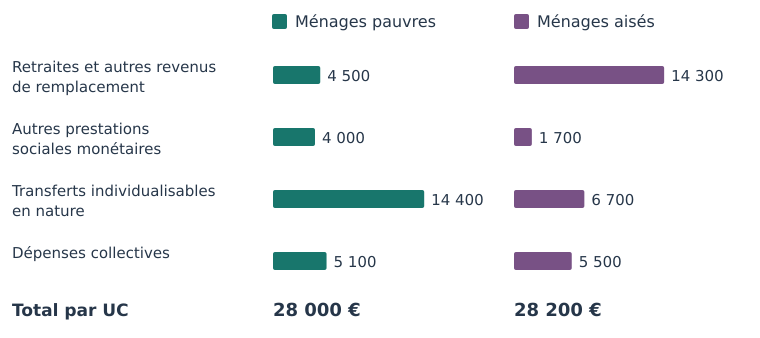

# ENS · B/L · Oral commun de sociologie 2025 · Corrigé guidé

*Corrigé rédigé par IA, non officiel. Signalez toute erreur.*

**Rédaction** · GPT-6.2 Astra Ultra · vitesse non renseignée · 26 novembre 2026

**Services publics : recomposition et inégalités**

## Préparer le commentaire

Le jury prévoit 1 h 30 de préparation, puis 15 minutes d’exposé et 15 minutes de discussion. La couverture des huit pages et le rapport de la session identifient l’épreuve commune. Le dossier donne un titre et sept pièces à mettre en relation. Les questions d’entraînement de cette édition proposent des relances possibles. [Rapport de l’oral commun de 2025](https://www.ens.psl.eu/sites/default/files/2025_bl_rapport_oral_sociologie_tronc_commun.pdf)

Pendant la première lecture, opposer deux fiches de travail. Sur la première, noter ce qu’un ménage reçoit, en quelles unités, et à quoi le comparer. Sur la seconde, noter ce qui définit chaque acteur du service public, son statut, son employeur, son activité ou sa clientèle. Lire ensuite la dernière pièce et chercher dans les chiffres un exemple qui confirme cette pluralité. La Poste en donne un au niveau des agents, la HATVP un autre au niveau des mobilités contrôlées.

Pour tenir le temps de parole, consacrer environ deux minutes à l’introduction, quatre minutes à chacun des trois mouvements et une minute à la conclusion. On peut montrer le premier graphique en expliquant un seul regroupement, laisser le second en appui pendant le commentaire des avis et conserver les calculs complémentaires pour l’entretien.

## Introduction

En France, en 2022, les sommes portées au compte des ménages pauvres et des ménages aisés au titre des sept transferts du document 1 sont presque égales, autour de 28 000 euros par unité de consommation. Pourtant, les revenus des deux groupes se rapprochent fortement après redistribution. Ce paradoxe invite à demander ce qu’un service public apporte à un ménage, qui le finance et qui l’assure. Le conseiller financier de La Poste interrogé en 2007 pouvait être fonctionnaire ou contractuel. Un consultant travaillant pour une administration pouvait, lui aussi, revendiquer une mission de service public.

**Comment les services publics réduisent-ils les écarts de ressources entre ménages, alors que les emplois et les positions de ceux qui les produisent restent socialement différenciés ?** Les comptes distribués de l’Insee mesurent l’effet des transferts sur les conditions de vie. L’enquête à La Poste et l’étude du milieu du conseil permettent d’observer qui accède à quelles positions. Enfin, la statistique administrative et les controverses sur le nombre des fonctionnaires montrent comment se construit la frontière du public.

## I. Ce que les services publics ajoutent aux ressources des ménages

### Le montant reçu et ce qu’il représente

> [!INDICATION]
> Additionnez les deux premières lignes du tableau, puis les trois lignes de transferts en nature individualisables. Refaites le calcul dans les deux colonnes extrêmes. Quelles prestations expliquent que les totaux soient si proches ?

Dans le document 1, les groupes sont classés selon leur niveau de vie usuel rapporté à la médiane. Les ménages pauvres sont sous le seuil de 60 % et les aisés au-dessus de 180 %. Ce découpage ne constitue pas cinq groupes de même taille. Les montants sont annuels, moyens et exprimés par unité de consommation. Dans un ménage de deux adultes avec un enfant de moins de 14 ans, le barème compte 1,8 unité. Il permet de tenir compte des économies réalisées en partageant certaines dépenses.

Regroupons les sept lignes de 2022. Les retraites et autres revenus de remplacement atteignent 4 500 euros dans le groupe pauvre et 14 300 dans le groupe aisé. Les pensions reflètent notamment des droits acquis au cours de trajectoires professionnelles inégales. La composition par âge peut aussi jouer. À l’inverse, les services individualisables de santé, d’éducation et les autres transferts en nature représentent ensemble 14 400 et 6 700 euros. Dans le seul domaine de l’éducation, l’écart atteint 1 800 euros en faveur du groupe pauvre. Ces sommes sont des valorisations comptables. Elles n’indiquent ni le prix que les familles auraient accepté de payer ni le montant qu’elles pourraient retirer en espèces. Les dépenses de santé culminent d’ailleurs chez les ménages modestes, à 5 900 euros contre 4 900 chez les pauvres. Pour comprendre cet écart, il faudrait connaître les besoins, l’âge, le recours aux soins et l’offre disponible dans chaque groupe. [Document 1, Mathias André et comptes nationaux distribués de l’Insee](https://www.ens.psl.eu/sites/default/files/sujet_oraux_sociologie_option_bl.pdf#page=27)

### Passer des transferts bruts au solde et à la distribution

> [!INDICATION]
> Gardez trois feuilles de calcul distinctes sur votre brouillon. Le document 1 donne des montants reçus en 2022, le document 3 ajoute les prélèvements et le document 2 décompose une variation d’indice en 2018.

Le document 3 part d’une mesure élargie du revenu primaire. Elle inclut un loyer imputé au propriétaire qui occupe son logement et écarte les pensions qui seront comptées parmi les transferts. Les ménages aisés y disposent en moyenne de 157 100 euros par unité de consommation contre 7 800 euros pour les pauvres, soit un rapport d’environ vingt. Deux prestations de même valeur pèseraient donc déjà de façon très différente relativement aux ressources de départ. Les prélèvements accentuent l’écart entre transferts bruts et solde net. Les deux courbes montrent une nette hausse dans les deux groupes les moins aisés, et une baisse dans les deux groupes supérieurs. Après transferts, le groupe aisé reste en tête. La mutualisation atténue la hiérarchie des ressources.

La note de lecture du document 3 attribue aux ménages médians 21 400 euros de transferts et dépenses collectives et 20 200 euros de prélèvements, soit un solde positif de 1 200 euros selon cette note. Les sept montants du document 1 donnent pour le même groupe une somme de 26 000 euros. L’écart de 4 600 euros correspond exactement à la ligne des dépenses collectives du document 1. Ses six autres lignes totalisent bien 21 400 euros. La note du document 3 présente pourtant ce dernier chiffre comme incluant les dépenses collectives. Pour citer le solde de 1 200 euros, il faut donc préciser qu’on reprend les montants de cette note. [Document 3, comptes nationaux distribués de 2022](https://www.ens.psl.eu/sites/default/files/sujet_oraux_sociologie_option_bl.pdf#page=29)

Le document 2 pose une autre question. Quelle part de la **baisse de l’indice de Gini** entre les distributions avant et après transferts attribuer à chaque composante en 2018 ? La moitié de cette baisse est associée aux transferts en nature, et 16 % aux services collectifs. Avec l’éducation ou la santé, on peut rattacher une dépense à des usagers. Pour des activités comme la justice, son affectation aux ménages dépend davantage de conventions. Les prestations monétaires représentent 23 % de la baisse, les retraites 10 % et les autres transferts 4 %. L’ensemble des prélèvements contribue pour −5 %. Ce signe traduit leur effet agrégé dans cette décomposition, où figurent également les impôts indirects et les cotisations. Il ne donne pas l’effet de l’impôt sur le revenu pris isolément. Les contributions affichées sont arrondies. Une contribution de 50 % signifie la moitié d’une variation de Gini, quelle que soit l’amplitude de cette variation. [Document 2, décomposition pour 2018](https://www.ens.psl.eu/sites/default/files/sujet_oraux_sociologie_option_bl.pdf#page=28)

## II. Produire un service public ouvre des carrières inégalement accessibles

### Un même métier postal, plusieurs voies de recrutement

> [!INDICATION]
> Reconstituez le 16 % de la première ligne. Le bon dénominateur est la colonne des fonctionnaires. Demandez ensuite quelles données de recrutement manquent pour en faire un tableau de chances d’accès.

Redistribuer suppose des écoles, des établissements de santé ou des services au public dotés de professionnels. La Poste offre un cas où l’on peut maintenir le métier constant et comparer les statuts. Dans l’enquête par questionnaire de Nadège Vezinat, 103 conseillers financiers sont contractuels et 62 fonctionnaires. Parmi les fonctionnaires, 10 ont déclaré un père agriculteur, soit environ 16 %. Ils sont 9 sur 103 parmi les contractuels, soit 9 %. Dans le premier groupe, les pères artisans ou commerçants représentent également 16 %, contre 6 % dans le second. Les pères cadres d’entreprise ou commerciaux sont, à l’inverse, plus fréquents chez les contractuels, 17 % contre 11 %. Dans les deux groupes, environ un quart des conseillers a un père ouvrier. [Document 4, enquête de 2007 auprès de 165 conseillers](https://www.ens.psl.eu/sites/default/files/sujet_oraux_sociologie_option_bl.pdf#page=30)

La coexistence de statuts modifie donc la composition sociale d’un même espace professionnel sans effacer les origines populaires. Une promotion interne depuis un autre métier postal et un recrutement direct fondé sur un diplôme commercial peuvent conduire au même poste par des voies socialement distinctes. Pour éprouver cette hypothèse, il faudrait croiser les statuts avec le diplôme, l’ancienneté, l’âge et le premier emploi. Le tableau décrit des professionnels déjà en poste. Il ne donne ni les candidatures refusées ni la profession de la mère, et ne permet donc pas de calculer les chances d’accès de l’ensemble des enfants d’agriculteurs ou d’ouvriers.

### Aux sommets de l’État, des expériences publiques peuvent valoir sur le marché du conseil

> [!INDICATION]
> Dans les entretiens, relevez séparément une ressource de carrière, un intérêt économique et une façon de justifier le travail auprès du public. À quel public la personne interrogée pourrait-elle adresser chacune de ces justifications ?

À l’autre extrémité de la hiérarchie, Julie Gervais étudie un club où se rencontrent hauts fonctionnaires, responsables d’entreprises, anciens membres de cabinets et universitaires. L’enquête suit des personnes situées à l’interface des administrations et des prestataires. Une expérience ministérielle, une familiarité familiale avec l’administration ou des relations entretenues dans le club peuvent aider un consultant à comprendre la demande d’un client public et à se présenter comme un interlocuteur légitime. La même expérience est alors une qualification pour deux univers professionnels.

L’extrait rend visible une tension interne aux entreprises. L’activité tournée vers les administrations représente, dans les sociétés étudiées, entre 10 et 15 % du chiffre d’affaires national. La commande publique offre des références et une certaine continuité, mais les projets longs ont moins de prestige auprès de collègues tournés vers la clientèle privée. Une dirigeante interrogée met en avant l’intérêt de travailler pour l’éducation ou la santé. Cette manière de raconter son activité renseigne sur les valeurs mobilisées pour la légitimer. Elle ne mesure pas le service effectivement rendu aux usagers. Les entretiens éclairent la construction de cette position particulière, dont la fréquence parmi tous les consultants reste inconnue. [Document 7, enquête de Julie Gervais](https://www.ens.psl.eu/sites/default/files/sujet_oraux_sociologie_option_bl.pdf#page=33)

## III. Compter et contrôler les personnes qui servent l’État

### La frontière entre les secteurs s’observe dans les deux sens

> [!INDICATION]
> Reconstituez la hauteur de la dernière barre avec ses trois éléments. Si l’on souhaite un taux de départ des agents, quel nouveau dénominateur faudrait-il connaître ?

Dans le club, une biographie peut mêler expérience administrative et conseil. Lorsqu’une autorité doit examiner un parcours, ces passages ont une traduction institutionnelle. En 2024, la Haute Autorité pour la transparence de la vie publique a rendu 639 avis déontologiques dans les trois catégories du document 5. Elle en a rendu 336 pour une mobilité vers le privé, 293 pour le recrutement d’un agent ayant récemment travaillé dans le privé et 10 pour un cumul lié à la création ou à la reprise d’une entreprise. Près de 46 % des avis de l’année concernent donc la deuxième catégorie. Regarder seulement les départs ferait manquer près de la moitié des situations examinées. [Document 5, rapport d’activité 2024 de la HATVP](https://www.ens.psl.eu/sites/default/files/sujet_oraux_sociologie_option_bl.pdf#page=31)

Le total passe de 482 en 2020 à 307 en 2021, puis 581 en 2022 et 438 en 2023, avant d’atteindre 639 en 2024. Les compétences de l’autorité et les pratiques de saisine conditionnent la série. Un avis compte une procédure. Le graphique ne renseigne ni sur son issue ni sur tous les changements d’emploi. Il serait tout aussi abusif de voir dans 639 avis autant de conflits d’intérêts avérés que d’y voir une mesure exhaustive des passages entre secteurs. Le club documente les ressources d’une mobilité, la HATVP les situations où elle relève d’un examen formel.

### Une controverse ancienne sur le périmètre du public

> [!INDICATION]
> Retirez les chemins de fer des effectifs de 1872. Pour pouvoir comparer le résultat à celui de 1854, quelle vérification manque-t-il ? Examinez séparément l’unité du classement international.

Compter oblige déjà à décider qui appartient à l’État. Émilien Ruiz reprend deux entrées du dictionnaire de Pierre Larousse. En 1867, la France apparaît en tête des pays présentés avec 24,07 francs par habitant pour les services publics, contre 6,06 en Suisse. La durée à laquelle se rapporte ce coût reste inconnue. Le périmètre des services, la conversion monétaire et l’organisation institutionnelle pourraient aussi varier d’un pays à l’autre. La précision au centime donne néanmoins un poids rhétorique au classement dans une entrée où le terme « fonctionnarisme » exprime un jugement sur la prépondérance des agents. [Document 6, dictionnaire de 1867 et 1872 étudié par Émilien Ruiz](https://www.ens.psl.eu/sites/default/files/sujet_oraux_sociologie_option_bl.pdf#page=32)

L’entrée de 1872 avance pour la France 278 000 fonctionnaires en 1854 puis 400 000 en 1872, dont 80 000 pour les chemins de fer. Ceux-ci pèsent un cinquième du second total. Si on les écarte en 1872, il reste 320 000 personnes. Pour interpréter la différence avec 1854, il faudrait savoir si le premier dénombrement inclut la même population. Le coût par habitant et le nombre d’agents posent de surcroît deux questions différentes. Aujourd’hui, des consultants payés par un marché public peuvent mettre en œuvre une politique en restant hors des effectifs de fonctionnaires. Inversement, le statut des postiers étudiés ne se déduit pas de l’intitulé de leur poste. Comparer l’action de l’État dans le temps suppose donc de préciser si on en compte les agents, les dépenses, les prestations ou les effets sur les ménages.

## Conclusion

Le dossier apporte deux résultats que le mot « public » tend à confondre. Les ressources financées collectivement desserrent la contrainte budgétaire des ménages modestes. L’accès aux emplois, aux carrières et aux réseaux qui produisent ces services reste différencié. Les indicateurs retenus rendent visibles tantôt un avantage en nature, tantôt une dépense ou un mouvement professionnel. Pour savoir si une réorganisation améliore aussi l’égalité d’accès, il faudrait relier les décisions concernant ces emplois à des observations de terrain sur les délais, les distances, les besoins et le recours effectif des usagers.

## S’entraîner à l’entretien

### Un forfait identique peut-il réduire une inégalité ?

Oui. Si deux ménages disposent respectivement de 10 000 et 40 000 euros par UC, un avantage identique valorisé à 5 000 euros fait passer le rapport de 4 à 3. L’écart absolu demeure de 30 000 euros. Le Gini est une mesure relative de dispersion. Cet exemple explique pourquoi il faut annoncer l’indicateur avant de conclure et pourquoi une prestation largement partagée peut contribuer à une baisse des inégalités.

### Que permet d’affirmer le chiffre de 16 % à La Poste ?

Sur les 62 conseillers fonctionnaires, 10 déclarent un père agriculteur. C’est une composition d’origine sociale. Pour inverser le sens de la question au sein de l’échantillon, on diviserait ces 10 fonctionnaires par les 19 conseillers dont le père est agriculteur, soit environ 53 %. Ce second pourcentage porte encore exclusivement sur les conseillers interrogés.

### Quelle différence entre fonction publique, service public et marché public ?

Le premier terme désigne ici un univers d’emplois et de statuts. Le deuxième qualifie une mission d’intérêt général organisée par la puissance publique, dont la réalisation peut être confiée à différents opérateurs. Le troisième est un instrument permettant à un acheteur public d’acquérir des travaux, des fournitures ou des services. Un fournisseur de logiciels pour une administration peut détenir un marché public. Cette relation commerciale ne lui confère ni le statut d’agent public ni, à elle seule, la responsabilité d’un service public.

### Les services seraient-ils également accessibles partout si leur valeur par habitant était identique ?

Il faudrait distinguer offre, besoins et recours. Pour l’éducation, on pourrait comparer les temps de transport et l’éventail des formations à distance donnée du domicile. Pour les soins, on comparerait les délais à besoin médical semblable et l’on interrogerait aussi les personnes qui ont renoncé à consulter. Les montants comptables donnent un point de départ, les enquêtes sur l’usage du service permettraient d’expliquer des écarts vécus.

## Sources

[Dossier officiel, pages 26 à 33 du fascicule](https://www.ens.psl.eu/sites/default/files/sujet_oraux_sociologie_option_bl.pdf#page=26) · [Rapport de l’épreuve orale commune](https://www.ens.psl.eu/sites/default/files/2025_bl_rapport_oral_sociologie_tronc_commun.pdf)
