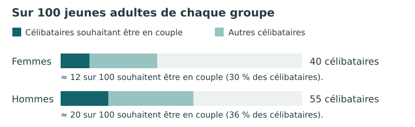
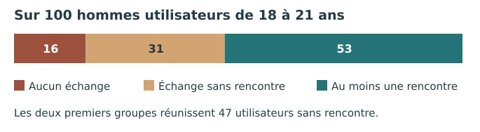

# BEL B/L — Sexualité, jeunesse et ordre social · Corrigé brut

*Corrigé rédigé par IA, non officiel.*

**Rédaction** · GPT-6.2 Astra Ultra · vitesse non renseignée

Épreuve orale commune de sociologie, session 2025. Le jury donne un dossier unique à commenter. La préparation dure 1 h 30, puis le jury prévoit quinze minutes d’exposé et quinze minutes d’échange. Les relances finales sont proposées pour l’entraînement.

## Introduction

En France hexagonale, en 2023, 40 % des femmes de 18 à 29 ans sont célibataires au moment de l’enquête Envie. Parmi elles, 30 % auraient préféré être en couple (document 3). Le passage de la première mesure à la seconde change la question sociologique. Connaître la situation d’une personne renseigne peu, à lui seul, sur la façon dont elle la vit. Comment les institutions et les positions sociales organisent-elles les occasions de rencontre et les manières de nommer, d’envisager ou de souhaiter une relation ?

Les six premiers documents exploitent une enquête téléphonique de l’Ined, réalisée auprès d’un échantillon représentatif de 10 021 jeunes adultes de 18 à 29 ans en France hexagonale. Le septième est un article d’Isabelle Clair sur la construction de la sexualité comme objet de recherche. Ensemble, ils permettent d’examiner trois opérations. Les calendriers de la jeunesse situent progressivement les individus dans des configurations de couple. La socialisation donne des significations différentes aux mêmes statuts. Enfin, les lieux où l’on se rencontre distribuent inégalement les occasions de concrétiser un projet.

## I. Des calendriers distincts selon l’événement observé

Le document 1 compare des générations de naissance. Pour les hommes nés en 1993, l’âge médian au premier rapport est de 17,3 ans. La moitié avait connu cet événement à cet âge. La série présente une hausse entre le milieu des années 1990 et le début des années 2000, avec des fluctuations. Pour la génération 2003, on lit environ 18,5 ans chez les femmes et 17,7 chez les hommes. L’écart est moindre pour la génération 2004. Attribuer ces variations au seul mouvement #MeToo, mentionné dans le titre du livre dont sont tirées les données, demanderait une enquête supplémentaire. Les générations ont traversé des contextes différents à des âges différents. La taille de chaque groupe et l’incertitude des estimations importent aussi pour l’interprétation des derniers points.

Le document 2 saisit, lui, les expériences au cours des douze derniers mois. La part ayant connu un couple passe de 58 % parmi les 18–21 ans à 75 % parmi les 26–29 ans. Ces groupes sont observés une même année. Pour comprendre comment une personne passe d’un état à un autre, il faudrait connaître la chronologie de ses relations, de ses études ou de ses changements de résidence. Les colonnes du tableau autorisent en outre plusieurs réponses. Avoir connu un couple pendant l’année et avoir envisagé une autre relation peuvent correspondre à des moments successifs. Les 66 % ayant connu un couple dans l’ensemble ne forment donc pas avec les 30 % ayant envisagé une relation les deux parties d’un seul total.

Ces distinctions changent le diagnostic porté sur la norme conjugale. L’âge auquel le couple est plus fréquent est aussi celui où davantage de célibataires expriment le souhait d’en former un. Parmi les femmes célibataires, 26 % des 18–21 ans souhaitent être en couple, contre 39 % des 26–29 ans (document 3). Le souhait est plus fréquent chez les plus âgées alors même que le célibat est plus rare dans ce groupe. L’installation résidentielle, les attentes de l’entourage ou l’expérience passée du couple sont des mécanismes possibles. Le tableau appelle à étudier ces transitions et la signification que les personnes leur donnent.

## II. La socialisation façonne les catégories à travers lesquelles on se décrit

Pourquoi retenir le souhait de couple parmi les choses à observer ? Isabelle Clair retrace en 2013 les débats qui, depuis les années 1970, ont rendu difficile l’étude sociologique de la sexualité (document 7). Certaines recherches féministes matérialistes privilégiaient le travail et ses divisions pour expliquer la hiérarchie entre les sexes. Étudier la vie privée soulevait une difficulté réelle. Comment saisir les rapports de pouvoir lorsqu’une relation est vécue et racontée dans le langage des affinités individuelles ? Clair restitue aussi la crainte que l’étude des identités ou des difficultés de certains hommes n’efface la question de la domination. Ce débat invite à prendre les déclarations individuelles au sérieux et à examiner les conditions sociales dans lesquelles elles prennent sens.

Le document 4 met cette démarche à l’épreuve. Il classe les hommes selon la manière dont ils se disent masculins et féminins. Les catégories « souple » ou « exclusive » résultent d’un codage par les enquêteurs. Parmi les hommes de classes supérieures, 29 % relèvent de la « masculinité souple », contre 14 % parmi ceux de classes populaires. La « masculinité exclusive » représente respectivement 22 % et 49 %. Un même questionnaire révèle ainsi plusieurs manières de se situer par rapport à une norme de genre. Les contextes familiaux, scolaires et amicaux peuvent valoriser différemment les façons de se présenter. La mesure porte sur les réponses au questionnaire. Une personne rangée dans l’une de ces catégories peut agir différemment selon ses interlocuteurs.

Le rapprochement avec les sports pratiqués à l’adolescence rend cette hypothèse plus concrète. Dans le document 4, 53 % des hommes ayant pratiqué le football sont classés dans la « masculinité exclusive », contre 24 % pour le tennis. Ces espaces peuvent participer à la socialisation par les pairs, notamment par les attitudes qui y sont valorisées ou tournées en dérision. Mais les pratiques sportives sont elles-mêmes socialement recrutées. Pour départager apprentissage au sein d’un groupe et sélection de ses membres, on comparerait les trajectoires de jeunes de milieux proches et leurs descriptions de ce qui était attendu d’eux avant et pendant la pratique. Cette précaution protège d’une lecture qui attribuerait à tous les membres d’un milieu une même identité.

Le document 3 montre ce que l’on gagne à distinguer déclarations, situations et aspirations. Sur 100 hommes, environ 55 sont célibataires, et 36 % de ces célibataires auraient préféré être en couple. Cela représente environ 20 hommes sur les 100 initiaux. Pour les femmes, l’ordre de grandeur est 12 sur 100. Comparer directement 36 à 40 reviendrait à rapprocher une préférence déclarée par des hommes célibataires d’un statut observé chez l’ensemble des femmes. Les deux dimensions de la norme conjugale doivent rester identifiables tout au long de l’interprétation.

## III. Les occasions de rencontre et le passage du projet à la relation

Le document 6 saisit une dimension souvent invisible dans un relevé des couples constitués. Chez les femmes en études, 32 % ont envisagé au moins une relation pendant l’année, dont 21 % une seule. Parmi les femmes en emploi, les proportions correspondantes sont 17 % et 13 %. L’écart de 15 points entre les deux premiers totaux peut tenir aux âges, à la situation conjugale antérieure et aux sociabilités offertes par l’établissement d’enseignement ou le travail. Envisager une relation suppose aussi d’interpréter et de déclarer un intérêt. L’écart ne dit pas combien de relations ont effectivement commencé. Le document 2 confirme l’utilité de la distinction. Parmi les personnes célibataires toute l’année, 50 % ont envisagé une relation. Un indicateur limité aux couples effacerait cette moitié du groupe.

Les plateformes offrent une occasion d’observer les étapes qui séparent l’accès à un lieu de la rencontre effective. Le document 5 porte sur les personnes s’étant déjà connectées à une application. Chez les hommes utilisateurs de 18 à 21 ans, 16 % n’ont échangé avec personne et 31 % ont échangé sans faire de rencontre. Cela laisse 53 % qui ont fait au moins une rencontre. Chez les hommes utilisateurs de 26 à 29 ans, l’absence de rencontre concerne 30 %, contre 47 % chez les plus jeunes. Les durées d’usage et l’ancienneté de l’inscription pourraient compter. Une simple connexion ne renseigne ni sur la durée d’exposition, ni sur les intentions initiales.

Cette dimension est aussi sociale. Parmi les hommes utilisateurs classés dans le « groupe majoritaire » par l’enquête, 36 % n’ont fait aucune rencontre, contre 55 % parmi ceux classés comme « racialisés noirs ». Dans le second groupe, 22 % n’ont même pas eu d’échange, contre 10 % dans le premier. Les écarts apparaissent donc dès la prise de contact. Ils invitent à étudier les mécanismes de visibilité des profils, les classements opérés par les utilisateurs et les expériences de discrimination. Les tableaux ne renseignent ni le profil présenté à chaque personne ni les réponses qu’elle a reçues à situation comparable. Un entretien sur une séquence d’usage ou une enquête sur les profils effectivement affichés aideraient à distinguer ces mécanismes. Les catégories de racialisation désignent ici des positions construites dans des rapports sociaux.

## Conclusion

Le dossier permet d’observer l’ordre social jusque dans le décalage entre ce qui est envisagé, ce qui se produit et ce que l’on souhaite ensuite. Le couple devient plus fréquent avec l’âge dans l’enquête, mais sa présence ne suffit à mesurer ni les aspirations ni les possibilités de rencontre. Les catégories de genre, les étapes du parcours d’études et les lieux de sociabilité donnent à ces décalages des formes socialement différenciées. Pour poursuivre l’enquête, on pourrait suivre un même groupe au fil d’une transition, par exemple de la fin des études au premier emploi, et recueillir à plusieurs dates situations, souhaits et occasions de rencontre. Ce dispositif éclairerait l’évolution d’une trajectoire dont les tableaux de 2023 donnent une image à une date donnée.

## Discussion avec le jury

**Pourquoi 30 % des femmes célibataires représentent-elles 12 % de toutes les femmes ?** Sur 100 femmes de l’enquête, 40 sont célibataires. Le produit des deux proportions vaut $0{,}40 \times 0{,}30 = 0{,}12$. Le calcul utilise la part conditionnelle des célibataires souhaitant être en couple. Il s’agit d’un ordre de grandeur, les pourcentages étant arrondis.

**Le recul du célibat avec l’âge permet-il de dire ce que souhaitent les couples ?** La question sur le souhait de vivre en couple s’adresse aux célibataires. Les répondants déjà en couple n’entrent pas dans ce champ. Pour étudier leurs aspirations, il faudrait leur poser une question adaptée, puis tenir compte de la durée de l’union.

**Comment tester l’hypothèse d’un effet des études sur les occasions de rencontre ?** On relèverait les situations conjugales et les occasions de socialisation avant et après la sortie des études, en distinguant âge, déménagement et entrée en emploi. Des entretiens préciseraient ce qui s’est ouvert ou fermé dans les réseaux de fréquentation. Un tel suivi aiderait aussi à repérer une causalité inverse, si une relation influe sur les choix d’études ou de résidence.
