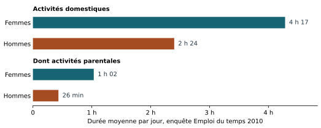
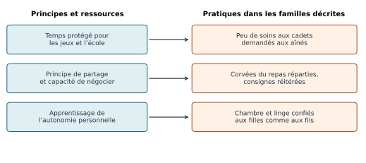

# ENS B/L · Sociologie, oral commun 2025 — La socialisation domestique primaire · Corrigé brut

*Corrigé rédigé par IA, non officiel. Signalez toute erreur.*

**Rédaction** · GPT-6.2 Astra Ultra · vitesse non renseignée · 26 novembre 2026

## Un repas familial, deux apprentissages possibles

Mettre la table est presque universel à dix ans. Près de 95 % des filles comme des garçons disent le faire au moins de temps en temps dans l’enquête Elfe (document 1). Débarrasser son assiette peut cependant répondre à des demandes différentes. Un enfant apprend à prendre soin de ses propres affaires. Un autre acquiert l’habitude de prévoir le repas de toute la famille. Dans le second cas, savoir accomplir un geste peut aller de pair avec l’attente d’en prendre régulièrement la responsabilité.

La socialisation primaire désigne l’acquisition, dès l’enfance et au fil des interactions, de manières de faire et d’attentes qui paraissent progressivement ordinaires. Ici, elle porte sur le travail nécessaire à la vie du foyer, depuis le linge jusqu’aux soins aux plus jeunes. La famille donne à voir une division du travail et distribue elle-même les occasions d’y participer. Comment cet apprentissage, si largement partagé, peut-il former des obligations différentes selon le sexe de l’enfant et les ressources de sa famille ?

## Aider est fréquent, mais le contenu de l’aide varie

Les documents 1, 2, 4, 5 et 6 proviennent de l’enquête Elfe auprès d’enfants âgés de dix ans et demi, exploitée par Ariane Pailhé et Anne Solaz. Le premier graphique distingue les participations régulières et occasionnelles. Pour la table, les barres des deux sexes atteignent presque l’extrémité de l’échelle lorsqu’on additionne les deux fréquences. Leur partie foncée, associée à une pratique régulière, concerne environ quatre enfants sur dix. Une réponse positive renseigne sur une expérience du geste. Elle laisse ouverte la question de savoir qui pense à le faire chaque jour et qui prend le relais si l’enfant oublie.

La nature des tâches fait apparaître un partage que la seule table rend peu visible. Environ 82 % des filles et 69 % des garçons aident en cuisine au moins occasionnellement. La direction s’inverse pour la poubelle, sortie par environ 43 % des filles et 56 % des garçons (document 1, lectures graphiques). La différence selon le sexe est signalée au seuil de 5 % pour ces deux tâches et pour le linge. La répétition de gestes distincts peut rendre certaines compétences plus familières. Elle peut également apprendre à qui il est normal de demander de l’aide lorsque le linge s’accumule.

Le document 3 donne une mesure d’un autre ordre. En France métropolitaine, l’enquête Emploi du temps de 2010 porte ici sur les 18–49 ans en ménage ordinaire qui occupent un emploi, sont au chômage ou au foyer. En moyenne, les femmes de ce champ consacrent 4 h 17 par jour aux activités domestiques et les hommes 2 h 24. L’écart atteint 1 h 53. Les activités parentales, incluses dans ces totaux, représentent respectivement 1 h 02 et 26 minutes. Cette inégale présence adulte fournit un contexte dans lequel des enfants peuvent associer certains soins ou travaux à un sexe. Les deux enquêtes portent sur des populations et des années différentes. On ne peut donc suivre du premier graphique au troisième la trajectoire d’une même génération, ni identifier quels enfants ont observé quelles pratiques.

## Ce qui se passe au foyer infléchit les occasions d’apprentissage

Les enfants peuvent voir qui travaille à la maison. Ils reçoivent également des demandes explicites. Le document 2 rapproche le nombre moyen de tâches effectuées par l’enfant de la division du travail chez ses parents. Lorsqu’il revient en très grande majorité à la mère, le dossier indique 5,5 tâches pour les filles contre 5,2 pour les garçons, parmi les sept proposées. L’écart de 0,3 porte sur la diversité des tâches. Il pourrait coexister avec une différence bien plus marquée de temps consacré à une seule d’entre elles. Même dans la catégorie où le partage parental est égal ou presque, le point des filles reste au-dessus de celui des garçons. Les habitudes des parents semblent donc faire partie de l’environnement d’apprentissage sans en épuiser l’explication. Reste à savoir qui demande quoi aux enfants, ce qu’ils acceptent et la suite donnée à un refus.

La configuration du foyer est une autre manière d’approcher ces sollicitations. Le document 4 compare les ménages selon leur nombre de mineurs. Dans ceux où vivent au moins trois enfants, environ 56 % des enfants de l’enquête disent sortir la poubelle au moins occasionnellement, contre 46 % lorsque le ménage compte un seul mineur. La différence est signalée au seuil de 5 %. Pour la table, la participation est très répandue dans tous les groupes. Dans une fratrie, le travail nécessaire, le nombre de personnes disponibles et les possibilités de transmission entre aînés et cadets peuvent tous augmenter. Le graphique classe les ménages par taille. Il ne donne ni le rang de l’enfant interrogé ni la répartition des corvées entre frères et sœurs.

Le document 5 permet de mettre à l’épreuve l’hypothèse selon laquelle la présence d’un seul parent accroîtrait partout le recours au travail des enfants. Pour la cuisine, environ sept enfants sur dix vivant en famille monoparentale déclarent aider au moins de temps en temps, contre un peu plus des trois quarts de ceux qui vivent avec un couple. C’est la seule différence signalée comme significative au seuil de 5 % entre types de famille. Pour les autres tâches, on ne peut établir d’écart avec ce test. Le travail domestique dépend aussi des horaires, des équipements et de la possibilité de faire intervenir d’autres adultes. L’organisation des repas serait, par exemple, une piste d’enquête pour comprendre l’écart observé en cuisine.

## Les demandes adressées aux enfants ont une histoire sociale

Dans le document 6, les enfants dont le père est agriculteur déclarent réaliser, en lecture graphique, environ 5,9 tâches pour les filles et 5,3 pour les garçons. Chez les enfants de cadres, les valeurs sont proches, environ 5,4 et 5,3. L’amplitude des barres d’incertitude varie entre catégories et est particulièrement grande pour les enfants d’agriculteurs. Ces ordres de grandeur invitent à étudier la variation sociale de l’écart. La profession du père ne résume ni le diplôme de la mère, ni le revenu du ménage, ni ses principes éducatifs. Ce graphique ne permet donc pas d’attribuer une attitude donnée à chaque famille d’une catégorie.

L’enquête de Martine Court et de ses collègues, publiée en 2016, décrit justement comment se fabrique une répartition relativement égalitaire dans un groupe de familles des classes moyennes salariées à fort capital culturel (document 7). Certaines mères travaillant dans l’enseignement ou les professions de soin conçoivent l’enfance comme un temps à réserver en partie à l’école et aux jeux. L’une d’elles explique avoir peu sollicité ses aînés pour s’occuper des plus petits. Limiter ces services profite notamment à la fille aînée, à laquelle cette charge aurait pu revenir. Parallèlement, les enfants des deux sexes apprennent à ranger leur chambre, à préparer un repas pour eux-mêmes ou à laver leur propre linge. Les adultes transmettent à la fois une frontière entre responsabilités d’enfant et d’adulte et une définition de l’autonomie personnelle.

Ces principes prennent effet par des règles et des moyens concrets. Partager les corvées autour du repas entre filles et garçons et reprendre un garçon qui se dérobe empêchent qu’une sœur accomplisse silencieusement sa part. L’activité professionnelle continue des mères du groupe et leurs ressources scolaires, parfois supérieures à celles du conjoint, peuvent renforcer leur capacité à négocier aussi le partage entre adultes. Dans certains foyers, payer une aide ménagère allège les tâches à distribuer. Une partie du travail passe alors à une autre femme salariée. L’égalité entre enfants à l’intérieur du ménage peut ainsi reposer sur une division sociale et sexuée du travail à l’extérieur de la famille.

À dix ans, les enfants peuvent donc tous « aider » et apprendre des choses sensiblement différentes. Les données attestent une différenciation précoce selon les tâches et montrent qu’elle varie avec la configuration et la position sociale du foyer. Le texte rend visibles les pratiques par lesquelles une famille peut l’entretenir ou la réduire. Pour mesurer ce qui demeure à l’âge adulte, il faudrait retrouver les mêmes enfants et observer à la fois le temps passé, les tâches dont ils prennent l’initiative et les conditions dans lesquelles ils forment leur propre ménage.

[Dossier officiel, pages 34 à 41 du recueil](https://www.ens.psl.eu/sites/default/files/sujet_oraux_sociologie_option_bl.pdf#page=34) · [Rapport du jury de l’oral commun](https://www.ens.psl.eu/sites/default/files/2025_bl_rapport_oral_sociologie_tronc_commun.pdf)
