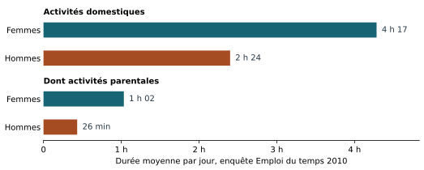
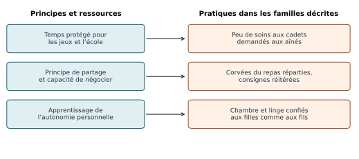

# ENS B/L · Sociologie, oral commun 2025 — La socialisation domestique primaire · Corrigé guidé

*Corrigé rédigé par IA, non officiel. Signalez toute erreur.*

**Rédaction** · GPT-6.2 Astra Ultra · vitesse non renseignée · 26 novembre 2026

## Préparer les quinze minutes d’exposé

Le rapport prévoit 1 h 30 de préparation, quinze minutes d’exposé puis quinze minutes de discussion. Commencer par l’extrait de Court et de ses collègues (document 7). Une fille qui range sa chambre et une fille chargée chaque soir de surveiller son petit frère participent toutes deux au travail domestique. Dans le premier cas, elle peut apprendre à s’occuper de ses propres affaires. Dans le second, elle risque d’apprendre qu’elle doit rester disponible pour autrui. Cette distinction donne un fil à la lecture des six documents statistiques.

Une problématique possible est la suivante. Dans quelles conditions le travail domestique transmis aux enfants devient-il une obligation de service différenciée selon le sexe, ou un apprentissage d’autonomie commun aux deux sexes ? Garder une minute pour poser cette question et une minute pour conclure. Les trois séquences suivantes peuvent occuper respectivement quatre, quatre et cinq minutes.

## Premier mouvement. Donner un contenu à la différence entre « aider » et prendre en charge

### Partir d’un contraste dans une même enquête

Le document 1 concerne des enfants de dix ans et demi interrogés dans l’enquête Elfe. Les sept activités ne signifient pas la même chose. Pour la table, le niveau de participation est voisin d’un bout à l’autre de la comparaison entre filles et garçons, autour de 95 % ou davantage. La teinte foncée correspond à la pratique régulière, la teinte claire à la pratique occasionnelle. La longueur totale cumule ces deux modalités. Les prendre pour deux groupes à additionner une seconde fois gonflerait le résultat.

Pour montrer que la répartition dépend de la tâche, le couple cuisine/poubelle suffit. En cuisine, on lit environ 82 % chez les filles contre 69 % chez les garçons, soit un écart d’environ 13 points. Pour la poubelle, les deux barres atteignent environ 43 % et 56 % dans le même ordre. Le signe de l’écart s’inverse. Les deux comparaisons portent le symbole de différence significative au seuil de 5 %. Ces deux résultats ne donnent ni les raisons invoquées par l’enfant ni le temps effectivement consacré.

### Introduire une autre unité de mesure

Les adultes du document 3 ont entre 18 et 49 ans et relèvent du champ de l’enquête Emploi du temps de 2010 en France métropolitaine. Pour les personnes en emploi, au chômage ou au foyer vivant en ménage ordinaire, le temps domestique moyen vaut 257 minutes par jour chez les femmes et 144 chez les hommes. Soustraire donne 113 minutes, soit 1 h 53. Les 62 et 26 minutes d’activités parentales apparaissent dans la ligne « dont ». Elles sont déjà comprises dans les deux premiers nombres.

**Transition à dire.** Un enfant peut observer une femme plus souvent qu’un homme occupée aux tâches domestiques. Relier cette distribution aux tâches qu’il effectue lui-même demande d’examiner l’organisation de son foyer. Le tableau Emploi du temps ne relie aucun adulte à un enfant précis de la cohorte Elfe.

## Deuxième mouvement. Confronter trois explications familiales

### Le partage entre adultes fournit-il un modèle ?

Dans le document 2, quand la mère effectue une très grande majorité du travail domestique parental, les filles participent à 5,5 des sept tâches en moyenne, les garçons à 5,2. Dire « 0,3 tâche en moyenne » rend explicite la nature du résultat. Chaque enfant peut obtenir un score entier et la moyenne du groupe être décimale. Lorsque le partage entre les parents est égal ou presque, les points représentant les filles et les garçons restent séparés. Les règles appliquées aux enfants, leurs apprentissages à l’extérieur du foyer et leurs propres stratégies restent donc des pistes à envisager. Les différences entre points d’un graphique muni de barres d’incertitude ne valent pas, à elles seules, test de chaque contraste.

### Davantage d’enfants rendent-ils l’entraide nécessaire ?

Lire le document 4 en conservant le même geste. Pour sortir la poubelle, on passe d’environ 46 % de participation lorsqu’il n’y a qu’un mineur dans le ménage à environ 56 % lorsqu’il y en a au moins trois. Le symbole apposé au dernier groupe prend comme référence celui d’un seul enfant mineur. Il ne compare pas directement deux enfants à trois ou plus. Une augmentation de la quantité de travail, des occasions de s’entraider ou des demandes adressées aux aînés sont trois mécanismes compatibles avec cette observation. Le graphique ne précise pas le rang de naissance, le sexe des autres enfants ni qui adresse la consigne.

### La monoparentalité suffit-elle à accroître les demandes ?

Vérifier cette prédiction tâche par tâche avec le document 5. Les comparaisons retenues au seuil de 5 % se réduisent à la cuisine, pour laquelle l’aide déclarée est même moins fréquente chez les enfants vivant avec un seul parent. Les proportions s’élèvent à environ 71 % pour ce groupe et 77 % chez ceux qui vivent avec un couple. Un écart visuel de quelques points sur une autre barre peut relever de l’incertitude. Il faudrait également connaître les horaires de travail du parent et le nombre de repas cuisinés à la maison pour interpréter la différence observée.

## Troisième mouvement. Expliquer comment une famille peut réduire les écarts

### Relier la position sociale à des pratiques observables

Le document 6 classe les enfants selon la catégorie socioprofessionnelle de leur père. Chez les ouvriers, on lit environ 5,6 tâches pour les filles et 5,3 pour les garçons. Chez les cadres, les points sont proches de 5,4 et 5,3. Le graphique ordonne les catégories selon la proportion moyenne de titulaires d’un bac + 2 dans chacune d’elles. Cette convention ne donne le diplôme personnel d’aucun parent. Présenter les différences comme autant d’indices d’une variation selon le milieu, en tenant compte des barres d’incertitude, puis rechercher comment se règlent ces différences dans les interactions.

L’enquête qualitative de Court et de ses collègues (document 7) décrit un groupe de familles salariées des classes moyennes à fort capital culturel. Première opération, les adultes préservent le temps des enfants pour les activités scolaires et les loisirs. Mme Denissov sollicite peu ses aînés, fille comprise, pour les soins aux cadets. Deuxième opération, ils rendent les corvées autour du repas communes aux filles et aux fils et poursuivent leurs demandes lorsque les garçons essaient de s’y soustraire. Troisième opération, ils confient progressivement à chacun les travaux dont il bénéficie directement. Dans ce groupe, ranger sa chambre peut ainsi signifier apprendre à être autonome même lorsque la participation aux tâches collectives est faible.

Reste à expliquer pourquoi un principe égalitaire devient applicable. Dans les familles décrites, l’emploi continu des mères et leurs ressources scolaires nourrissent leur capacité à négocier avec le conjoint et à demander davantage aux garçons. Le recours, dans certains cas, au travail rémunéré d’une employée de maison réduit la charge à partager. Cela déplace la question « qui réalise le travail ? » au-delà des membres du foyer. Le texte éclaire un mécanisme et ses conditions matérielles. Il ne permet pas d’estimer sa fréquence dans l’ensemble d’une catégorie.

### Revenir à la question de départ

Des gestes accomplis par tous peuvent transmettre des obligations différentes suivant leur fréquence, leur destinataire, la personne qui les distribue et ce qui se passe si un enfant refuse. Les graphiques permettent de localiser des différences. Les règles de repas, les soins aux cadets et le linge personnel décrits dans le texte permettent de proposer une interprétation précise de leur formation.

## S’entraîner à l’échange avec le jury

**Que manque-t-il au décompte de sept tâches ?** Deux enfants peuvent en faire cinq chacun. L’un aide parfois sous consigne, l’autre organise le repas tous les jours. Un carnet de temps renseignerait la durée, une observation le partage de l’initiative et des rappels.

**Les filles des agriculteurs aident-elles nécessairement davantage que toutes les autres ?** Le point est élevé, mais son intervalle est large. C’est une moyenne de groupe. Il faudrait les données et un test de contraste approprié pour établir les comparaisons entre toutes les catégories. Il resterait ensuite à expliquer l’écart.

**Comment enquêter sur la transmission ?** Suivre les mêmes enfants et décrire les trajectoires des deux parents. Croiser observations de repas, entretiens avec plusieurs membres du foyer et relevés de temps. On pourrait alors distinguer ce que les parents disent vouloir transmettre, les tâches qu’ils demandent effectivement et celles que l’enfant continue d’accomplir en leur absence.

[Dossier officiel, pages 34 à 41 du recueil](https://www.ens.psl.eu/sites/default/files/sujet_oraux_sociologie_option_bl.pdf#page=34) · [Rapport du jury de l’oral commun](https://www.ens.psl.eu/sites/default/files/2025_bl_rapport_oral_sociologie_tronc_commun.pdf)
