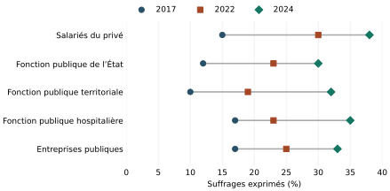
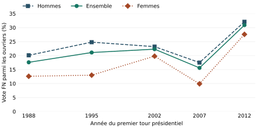

# BEL B/L · Épreuve orale commune de sociologie 2025 · Le vote d’extrême droite · Corrigé brut

*Corrigé rédigé par IA, non officiel. Signalez toute erreur.*

**Rédaction** · GPT-6.2 Astra Ultra · vitesse non renseignée · 26 novembre 2026

## Un même scrutin, des groupes traversés par des clivages

Aux législatives de 2024, que signifie parler du « vote des fonctionnaires » ? Dans la même fonction publique de l’État, 52 % des suffrages exprimés par les policiers et militaires interrogés vont au Rassemblement national (RN), contre 16 % dans la ligne « enseignants, professions scientifiques » (document 1). L’écart de 36 points invite à chercher ce qui distingue des personnes ayant en commun le même grand secteur d’emploi.

Le dossier confronte des enquêtes électorales à des mesures des préférences politiques et à l’enquête de terrain de Félicien Faury. Comment le vote d’extrême droite peut-il progresser dans des milieux professionnels différents, alors que leurs pratiques et leurs valeurs restent hétérogènes ? On peut d’abord mesurer la diffusion du vote entre secteurs et ses limites au sein de chaque groupe. Les valeurs et les publics médiatiques permettent ensuite de comprendre comment des expériences sociales acquièrent une signification politique. Enfin, l’enquête locale éclaire la place de la redistribution et de la racialisation dans les justifications du vote.

## I. Une diffusion électorale qui laisse subsister des écarts sociaux

Dans le document 1, l’enquête de Luc Rouban distingue les suffrages RN de ceux pour les candidats LR/RN et pour Reconquête. Dans la seule colonne RN, on lit 32 % chez les salariés du privé, 26 % dans la fonction publique de l’État, 28 % dans la territoriale et 30 % dans l’hospitalière. Au sein des trois fonctions publiques réunies, 22 % des suffrages des cadres vont au RN, contre 30 % de ceux des employés. Dans le privé, les cadres administratifs sont à 18 % et les employés des entreprises à 30 %. Position hiérarchique et métier traversent la frontière entre emploi public et privé. Les professeurs des écoles, avec 19 % pour le RN et 41 % pour le Nouveau Front populaire, rappellent combien la moyenne du secteur peut masquer des choix concurrents. Le tableau décrit les participants ayant exprimé un suffrage. Pour connaître le poids des abstentionnistes ou la part des fonctionnaires dans l’électorat RN, il faudrait d’autres dénominateurs.

La comparaison de trois élections législatives montre un mouvement plus large (document 2). Le regroupement y comprend les candidats classés à l’extrême droite. Dans le privé, la série est de 15 %, 30 % et 38 % en 2017, 2022 et 2024. Dans la territoriale, elle est de 10 %, 19 % et 32 %. La hausse sur sept ans atteint respectivement 23 et 22 points. Elle passe aussi par la fonction publique hospitalière, de 17 % à 35 %. En 2024, les 38 % du privé et les 32 % de la seule colonne RN du document 1 se comprennent ensemble. Les colonnes RN, LR/RN et Reconquête du premier tableau valent 32, 5 et 1 % dans ce secteur.

La hausse ne dessine pas une trajectoire individuelle. La population employée, la participation et l’offre de candidatures peuvent changer entre les scrutins. Les entreprises publiques gagnent 16 points entre 2017 et 2024, contre 23 dans le privé. En 2024, leur écart est de 5 points. Une évolution commune laisse donc subsister une différenciation entre secteurs.

Le détour par cinq présidentielles en donne une autre preuve (document 5). Dans les enquêtes du Cevipof analysées par Florent Gougou, le vote FN parmi les ouvriers passe de 17,6 % en 1988 à 30,9 % en 2012. Entre ces deux dates, il tombe de 22,3 % en 2002 à 15,6 % en 2007. Même en 2012, ce vote est minoritaire dans l’ensemble ouvrier. À cette date, il atteint 48,9 % chez ceux qui se situent à droite, 36,5 % chez ceux qui se disent ni de gauche ni de droite, et 12,5 % chez ceux qui se situent à gauche. Cette diversité interne interdit de déduire un bulletin de la seule profession. La comparaison porte ici sur des présidentielles, avec le FN de l’époque. Elle apporte une profondeur historique aux données législatives, sans en prolonger directement la série.

## II. Les préférences et les publics qui donnent au vote un sens politique

Le document 4 présente les chances de voter pour chaque candidat au premier tour de la présidentielle de 2022 selon quatre échelles d’attitudes. La probabilité de vote pour Marine Le Pen est proche de 36 % parmi le cinquième le plus conservateur culturellement et de 2 % parmi le cinquième le plus progressiste. Sur l’échelle socioéconomique, les extrêmes se situent autour de 20 % chez les plus libéraux et de 8 % chez les plus favorables à la redistribution. La différence est également marquée pour la mondialisation, autour de 28 % dans le quart le plus opposé et de 3 % dans le quart le plus favorable. Elle est plus faible sur l’environnement. Ces ordres de grandeur sont lus sur des barres. Une même personne est classée sur chacune des quatre échelles. Ces écarts décrivent des associations et ne mesurent pas l’effet propre de chaque dimension. Ils invitent à se demander à quelles questions les électeurs accordent du poids lorsqu’ils choisissent un candidat.

Le document 3 déplace l’analyse du vote vers les publics des chaînes de télévision. L’indice 1 représente une composition à l’image de la population de référence. Sur CNews, en 2022, l’indice des électeurs de droite atteint 2, tandis que celui des électeurs de gauche est inférieur à 0,4. Avec un indice 2, la part des électeurs de droite dans ce public est deux fois leur part dans la population étudiée. Il ne s’agit ni d’une majorité chiffrable sans connaître la part de référence, ni d’une mesure des seuls électeurs RN. Le contraste avec France 2, où les électeurs de gauche sont surreprésentés, suggère une segmentation des audiences. On peut choisir un média proche de ses opinions. L’exposition régulière à certains sujets peut aussi peser sur l’importance qu’on leur accorde. Deux enquêtes transversales ne départagent pas ces mécanismes. Le graphique et ses sources comparent 2007 et 2022. La mention « 2002 » dans le sous-titre est une coquille.

Le paradoxe réapparaît à l’échelle de plusieurs décennies (document 6). L’indice de préférences culturelles s’élève d’environ 46 points d’indice à la fin des années 1970 à plus de 65 vers la fin de la série. L’indice élargi de tolérance monte aussi dans la durée, avec des reculs, notamment au début des années 2010. Les préférences sociales et redistributives oscillent davantage et suivent une autre trajectoire. Le premier indice synthétise des opinions sur des sujets comme la peine de mort ou les droits des femmes et des couples homosexuels. L’indice de tolérance mobilise d’autres questions, dont celles sur l’immigration et les minorités. Ces constructions, bornées entre 0 et 100, ne mesurent pas un pourcentage de votes ou de personnes tolérantes. Une évolution moyenne vers des réponses plus progressistes est compatible avec une polarisation entre groupes, des différences de participation ou un poids accru de certains enjeux au moment de voter. Le dossier ne chiffre pas la contribution de ces trois mécanismes.

## III. La redistribution interprétée à travers des frontières de classe et de race

L’enquête de Félicien Faury dans le sud-est de la France (document 7) permet de revenir à l’échelle où les préférences se forment et s’expriment. Les électeurs RN qu’il a rencontrés évoquent un impôt jugé lourd, le quartier, l’école de leurs enfants ou la qualité des services publics. Certains connaissent une situation fragile tout en disposant d’un emploi et d’un logement. Leur inquiétude porte notamment sur ce qu’ils apportent à la collectivité et sur ce qu’ils estiment recevoir en retour. Elle peut ainsi se traduire par une demande de protection des ressources publiques.

La façon de définir ceux qui y auraient droit donne un contenu politique à ce sentiment. Dans ces récits, une morale du travail oppose des contribuables jugés méritants à des bénéficiaires soupçonnés d’abuser de la solidarité. Une frontière supplémentaire intervient lorsque des personnes perçues comme immigrées sont désignées comme des concurrentes illégitimes pour des services, une école ou un lieu de vie. La *racialisation* désigne ici le processus par lequel une origine attribuée sert à former des groupes supposés homogènes, à les hiérarchiser et à juger leurs droits. L’enquête analyse cette accusation et ses effets sur les rapports entre groupes. Elle n’établit aucun avantage effectif de ces bénéficiaires dans la distribution des aides.

Cette analyse déplace la question posée au document 4. Une personne peut se prononcer sur le montant de la redistribution et réserver, dans ses discours, la solidarité à certaines catégories de destinataires. Des échelles distinctes en enquête peuvent donc correspondre à une même situation vécue, par exemple le choix d’une école. L’étude locale rend ce lien intelligible. Elle ne fournit ni la fréquence nationale de ce raisonnement, ni la motivation de chaque policier, ouvrier ou employé des tableaux. Réciproquement, les données nationales permettent de situer la diversité des votes que le terrain local ne prétend pas représenter.

## Conclusion

Le résultat le plus solide est la diffusion différenciée du vote d’extrême droite. La progression touche tous les secteurs étudiés, tandis que des écarts importants traversent chacun d’eux. Le choix électoral engage aussi des préférences culturelles, des appartenances politiques et une manière de penser qui peut bénéficier de la solidarité. L’enquête locale montre comment insécurité sociale et racialisation peuvent se renforcer dans des situations précises. Pour savoir comment ces dispositions se convertissent en changement de vote ou en participation, il faudrait suivre les mêmes électeurs sur plusieurs scrutins, en incluant ceux qui s’abstiennent.
