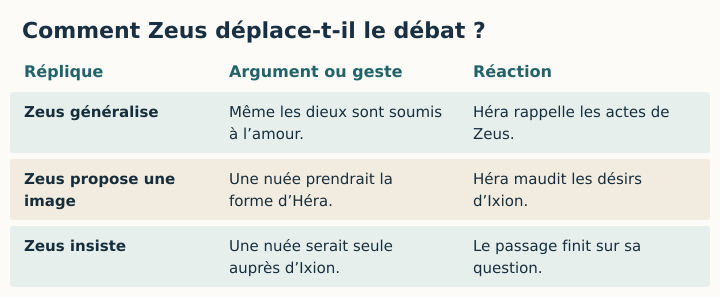

# BEL · B/L · Version grecque 2025 — Corrigé brut

*Corrigé rédigé par IA, non officiel. Signalez toute erreur.*

**Rédaction** · GPT-6.2 Astra Ultra · vitesse non renseignée

Écrit commun à Ulm et Lyon, quatre heures. Lucien, *Dialogues des dieux, 6, 4*.

## Traduction française

**Zeus.** L’amour est une force impérieuse. Il règne sur les hommes, et quelquefois aussi sur nous-mêmes.

**Héra.** Sur toi, en tout cas, il règne en maître, et comment ! Il fait de toi tout ce qu’il veut, il te mène, comme on dit, par le bout du nez. Toi, tu le suis partout où il te conduit et tu prends sans difficulté toutes les formes qu’il t’ordonne de prendre. Bref, tu es bel et bien la chose et le jouet de l’amour. Et aujourd’hui, je sais à quel titre tu accordes ton pardon à Ixion : toi aussi, il t’est arrivé de séduire sa femme, celle qui t’a donné Pirithoos.

**Zeus.** Comment ! Tu te souviens encore de ces vieilles histoires, de quelque amusement que je me suis permis en descendant sur terre ? Mais sais-tu ce que je propose pour Ixion ? Gardons-nous de le punir ou de le chasser de notre banquet ; ce serait grossier. Puisqu’il est amoureux, cependant, et que, selon toi, il pleure et souffre le martyre…

**Héra.** Eh bien quoi, Zeus ? Je crains que toi aussi, tu ne dises quelque chose d’insultant.

**Zeus.** Pas du tout. Façonnons dans une nuée une image toute semblable à toi. Une fois le banquet terminé, quand l’amour, comme il est probable, tiendra notre homme éveillé, apportons-la et couchons-la près de lui. Il pourrait ainsi cesser de se tourmenter, persuadé d’avoir obtenu ce qu’il désirait.

**Héra.** Ah non ! Puisse-t-il ne jamais connaître de beaux jours, lui qui porte ses désirs au-dessus de sa condition !

**Zeus.** Allons, Héra, fais-moi tout de même cette concession. Car enfin, quel grand mal pourrait te venir de cette figure façonnée de toutes pièces, si Ixion va partager la couche d’une nuée ?

[Énoncé officiel, p. 2](https://www.ens.psl.eu/sites/default/files/2025_blses_sujet_version_grecque.pdf#page=2) · [Fascicule commun de Lyon](https://www.ens-lyon.fr/sites/default/files/2025-10/Sujets%20BLSES%20%C3%A9preuves%20optionnelles%202025.pdf#page=50) · [Rapport officiel, partie écrite](https://www.ens.psl.eu/sites/default/files/2025_bl_grec_ancien_ecrit_et_oral_option.pdf)
