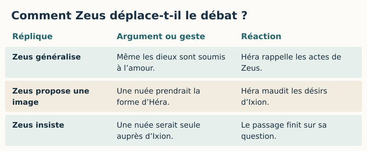

# BEL · B/L · Version grecque 2025 — Corrigé guidé

*Corrigé rédigé par IA, non officiel. Signalez toute erreur.*

**Rédaction** · GPT-6.2 Astra Ultra · vitesse non renseignée

Écrit commun à Ulm et Lyon, quatre heures. Lucien, *Dialogues des dieux, 6, 4*.

## Traduction française

**Zeus.** L’amour est une force impérieuse. Il règne sur les hommes, et quelquefois aussi sur nous-mêmes.

**Héra.** Sur toi, en tout cas, il règne en maître, et comment ! Il fait de toi tout ce qu’il veut, il te mène, comme on dit, par le bout du nez. Toi, tu le suis partout où il te conduit et tu prends sans difficulté toutes les formes qu’il t’ordonne de prendre. Bref, tu es bel et bien la chose et le jouet de l’amour. Et aujourd’hui, je sais à quel titre tu accordes ton pardon à Ixion : toi aussi, il t’est arrivé de séduire sa femme, celle qui t’a donné Pirithoos.

**Zeus.** Comment ! Tu te souviens encore de ces vieilles histoires, de quelque amusement que je me suis permis en descendant sur terre ? Mais sais-tu ce que je propose pour Ixion ? Gardons-nous de le punir ou de le chasser de notre banquet ; ce serait grossier. Puisqu’il est amoureux, cependant, et que, selon toi, il pleure et souffre le martyre…

**Héra.** Eh bien quoi, Zeus ? Je crains que toi aussi, tu ne dises quelque chose d’insultant.

**Zeus.** Pas du tout. Façonnons dans une nuée une image toute semblable à toi. Une fois le banquet terminé, quand l’amour, comme il est probable, tiendra notre homme éveillé, apportons-la et couchons-la près de lui. Il pourrait ainsi cesser de se tourmenter, persuadé d’avoir obtenu ce qu’il désirait.

**Héra.** Ah non ! Puisse-t-il ne jamais connaître de beaux jours, lui qui porte ses désirs au-dessus de sa condition !

**Zeus.** Allons, Héra, fais-moi tout de même cette concession. Car enfin, quel grand mal pourrait te venir de cette figure façonnée de toutes pièces, si Ixion va partager la couche d’une nuée ?

## Construire la traduction

**Suivre le déplacement du débat.** Zeus formule d’abord une vérité générale sur la puissance d’Éros. Héra saisit le génitif de la deuxième personne, *σοῦ*, pour retourner cet argument contre son époux. L’énumération mène du dieu entraîné par le bout du nez au dieu devenu un jouet. Le datif désignant Ixion dépend du verbe « accorder » ; c’est le bénéficiaire du pardon. La référence à la femme d’Ixion explique la mauvaise foi qu’Héra prête à Zeus.

**Identifier deux personnes derrière un même pronom.** Dans le reproche d’Héra, *αὐτός* au nominatif insiste sur Zeus en personne, tandis que le génitif *αὐτοῦ* désigne Ixion, le mari. La femme a donné un fils à Zeus. Plus haut, les deux formes *ἕπῃ* et *ἀλλάττῃ* ont pour sujet le même « tu ». Les relatives avec *ἄν* laissent ouverts le lieu où le dieu suit l’amour et la forme qu’il adopte. Cela motive « partout où » et « toutes les formes ».

**Conserver l’interruption.** Zeus présente comme une fredaine ce qu’Héra vient de rappeler. Le parfait de « se souvenir » exprime ce qu’elle garde en mémoire. Sa réponse sur la conduite à tenir comporte deux refus, punir Ixion et le chasser du banquet. La proposition introduite par « puisque » reste en suspens quand Héra lui coupe la parole. La construction de crainte qui suit, *δέδια μή*, explique le « ne » de « je crains que tu ne dises ».

**Distinguer projet et résultat.** Le participe qui indique le façonnage a le même sujet que le subjonctif d’exhortation : Zeus invite Héra à agir avec lui. Dans le groupe *αὐτῇ σοι ὅμοιον*, l’image doit ressembler à Héra elle-même. La fin du banquet est attendue, mais l’apaisement d’Ixion relève encore du possible ; l’optatif avec *ἄν* exprime cette nuance. Dans sa dernière réplique, Héra lance une malédiction. Puis Zeus ramène le danger qu’elle perçoit à un objet matériel, la nuée, et lui adresse une question à laquelle il n’attend qu’une réponse.

[Énoncé officiel, p. 2](https://www.ens.psl.eu/sites/default/files/2025_blses_sujet_version_grecque.pdf#page=2) · [Fascicule commun de Lyon](https://www.ens-lyon.fr/sites/default/files/2025-10/Sujets%20BLSES%20%C3%A9preuves%20optionnelles%202025.pdf#page=50) · [Rapport officiel, partie écrite](https://www.ens.psl.eu/sites/default/files/2025_bl_grec_ancien_ecrit_et_oral_option.pdf)
