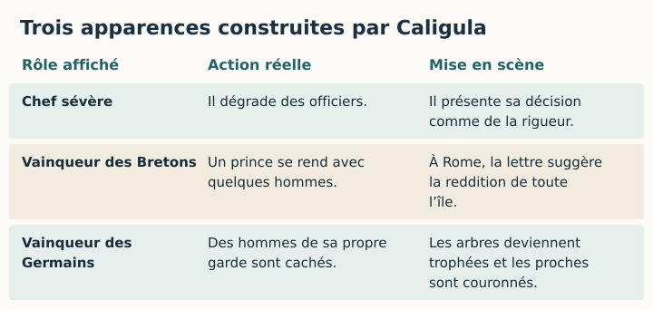

# BEL · B/L · Version latine 2025 — Corrigé guidé

*Corrigé rédigé par IA, non officiel. Signalez toute erreur.*

**Rédaction** · GPT-6.2 Astra Ultra · vitesse non renseignée

Écrit commun à Ulm et Lyon, quatre heures. Suétone, *Vie de Caligula*.

## Traduction française

Dès qu’il eut atteint le camp, Caligula, soucieux de se montrer un chef énergique et inflexible, congédia avec ignominie les légats qui, de divers endroits, avaient amené trop tard les troupes auxiliaires. Puis, lors de la revue de l’armée, il retira à la plupart des centurions leur grade de primipile. Ils étaient déjà d’âge mûr, et il ne restait à certains que quelques jours de service à accomplir. Il prétexta, dans chaque cas, l’âge avancé de l’homme et son manque de vigueur. Aux autres, il reprocha leur cupidité et ramena à six mille sesterces les avantages auxquels leur donnait droit la fin de leur service. Or tout ce qu’il avait obtenu, c’était la soumission d’Adminius, le fils de Cynobellinus, roi des Bretons. Chassé par son père, ce prince était passé dans l’autre camp avec une poignée d’hommes. Caligula écrivit pourtant à Rome une lettre pleine de superbe, comme si on lui avait livré l’île entière. Il avait donné consigne aux messagers de pousser en voiture jusqu’au forum et à la curie, et de ne remettre sa lettre aux consuls que dans le temple de Mars, en présence d’un Sénat réuni en nombre.

Bientôt, faute de matière à faire la guerre, il fit passer quelques Germains de sa garde sur l’autre rive du Rhin et les y fit cacher. Il ordonna qu’après son déjeuner on vînt lui annoncer à grand fracas que l’ennemi était là. Une fois la chose faite, il se précipita dans le bois le plus proche avec ses amis et une partie des cavaliers prétoriens. On ébrancha des arbres et on les para en guise de trophées. Revenu à la lueur des torches, il s’en prit à la timidité et à la lâcheté de ceux qui ne l’avaient pas suivi. Quant à ses compagnons et à ceux qui avaient eu part à sa victoire, il leur fit présent de couronnes d’un genre et d’un nom nouveaux. Il les orna de figures représentant le soleil, la lune et les astres, et leur donna le nom de « couronnes de reconnaissance ».

## Construire la traduction

**Reconstruire la première phrase.** Autour de *dimisit* (« il congédia »), repérer le sujet indiqué par la note 1, l’objet *legatos*, puis la relative dont ces légats sont le sujet. Le comparatif adverbial *serius* peut désigner un retard excessif. Avec *ademit*, le grade retiré est à l’accusatif, *primos pilos*. Au datif, *plerisque centurionum* désigne ceux qui en sont privés. L’accumulation « les légats, la plupart des centurions, les autres » organise le premier mouvement. Le passage en revue n’exprime aucune obligation de passer l’armée en revue.

**Rétablir les étapes d’une victoire écrite à Rome.** *Adminio … recepto* présente le fait modeste, la soumission d’un prince déjà chassé par son père. *Quasi* introduit le fait imaginaire, la reddition de l’île entière. Le parfait *misit* ramène alors au geste de Caligula, l’envoi de la lettre. Au pluriel, *litteras* peut désigner une seule lettre. Le tour restrictif *nec nisi* fixe les conditions de sa remise. Le temple de Mars et le grand nombre de sénateurs donnent à cette nouvelle l’apparat voulu par Caligula.

**Distribuer les rôles autour de iussit.** D’un côté, Caligula fait déplacer et cacher des hommes de sa garde. De l’autre, il exige qu’on lui annonce la présence de l’ennemi. Le premier groupe est l’objet du stratagème ; le second désigne l’annonce à lui adresser. Avec le superlatif, *quam* pousse le vacarme aussi loin que possible. Le lecteur connaît déjà les préparatifs et peut donc juger l’empressement du prince quand il court au bois.

**Lire les récompenses.** La relative au plus-que-parfait du subjonctif désigne ceux qui, aux yeux de Caligula, n’ont pas suivi. Elle s’oppose à ses compagnons qu’il récompense. Les couronnes portent des images d’astres. La note 5 rattache *exploratorias* à l’éclaireur. « De reconnaissance » reprend donc le sens militaire du mot, celui d’une mission d’exploration. La solennité de ce nom inventé achève la satire de l’épisode.

[Énoncé officiel, p. 2](https://www.ens.psl.eu/sites/default/files/2025_blses_epreuve_a_option_sujet_version_latine.pdf#page=2) · [Fascicule commun de Lyon](https://www.ens-lyon.fr/sites/default/files/2025-10/Sujets%20BLSES%20%C3%A9preuves%20optionnelles%202025.pdf#page=52) · [Rapport officiel, partie écrite](https://www.ens.psl.eu/sites/default/files/2025_bl_rapport_ecrit_latin.pdf)
