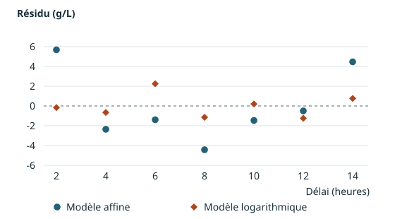

# BTSA toutes options — Traitement de données 2025 · Corrigé guidé

*Corrigé rédigé par IA, non officiel. Signalez toute erreur.*

## Présentation du sujet

Trois exercices s’appuient sur des mesures de qualité du colostrum. Le premier compare deux modèles de régression sur sept couples de valeurs. Le deuxième demande un test d’indépendance, puis une estimation sur le sous-groupe des vaches normandes. Le dernier porte sur la loi du nombre de prélèvements contaminés. La calculatrice est autorisée. Le sujet fournit les tables de la normale et du khi-deux et demande d’arrondir au millième si nécessaire. [Sujet officiel du BTSA, toutes options, session 2025 (PDF)](https://chlorofil.fr/fileadmin/user_upload/sujets-examens/2025/2025-BTS103-NOR-ME-RE-MA.pdf)

## Exercice 1 — Modéliser la concentration

### Question 1

> [!INDICATION]
> Comparer la position des points aux deux extrémités à celle des points au milieu du nuage. Un résidu positif signifie que le modèle sous-estime la mesure.

#### Solution

Les points du graphique des résidus sont au-dessus de zéro à 2 h et à 14 h. Les cinq points intermédiaires sont en dessous. La droite sous-estime donc la concentration aux deux extrémités et la surestime entre les deux. **Cette courbure systématique rend l’ajustement affine inadapté**, malgré son coefficient de détermination de $0{,}9242$.

### Question 2a

> [!INDICATION]
> Créer une colonne avec le logarithme népérien de chacun des sept délais. Calculer la corrélation de cette colonne avec les concentrations et la mettre au carré.

#### Solution

Pour les délais $2$, $4$, $6$, $8$, $10$, $12$, $14$, les concentrations correspondantes sont $113$, $99$, $94$, $85$, $82$, $77$, $76$. On calcule $r$ sur les couples $(\ln x_i,y_i)$ et l’on obtient $r\simeq -0{,}99582$. Le coefficient de détermination vaut donc **$R^2\simeq 0{,}992$**.

### Question 2b

> [!INDICATION]
> La variable explicative de la droite de régression est désormais le logarithme du délai. Penser à remplacer cette variable par son expression pour revenir aux heures.

#### Solution

En posant $z_i=\ln(x_i)$, on obtient $\bar z\simeq 1{,}91103$ et $\bar y\simeq 89{,}42857$. La pente des moindres carrés et l’ordonnée à l’origine valent

$$
a=\frac{\sum_i (z_i-\bar z)(y_i-\bar y)}{\sum_i(z_i-\bar z)^2}\simeq -19{,}48872,\qquad b=\bar y-a\bar z\simeq126{,}67205.
$$

La droite de régression de $Y$ en $Z$ est **$\widehat y=-19{,}489z+126{,}672$** à l’arrondi demandé. La prévision en fonction du délai s’obtient avec $z=\ln x$.

### Question 2c

> [!INDICATION]
> Pour chaque délai, faire la différence entre la mesure et la concentration prévue. Conserver en mémoire les coefficients non arrondis pour calculer ces sept différences.

#### Solution

Le signe est celui de la différence $e_i=y_i-(a\ln x_i+b)$. Par exemple, à 6 h, l’estimation est $91{,}75295$ g/L et la mesure $94$ g/L. Le résidu vaut $+2{,}247$ g/L. On trouve, en g/L :

$$
\begin{array}{c|rrr}
x_i\ (\mathrm h) & 2 & 4 & 6\\ \hline
e_i & -0{,}164 & -0{,}655 & 2{,}247
\end{array}
\qquad
\begin{array}{c|rrrr}
x_i\ (\mathrm h) & 8 & 10 & 12 & 14\\ \hline
e_i & -1{,}146 & 0{,}202 & -1{,}244 & 0{,}760
\end{array}
$$

### Question 2d

> [!INDICATION]
> Chercher si une succession d’écarts de même signe subsiste. Comparer aussi leur amplitude avec celle des résidus du premier modèle.

#### Solution

Le modèle logarithmique explique environ $99{,}2\,\%$ de la variation observée des concentrations. Ses résidus sont compris entre $-1{,}244$ et $2{,}247$ g/L, sans la courbure visible pour la droite. L’ajustement logarithmique rend donc bien compte des **sept observations entre 2 et 14 heures**.

### Question 2e

> [!INDICATION]
> Vérifier dans quelle unité se mesure le délai et si la valeur demandée appartient à l’intervalle étudié.

#### Solution

Avec les coefficients non arrondis, $\widehat y(15)=a\ln(15)+b\simeq 73{,}896\ \mathrm{g/L}$. Cette estimation à **15 heures** est une extrapolation d’une heure au-delà du dernier délai observé. Elle suppose que le modèle reste valable.

## Exercice 2 — Partie A

### Test d’indépendance

> [!INDICATION]
> Sous l’hypothèse d’indépendance, calculer chaque effectif attendu à partir des totaux de sa ligne et de sa colonne. Le seuil de décision se lit dans la colonne 0,95 de la table fournie.

#### Solution

On teste au seuil de $5\,\%$ l’hypothèse $H_0$ selon laquelle la race et la catégorie de qualité sont indépendantes, contre $H_1$ selon laquelle elles sont associées. Les trois effectifs par race sont $892$, $95$ et $323$. Les totaux par qualité, de mauvaise à excellente, sont $470$, $240$, $340$ et $260$, pour un total de $1\,310$.

Sous $H_0$, l’effectif attendu d’une case vaut $E_{ij}=n_{i\cdot}n_{\cdot j}/1310$. Pour la race Normande et la catégorie « mauvaise », on attend par exemple $95\times470/1310\simeq34{,}084$ vaches, contre $51$ observées. Les effectifs théoriques sont les suivants, par race et dans l’ordre des qualités du sujet :

- Prim Holstein : $320{,}031$ ; $163{,}420$ ; $231{,}511$ ; $177{,}038$.
- Normande : $34{,}084$ ; $17{,}405$ ; $24{,}656$ ; $18{,}855$.
- Montbéliarde : $115{,}885$ ; $59{,}176$ ; $83{,}832$ ; $64{,}107$.

Tous dépassent 5. Avec l’hypothèse d’échantillonnage du sujet, on peut appliquer le test du khi-deux. On somme les contributions calculées sur les effectifs non arrondis :

$$
\chi^2_{\mathrm{obs}}=\sum_{i,j}\frac{(O_{ij}-E_{ij})^2}{E_{ij}}\simeq33{,}723.
$$

Il y a $(3-1)(4-1)=6$ degrés de liberté. La valeur critique lue dans la table est $12{,}59$. Puisque $33{,}723>12{,}59$, **on rejette l’indépendance au seuil de 5 %**. Les données mettent en évidence une association entre la race et la catégorie de qualité du colostrum.

## Exercice 2 — Partie B

### Question 1

> [!INDICATION]
> Le groupe de référence est celui des vaches normandes. Choisir le dénominateur dans la ligne correspondante.

#### Solution

Parmi les $95$ vaches normandes, $51$ ont un colostrum de mauvaise qualité. L’estimation ponctuelle est la fréquence observée **$\widehat p=51/95\simeq 0{,}537$**, soit environ $53{,}7\,\%$.

### Question 2

> [!INDICATION]
> Commencer par la loi exacte de l’effectif. Que devient son espérance et que devient son écart-type quand on divise l’effectif par 95 ?

#### Solution

Le tirage est assimilé à un échantillonnage avec remise. Le nombre de vaches concernées $95F$ suit la loi binomiale $\mathcal B(95,p)$. Par approximation normale, $F$ suit approximativement une loi normale **de moyenne $p$ et d’écart-type $\sqrt{p(1-p)/95}$**. Les conditions d’effectifs sont plausibles : en remplaçant $p$ par la fréquence observée, $95\widehat p=51$ et $95(1-\widehat p)=44$, tous deux supérieurs à 5. L’écart-type estimé vaut $0{,}05116$.

### Question 3

> [!INDICATION]
> Un intervalle bilatéral à 95 % laisse 2,5 % dans chaque queue de la loi normale. Chercher le quantile correspondant et utiliser la fréquence non arrondie.

#### Solution

On utilise $1{,}96$, quantile d’ordre $0{,}975$ de la loi normale centrée réduite. Avec $f=51/95$, l’intervalle de confiance approché est

$$
\left[f-1{,}96\sqrt{\frac{f(1-f)}{95}}\ ;\ f+1{,}96\sqrt{\frac{f(1-f)}{95}}\right]
\simeq [0{,}437\,;\,0{,}637].
$$

La proportion de vaches normandes concernées est donc estimée **entre 43,7 % et 63,7 %** au niveau de confiance de 95 %. Le calcul utilise les 95 vaches normandes et conserve la précision de $f$ jusqu’à l’arrondi final.

## Exercice 3 — Quatre affirmations

### Affirmation 1

> [!INDICATION]
> Distinguer la probabilité pour un prélèvement et le nombre de prélèvements de l’échantillon.

#### Solution

**Fausse.** Chaque prélèvement a une probabilité $0{,}51$ d’être contaminé. Les 50 prélèvements sont assimilés à des essais indépendants de même probabilité. Le nombre de prélèvements contaminés suit donc la loi $\mathcal B(50\,;\,0{,}51)$. Le paramètre de probabilité proposé, $0{,}255$, est erroné.

### Affirmation 2

> [!INDICATION]
> L’espérance d’une somme d’indicatrices est la somme de leurs probabilités.

#### Solution

**Vraie.** L’espérance est $E(X)=np=50\times0{,}51=25{,}5$. C’est un nombre moyen sur un grand nombre d’échantillons de 50, ce qui explique sa valeur non entière.

### Affirmation 3

> [!INDICATION]
> Contrôler les effectifs moyens des deux issues, puis calculer moyenne et variance.

#### Solution

**Vraie.** Les effectifs moyens $np=25{,}5$ et $n(1-p)=24{,}5$ sont tous deux largement supérieurs à 5. La binomiale peut être approchée par une loi normale de moyenne $25{,}5$ et de variance $50\times0{,}51\times0{,}49=12{,}495$, soit un écart-type d’environ $3{,}535$.

### Affirmation 4

> [!INDICATION]
> Traduire « plus du quart » par une inégalité portant sur un nombre entier de prélèvements. Le calcul est plus court en passant par l’événement complémentaire.

#### Solution

**Vraie**, en comprenant « plus du quart » comme plus du quart des 50 prélèvements. Un quart de 50 vaut $12{,}5$. L’événement est donc $X\geq13$. Avec la fonction de répartition de la loi binomiale,

$$
P(X\geq13)=1-P(X\leq12)=1-\sum_{k=0}^{12}\binom{50}{k}(0{,}51)^k(0{,}49)^{50-k}\simeq0{,}999911.
$$

La probabilité vaut environ $99{,}991\,\%$. À $10^{-3}$ près, elle s’arrondit à $1{,}000$, tout en restant strictement inférieure à 1.

## Bilan

Une droite peut avoir un coefficient de détermination élevé tout en laissant apparaître une courbure dans ses résidus. Ici, prendre le logarithme du délai corrige cette courbure. Pour le test d’indépendance, les marges du tableau entier servent à reconstruire les effectifs attendus. Pour estimer une proportion propre à une race, seule la ligne de cette race compte. Enfin, un seuil formulé en pourcentage doit être traduit en nombre entier avant d’interroger une loi binomiale.
