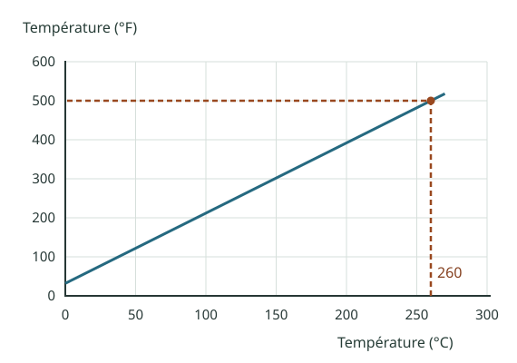

# CAP groupement 1 — Mathématiques et physique-chimie 2025 · Corrigé brut

*Corrigé rédigé par IA, non officiel. Signalez toute erreur.*

## Exercice 1 — La tombola

### Question 1.1

La colonne D donne le coût des lots et la ligne 8 en regroupe le total. La cellule **D8** donne **1 200 €**.

### Question 1.2

Une montre coûte 15 €. Pour un coût total de 180 €, l’association a acheté $180/15=12$ montres. On inscrit **12 en C5**.

### Question 1.3

La vente rapporte $500x$ euros. Après paiement des lots, le bénéfice vaut $500x-1\,200$. Il faut cocher la **troisième équation**, $500x-1\,200=800$.

### Question 1.4

De $500x-1\,200=800$, on déduit $500x=2\,000$, puis $x=2\,000/500=4$. Le prix recherché est **4 € le ticket**.

### Question 1.5

Les ventes rapportent $500\times4=2\,000$ €. Une fois les lots payés, il reste $2\,000-1\,200=800$ €. **Le bénéfice souhaité est atteint** si les 500 tickets sont vendus.

### Question 1.6

Pour un ticket pris au hasard, $P(\text{gain})=100/500=1/5=0{,}20$, soit **20 %**.

### Question 1.7

L’affirmation est fausse : sur l’ensemble des 500 tickets, un cinquième est gagnant. Pour un ticket tiré au hasard, **une chance sur cinq** est inférieure à une chance sur trois.

## Exercice 2 — Le thermostat du four

### Question 2.1

Dans la colonne de 90 °C, on lit **194 °F**.

### Question 2.2

On coche **non proportionnelles**. Pour passer de 30 à 90 °C, on multiplie par trois. Or $3\times86=258$ et la seconde température vaut 194 °F. Les deux lignes n’ont donc pas le même facteur de variation.

### Question 2.3

La verticale de 260 °C rencontre la droite au niveau de 500 °F. La projection horizontale donne **$f(260)=500$** par lecture graphique.

### Question 2.4

$f(220)=1{,}8\times220+32=396+32=428$. La température correspondante est **428 °F**.

### Question 2.5

L’étudiant règle le four sur **500 °F pour le préchauffage**, puis sur **428 °F pour la cuisson**.

## Exercice 3 — Le massif de tulipes

### Question 3.1

Le plus grand côté est **$[AC]$**, de longueur 10 m, contre 8 m et 6 m pour les autres.

### Question 3.2

$AC^2=10^2=100$ et $AB^2+BC^2=8^2+6^2=64+36=100$. Les deux valeurs sont égales, donc **$AC^2=AB^2+BC^2$**.

### Question 3.3

La réciproque du théorème de Pythagore s’applique à l’égalité de 3.2. **Le triangle est rectangle en B**, sommet opposé au plus grand côté $[AC]$.

### Question 3.4

L’aire du massif est $\mathcal A=(AB\times BC)/2=(8\times6)/2=\mathbf{24\ m^2}$.

### Question 3.5

Le jardinier a besoin d’au moins $24\times70=1\,680$ bulbes. Avec 1 700 bulbes, **il peut couvrir tout le massif** et il lui en restera 20 s’il en plante le minimum.

## Exercice 4 — Une boisson sucrée

### Question 4.1

Puisque $1\ \mathrm{L}=100\ \mathrm{cL}$, $1{,}5\ \mathrm{L}=\mathbf{150\ cL}$.

### Question 4.2

Dans l’ordre des lignes du sujet, les numéros sont **4, 3, 1, 2**. On pèse et introduit les 66 g de sucre, on ajoute une partie de l’eau, on agite jusqu’à dissolution, puis on complète jusqu’au volume final de 1,5 L.

### Question 4.3

$C_m=m/V=66/1{,}5=44$. La boisson contient **44 g de sucre par litre**.

### Question 4.4

La limite donnée dans l’exercice est 20 g/L. Puisque $44>20$, **la préparation dépasse cette limite**.

### Question 4.5

Pour préparer à nouveau 1,5 L, il faut y dissoudre **au maximum $20\times1{,}5=30$ g** de sucre. On peut aussi garder les 66 g déjà dissous et ajouter de l’eau pour porter le volume total à **au moins $66/20=3{,}3$ L**.

### Question 4.6

La formule $\mathrm{C}_{12}\mathrm{H}_{22}\mathrm{O}_{11}$ indique qu’une molécule contient **12 atomes de carbone, 22 atomes d’hydrogène et 11 atomes d’oxygène**.

## Exercice 5 — L’éclairage d’un monument

### Question 5.1

De gauche à droite, on écrit **ultraviolet (UV), visible, infrarouge (IR)**. Les UV sont du côté du violet et les IR du côté du rouge.

### Question 5.2

Une surexposition aux UV peut provoquer un **coup de soleil**. Une exposition intense ou prolongée aux infrarouges peut léser le cristallin de l’œil et favoriser une **cataracte**.

### Question 5.3

Pour obtenir du blanc sur le monument, il faut cocher les trois spots : **vert, rouge et bleu**, en superposant des intensités appropriées.

### Question 5.4

Pour éclairer les statues en cyan, on allume les spots **vert et bleu**. Le spot rouge reste éteint.

### Question 5.5

**1,8 A** désigne l’intensité du courant électrique, mesurée en **ampères**. **230 V** désigne la tension électrique, mesurée en **volts**.
