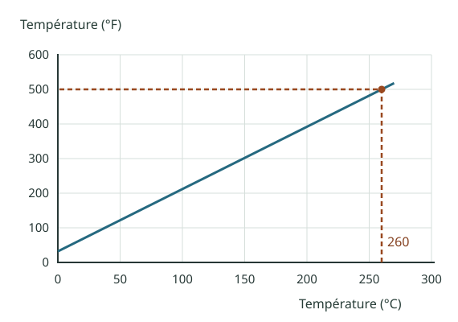

# CAP groupement 1 — Mathématiques et physique-chimie 2025 · Corrigé guidé

*Corrigé rédigé par IA, non officiel. Signalez toute erreur.*

## Présentation du sujet

L’épreuve dure 1 h 30. La tombola, le four et le massif comptent ensemble pour 12 points de mathématiques. La boisson et les projecteurs comptent pour 8 points de physique-chimie. Pour chaque situation, repérez la donnée, l’opération et l’unité de la réponse. Conservez un crayon et une règle pour la lecture graphique de 2.3. [Sujet du ministère](https://www.education.gouv.fr/sites/default/files/2025-06/certificat-d-aptitude-professionnelle-2025-math-matiques-physique-chimie---groupement-1-440592.pdf)

## Exercice 1 — La tombola

Repérez la dépense de l’association, puis distinguez les recettes, le bénéfice et la chance de gagner.

### Question 1.1

> [!INDICATION]
> Croisez la dernière ligne avec la colonne contenant le coût des lots.

#### Solution

La colonne D donne le coût des lots et la ligne 8 en regroupe le total. La cellule **D8** donne **1 200 €**.

### Question 1.2

> [!INDICATION]
> Le coût de toutes les montres est le produit du prix d’une montre par leur nombre.

#### Solution

Une montre coûte 15 €. Pour un coût total de 180 €, l’association a acheté $180/15=12$ montres. On inscrit **12 en C5**.

### Question 1.3

> [!INDICATION]
> Exprimez la recette des ventes en fonction du prix d’un ticket. Quelle dépense reste à enlever ?

#### Solution

La vente rapporte $500x$ euros. Après paiement des lots, le bénéfice vaut $500x-1\,200$. Il faut cocher la **troisième équation**, $500x-1\,200=800$.

### Question 1.4

> [!INDICATION]
> Ajoutez la dépense aux deux membres, puis isolez le prix d’un ticket.

#### Solution

De $500x-1\,200=800$, on déduit $500x=2\,000$, puis $x=2\,000/500=4$. Le prix recherché est **4 € le ticket**.

### Question 1.5

> [!INDICATION]
> Recalculez le bénéfice avec le prix annoncé.

#### Solution

Les ventes rapportent $500\times4=2\,000$ €. Une fois les lots payés, il reste $2\,000-1\,200=800$ €. **Le bénéfice souhaité est atteint** si les 500 tickets sont vendus.

### Question 1.6

> [!INDICATION]
> Comparez le nombre de tickets gagnants au nombre total de tickets.

#### Solution

Pour un ticket pris au hasard, $P(\text{gain})=100/500=1/5=0{,}20$, soit **20 %**.

### Question 1.7

> [!INDICATION]
> Traduisez la probabilité obtenue en « une chance sur… ».

#### Solution

L’affirmation est fausse : sur l’ensemble des 500 tickets, un cinquième est gagnant. Pour un ticket tiré au hasard, **une chance sur cinq** est inférieure à une chance sur trois.

> [!PIEGE]
> Sur cinq tickets pris ensemble, il n’est pas garanti d’en gagner un. La fraction décrit la chance associée à un ticket tiré au hasard.

## Exercice 2 — Le thermostat du four

Le tableau, le graphique et la formule décrivent la même conversion. Utilisez le support demandé pour chaque question.

### Question 2.1

> [!INDICATION]
> Suivez la colonne de la température demandée.

#### Solution

Dans la colonne de 90 °C, on lit **194 °F**.

### Question 2.2

> [!INDICATION]
> Si une température en degrés Celsius est multipliée par trois, que devrait-il se passer dans une situation de proportionnalité ?

#### Solution

On coche **non proportionnelles**. Pour passer de 30 à 90 °C, on multiplie par trois. Or $3\times86=258$ et la seconde température vaut 194 °F. Les deux lignes n’ont donc pas le même facteur de variation.

### Question 2.3

> [!INDICATION]
> Partez de 260 sur l’axe horizontal, montez jusqu’à la droite et rejoignez l’axe vertical.

#### Solution

La verticale de 260 °C rencontre la droite au niveau de 500 °F. La projection horizontale donne **$f(260)=500$** par lecture graphique.

### Question 2.4

> [!INDICATION]
> Dans la formule, remplacez uniquement la lettre qui représente la température en Celsius.

#### Solution

$f(220)=1{,}8\times220+32=396+32=428$. La température correspondante est **428 °F**.

### Question 2.5

> [!INDICATION]
> Les deux valeurs précédentes renvoient à deux étapes successives.

#### Solution

L’étudiant règle le four sur **500 °F pour le préchauffage**, puis sur **428 °F pour la cuisson**.

## Exercice 3 — Le massif de tulipes

Les longueurs permettent d’établir la nature du triangle, puis de choisir une base et sa hauteur.

### Question 3.1

> [!INDICATION]
> Comparez les mesures indiquées sur le croquis.

#### Solution

Le plus grand côté est **$[AC]$**, de longueur 10 m, contre 8 m et 6 m pour les autres.

### Question 3.2

> [!INDICATION]
> Calculez séparément le carré de la plus grande longueur et la somme des deux autres carrés.

#### Solution

$AC^2=10^2=100$ et $AB^2+BC^2=8^2+6^2=64+36=100$. Les deux valeurs sont égales, donc **$AC^2=AB^2+BC^2$**.

### Question 3.3

> [!INDICATION]
> Quel théorème permet de passer d’une égalité de longueurs au nom d’un angle ?

#### Solution

La réciproque du théorème de Pythagore s’applique à l’égalité de 3.2. **Le triangle est rectangle en B**, sommet opposé au plus grand côté $[AC]$.

### Question 3.4

> [!INDICATION]
> Prenez comme base et hauteur les deux côtés qui se rencontrent à angle droit.

#### Solution

L’aire du massif est $\mathcal A=(AB\times BC)/2=(8\times6)/2=\mathbf{24\ m^2}$.

### Question 3.5

> [!INDICATION]
> Convertissez la surface en nombre minimal de bulbes avant de la comparer au stock.

#### Solution

Le jardinier a besoin d’au moins $24\times70=1\,680$ bulbes. Avec 1 700 bulbes, **il peut couvrir tout le massif** et il lui en restera 20 s’il en plante le minimum.

## Exercice 4 — Une boisson sucrée

La quantité dissoute et le volume final permettent de calculer la masse de sucre contenue dans un litre.

### Question 4.1

> [!INDICATION]
> Combien de centilitres contient un litre ?

#### Solution

Puisque $1\ \mathrm{L}=100\ \mathrm{cL}$, $1{,}5\ \mathrm{L}=\mathbf{150\ cL}$.

### Question 4.2

> [!INDICATION]
> Repérez ce qu’on mesure au départ et ce qu’on ajuste seulement après dissolution.

#### Solution

Dans l’ordre des lignes du sujet, les numéros sont **4, 3, 1, 2**. On pèse et introduit les 66 g de sucre, on ajoute une partie de l’eau, on agite jusqu’à dissolution, puis on complète jusqu’au volume final de 1,5 L.

### Question 4.3

> [!INDICATION]
> Exprimez la masse en grammes et le volume final en litres.

#### Solution

$C_m=m/V=66/1{,}5=44$. La boisson contient **44 g de sucre par litre**.

### Question 4.4

> [!INDICATION]
> Comparez deux valeurs exprimées dans la même unité.

#### Solution

La limite donnée dans l’exercice est 20 g/L. Puisque $44>20$, **la préparation dépasse cette limite**.

### Question 4.5

> [!INDICATION]
> On peut modifier la masse pour un même volume, ou le volume pour une même masse.

#### Solution

Pour préparer à nouveau 1,5 L, il faut y dissoudre **au maximum $20\times1{,}5=30$ g** de sucre. On peut aussi garder les 66 g déjà dissous et ajouter de l’eau pour porter le volume total à **au moins $66/20=3{,}3$ L**.

> [!PIEGE]
> La seconde valeur est le volume final : pour passer de 1,5 L à 3,3 L, on ajoute environ 1,8 L d’eau.

### Question 4.6

> [!INDICATION]
> Lisez le petit nombre placé après chaque symbole chimique.

#### Solution

La formule $\mathrm{C}_{12}\mathrm{H}_{22}\mathrm{O}_{11}$ indique qu’une molécule contient **12 atomes de carbone, 22 atomes d’hydrogène et 11 atomes d’oxygène**.

## Exercice 5 — L’éclairage d’un monument

Ici, on superpose des lumières sur une pierre blanche. Lisez ensuite les symboles électriques portés par le projecteur.

### Question 5.1

> [!INDICATION]
> La bande de couleurs est celle que l’œil peut percevoir. Les deux autres domaines encadrent cette bande.

#### Solution

De gauche à droite, on écrit **ultraviolet (UV), visible, infrarouge (IR)**. Les UV sont du côté du violet et les IR du côté du rouge.

### Question 5.2

> [!INDICATION]
> Donnez un exemple de lésion pour la peau et un autre pour les yeux.

#### Solution

Une surexposition aux UV peut provoquer un **coup de soleil**. Une exposition intense ou prolongée aux infrarouges peut léser le cristallin de l’œil et favoriser une **cataracte**.

### Question 5.3

> [!INDICATION]
> Cherchez sur le diagramme la zone blanche et observez quelles lumières s’y superposent.

#### Solution

Pour obtenir du blanc sur le monument, il faut cocher les trois spots : **vert, rouge et bleu**, en superposant des intensités appropriées.

### Question 5.4

> [!INDICATION]
> Repérez l’intersection qui porte le nom de la couleur demandée.

#### Solution

Pour éclairer les statues en cyan, on allume les spots **vert et bleu**. Le spot rouge reste éteint.

### Question 5.5

> [!INDICATION]
> Pour chaque ligne, donnez le nom de la grandeur mesurée, puis développez le symbole de son unité.

#### Solution

**1,8 A** désigne l’intensité du courant électrique, mesurée en **ampères**. **230 V** désigne la tension électrique, mesurée en **volts**.

## Bilan

Pour décider si une situation est proportionnelle, testez un facteur multiplicatif sur deux colonnes. Pour prouver qu’un triangle est rectangle, repérez d’abord son plus grand côté. En physique, les unités vous aident à choisir l’opération : des grammes divisés par des litres donnent des grammes par litre. Les résultats ont été confrontés aux éléments de correction diffusés par l’académie de Toulouse. [Éléments de correction](https://pedagogie.ac-toulouse.fr/mathematiques-physique-chimie/system/files/2026-06/25_CAP-MSPC-Gr1-Corrig%C3%A9.pdf)
