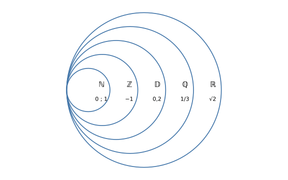

# CAPES Maths — Épreuve disciplinaire appliquée (bac+5) 2025 · Corrigé brut

*Corrigé rédigé par IA, non officiel. Signalez toute erreur.*

Sujet de la session 2025 (durée 5 h) : deux parties, 42 questions numérotées (59 items avec les sous-questions a, b, c). Partie 1 : les ensembles de nombres (fractions, décimaux, irrationnels, cycle 3 → terminale). Partie 2 : quatre situations d'alignement (plan affine, complexes, espace).

## Partie 1 — Les ensembles de nombres

### I.A — Les fractions : définitions et repères de progressivité (questions 1 à 4)

#### Question 1

Un énoncé qui rend nécessaire l'introduction des fractions est un partage que les entiers ne peuvent pas résoudre :

**« Trois tablettes de chocolat identiques doivent être partagées équitablement entre quatre enfants. Quelle quantité de tablette chaque enfant reçoit-il ? »**

Aucun nombre entier ne convient : la réponse est $\tfrac34$ de tablette, ce qui motive, comme le prescrivent les repères de progressivité du cycle 3, d'introduire de « nouveaux nombres » pour « pallier l'insuffisance des nombres entiers ».

#### Question 2

Le concept « partie/tout » présente $\tfrac ab$ comme $a$ parts d'un tout partagé en $b$ parts égales : il suggère que $a\le b$. Il a donc pour limite de ne pas donner de sens aux fractions supérieures à 1, par exemple $\tfrac73$, qui ne sont pas « une partie d'un tout ».

#### Question 3

Les repères annuels de progression du cycle 3 incitent à exploiter en CM1-CM2 le concept de fraction **« partage »** : $\tfrac ab$ y désigne la réplication $a$ fois de l'unité d'une grandeur partagée en $b$ parties égales.

#### Question 4

Pour étendre la définition des fractions au cas $a\in\mathbb Z$ et $b\in\mathbb Z^\ast$ au 
cycle 4, on utilise le concept de fraction **« quotient »** : $\tfrac ab$ est le quotient de 
$a$ par $b$, c'est-à-dire l'unique nombre $x$ tel que $b\,x=a$. C'est le seul des quatre 
concepts qui garde un sens lorsque le numérateur ou le dénominateur est négatif.

### I.B — Analyse d'un outil : le guide-âne (question 5)

#### Question 5.a

Le guide-âne est une feuille de papier ligné : le réseau de droites tracées est, par définition, un réseau de droites **parallèles et équidistantes**. Soit $d_0,d_1,\dots,d_5$ les cinq droites successives qui délimitent les cinq bandes de la feuille, et $P_0=A,P_1,\dots,P_5=B$ leurs points d'intersection avec le segment $[AB]$. La droite $(AB)$ est une sécante de ces droites parallèles. D'après le théorème des parallèles équidistantes : *si des droites parallèles sont équidistantes, elles déterminent sur toute sécante des segments de même longueur*. Les deux hypothèses sont bien réalisées (parallélisme et équidistance des droites du guide-âne, sécante $(AB)$), donc

$$
\begin{aligned}
P_0P_1&=P_1P_2\\
P_1P_2&=P_2P_3\\
P_2P_3&=P_3P_4\\
P_3P_4&=P_4P_5.
\end{aligned}
$$

Les cinq points partagent donc $[AB]$ en **cinq segments de même longueur**. $\square$

#### Question 5.b

- Schéma 1 (« sept tiers de l'unité ») : on réplique 7 fois le tiers de l'unité → concept **« partage »**.
- Schéma 2 (« le tiers de sept unités ») : on partage les 7 unités en 3 → concept **« quotient »**.

#### Question 5.c

L'objectif majeur est de faire percevoir que ces deux procédures donnent **le même nombre** $\tfrac73$ : la fraction acquiert ainsi le statut de **nombre**, indépendant de sa représentation (7 parts d'un tout partagé en 3, ou quotient de 7 par 3).

### I.C — Construction et analyse de ressources autour de la manipulation de fractions (questions 6 à 9)

#### Question 6.a

Oui. Les deux réponses sont valides **selon l'unité de référence choisie** : les deux gâteaux sont partagés en 3 parts égales, soit 6 parts au total, dont 5 sont mangées. Si le « tout » est l'ensemble des deux gâteaux (6 parts), la fraction mangée est $\tfrac56$ (élève 1). Si le « tout » est un seul gâteau (3 parts), on obtient $\tfrac53$ (élève 2). L'énoncé ne fixant pas l'unité, les deux écritures sont cohérentes.

#### Question 6.b

L'objectif visé est le **rôle de l'unité de référence (le « tout »)** dans l'écriture d'une fraction : la même situation peut s'écrire avec des fractions différentes selon l'unité choisie.

#### Question 6.c

En exploitant le concept de « fraction ratio », on modifie la question en : « La part mangée représente combien de fois la part restante ? » La réponse est $\tfrac51=5$ (5 parts mangées pour 1 part restante), ce qui rend valide la réponse de l'élève 3.

#### Question 7.a

On peut dire à l'élève : « Les $\tfrac25$ désignent 10 billes, donc ces deux cinquièmes valent 10 et non le total. Que vaut alors un cinquième ? » L'élève a confondu la part $\tfrac25$ avec le tout.

#### Question 7.b

$\tfrac25$ des billes de Pierre valent 10 billes, donc $\tfrac15$ vaut 5 billes, et

$$
\boxed{\text{Pierre possède } \tfrac55=5\times5=25 \text{ billes.}}
$$

#### Question 8

On propose le QCM : « Combien vaut $\tfrac12+\tfrac13$ ? » avec les choix (a) $\tfrac25$, (b) $\tfrac56$, (c) $\tfrac15$. La bonne réponse est (b). Le distracteur (a) $\tfrac25$ révèle la conception bipartite (addition des numérateurs et des dénominateurs, *whole number bias*) ; le distracteur (c) $\tfrac15$ peut résulter d'une multiplication des numérateurs combinée à une addition des dénominateurs. La réponse seule ne permet cependant pas d'attribuer avec certitude cette procédure à l'élève : une brève demande de justification complète le diagnostic.

#### Question 9.a

Deux raisons à cet objectif d'apprentissage : (i) **situer** la fraction entre deux entiers consécutifs (encadrement, comparaison, placement sur la droite graduée) ; (ii) préparer le **passage à l'écriture décimale** (ordre de grandeur, division euclidienne).

#### Question 9.b

Exemple générique pour $\tfrac{17}{5}$. La division euclidienne donne $17=3\times5+2$, donc

$$
\frac{17}{5}=\frac{3\times5+2}{5}=3+\frac25,
$$
avec $\frac25<1$.

### II.A — Continuité des apprentissages : des fractions aux nombres décimaux (questions 10 et 11)

#### Question 10.a

La définition manquante est : « Un nombre décimal est un nombre qui peut s'écrire sous la forme d'une fraction décimale, c'est-à-dire $\tfrac a{10^n}$ avec $a\in\mathbb Z$ et $n\in\mathbb N$. » Elle figurera au **début de la partie II**, avant la rubrique « Écriture décimale », dont la trace écrite la présuppose.

#### Question 10.b

$$
\frac38=\frac{3\times125}{8\times125}=\frac{375}{1000},
$$

et $\tfrac{375}{1000}$ est une fraction décimale. Donc

$$
\boxed{\tfrac38 \text{ est un nombre décimal } (=0{,}375).}
$$

(La justification « parce que $\tfrac38<1$ » est fausse : seule compte la possibilité d'écrire le nombre sous forme de fraction décimale.)

#### Question 11

La bonne réponse est la réponse **B** : « deux unités et trois centièmes » s'écrit $2+\tfrac3{100}=2{,}03$.

- Distracteur A ($2{,}3$) : l'élève place le 3 au rang des dixièmes au lieu des centièmes (confusion des valeurs de position).
- Distracteur C ($2{,}300$) : cette écriture vaut $2{,}3$, donc deux unités et trente centièmes, et non deux unités et trois centièmes. Elle peut traduire une mauvaise association entre le mot « centièmes » et l'ajout de zéros. Les zéros finaux ne changent pas la valeur du nombre ; le seul choix de cette réponse ne suffit pas à déterminer précisément le raisonnement de l'élève.

### II.B — Analyse d'un exercice sur l'écriture fractionnaire des nombres décimaux (question 12)

#### Question 12.a

Soit $a\in\mathbb Z$ et $b\in\mathbb N^\ast$ tels que $\tfrac ab$ soit irréductible ($\gcd(|a|,b)=1$).

*Sens direct.* Supposons que $\tfrac ab$ soit égale à une fraction décimale : 
$\tfrac ab=\tfrac c{10^n}$ avec $c\in\mathbb Z$, $n\in\mathbb N$. Alors $a\cdot10^n=b\,c$, donc
$b\mid a\cdot10^n$. Comme $\gcd(|a|,b)=1$, le lemme de Gauss donne $b\mid 10^n=2^n5^n$. Tout 
diviseur premier de $b$ divise donc $2^n5^n$ et appartient à $\{2,5\}$.

*Réciproque.* Supposons que les seuls diviseurs premiers possibles de $b$ soient 2 et 5 : $b=2^\alpha5^\beta$ avec $\alpha,\beta\in\mathbb N$. Posons $n=\max(\alpha,\beta)$. Alors

$$
\frac ab=\frac{a\cdot2^{n-\alpha}5^{n-\beta}}{2^\alpha5^\beta\cdot2^{n-\alpha}5^{n-\beta}}=\frac{a\cdot2^{n-\alpha}5^{n-\beta}}{10^n},
$$

et le numérateur est un entier : $\tfrac ab$ est égale à une fraction décimale.

$$
\boxed{\tfrac ab \text{ est décimal } \iff \text{les seuls diviseurs premiers possibles de } b \text{ sont } 2 \text{ et } 5.}
$$

#### Question 12.b

Après réduction éventuelle (le critère porte sur la forme irréductible) :

- $\tfrac{21}{15}=\tfrac75$ : non irréductible au départ ; réduite, la fraction irréductible $7/5$ a pour dénominateur $5$ → **décimale** ($1{,}4$) : il fallait simplifier avant de conclure ;
- $\tfrac3{50}$ : irréductible, $50=2\times5^2$ → **décimale** ($0{,}06$) ;
- $\tfrac7{15}$ : irréductible, $15=3\times5$ ; le facteur premier 3 interdit → **non décimale** ;
- $\tfrac{34}{100}=\tfrac{17}{50}$ : **décimale** ($0{,}34$), mais piège de la réductibilité.

#### Question 12.c

Deux prérequis : savoir **simplifier une fraction** (reconnaître une fraction irréductible) ; savoir **décomposer un entier en produit de facteurs premiers**.

### II.C — Construction et analyse de ressources autour de la multiplication de deux nombres décimaux (questions 13 et 14)

#### Question 13

Contre-exemple à « le résultat aura forcément deux chiffres après la virgule » :

$$
\boxed{2{,}5\times0{,}4=1,}
$$

produit entier de deux nombres décimaux ayant chacun un chiffre non nul après la virgule.

#### Question 14

Un décimal ayant un seul chiffre non nul après la virgule s'écrit $x=\tfrac m{10}$ avec $m\in\mathbb Z$ non multiple de 10. Comme le produit demandé est positif, les deux facteurs sont non nuls et de même signe. Cherchons d'abord les couples positifs, donc avec $m,n\in\mathbb N^\ast$, tels que $xy=6$ :

$$
\frac{mn}{100}=6,
$$
soit $mn=600$, et $600=2^3\times3\times5^2$.

Un diviseur de 600 est multiple de 10 si et seulement s'il contient à la fois un facteur 2 et un facteur 5. Pour que ni $m$ ni $n$ ne soit multiple de 10, il faut donc placer tous les facteurs 2 d'un côté et tous les facteurs 5 de l'autre ; le facteur 3 se place librement. Les seuls couples (à l'ordre près) sont $m=24,\ n=25$ et $m=8,\ n=75$, soit

$$
\boxed{\{2{,}4\ ;\ 2{,}5\} \text{ et } \{0{,}8\ ;\ 7{,}5\}.}
$$

Les deux facteurs peuvent aussi être négatifs. À l'ordre près, la liste complète est donc

$$
\{2{,}4;2{,}5\},\quad \{0{,}8;7{,}5\},\quad
\{-2{,}4;-2{,}5\},\quad \{-0{,}8;-7{,}5\}.
$$

Si le mot « couple » désigne un couple ordonné, on ajoute pour chacun l'ordre inverse : il y a huit couples. Si l'enseignant souhaite se limiter aux décimaux positifs, cette restriction doit être annoncée dans l'énoncé.

### III.A — Étude du nombre $\sqrt2$ (questions 15 à 19)

#### Question 15

Supposons par l'absurde que $\sqrt2$ soit rationnel : $\sqrt2=\tfrac pq$ avec $p\in\mathbb N$, $q\in\mathbb N^\ast$, la fraction étant irréductible ($\gcd(p,q)=1$). Alors

$$
p^2=2q^2.
$$

Ainsi $2\mid p^2$, donc $2\mid p$ (si le carré d'un entier est pair, l'entier est pair) : 
écrivons $p=2p'$. Il vient $4p'^2=2q^2$, soit $q^2=2p'^2$, donc $2\mid q^2$ et $2\mid q$. Les 
entiers $p$ et $q$ sont tous deux pairs, ce qui contredit $\gcd(p,q)=1$.

$$
\boxed{\sqrt2 \text{ est irrationnel.}}
$$

#### Question 16

Deux prérequis : la notion de **fraction irréductible** (tout rationnel admet une écriture irréductible) et la propriété de **parité** « le carré d'un entier est pair si et seulement si l'entier est pair » (on peut ajouter la maîtrise du raisonnement par l'absurde).

#### Question 17

Il en existe **une infinité**. Pour tout entier $n\in\mathbb N$, le nombre $n+\sqrt2$ est irrationnel : si $n+\sqrt2$ était rationnel, alors $\sqrt2=(n+\sqrt2)-n$ le serait aussi, contradiction. Les nombres $\sqrt2,\ 1+\sqrt2,\ 2+\sqrt2,\dots$ sont deux à deux distincts : il existe une infinité de nombres irrationnels.

#### Question 18

Deux propriétés nécessaires : le **théorème de Pythagore** et l'**irrationalité de $\sqrt2$**. 
En effet, dans un triangle rectangle isocèle de côtés de l'angle droit $a$ et d'hypoténuse $c$,
Pythagore donne $c^2=2a^2$, donc $c=a\sqrt2$. Si $a\in\mathbb N^\ast$, alors $c=a\sqrt2$ est 
irrationnel : **aucun** triangle rectangle isocèle n'a ses trois longueurs de côtés entières.

#### Question 19.a

```python
def heron(n):
    u = 2.0            # u_0 = 2
    for i in range(n): # exactement n iterations -> u_n
        u = 0.5 * (u + 2 / u)
    return u           # renvoie u_n
```

#### Question 19.b

Soit $a>\sqrt A>0$ et posons $b=\tfrac12\!\left(a+\tfrac Aa\right)$. Alors

$$
b-\sqrt A=\frac{a^2-2a\sqrt A+A}{2a}=\frac{(a-\sqrt A)^2}{2a}.
$$

Ce nombre est strictement positif (car $a\neq\sqrt A$ et $a>0$), donc $b>\sqrt A$. De plus,

$$
\frac{b-\sqrt A}{a-\sqrt A}=\frac{a-\sqrt A}{2a},
$$

et comme $0<a-\sqrt A<a<2a$, ce quotient appartient à $]0,1[$, d'où $b-\sqrt A<a-\sqrt A$ :

$$
\boxed{b \text{ est strictement plus proche de } \sqrt A \text{ que } a.}
$$

#### Question 19.c

L'algorithme de Newton appliqué à $f(x)=x^2-A$ sur $]0,+\infty[$ donne

$$
x_{n+1}=x_n-\frac{f(x_n)}{f'(x_n)}=x_n-\frac{x_n^2-A}{2x_n}
$$

$$
=\frac12\!\left(x_n+\frac{A}{x_n}\right),
$$

qui est exactement la récurrence de Héron. Les hypothèses de l'annexe 1.17 sont vérifiées : $f$ est définie, dérivable et **convexe** sur $]0,+\infty[$ (car $f''(x)=2>0$), et $f(x)=0$ y admet la solution $\sqrt A$. L'algorithme de Héron est donc le **cas particulier** de celui de Newton pour $f(x)=x^2-A$.

### III.B — Culture mathématique : le nombre $e$ (questions 20 et 21)

#### Question 20

- Définition de cahier de lycée : $e$ est l'unique réel tel que $\ln e=1$, c'est-à-dire $e=\exp(1)$.
- Définition calculatoire : $e=\displaystyle\sum_{k=0}^{+\infty}\frac1{k!}=\lim_{n\to+\infty}\sum_{k=0}^n\frac1{k!}$, qui fournit des valeurs approchées de $e$.

#### Question 21.a

C'est la formule d'**intégration par parties** : si $u$ et $v$ sont deux fonctions dérivables sur $[a,b]$ dont les dérivées $u'$ et $v'$ sont continues sur $[a,b]$, alors

$$
\int_a^b u'(t)v(t)\,\mathrm dt=\big[u(t)v(t)\big]_a^b-\int_a^b u(t)v'(t)\,\mathrm dt.
$$

#### Question 21.b

Deux réussites : l'élève organise sa démonstration par récurrence (initialisation, hérédité, conclusion) et utilise la relation $I_{n+1}=(n+1)I_n-1$ pour essayer d'exprimer $J_{n+1}$ en fonction de $J_n$. Ce sont les bonnes structures de preuve, même si les calculs comportent des erreurs.

Deux erreurs de signe sont identifiables dans la production :

- Une primitive de $t\mapsto e^{1-t}$ est $-e^{1-t}$, et non $e^{1-t}$. On obtient donc $I_0=e-1$, puis $J_0=e-I_0=1\in\mathbb N$. La valeur $J_0=-1$ annoncée par l'élève ne peut d'ailleurs pas valider une propriété disant « entier naturel ».
- En utilisant la récurrence, il faut distribuer le signe moins devant toute l'expression de $I_{n+1}$ :

$$
\begin{aligned}
J_{n+1}&=e(n+1)!-\big((n+1)I_n-1\big),\\
&=(n+1)\big(en!-I_n\big)+1,\\
&=(n+1)J_n+1.
\end{aligned}
$$

L'élève écrit au contraire $(n+1)J_n-1$. Après correction, l'hérédité garantit un entier naturel. Enfin, l'hypothèse de récurrence doit porter sur un entier $n$ fixé, et non être supposée vraie pour tout entier $n$.

#### Question 21.c

L'encadrement $\tfrac1{n+1}\le I_n\le\tfrac e{n+1}$ ne place $I_n$ dans $]0,1[$ que pour 
$n\ge2$ : pour $n\ge2$, $\tfrac e{n+1}\le\tfrac e3<1$ (car $2<e<3$) et $\tfrac1{n+1}>0$, donc 
$0<I_n<1$ et $I_n$ n'est pas un entier. Pour $n=0$ et $n=1$, la majoration $\tfrac e{n+1}$ 
dépasse 1 ($e-1\approx1{,}72$ et $\tfrac e2\approx1{,}36$) : l'argument tombe.

#### Question 21.d

Supposons par l'absurde $e=\tfrac pq$ avec $p,q\in\mathbb N^\ast$. Choisissons un entier $n$ 
tel que $n>1$ et $n\ge q$ (par exemple $n=\max(2,q)$). Alors $q\mid n!$, donc

$$
e\cdot n!=\frac pq\times n!=p\times\frac{n!}{q} \text{ est un entier.}
$$

Or, d'après la question 3.c de l'annexe 1.18, pour $n>1$, $e\times n!$ n'est pas un entier. Contradiction.

$$
\boxed{e \text{ est irrationnel.}}
$$

### III.C — Représentation des ensembles de nombres (question 22)

#### Question 22

Les inclusions sont strictes :

$$
\mathbb N\subsetneq\mathbb Z\subsetneq\mathbb D\subsetneq\mathbb Q\subsetneq\mathbb R.
$$

Le diagramme de Venn est constitué de cinq courbes fermées emboîtées, de la plus intérieure $\mathbb N$ à la plus extérieure $\mathbb R$, avec des exemples placés dans les bonnes « couronnes » :



- $3\in\mathbb N$ ;
- $-2\in\mathbb Z\setminus\mathbb N$ ;
- $1{,}5=\tfrac32\in\mathbb D\setminus\mathbb Z$ ;
- $\tfrac13\in\mathbb Q\setminus\mathbb D$ ;
- $\sqrt2$ et $\pi\in\mathbb R\setminus\mathbb Q$.

## Partie 2 — Situations d'alignement

### Situation 1 — Un exercice de quatrième (questions 1 à 6 ; sections A : 1-3, B : 4-5, C : 6)

#### Question 1

L'objectif est de « confronter la géométrie visuelle à la géométrie raisonnée ». Le choix est pertinent car la figure **suggère** que $O$ est le milieu de $[AC]$ (les dimensions sont proches : $BD=57$ et $AB/2=58{,}5$), alors que ce n'est pas le cas : l'exercice crée un conflit entre la perception et la preuve, qui oblige à démontrer plutôt qu'à constater.

#### Question 2

D'après l'annexe 2.2, il s'agit d'un **exercice/problème ouvert favorisant la prise d'initiatives**, débouchant sur une démonstration (« exercices et problèmes ouverts favorisant la prise d'initiatives, débats et mises au point collectives d'une démonstration ») : ce n'est ni une « question flash », ni un simple exercice d'application.

#### Question 3

Deux arguments : (i) le travail de groupe favorise la **confrontation de stratégies** (mesure, Pythagore, Thalès) et la **verbalisation** entre pairs ; (ii) il permet de **dépasser le constat visuel** par la controverse, en construisant collectivement la nécessité d'une preuve.

#### Question 4

Dans le repère orthonormé $(B;\vec{BA}/117,\vec{BC}/351)$, on a $A=(117,0)$, $C=(0,351)$, 
$D=(57,0)$, $E=(0,175)$. Comme $DBEO$ est un rectangle, $O=D+E-B=(57,175)$. Le milieu de $[AC]$
est $M=(58{,}5;175{,}5)$ :

$$
\boxed{O \text{ n'est pas le milieu de } [AC].}
$$

*Groupe 1.* Réussite : la justification de $(OE)\parallel(AB)$ (deux droites perpendiculaires à $(BC)$) est correcte. Erreurs : (a) il applique Thalès dans le « triangle $ABC$ » en supposant $O$ sur $(AC)$, ce qui est précisément ce qu'il faut établir (raisonnement circulaire) ; (b) il conclut à partir de $\tfrac{OC}{AC}=\tfrac{176}{351}\approx0{,}5$, valeur approchée qui ne prouve pas le milieu exact.

*Groupe 2.* Réussite : les calculs de Pythagore sont corrects, $OC=AO=185$ (car 
$57^2+176^2=60^2+175^2=34225$). Erreur centrale : de $AO=OC$, il conclut que $O$ est le milieu 
de $[AC]$ ; or $AO=OC$ signifie seulement que $O$ appartient à la **médiatrice** de $[AC]$, il 
manque l'alignement. De fait $AO+OC=370$ et 
$AC=\sqrt{117^2+351^2}=\sqrt{136890}\approx369{,}99$, donc l'inégalité triangulaire est stricte
: $O\notin[AC]$.

#### Question 5

Vrai-faux pointant l'erreur centrale du groupe 2 : « Si un point $O$ vérifie $AO=OC$, alors $O$ est le milieu du segment $[AC]$. » — **faux** : tout point de la médiatrice de $[AC]$ vérifie $AO=OC$ sans être le milieu.

#### Question 6

On garde $BD=57$, $BE=175$, $AB=117$, $BC=351$, et $O$ défini par $\vec{BO}=\vec{BD}+\vec{BE}$ 
(parallélogramme $BDOE$), sans hypothèse d'angle droit. Deux pistes :

- **Piste 1 (vectorielle, exacte).** $O$ milieu de $[AC]$ équivaut à $\vec{BO}=\tfrac12(\vec{BA}+\vec{BC})$. Or $\vec{BD}=\tfrac{57}{117}\vec{BA}=\tfrac{19}{39}\vec{BA}$ et $\vec{BE}=\tfrac{175}{351}\vec{BC}$. La condition devient

$$
\tfrac{19}{39}\vec{BA}+\tfrac{175}{351}\vec{BC}=\tfrac12\vec{BA}+\tfrac12\vec{BC}.
$$

Comme le triangle est non plat, la famille $(\vec{BA},\vec{BC})$ est libre : on identifie les coefficients, et $\tfrac{19}{39}\neq\tfrac12$ (de même $\tfrac{175}{351}\neq\tfrac12$). **Aucun triangle ne convient**, quel que soit l'angle en $B$.
- - **Piste 2 (géométrie dynamique).** Placer $B$ à l'origine, faire varier l'angle 
  $\widehat{ABC}$ avec $AB=117$ et $BC=351$ fixés, construire $O$ et tester numériquement 
  (logiciel de géométrie dynamique) si $O$ coïncide avec le milieu de $[AC]$ ; on constate que ce
  n'est jamais le cas, ce qui conjecture le résultat de la piste 1.

### Situation 2 — Démonstration d'une propriété (questions 7 et 8)

#### Question 7

L'élève démontre correctement le **sens direct** : en supposant $A,H,F$ alignés, il applique Thalès dans les triangles $ABF$ et $ACF$, utilise les parallélismes puis $BF=FC$, et conclut $DH=HE$. L'alignement $A,H,F$ est l'hypothèse de ce sens de l'implication : ce n'est donc pas un raisonnement circulaire.

La démonstration reste **incomplète**, car le problème demande une équivalence. Le sens réciproque, « si $H$ est le milieu de $[DE]$, alors $A,H,F$ sont alignés », n'est pas traité. On peut le compléter par l'intersection $H'$ de $(AF)$ et $(DE)$, puis utiliser le sens direct et l'unicité du milieu, comme en question 8.

#### Question 8

On rappelle la configuration : triangle non plat $ABC$, $D\in[AB]$, $E\in[AC]$, 
$(DE)\parallel(BC)$, $F$ milieu de $[BC]$, $H\in[DE]$.

*Sens direct.* Supposons $A,H,F$ alignés. Dans le triangle $ABF$, comme $(DH)\parallel(BF)$, 
Thalès donne $\tfrac{DH}{BF}=\tfrac{AD}{AB}$. Dans le triangle $ACF$, comme $(HE)\parallel(FC)$
, Thalès donne $\tfrac{HE}{FC}=\tfrac{AE}{AC}$. Dans le triangle $ABC$, comme 
$(DE)\parallel(BC)$, on a $\tfrac{AD}{AB}=\tfrac{AE}{AC}$. Donc $\tfrac{DH}{BF}=\tfrac{HE}{FC}$
, et comme $BF=FC$, on obtient $DH=HE$ : $H$ est le milieu de $[DE]$.

*Réciproque.* Notons $H'$ le point d'intersection de $(AF)$ et de $(DE)$ ; il existe et est 
unique car $(AF)$ n'est pas parallèle à $(DE)$ (en effet $(DE)\parallel(BC)$ et $(AF)$ coupe 
$(BC)$ en $F$). Par le sens direct appliqué à $H'\in(AF)$, $H'$ est le milieu de $[DE]$. Par 
unicité du milieu, $H=H'$, donc $A,H,F$ sont alignés.

$$
\boxed{A,H,F \text{ alignés } \iff H \text{ milieu de } [DE].}
$$

### Situation 3 — Nombres complexes et inversion (questions 9 à 14 ; sections A : 9-10, B : 11-12, C : 13-14)

#### Question 9

L'intérêt didactique de la question 2 (cas particulier $D$ d'affixe $1+i$) est de traiter un **cas particulier numérique avant le cas général** (question 3) : les élèves peuvent ainsi **conjecturer** le résultat (l'alignement de $A,B,D'$), se familiariser avec la transformation $t$ sur un exemple concret, et disposer d'un appui méthodologique pour la généralisation.

#### Question 10

Le point $M(z)$ appartient au cercle de centre $\Omega(\omega)$ et de rayon $r\ge0$ si et seulement si $|z-\omega|=r$, soit, les deux membres étant positifs, $|z-\omega|^2=r^2$. Or

$$
|z-\omega|^2=(z-\omega)(\bar z-\bar\omega)=z\bar z-\bar\omega z-\omega\bar z+|\omega|^2.
$$

L'égalité $|z-\omega|^2=r^2$ s'écrit donc

$$
\boxed{z\bar z-\bar\omega z-\omega\bar z=r^2-|\omega|^2.}
$$

#### Question 11.a

Réponse à l'élève : **oui**, par trois points non alignés passe un **unique** cercle, appelé le **cercle circonscrit** au triangle formé par ces trois points.

#### Question 11.b

Soient $A,B,C$ trois points non alignés. Un point $O$ est le centre d'un cercle passant par 
$A,B,C$ si et seulement si $OA=OB=OC$, c'est-à-dire si et seulement si $O$ appartient à la 
médiatrice $m_{AB}$ de $[AB]$ et à la médiatrice $m_{AC}$ de $[AC]$.

*Existence.* $m_{AB}$ est perpendiculaire à $(AB)$ et $m_{AC}$ à $(AC)$ ; comme $A,B,C$ ne sont
pas alignés, $(AB)$ et $(AC)$ ne sont pas parallèles, donc $m_{AB}$ et $m_{AC}$ non plus : 
elles se coupent en un point $O$. Alors $OA=OB$ et $OA=OC$, donc $OA=OB=OC$ : le cercle de 
centre $O$ et de rayon $OA$ passe par $A,B,C$.

*Unicité.* Tout centre d'un tel cercle appartient à $m_{AB}\cap m_{AC}=\{O\}$ : le centre, donc le cercle, est unique. $\square$

#### Question 12.a

L'élève écrit correctement l'équation de $\mathcal C$ (centre $I$ d'affixe 1, rayon 1) : 
$z\bar z-z-\bar z=0$. Mais il remplace $-z-\bar z$ par $-(z-\bar z)=-2i\,\mathrm{Im}(z)$ : il 
**confond $z+\bar z$ et $z-\bar z$**. Le terme correct est $z+\bar z=2\,\mathrm{Re}(z)$, de 
sorte que l'équation est $|z|^2-2\,\mathrm{Re}(z)=0$. Pour l'amener à identifier son erreur, on
lui fait poser $z=x+iy$, calculer $z\bar z-z-\bar z=x^2+y^2-2x$, et constater que cette 
expression est réelle alors que la sienne contient un $i$.

#### Question 12.b

Pour $M(z)\in\mathcal C$ avec $z\neq0$, l'équation du cercle donne $|z|^2=2\,\mathrm{Re}(z)$. L'image $M'$ a pour affixe $z'=\tfrac1{\bar z}=\tfrac{z}{z\bar z}=\tfrac{z}{|z|^2}$, donc

$$
\mathrm{Re}(z')=\frac{\mathrm{Re}(z)}{|z|^2}
$$

$$
=\frac{\tfrac12|z|^2}{|z|^2}=\frac12.
$$

Or $A$ (affixe $\tfrac12+i\tfrac{\sqrt3}2$) et $B$ (affixe 
$e^{-i\pi/3}=\tfrac12-i\tfrac{\sqrt3}2$) ont tous deux une partie réelle égale à $\tfrac12$ : 
la droite $(AB)$ est la droite verticale d'équation $\mathrm{Re}(z)=\tfrac12$. Ainsi

$$
\boxed{A,\ B \text{ et } M' \text{ sont alignés.}}
$$

#### Question 12.c

Coup de pouce : « Que vaut $|z|^2$ en fonction de $\mathrm{Re}(z)$ pour un point de 
$\mathcal C$ ? Écris $z'$ sous la forme $\tfrac{z}{|z|^2}$ et calcule sa partie réelle. Quelle 
est la partie réelle commune de $A$ et de $B$ ? »

#### Question 13

Pour $M(z)$ avec $z\neq0$, l'image a pour affixe $z'=\tfrac1{\bar z}=\tfrac{z}{|z|^2}$. En termes de vecteurs, $\vec{OM}$ a pour affixe $z$ et $OM^2=|z|^2$, donc

$$
\vec{OM'}=\frac{\vec{OM}}{OM^2}.
$$

C'est exactement la définition d'une **inversion de centre $O$ et de puissance $k=1$** :

$$
\boxed{t \text{ est l'inversion de centre } O \text{ et de puissance } 1.}
$$

#### Question 14

L'affirmation est **fausse** en général. L'image d'un cercle par une inversion est une **droite
si et seulement si le cercle passe par le centre de l'inversion** ; sinon, c'est un cercle. 
Ici, $\mathcal C$ passe par $O$ (question 1 de l'exercice), donc son image privée de $O$ est 
bien la droite $(AB)$ ; mais un cercle ne passant pas par $O$, par exemple le cercle de centre 
d'affixe 2 et de rayon 1 pour l'inversion $t$, a pour image un **cercle**, pas une droite. 
$\square$

### Situation 4 — Géométrie dans l'espace (questions 15 à 20)

On considère le cube $ABCDEFGH$, $I$ et $I'$ les milieux respectifs de $[EG]$ et $[BD]$, et 
pour $k\in[0,1]$ les points définis par $\vec{EU_k}=k\vec{ED}$, $\vec{IV_k}=k\vec{II'}$, 
$\vec{GW_k}=k\vec{GB}$.

#### Question 15

Deux intérêts d'une question ouverte : (i) développer la **prise d'initiative et la démarche de recherche** (conjecturer, choisir un outil : vecteurs ou coordonnées) ; (ii) autoriser une **pluralité de méthodes** et de représentations, valorisant des profils d'élèves variés.

#### Question 16

Un logiciel de géométrie dynamique dans l'espace permet de **construire** la configuration, de **faire varier $k$** et de **conjecturer** l'alignement de $U_k,V_k,W_k$ et la position de $V_k$ avant la preuve ; il aide aussi à **visualiser la surface** balayée (question 20).

#### Question 17

Prérequis nécessaire : le **calcul vectoriel dans l'espace**, notamment la colinéarité de deux vecteurs et le repérage par coordonnées dans un repère de l'espace.

#### Question 18

Pour aider un élève à s'engager : **fournir un repère adapté** $(A;\vec{AB},\vec{AD},\vec{AE})$ et suggérer de calculer les coordonnées de $U_k,V_k,W_k$ ; ou lui proposer de **traiter d'abord le cas $k=\tfrac12$** avant de généraliser.

#### Question 19

Dans le repère $(A;\vec{AB},\vec{AD},\vec{AE})$, on a $E=(0,0,1)$, $\vec{ED}=(0,1,-1)$, 
$I=(\tfrac12,\tfrac12,1)$, $\vec{II'}=(0,0,-1)$, $G=(1,1,1)$, $\vec{GB}=(0,-1,-1)$, d'où

$$
\begin{aligned}
U_k&=(0,k,1-k),\\
V_k&=\Big(\tfrac12,\tfrac12,1-k\Big),\\
W_k&=(1,1-k,1-k).
\end{aligned}
$$

- **Correction appuyée sur la production de l'élève 1 (vecteurs).** Par décomposition le long du chemin $U_k\to E\to G\to W_k$ et $U_k\to E\to I\to V_k$ :

$$
\begin{aligned}
\vec{U_kW_k}&=\vec{EG}+k(\vec{GB}-\vec{ED}),\\
\vec{U_kV_k}&=\tfrac12\vec{EG}+\tfrac{k}{2}(\vec{GB}-\vec{ED}).
\end{aligned}
$$

Donc

$$
\boxed{\vec{U_kW_k}=2\,\vec{U_kV_k}.}
$$

- **Correction appuyée sur la production de l'élève 2 (coordonnées).** On calcule

$$
\begin{aligned}
\vec{U_kV_k}&=\Big(\tfrac12,\tfrac12-k,0\Big),\\
\vec{U_kW_k}&=(1,1-2k,0).
\end{aligned}
$$

et l'élève conclut à la colinéarité « parce qu'ils ont la même troisième coordonnée » : ce raisonnement est **faux** (avoir la même troisième coordonnée ne rend pas colinéaires ; ici, cela traduit seulement que $U_k,V_k,W_k$ appartiennent au plan d'équation $z=1-k$). La justification correcte est $\vec{U_kW_k}=2\,\vec{U_kV_k}$.

Dans les deux cas, pour tout $k\in[0,1]$, les points $U_k,V_k,W_k$ sont **alignés** et $V_k$ est le **milieu** de $[U_kW_k]$.

#### Question 20

Un point du segment $[U_kW_k]$ s'écrit $P(k,s)=U_k+s\,\vec{U_kW_k}=(s,\ k+s(1-2k),\ 1-k)$ avec $s\in[0,1]$. Prenons les quatre extrémités :

$$
\begin{aligned}
U_0&=(0,0,1), & W_0&=(1,1,1),\\
U_1&=(0,1,0), & W_1&=(1,0,0).
\end{aligned}
$$

Le plan passant par $U_0,W_0,U_1$ a pour vecteur normal $\vec{U_0W_0}\wedge\vec{U_0U_1}=(1,1,0)\wedge(0,1,-1)=(-1,1,1)$, donc pour équation $-x+y+z=1$. Or $W_1=(1,0,0)$ donne $-1+0+0=-1\neq1$ : les quatre points ne sont pas coplanaires.

$$
\boxed{\text{La surface engendrée par } [U_kW_k],\ k\in[0,1], \text{ n'est pas un plan.}}
$$

En posant $x=s$ et $z=1-k$, on obtient $y=1-x-z+2xz$ : le terme bilinéaire $2xz$ montre qu'il s'agit d'une portion de **quadrique réglée** (paraboloïde hyperbolique).
