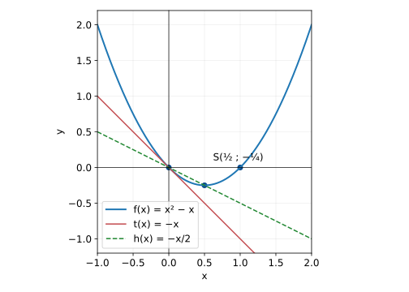
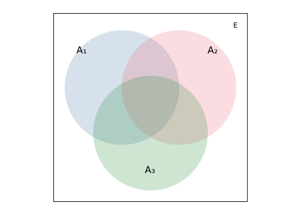

# CAPES Maths — Épreuve disciplinaire (bac+5) 2025 · Corrigé brut

*Corrigé rédigé par IA, non officiel. Signalez toute erreur.*

Épreuve de 5 heures. Trois problèmes indépendants. Pour le problème 1, chaque réponse est donnée avec sa justification.

## Problème 1 : Vrai – Faux

### Calculs dans ℝ

**1.** Notons $p$ le prix hors taxes. Alors $1{,}10\,p = 110$, donc $p = 100$ et la taxe vaut $110 - 100 = 10$ euros, et non 11. **FAUX.**

**2.** Pour tous réels $\alpha,\beta$ :

$$
\alpha^2+\alpha\beta+\beta^2 = \left(\alpha+\frac{\beta}{2}\right)^2 + \frac{3\beta^2}{4},
$$

somme de deux carrés, donc supérieure ou égale à $0$ (nulle seulement si $\alpha=\beta=0$). **VRAI.**

**3.** La négation de $P\Rightarrow Q$ est $P\wedge\neg Q$. Ici :

$$
\begin{aligned} \\
\neg\Big((a>1 \text{ et } b>1)\Rightarrow(a+b>2)\Big) \\
&= (a>1 \text{ et } b>1)\ \text{et}\ (a+b\le 2). \\
\end{aligned}
$$

L'assertion proposée est une implication, ce qu'une négation d'implication ne peut pas être. **FAUX.**

**4.** On a

$$
\begin{aligned} \\
\cos(2025x)=1 &\iff 2025x\in 2\pi\mathbb Z \\
&\iff x=\frac{2k\pi}{2025},\quad k\in\mathbb Z. \\
\end{aligned}
$$

La condition $x\in\,]-\pi,\pi]$ équivaut à $-\dfrac{2025}{2}<k\le\dfrac{2025}{2}$, soit $-1012{,}5<k\le 1012{,}5$ : les entiers $k=-1012,\dots,1012$ conviennent, c'est-à-dire

$$
\boxed{2025 \text{ solutions}}.
$$

**VRAI.**

### Arithmétique

**5.** Si $f(n)=f(m)$, alors $8(n^2-m^2)-10(n-m)=0$, soit

$$
(n-m)\big(8(n+m)-10\big)=0.
$$

Si $n\ne m$, il faudrait $n+m=\dfrac{5}{4}$, impossible pour des entiers naturels. L'application $f$ est donc injective. **VRAI.**

**6.** On a $2^{3n}-1=8^n-1$ et $8\equiv 1\ [7]$, donc $8^n-1\equiv 0\ [7]$ : $7$ divise $2^{3n}-1$ pour tout $n\in\mathbb N$. **VRAI.**

**7.** Contre-exemple : $n=4$, $a=4$, $b=0$ (on a bien $4\equiv 0\ [4]$) et $x=2$.
Alors $x^a=2^4=16\equiv 0\ [4]$ mais $x^b=2^0=1\equiv 1\ [4]$. **FAUX.**

**8.** Récurrence sur $n\ge1$ : initialisation $\sum_{k=1}^1 k^2=1=\frac{1\cdot2\cdot3}{6}$ ; hérédité :

$$
\begin{aligned} \\
\sum_{k=1}^{n+1}k^2 &= \frac{n(n+1)(2n+1)}{6}+(n+1)^2 \\
&= \frac{(n+1)(n+2)(2n+3)}{6}. \\
\end{aligned}
$$

Conclusion : la formule est vraie pour tout $n\ge1$. **VRAI.**

### Analyse réelle

**9.** On a $u_n=-3(-4)^n$ : la suite change de signe à chaque rang et n'est pas bornée, elle ne tend pas vers $+\infty$ (elle n'admet pas de limite). **FAUX.**

**10.** Les sous-suites extraites $u_{2n}=1+\frac{1}{2n}\to1$ et $u_{2n+1}=-1+\frac{1}{2n+1}\to-1$ ont deux limites distinctes : la suite n'admet pas de limite. **VRAI.**

**11.** Soit $\ell=\lim u_n>0$ et $\varepsilon=\frac{\ell}{2}>0$. Il existe un rang $N$ tel que $n\ge N\Rightarrow |u_n-\ell|<\frac{\ell}{2}$, d'où $u_n>\ell-\frac{\ell}{2}=\frac{\ell}{2}>0$. **VRAI.**

**12.** Contre-exemple : $f(x)=-x$ (strictement décroissante) et $u_0=1$ donnent $u_1=-1$, $u_2=1$, $u_3=-1,\dots$ : la suite oscille, elle n'est pas décroissante. **FAUX.**

**13.** Posons $g(x)=e^x-x-1$. Alors $g'(x)=e^x-1$ s'annule en $0$ en changeant de signe
(négative sur $]-\infty,0[$, positive sur $]0,+\infty[$) :
$g$ admet un minimum global en $0$, et $g(0)=0$.
L'équation $e^x=x+1$ a donc $x=0$ pour unique solution. **VRAI.**

**14.** La fonction $f:x\mapsto|x|$ est continue en $0$ mais non dérivable en $0$ (taux d'accroissement égal à $-1$ à gauche, $+1$ à droite). **FAUX.**

**15.** Pour $x\ge0$ :

$$
f(x)=\int_0^x e^{-t}\,dt = 1-e^{-x},
$$

donc $0\le f(x)<1$ : $f$ est bornée sur $[0,+\infty[$. **VRAI.**

**16.** Pour $x\in[0,1]$, $x^{n+1}e^{-x}\le x^n e^{-x}$, donc par croissance de l'intégrale $I_{n+1}\le I_n$ : la suite $(I_n)$ est décroissante, non croissante. **FAUX.**

**17.** Les fonctions $t\mapsto\frac{t^2}{2}$ et $t\mapsto(\ln t)^{n+1}$ sont $C^1$ sur $[1,e]$, donc par intégration par parties :

$$
I_{n+1}=\left[\frac{t^2}{2}(\ln t)^{n+1}\right]_1^e-\int_1^e \frac{t^2}{2}\,(n+1)\frac{(\ln t)^n}{t}\,dt
$$

$$
=\frac{e^2}{2}-\frac{n+1}{2}I_n.
$$

Le signe est moins, et non plus : la relation proposée est fausse. **FAUX.**

### Géométrie

**18.** Codages de la figure : $AB=BD$, $\widehat{DAB}=50^\circ$, $\widehat{DAC}=25^\circ$, $\widehat{DBE}=15^\circ$, angles droits en $C$ et en $E$.

- Triangle $ABD$ isocèle en $B$ (car $AB=BD$) : $\widehat{ADB}=\widehat{DAB}=50^\circ$.
- Triangle $ACD$ rectangle en $C$ : $\widehat{CDA}=90^\circ-25^\circ=65^\circ$.
- Triangle $BDE$ rectangle en $E$ : $\widehat{BDE}=90^\circ-15^\circ=75^\circ$.

Si $C$, $D$, $E$ étaient alignés, les trois angles en $D$ situés d'un même côté de la droite $(CE)$ sommeraient à $180^\circ$. Or

$$
\widehat{CDA}+\widehat{ADB}+\widehat{BDE}=65^\circ+50^\circ+75^\circ=190^\circ\ne180^\circ.
$$

Les points $C$, $D$, $E$ ne sont pas alignés. **FAUX.**

**19.** Loi des cosinus dans le triangle $ABC$ :

$$
CA^2=AB^2+BC^2-2\,AB\cdot BC\cos\widehat{ABC},
$$

d'où

$$
\begin{aligned} \\
\cos\widehat{ABC} \\
&= \frac{4^2+8^2-(4\sqrt3)^2}{2\cdot4\cdot8} \\
&= \frac{16+64-48}{64} = \frac12. \\
\end{aligned}
$$

soit $\widehat{ABC}=\dfrac{\pi}{3}$. **VRAI.**

**20.** On a $\vec{AB}=(2,-1)$ et $\vec{AM}=(5x-1,\,x^2-3)$. Les points $A,B,M$ sont alignés si et seulement si $\det(\vec{AB},\vec{AM})=0$ :

$$
\begin{aligned} \\
2(x^2-3)-(-1)(5x-1) &= 2x^2+5x-7 \\
&= (2x+7)(x-1)=0. \\
\end{aligned}
$$

Les deux valeurs $x=1$ et $x=-\dfrac72$ conviennent : l'équivalence proposée est fausse. **FAUX.**

**21.** Les points $A'$, $B'$, $C'$ appartiennent au plan $(ABC)$
(car $A'\in(BC)$, $B'\in(AC)$, $C'\in(AB)$) et au plan $(P)$.
Comme $A,B,C\notin(P)$, les plans $(ABC)$ et $(P)$ sont distincts ;
leur intersection est une droite, qui contient $A'$, $B'$, $C'$ :
ces trois points sont alignés. **VRAI.**

**22.** Dans le repère orthonormé $(A,\vec{AB}/5,\vec{AD}/4,\vec{AE}/3)$, on a $H(0,4,3)$, $F(5,0,3)$ et $I\left(\frac52,0,0\right)$ (milieu de $[AB]$). Donc

$$
\vec{HF}=(5,-4,0),
$$

$$
\vec{HI}=\left(\tfrac52,-4,-3\right),
$$

et

$$
\begin{aligned} \\
\cos\widehat{FHI} \\
&= \frac{\vec{HF}\cdot\vec{HI}}{\|\vec{HF}\|\,\|\vec{HI}\|} \\
&= \frac{\frac{25}{2}+16}{\sqrt{41}\,\sqrt{\frac{125}{4}}} \\
= \frac{57}{5\sqrt{205}}\approx0{,}796. \\
\end{aligned}
$$

Ainsi $\widehat{FHI}\approx37^\circ$ (arrondi au degré près), et non $45^\circ$. **FAUX.**

**23.** On a

$$
z=e^{2i\pi/3}+e^{-i\pi/2}=-\frac12+i\left(\frac{\sqrt3}{2}-1\right).
$$

Comme $\Re z=-\frac12<0$ et $\Im z=\frac{\sqrt3}{2}-1<0$, le nombre $z$ est dans le troisième quadrant et admet un argument voisin de $-165^\circ$ (modulo $360^\circ$), certainement pas $\frac{\pi}{12}$. **FAUX.**

### Algèbre linéaire

**24.** Dans un espace préhilbertien réel :

$$
\|u+v\|^2=\|u\|^2+2\langle u,v\rangle+\|v\|^2,
$$

donc

$$
\begin{aligned} \\
\|u+v\|^2=\|u\|^2+\|v\|^2 \\
&\iff \langle u,v\rangle=0 \\
&\iff u\perp v. \\
\end{aligned}
$$

**VRAI.**

**25.** Le produit des valeurs propres d'une matrice carrée est égal à son déterminant : $\det A=1\cdot1-(-1)\cdot1=2$. **VRAI.**

**26.** Si $A=PDP^{-1}$ avec $D$ diagonale, alors $A^2=PD^2P^{-1}$, et $D^2$ est diagonale (le carré d'une matrice diagonale est diagonale) : $A^2$ est diagonalisable. **VRAI.**

### Dénombrement et probabilités

**27.** Notons $F_1$ (resp. $F_2$) l'événement « le premier (resp. le deuxième) candidat interrogé est une femme ». Sachant $F_1$, il reste $19$ candidats dont $12$ femmes, et la liste restante est équiprobable :

$$
P(F_2\mid F_1)=\frac{12}{19}.
$$

**VRAI.**

**28.** Voici le programme :

```python
from math import*
n=int(input("Entrez un entier compris entre 3 et 18 :"))
s=0
for i in range(1,7):
  for j in range(1,7):
    for k in range(1,7):
      if i+j+k==n:
        print(i,j,k)
s=s+1
print("Le nombre de façons d'obtenir",n,"avec trois dés est :",s)
```

La ligne `s=s+1` (ligne 9) n'est pas indentée à l'intérieur du test `if` : elle n'est exécutée qu'une seule fois, après les trois boucles, et le programme affiche donc $s=1$ quel que soit $n$. La ligne 10 ne donne pas le nombre de façons d'obtenir la somme $n$. **FAUX.**

(La correction consiste à indenter `s=s+1` au même niveau que le `print(i,j,k)`, à l'intérieur du `if`.)

## Problème 2 : meilleure approximation affine

Dans tout le problème, $f(x)=x^2-x$ sur $\mathbb R$.

### Étude d'un exemple

**1.** $f$ est une fonction polynomiale, donc dérivable sur $\mathbb R$, de dérivée $f'(x)=2x-1$.

**2.** Allure de la courbe : $f$ est un trinôme de coefficient dominant $1>0$ ; la parabole est tournée vers le haut, de sommet $S\left(\frac12,-\frac14\right)$,
et coupe l'axe des abscisses en $0$ et $1$.
Sur la même figure : la tangente en $0$ est la droite d'équation $y=-x$,
et la droite représentative de $h$ est $y=-\frac12x$.



**3.** Par définition, $t(x)=f(0)+f'(0)(x-0)$ avec $f(0)=0$ et $f'(0)=-1$ :

$$
\boxed{t(x)=-x.}
$$

**4.1.** $h$ est affine et $h(0)=0=f(0)$ : **$h$ est une approximation affine de $f$ en $0$.**

**4.2.** On a $f(x)-t(x)=x^2$ et $f(x)-h(x)=x^2-\frac12x=x\left(x-\frac12\right)$, donc

$$
|f(x)-t(x)|=x^2,
$$

$$
|f(x)-h(x)|=|x|\,\left|x-\tfrac12\right|.
$$

Si $x=0$, les deux membres de l'équivalence proposée sont nuls : elle est vraie. Si $x\ne0$, on divise par $|x|>0$ :

$$
\begin{aligned} \\
|f(x)-t(x)|\le|f(x)-h(x)| \\
&\iff |x|\le\left|x-\tfrac12\right|. \\
\end{aligned}
$$

L'équivalence vaut donc pour tout réel $x$.

**4.3.** En élevant au carré :

$$
\begin{aligned} \\
|x|\le\left|x-\tfrac12\right| \\
&\iff x^2\le x^2-x+\tfrac14 \\
&\iff x\le\tfrac14. \\
\end{aligned}
$$

L'intervalle ouvert $D=\left]-1,\tfrac14\right[$ contient $0$ et est inclus dans $\{x\le\frac14\}$ :

$$
\forall x\in D,\quad |f(x)-t(x)|\le|f(x)-h(x)|.
$$

**$t$ est donc une meilleure approximation affine de $f$ en $0$ que $h$.**

**5.1.** $g_k$ est affine et $g_k(0)=0=f(0)$ : **$g_k$ est une approximation affine de $f$ en $0$** (pour tout $k\ne-1$).

**5.2.** On a $f(x)-g_k(x)=x^2-(1+k)x=x\big(x-(1+k)\big)$, donc

$$
\begin{aligned} \\
|f(x)-t(x)|\le|f(x)-g_k(x)| \\
&\iff |x|\le|x-(1+k)|. \\
\end{aligned}
$$

(par division par $|x|$ si $x\ne0$, le cas $x=0$ étant immédiat).

**5.3.** Posons $c=1+k\ne0$. Alors

$$
\begin{aligned} \\
|x|\le|x-c| \\
&\iff x^2\le(x-c)^2 \\
&\iff 2cx\le c^2. \\
\end{aligned}
$$

- Si $c>0$ : $x\le\frac c2$, donc a fortiori tout $x\in\left]-\frac c2,\frac c2\right[=\left]-\left|\frac c2\right|,\left|\frac c2\right|\right[$ convient.
- Si $c<0$ : $x\ge\frac c2=-\left|\frac c2\right|$, donc tout $x\in\left]-\left|\frac c2\right|,\left|\frac c2\right|\right[=\left]\frac c2,-\frac c2\right[$ convient.

Dans les deux cas :

$$
\forall x\in\left]-\left|\frac{1+k}{2}\right|,\left|\frac{1+k}{2}\right|\right[,\quad |f(x)-t(x)|\le|f(x)-g_k(x)|.
$$

**6.** L'intervalle $\left]-\left|\frac{1+k}{2}\right|,\left|\frac{1+k}{2}\right|\right[$ est ouvert et contient $0$ (car $k\ne-1$) :
d'après 5.3, $t$ est une meilleure approximation affine de $f$ en $0$ que $g_k$, pour tout $k\ne-1$.
Or toute approximation affine $g$ de $f$ en $0$ vérifie $g(0)=f(0)=0$,
donc est de la forme $x\mapsto kx$ : c'est $t$ si $k=-1$, un $g_k$ sinon.

**La tangente $t$ est donc une meilleure approximation affine de $f$ en $0$ que toute autre approximation affine de $f$ en $0$.**

### Cas général

**7.** ($\Leftarrow$) Si $g(x)=f(a)+k(x-a)$, alors $g$ est affine et $g(a)=f(a)$ :
c'est une approximation affine de $f$ en $a$.
($\Rightarrow$) Si $g$ est une approximation affine de $f$ en $a$, écrivons $g(x)=px+q$ ;
alors $g(x)-g(a)=p(x-a)$, donc $g(x)=g(a)+p(x-a)=f(a)+p(x-a)$.
D'où l'équivalence.

**8.** Pour $x\ne a$ :

$$
T(x)=\frac{f(x)-t(x)}{x-a}=\frac{f(x)-f(a)}{x-a}-f'(a)\xrightarrow[x\to a]{}0,
$$

$$
G(x)=\frac{f(x)-g(x)}{x-a}=\frac{f(x)-f(a)}{x-a}-k\xrightarrow[x\to a]{}f'(a)-k\ne0.
$$

**9.** Posons $L=f'(a)-k\ne0$. Comme $T(x)\to0$ et $|G(x)|\to|L|$, il existe $\delta>0$ tel que pour $0<|x-a|<\delta$ :

$$
\begin{aligned} \\
|T(x)|&\le\frac{|L|}{2},\\
|G(x)|&\ge\frac{|L|}{2}. \\
\end{aligned}
$$

Alors $|f(x)-t(x)|=|x-a|\,|T(x)|\le|x-a|\,|G(x)|=|f(x)-g(x)|$ (l'inégalité vaut aussi en $x=a$, où les deux membres sont nuls). Sur l'intervalle ouvert $D=\left]a-\delta,a+\delta\right[$ contenant $a$ :

$$
\forall x\in D,\quad |f(x)-t(x)|\le|f(x)-g(x)|,
$$

donc $t$ est une meilleure approximation affine de $f$ en $a$ que $g$.
Toute approximation affine de $f$ en $a$ est de la forme $x\mapsto f(a)+k(x-a)$ (question 7)
et coincide avec $t$ si $k=f'(a)$.

**La fonction affine tangente $t$ est donc la meilleure approximation affine de $f$ en $a$.**

### Relation d'ordre

**10.** Une relation binaire $\mathcal R$ sur un ensemble $E$ est une **relation d'ordre** lorsqu'elle est :
- réflexive : $\forall x\in E,\ x\mathcal R x$ ;
- antisymétrique : $\forall x,y\in E,\ (x\mathcal R y \text{ et } y\mathcal R x)\Rightarrow x=y$ ;
- transitive : $\forall x,y,z\in E,\ (x\mathcal R y \text{ et } y\mathcal R z)\Rightarrow x\mathcal R z$.

**11.** Notons $\mathcal R$ la relation « être une meilleure approximation affine de $f$ en $a$ que » sur l'ensemble des approximations affines de $f$ en $a$.

*Réflexivité.* Pour toute approximation affine $g$ et tout $x\in I$, $|f(x)-g(x)|\le|f(x)-g(x)|$ : avec $D=I$, on a $g\,\mathcal R\,g$.

*Transitivité.* Si $g_1\,\mathcal R\,g_2$ sur $D_1$ et $g_2\,\mathcal R\,g_3$ sur $D_2$,
alors sur $D_1\cap D_2$ (intervalle ouvert contenant $a$) :
$|f-g_1|\le|f-g_2|\le|f-g_3|$, donc $g_1\,\mathcal R\,g_3$.

*Antisymétrie.* Prenons $f:x\mapsto x$ et $a=0$.
Les approximations affines de $f$ en $0$ sont les $g_k:x\mapsto kx$,
et $|f(x)-g_k(x)|=|1-k|\,|x|$.
Pour $g_0=0$ et $g_2:x\mapsto 2x$, on a $|f-g_0|=|f-g_2|$ sur $\mathbb R$ tout entier :
$g_0\,\mathcal R\,g_2$ et $g_2\,\mathcal R\,g_0$, alors que $g_0\ne g_2$.

**$\mathcal R$ est réflexive et transitive mais pas antisymétrique : ce n'est pas une relation d'ordre.**

## Problème 3 : dérangements

### Généralités

**1.** La réunion se partitionne en parties disjointes :

$$
A_1\cup A_2=(A_1\setminus A_2)\sqcup(A_2\setminus A_1)\sqcup(A_1\cap A_2),
$$

d'où

$$
\mathrm{card}(A_1\cup A_2)=\mathrm{card}(A_1\setminus A_2)+\mathrm{card}(A_2\setminus A_1)+\mathrm{card}(A_1\cap A_2).
$$

Comme $\mathrm{card}(A_i)=\mathrm{card}(A_i\setminus A_j)+\mathrm{card}(A_i\cap A_j)$, on obtient

$$
\boxed{\mathrm{card}(A_1\cup A_2)=\mathrm{card}(A_1)+\mathrm{card}(A_2)-\mathrm{card}(A_1\cap A_2).}
$$

**2.** Schéma de Venn à trois disques sécants : en sommant les trois cardinaux, chaque intersection deux à deux est comptée deux fois (on la retranche une fois), et la zone centrale est comptée trois fois puis retranchée trois fois (on la rajoute une fois). D'où, sans démonstration :



$$
\boxed{\begin{aligned} \\
\mathrm{card}(A_1\cup A_2\cup A_3) = \sum_{i=1}^3\mathrm{card}(A_i)-\sum_{1\le i<j\le3}\mathrm{card}(A_i\cap A_j)+\mathrm{card}(A_1\cap A_2\cap A_3). \\
\end{aligned}}
$$

**3.** La formule du crible avec $n=3$ s'écrit

$$
\begin{aligned} \\
\mathrm{card}\left(\bigcup_{i=1}^3A_i\right) \\
&= \sum_{k=1}^3(-1)^{k-1}\sum_{1\le i_1<\dots<i_k\le3}\mathrm{card}(A_{i_1}\cap\dots\cap A_{i_k}), \\
\end{aligned}
$$

ce qui redonne exactement l'expression de la question 2.

### Calcul du nombre de dérangements

**4.** $E_1=\{1\}$ : la seule permutation est l'identité, qui fixe $1$, donc $d_1=0$. $E_2=\{1,2\}$ : parmi les deux permutations, seule la transposition est sans point fixe, donc $d_2=1$.

$$
\boxed{d_1=0,\ d_2=1.}
$$

**5.** Soit $\sigma\in S_n$ :

$$
\begin{aligned} \\
\sigma\in S_n\setminus D_n \\
&\iff \sigma\text{ admet au moins un point fixe} \\
&\iff \exists i\in E_n,\ \sigma(i)=i \\
&\iff \sigma\in\bigcup_{i=1}^n A_i. \\
\end{aligned}
$$

Donc $S_n\setminus D_n=\bigcup_{i=1}^n A_i$.

**6.** Si $\sigma\in A_{i_1}\cap\dots\cap A_{i_k}$, les $k$ points distincts $i_1,\dots,i_k$ sont fixés et $\sigma$ induit une bijection quelconque des $n-k$ points restants, ce qui caractérise entièrement $\sigma$ :

$$
\boxed{\mathrm{card}(A_{i_1}\cap\dots\cap A_{i_k})=(n-k)!}
$$

**7.** Par la formule du crible appliquée aux $A_i$, sachant que chaque intersection de $k$ ensembles a pour cardinal $(n-k)!$ et qu'il y a $\binom nk$ tels choix :

$$
\begin{aligned} \\
\mathrm{card}\left(\bigcup_{i=1}^n A_i\right) \\
&= \sum_{k=1}^n(-1)^{k-1}\binom nk(n-k)!. \\
\end{aligned}
$$

Comme $D_n=S_n\setminus\bigcup_i A_i$ et $\mathrm{card}(S_n)=n!$ (question 5) :

$$
\boxed{d_n=n!-\sum_{k=1}^n(-1)^{k-1}\binom nk(n-k)!}
$$

**8.** Puisque $\binom nk(n-k)!=\dfrac{n!}{k!(n-k)!}(n-k)!=\dfrac{n!}{k!}$ :

$$
\begin{aligned} \\
d_n &= n!-\sum_{k=1}^n(-1)^{k-1}\frac{n!}{k!} \\
&= n!\left(1+\sum_{k=1}^n\frac{(-1)^k}{k!}\right), \\
\end{aligned}
$$

$$
\boxed{d_n=n!\sum_{k=0}^n\frac{(-1)^k}{k!}.}
$$

### Applications

**9.** On a $p_n=\dfrac{d_n}{n!}=\displaystyle\sum_{k=0}^n\frac{(-1)^k}{k!}$ (question 8), qui est la somme partielle d'ordre $n$ de la série exponentielle en $-1$, absolument convergente :

$$
\boxed{\begin{aligned} \\
\lim_{n\to+\infty}p_n = \sum_{k=0}^{+\infty}\frac{(-1)^k}{k!} = e^{-1} = \frac1e. \\
\end{aligned}}
$$

**10.1.** La répartition des boules est équiprobable sur les $n!$ permutations, donc

$$
\begin{aligned} \\
P(X_n=0) &= \frac{d_n}{n!} = \sum_{k=0}^n\frac{(-1)^k}{k!},\\
P(X_n\ge1) &= 1-\sum_{k=0}^n\frac{(-1)^k}{k!}. \\
\end{aligned}
$$

**10.2.** Avoir exactement $q$ coïncidences, c'est choisir les $q$ urnes qui reçoivent leur propre boule ($\binom nq$ choix) et imposer un dérangement sur les $n-q$ restantes ($d_{n-q}$ façons) :

$$
\begin{aligned} \\
P(X_n=q) \\
&= \frac{\binom nq\,d_{n-q}}{n!} \\
= \frac{1}{q!}\sum_{k=0}^{n-q}\frac{(-1)^k}{k!}. \\
\end{aligned}
$$

**10.3.** Écrivons $X_n=\sum_{i=1}^n B_i$, où $B_i$ vaut $1$ si l'urne $i$ reçoit la boule $i$, $0$ sinon. Alors

$$
\begin{aligned} \\
E(B_i) &= P(\sigma(i)=i) \\
&= \frac{(n-1)!}{n!} = \frac1n. \\
\end{aligned}
$$

Par linéarité de l'espérance (qui ne requiert aucune indépendance) :

$$
\boxed{\begin{aligned} \\
E(X_n) &= \sum_{i=1}^n E(B_i) = n\cdot\frac1n = 1, \\
\end{aligned}}
$$

valeur indépendante de $n$.
