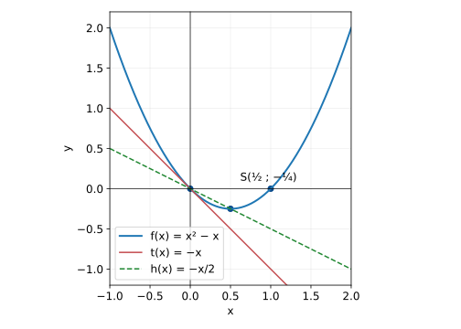
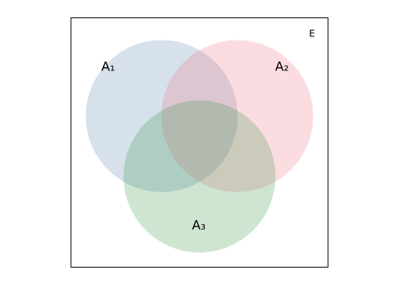

# CAPES Maths — Épreuve disciplinaire (bac+5) 2025 · Corrigé guidé

*Corrigé rédigé par IA, non officiel. Signalez toute erreur.*

## Présentation du sujet

L'épreuve dure **5 heures**, est notée sur 20 (coefficient 2), et « une note globale égale ou inférieure à 5 est éliminatoire » (rapport 2025, p. 4). La calculatrice est autorisée. Moyenne de la session 2025 : 8,93, écart-type 4,62, quartiles 5,33 / 8,75 / 12,66 (rapport p. 9).

Le sujet comporte **trois problèmes indépendants**, soit **55 questions** :

| Problème | Questions | Contenu | Notions du programme mobilisées |
|---|---|---|---|
| 1 — Vrai – Faux | items 1 à 28 | 28 affirmations à verdict argumenté, balayant six thèmes : calculs dans ℝ (1-4), arithmétique (5-8), analyse réelle (9-17), géométrie (18-23), algèbre linéaire (24-26), dénombrement et probabilités (27-28) | logique, congruences, suites, continuité/dérivabilité, intégration, géométrie plane et dans l'espace, produits scalaires, matrices, probabilités conditionnelles, algorithmique |
| 2 — Meilleure approximation affine | questions 1 à 11 (dont 4.1-4.3, 5.1-5.3) | étude de $f:x\mapsto x^2-x$ en $0$, généralisation à une fonction dérivable en $a$, puis structure de la relation « être une meilleure approximation affine que » | dérivabilité, limites, taux d'accroissement, relations d'ordre |
| 3 — Dérangements | questions 1 à 10 (dont 10.1-10.3) | formule du crible, dénombrement des dérangements $d_n$, limite de $p_n=d_n/n!$, loi du nombre de coïncidences | cardinaux, formule du crible, permutations, probabilités, espérance |

**Règle d'or du problème 1.** Le rapport 2025 prévient : « Il s'agit de répondre et d'argumenter chaque réponse ; dans le cas contraire, aucun point n'est attribué à la question. » (p. 17) Une réponse juste sans preuve ne rapporte rien.

**Questions discriminantes d'après le rapport 2025.** Le problème 1 « a toujours été abordé » (p. 17) ; le problème 3 « a été abordé (au moins sur une question) par 70% des candidats, mais seulement 16% obtient une note supérieure à la moitié des points attribués » (p. 22) : c'est la partie la plus rentable à soigner. Dans le problème 2, le cas général (questions 8-9) et la relation d'ordre (questions 10-11) sont les points durs — « la propriété d'antisymétrie n'est pas maîtrisée » (p. 21).

**Gestion du temps.** Les problèmes étant indépendants, on peut les traiter dans l'ordre de son choix (rapport p. 17). Comptez environ 1 h 30 pour le problème 1 (verdicts rapides mais preuves à rédiger soigneusement), 1 h 45 pour le problème 2 (le cœur du sujet), 1 h 15 pour le problème 3, et gardez du temps pour la relecture.

## Problème 1 — Vrai – Faux

Six thèmes balayés : calculs dans ℝ (items 1-4), arithmétique (5-8), analyse réelle (9-17), géométrie (18-23), algèbre linéaire (24-26), dénombrement et probabilités (27-28). Pour chaque item : un verdict (VRAI/FAUX), puis une preuve ou un contre-exemple. Ne jamais conclure sans argument.

### Item 1

> [!INDICATION]
> Traduire « taxé à 10 %, payé 110 € TTC » par une équation sur le prix hors taxes.

> [!INDICATION]
> Ne pas confondre le montant de la taxe et 10 % du prix TTC.

#### Solution

Notons $p$ le prix hors taxes. Alors $1{,}10\,p = 110$, donc $p = 100$ et la taxe vaut $110 - 100 = 10$ euros, et non 11. **FAUX.**

### Item 2

> [!INDICATION]
> Mettre le trinôme en $α$ sous forme canonique.

#### Solution

Pour tous réels $\alpha,\beta$ :

$$
\alpha^2+\alpha\beta+\beta^2 = \left(\alpha+\frac{\beta}{2}\right)^2 + \frac{3\beta^2}{4},
$$

somme de deux carrés, donc supérieure ou égale à $0$ (nulle seulement si $\alpha=\beta=0$). **VRAI.**

### Item 3

> [!INDICATION]
> Écrire la négation logique de $P\Rightarrow Q$ avant de la comparer à l'assertion proposée.

#### Solution

La négation de $P\Rightarrow Q$ est $P\wedge\neg Q$. Ici :

$$
\begin{aligned} \\
\neg\Big((a>1 \text{ et } b>1)\Rightarrow(a+b>2)\Big) \\
&= (a>1 \text{ et } b>1)\ \text{et}\ (a+b\le 2). \\
\end{aligned}
$$

L'assertion proposée est une implication, ce qu'une négation d'implication ne peut pas être. **FAUX.**

> [!JURY]
> Le rapport 2025 (p. 17) insiste : « la négation d’une implication n’est pas une implication ».

### Item 4

> [!INDICATION]
> Résoudre $\cos u = 1$ sur ℝ, puis compter les solutions dans l'intervalle donné.

> [!INDICATION]
> Ne pas utiliser arccosinus comme réciproque de cosinus sur ℝ : compter les $k$ tels que $2k\pi/2025\in\,]-\pi,\pi]$.

#### Solution

On a

$$
\begin{aligned} \\
\cos(2025x)=1 &\iff 2025x\in 2\pi\mathbb Z \\
&\iff x=\frac{2k\pi}{2025},\quad k\in\mathbb Z. \\
\end{aligned}
$$

La condition $x\in\,]-\pi,\pi]$ équivaut à $-\dfrac{2025}{2}<k\le\dfrac{2025}{2}$, soit $-1012{,}5<k\le 1012{,}5$ : les entiers $k=-1012,\dots,1012$ conviennent, soit $2025$ solutions. **VRAI.**

> [!JURY]
> « la fonction arccosinus n’est pas la réciproque de la fonction cosinus sur l’ensemble des réels » (rapport 2025, p. 17).

### Item 5

> [!INDICATION]
> Partir de $f(n)=f(m)$ et factoriser ; raisonner sur la somme $n+m$, sans dériver sur ℕ.

#### Solution

Si $f(n)=f(m)$, alors $8(n^2-m^2)-10(n-m)=0$, soit

$$
(n-m)\big(8(n+m)-10\big)=0.
$$

Si $n\ne m$, il faudrait $n+m=\dfrac{5}{4}$, impossible pour des entiers naturels. L'application $f$ est donc injective. **VRAI.**

> [!JURY]
> Le rapport 2025 (p. 18) rappelle qu'« on ne peut pas dériver une fonction à variable réelle dans l’ensemble des entiers naturels » et que l'injectivité « n’est pas à confondre avec celle de surjectivité ».

### Item 6

> [!INDICATION]
> Réduire $2^{3n}$ modulo 7.

#### Solution

On a $2^{3n}-1=8^n-1$ et $8\equiv 1\ [7]$, donc $8^n-1\equiv 0\ [7]$ : $7$ divise $2^{3n}-1$ pour tout $n\in\mathbb N$. **VRAI.**

### Item 7

> [!INDICATION]
> Chercher un contre-exemple avec de petits entiers (puissances de 2 modulo 4).

#### Solution

Contre-exemple : $n=4$, $a=4$, $b=0$ (on a bien $4\equiv 0\ [4]$) et $x=2$.
Alors $x^a=2^4=16\equiv 0\ [4]$ mais $x^b=2^0=1\equiv 1\ [4]$. **FAUX.**

### Item 8

> [!INDICATION]
> Démonstration par récurrence sur $n\ge1$.

#### Solution

Initialisation : $\sum_{k=1}^1 k^2=1=\frac{1\cdot2\cdot3}{6}$. Hérédité :

$$
\begin{aligned} \\
\sum_{k=1}^{n+1}k^2 &= \frac{n(n+1)(2n+1)}{6}+(n+1)^2 \\
&= \frac{(n+1)(n+2)(2n+3)}{6}. \\
\end{aligned}
$$

Conclusion : la formule est vraie pour tout $n\ge1$. **VRAI.**

> [!JURY]
> « Si la démonstration par récurrence est souvent bien menée sur les deux premières étapes, il s'agit de ne pas oublier la troisième qui est de conclure » (rapport 2025, p. 18).

### Item 9

> [!INDICATION]
> Exprimer $u_n$ en fonction de $n$ et examiner le signe.

#### Solution

On a $u_n=-3(-4)^n$ : la suite change de signe à chaque rang et n'est pas bornée, elle ne tend pas vers $+\infty$ (elle n'admet pas de limite). **FAUX.**

### Item 10

> [!INDICATION]
> Extraire les sous-suites des rangs pairs et impairs.

#### Solution

Les sous-suites extraites $u_{2n}=1+\frac{1}{2n}\to1$ et $u_{2n+1}=-1+\frac{1}{2n+1}\to-1$ ont deux limites distinctes : la suite n'admet pas de limite. **VRAI.**

> [!PIEGE]
> Une suite alternée *peut* admettre une limite finie : le rapport 2025 (p. 18-19) note que « certains candidats pensent qu’une suite alternée ne peut pas avoir une limite finie ».

### Item 11

> [!INDICATION]
> Appliquer la définition de la limite avec un $\varepsilon$ bien choisi en fonction de $\ell$.

#### Solution

Soit $\ell=\lim u_n>0$ et $\varepsilon=\frac{\ell}{2}>0$. Il existe un rang $N$ tel que $n\ge N\Rightarrow |u_n-\ell|<\frac{\ell}{2}$, d'où $u_n>\ell-\frac{\ell}{2}=\frac{\ell}{2}>0$. **VRAI.**

### Item 12

> [!INDICATION]
> Tester une fonction strictement décroissante simple.

#### Solution

Contre-exemple : $f(x)=-x$ (strictement décroissante) et $u_0=1$ donnent $u_1=-1$, $u_2=1$, $u_3=-1,\dots$ : la suite oscille, elle n'est pas décroissante. **FAUX.**

### Item 13

> [!INDICATION]
> Étudier les variations de $g:x\mapsto e^x-x-1$.

#### Solution

$g'(x)=e^x-1$ s'annule en $0$ en changeant de signe
(négative sur $]-\infty,0[$, positive sur $]0,+\infty[$) :
$g$ admet un minimum global en $0$, et $g(0)=0$.
L'équation $e^x=x+1$ a donc $x=0$ pour unique solution. **VRAI.**

### Item 14

> [!INDICATION]
> La continuité en un point n'entraîne pas la dérivabilité : exhiber un contre-exemple classique.

#### Solution

La fonction $f:x\mapsto|x|$ est continue en $0$ mais non dérivable en $0$ (taux d'accroissement égal à $-1$ à gauche, $+1$ à droite). **FAUX.**

> [!JURY]
> Le rapport 2025 (p. 18) relève parmi les énoncés faux proposés « toute fonction continue est dérivable ».

### Item 15

> [!INDICATION]
> Calculer explicitement l'intégrale, puis conclure sur les valeurs de $f$.

#### Solution

Pour $x\ge0$ :

$$
f(x)=\int_0^x e^{-t}\,dt = 1-e^{-x},
$$

donc $0\le f(x)<1$ : $f$ est bornée sur $[0,+\infty[$. **VRAI.**

### Item 16

> [!INDICATION]
> Comparer les intégrandes $x^{n+1}e^{-x}$ et $x^n e^{-x}$ sur $[0,1]$.

#### Solution

Pour $x\in[0,1]$, $x^{n+1}e^{-x}\le x^n e^{-x}$, donc par croissance de l'intégrale $I_{n+1}\le I_n$ : la suite $(I_n)$ est décroissante, non croissante. **FAUX.**

### Item 17

> [!INDICATION]
> Intégration par parties avec $u=(\ln t)^{n+1}$ et $dv=t\,dt$ ; vérifier que les fonctions sont $C^1$ avant de calculer.

#### Solution

Les fonctions $t\mapsto\frac{t^2}{2}$ et $t\mapsto(\ln t)^{n+1}$ sont $C^1$ sur $[1,e]$, donc :

$$
I_{n+1}=\left[\frac{t^2}{2}(\ln t)^{n+1}\right]_1^e-\int_1^e \frac{t^2}{2}\,(n+1)\frac{(\ln t)^n}{t}\,dt
$$

$$
=\frac{e^2}{2}-\frac{n+1}{2}I_n.
$$

Le signe est moins, et non plus : la relation proposée est fausse. **FAUX.**

> [!JURY]
> « l’existence des intégrales manipulées se doit d’être vérifiée » et les conditions d'application des propriétés calculatoires justifiées (rapport 2025, p. 19) ; « Une forte proportion de candidats n’a pas traité cette partie » (p. 19).

### Item 18

> [!INDICATION]
> Sur la figure codée : $AB=BD$, $\widehat{DAB}=50^\circ$, $\widehat{DAC}=25^\circ$, $\widehat{DBE}=15^\circ$,
> angles droits en $C$ et $E$.
> Exprimer les trois angles en $D$ des triangles $ACD$, $ABD$, $BDE$.

> [!INDICATION]
> Si $C$, $D$, $E$ étaient alignés, la somme de ces trois angles d'un même côté de $(CE)$ vaudrait $180^\circ$. La calculer.

#### Solution

- Triangle $ABD$ isocèle en $B$ (car $AB=BD$) : $\widehat{ADB}=\widehat{DAB}=50^\circ$.
- Triangle $ACD$ rectangle en $C$ : $\widehat{CDA}=90^\circ-25^\circ=65^\circ$.
- Triangle $BDE$ rectangle en $E$ : $\widehat{BDE}=90^\circ-15^\circ=75^\circ$.

Si $C$, $D$, $E$ étaient alignés, les trois angles en $D$ situés d'un même côté de la droite $(CE)$ sommeraient à $180^\circ$. Or

$$
\widehat{CDA}+\widehat{ADB}+\widehat{BDE}=65^\circ+50^\circ+75^\circ=190^\circ\ne180^\circ.
$$

Les points $C$, $D$, $E$ ne sont pas alignés. **FAUX.**

> [!PIEGE]
> Ne pas confondre implication et équivalence : l'alignement exigerait exactement $180^\circ$, et toute autre somme conclut à la non-alignement.

> [!JURY]
> « les questions 18 et 19 sont bien traitées dans la majorité des cas » (rapport 2025, p. 19) ; le rapport relève aussi « des confusions entre implication et équivalence » (p. 19).

### Item 19

> [!INDICATION]
> Appliquer la loi des cosinus pour exprimer $\cos\widehat{ABC}$.

#### Solution

$$
CA^2=AB^2+BC^2-2\,AB\cdot BC\cos\widehat{ABC},
$$

d'où

$$
\begin{aligned} \\
\cos\widehat{ABC} \\
&= \frac{4^2+8^2-(4\sqrt3)^2}{2\cdot4\cdot8} \\
&= \frac{16+64-48}{64} = \frac12. \\
\end{aligned}
$$

soit $\widehat{ABC}=\dfrac{\pi}{3}$. **VRAI.**

### Item 20

> [!INDICATION]
> Exprimer l'alignement de $A$, $B$, $M$ par l'annulation d'un déterminant, puis résoudre l'équation obtenue.

#### Solution

On a $\vec{AB}=(2,-1)$ et $\vec{AM}=(5x-1,\,x^2-3)$. L'alignement équivaut à $\det(\vec{AB},\vec{AM})=0$ :

$$
\begin{aligned} \\
2(x^2-3)-(-1)(5x-1) &= 2x^2+5x-7 \\
&= (2x+7)(x-1)=0. \\
\end{aligned}
$$

Les deux valeurs $x=1$ et $x=-\dfrac72$ conviennent : l'équivalence proposée est fausse. **FAUX.**

> [!PIEGE]
> L'assertion « alignés si et seulement si $x=1$ » oublie la seconde racine : une équivalence exige de résoudre complètement l'équation.

### Item 21

> [!INDICATION]
> Situer $A'$, $B'$, $C'$ à la fois dans le plan $(ABC)$ et dans le plan $(P)$, puis conclure sur leur intersection.

#### Solution

Les points $A'$, $B'$, $C'$ appartiennent au plan $(ABC)$
(car $A'\in(BC)$, $B'\in(AC)$, $C'\in(AB)$) et au plan $(P)$.
Comme $A,B,C\notin(P)$, les plans $(ABC)$ et $(P)$ sont distincts ;
leur intersection est une droite, qui contient $A'$, $B'$, $C'$ :
ces trois points sont alignés. **VRAI.**

### Item 22

> [!INDICATION]
> Choisir un repère orthonormé adapté au pavé droit, calculer les coordonnées de $H$, $F$, $I$, puis le cosinus de l'angle.

#### Solution

Dans le repère orthonormé $(A,\vec{AB}/5,\vec{AD}/4,\vec{AE}/3)$, on a $H(0,4,3)$, $F(5,0,3)$ et $I\left(\frac52,0,0\right)$ (milieu de $[AB]$). Donc

$$
\vec{HF}=(5,-4,0),
$$

$$
\vec{HI}=\left(\tfrac52,-4,-3\right),
$$

et

$$
\begin{aligned} \\
\cos\widehat{FHI} \\
&= \frac{\vec{HF}\cdot\vec{HI}}{\|\vec{HF}\|\,\|\vec{HI}\|} \\
&= \frac{\frac{25}{2}+16}{\sqrt{41}\,\sqrt{\frac{125}{4}}} \\
= \frac{57}{5\sqrt{205}}\approx0{,}796. \\
\end{aligned}
$$

Ainsi $\widehat{FHI}\approx37^\circ$ (arrondi au degré près), et non $45^\circ$. **FAUX.**

> [!JURY]
> « La géométrie dans l’espace est peu abordée » (rapport 2025, p. 19) : ne pas la négliger, un simple calcul de produit scalaire suffit ici.

### Item 23

> [!INDICATION]
> Mettre $z$ sous forme algébrique et déterminer son quadrant.

#### Solution

$$
z=e^{2i\pi/3}+e^{-i\pi/2}=-\frac12+i\left(\frac{\sqrt3}{2}-1\right).
$$

Comme $\Re z=-\frac12<0$ et $\Im z=\frac{\sqrt3}{2}-1<0$, le nombre $z$ est dans le troisième quadrant et admet un argument voisin de $-165^\circ$ (modulo $360^\circ$), certainement pas $\frac{\pi}{12}$. **FAUX.**

### Item 24

> [!INDICATION]
> Développer $\|u+v\|^2$ avec le produit scalaire ; rester dans un espace préhilbertien quelconque.

#### Solution

$$
\|u+v\|^2=\|u\|^2+2\langle u,v\rangle+\|v\|^2,
$$

donc

$$
\begin{aligned} \\
\|u+v\|^2=\|u\|^2+\|v\|^2 \\
&\iff \langle u,v\rangle=0 \\
&\iff u\perp v. \\
\end{aligned}
$$

**VRAI.**

> [!JURY]
> « certains candidats ont considéré uniquement le cas où E est le plan euclidien » (rapport 2025, p. 20) : l'équivalence vaut dans tout espace préhilbertien réel.

### Item 25

> [!INDICATION]
> Relier le produit des valeurs propres au déterminant.

#### Solution

Le produit des valeurs propres d'une matrice carrée est égal à son déterminant : $\det A=1\cdot1-(-1)\cdot1=2$. **VRAI.**

### Item 26

> [!INDICATION]
> Écrire $A=PDP^{-1}$ avec $D$ diagonale et élever au carré.

#### Solution

Si $A=PDP^{-1}$ avec $D$ diagonale, alors $A^2=PD^2P^{-1}$, et $D^2$ est diagonale (le carré d'une matrice diagonale est diagonale) : $A^2$ est diagonalisable. **VRAI.**

> [!JURY]
> Le rapport 2025 (p. 20) relève « des omissions du fait de préciser que le carré d’une matrice diagonale est lui-même diagonal ».

### Item 27

> [!INDICATION]
> Nommer précisément les événements, puis compter ce qui reste sachant le premier tirage.

#### Solution

Notons $F_1$ (resp. $F_2$) l'événement « le premier (resp. le deuxième) candidat interrogé est une femme ». Sachant $F_1$, il reste $19$ candidats dont $12$ femmes, et la liste restante est équiprobable :

$$
P(F_2\mid F_1)=\frac{12}{19}.
$$

**VRAI.**

> [!JURY]
> Le rapport 2025 (p. 20) note une « confusion entre évènement et probabilité » : distinguer soigneusement l'événement et sa probabilité.

### Item 28

> [!INDICATION]
> Lire l'indentation du programme ligne par ligne : à quel bloc appartient la ligne `s=s+1` ?

#### Solution

```python
from math import*
n=int(input("Entrez un entier compris entre 3 et 18 :"))
s=0
for i in range(1,7):
  for j in range(1,7):
    for k in range(1,7):
      if i+j+k==n:
        print(i,j,k)
s=s+1
print("Le nombre de façons d'obtenir",n,"avec trois dés est :",s)
```

La ligne `s=s+1` (ligne 9) n'est pas indentée à l'intérieur du test `if` : elle n'est exécutée qu'une seule fois, après les trois boucles, et le programme affiche donc $s=1$ quel que soit $n$. La ligne 10 ne donne pas le nombre de façons d'obtenir la somme $n$. **FAUX.** (La correction consiste à indenter `s=s+1` au même niveau que le `print(i,j,k)`, à l'intérieur du `if`.)

> [!JURY]
> « les réponses à la question sur l’algorithme manquent parfois de clarté » (rapport 2025, p. 20) : pointer précisément la ligne fautive et son effet.

## Problème 2 — Meilleure approximation affine

On étudie d'abord $f:x\mapsto x^2-x$ en $0$ (approximations affines $t$, $h$, $g_k$), puis le cas général d'une fonction dérivable en $a$ (la tangente est la meilleure approximation affine), enfin la structure de la relation « être une meilleure approximation affine que ».

### Question 1

> [!INDICATION]
> $f$ est polynomiale : que peut-on dire de sa dérivabilité ?

#### Solution

$f$ est une fonction polynomiale, donc dérivable sur $\mathbb R$, de dérivée $f'(x)=2x-1$.

### Question 2

> [!INDICATION]
> Reconnaître un trinôme : signe du coefficient dominant, sommet, racines.

> [!INDICATION]
> Sur la figure, placer aussi la tangente en $0$ (question 3) et la droite de $h$ (question 4).

#### Solution

$f$ est un trinôme de coefficient dominant $1>0$  : parabole tournée vers le haut, de sommet $S\left(\frac12,-\frac14\right)$,
coupant l'axe des abscisses en $0$ et $1$.
Sur la même figure : la tangente en $0$ est la droite d'équation $y=-x$,
et la droite représentative de $h$ est $y=-\frac12x$.



> [!JURY]
> « la nécessité d’être rigoureux pour obtenir les tracés demandés, même s’il s’agit d’allures de courbes » (rapport 2025, p. 21) ; le jury y retrouve la confusion entre fonction, graphe et image.

### Question 3

> [!INDICATION]
> Appliquer la définition de la fonction affine tangente en $a=0$.

#### Solution

$t(x)=f(0)+f'(0)(x-0)$ avec $f(0)=0$ et $f'(0)=-1$ :

$$
\boxed{t(x)=-x.}
$$

### Question 4.1

> [!INDICATION]
> Vérifier les deux conditions de la définition d'une approximation affine en $0$.

#### Solution

$h$ est affine et $h(0)=0=f(0)$ : **$h$ est une approximation affine de $f$ en $0$.**

> [!JURY]
> « Il s'agit de bien vérifier les conditions même si certaines semblent triviales » (rapport 2025, p. 21).

### Question 4.2

> [!INDICATION]
> Calculer $f-t$ et $f-h$, puis comparer $|f-t|$ et $|f-h|$ ; penser au cas $x=0$ avant de diviser par $|x|$.

#### Solution

On a $f(x)-t(x)=x^2$ et $f(x)-h(x)=x^2-\frac12x=x\left(x-\frac12\right)$, donc

$$
|f(x)-t(x)|=x^2,
$$

$$
|f(x)-h(x)|=|x|\,\left|x-\tfrac12\right|.
$$

Si $x=0$, les deux membres de l'équivalence proposée sont nuls : elle est vraie. Si $x\ne0$, on divise par $|x|>0$ :

$$
\begin{aligned} \\
|f(x)-t(x)|\le|f(x)-h(x)| \\
&\iff |x|\le\left|x-\tfrac12\right|. \\
\end{aligned}
$$

L'équivalence vaut donc pour tout réel $x$.

### Question 4.3

> [!INDICATION]
> Résoudre l'inéquation $|x|\le|x-\frac12|$ (élever au carré), puis exhiber un intervalle ouvert contenant $0$ où elle est vraie.

#### Solution

$$
\begin{aligned} \\
|x|\le\left|x-\tfrac12\right| \\
&\iff x^2\le x^2-x+\tfrac14 \\
&\iff x\le\tfrac14. \\
\end{aligned}
$$

L'intervalle ouvert $D=\left]-1,\tfrac14\right[$ contient $0$ et est inclus dans $\{x\le\frac14\}$ :

$$
\forall x\in D,\quad |f(x)-t(x)|\le|f(x)-h(x)|.
$$

**$t$ est donc une meilleure approximation affine de $f$ en $0$ que $h$.**

### Question 5.1

> [!INDICATION]
> Même vérification que pour $h$, avec $g_k(x)=kx$.

#### Solution

$g_k$ est affine et $g_k(0)=0=f(0)$ : **$g_k$ est une approximation affine de $f$ en $0$** (pour tout $k\ne-1$).

> [!JURY]
> « La question 5. est en grande partie une généralisation de la question 4. et se traite de la même façon. » (rapport 2025, p. 21)

### Question 5.2

> [!INDICATION]
> Même démarche que la question 4.2, avec $f(x)-g_k(x)$ factorisé par $x$.

#### Solution

On a $f(x)-g_k(x)=x^2-(1+k)x=x\big(x-(1+k)\big)$, donc

$$
\begin{aligned} \\
|f(x)-t(x)|\le|f(x)-g_k(x)| \\
&\iff |x|\le|x-(1+k)|. \\
\end{aligned}
$$

(par division par $|x|$ si $x\ne0$, le cas $x=0$ étant immédiat).

### Question 5.3

> [!INDICATION]
> Poser $c=1+k$, résoudre $|x|\le|x-c|$ par élévation au carré, distinguer le signe de $c$.

> [!INDICATION]
> Vérifier que l'intervalle proposé, symétrique autour de $0$, est bien inclus dans l'ensemble des solutions.

#### Solution

Posons $c=1+k\ne0$. Alors

$$
\begin{aligned} \\
|x|\le|x-c| \\
&\iff x^2\le(x-c)^2 \\
&\iff 2cx\le c^2. \\
\end{aligned}
$$

- Si $c>0$ : $x\le\frac c2$, donc a fortiori tout $x\in\left]-\frac c2,\frac c2\right[=\left]-\left|\frac c2\right|,\left|\frac c2\right|\right[$ convient.
- Si $c<0$ : $x\ge\frac c2=-\left|\frac c2\right|$, donc tout $x\in\left]-\left|\frac c2\right|,\left|\frac c2\right|\right[=\left]\frac c2,-\frac c2\right[$ convient.

Dans les deux cas :

$$
\forall x\in\left]-\left|\frac{1+k}{2}\right|,\left|\frac{1+k}{2}\right|\right[,\quad |f(x)-t(x)|\le|f(x)-g_k(x)|.
$$

### Question 6

> [!INDICATION]
> L'intervalle de la question 5.3 est ouvert et contient $0$ : que dit la définition ? Puis caractériser toutes les approximations affines de $f$ en $0$.

#### Solution

L'intervalle $\left]-\left|\frac{1+k}{2}\right|,\left|\frac{1+k}{2}\right|\right[$ est ouvert et contient $0$ (car $k\ne-1$) :
d'après 5.3, $t$ est une meilleure approximation affine de $f$ en $0$ que $g_k$, pour tout $k\ne-1$.
Or toute approximation affine $g$ de $f$ en $0$ vérifie $g(0)=f(0)=0$,
donc est de la forme $x\mapsto kx$ : c'est $t$ si $k=-1$, un $g_k$ sinon.

**La tangente $t$ est donc une meilleure approximation affine de $f$ en $0$ que toute autre approximation affine de $f$ en $0$.**

### Question 7

> [!INDICATION]
> Double implication ; à droite, écrire une fonction affine générale $g(x)=px+q$ et utiliser $g(a)=f(a)$.

#### Solution

($\Leftarrow$) Si $g(x)=f(a)+k(x-a)$, alors $g$ est affine et $g(a)=f(a)$ :
c'est une approximation affine de $f$ en $a$.
($\Rightarrow$) Si $g$ est une approximation affine de $f$ en $a$, écrivons $g(x)=px+q$ ;
alors $g(x)-g(a)=p(x-a)$, donc $g(x)=g(a)+p(x-a)=f(a)+p(x-a)$.
D'où l'équivalence.

### Question 8

> [!INDICATION]
> Écrire $T(x)$ et $G(x)$ comme des taux d'accroissement moins une constante, et passer à la limite avec la définition du nombre dérivé.

#### Solution

Pour $x\ne a$ :

$$
T(x)=\frac{f(x)-t(x)}{x-a}=\frac{f(x)-f(a)}{x-a}-f'(a)\xrightarrow[x\to a]{}0,
$$

$$
G(x)=\frac{f(x)-g(x)}{x-a}=\frac{f(x)-f(a)}{x-a}-k\xrightarrow[x\to a]{}f'(a)-k\ne0.
$$

> [!JURY]
> « il est attendu que le candidat fasse le lien entre les notions de limite et de dérivée à travers la définition de nombre dérivé » (rapport 2025, p. 21).

### Question 9

> [!INDICATION]
> Comparer les limites de $|T|$ (nulle) et de $|G|$ (non nulle) pour obtenir une inégalité valable sur un voisinage de $a$.

#### Solution

Posons $L=f'(a)-k\ne0$. Comme $T(x)\to0$ et $|G(x)|\to|L|$, il existe $\delta>0$ tel que pour $0<|x-a|<\delta$ :

$$
\begin{aligned} \\
|T(x)|&\le\frac{|L|}{2},\\
|G(x)|&\ge\frac{|L|}{2}. \\
\end{aligned}
$$

Alors $|f(x)-t(x)|=|x-a|\,|T(x)|\le|x-a|\,|G(x)|=|f(x)-g(x)|$ (l'inégalité vaut aussi en $x=a$, où les deux membres sont nuls). Sur l'intervalle ouvert $D=\left]a-\delta,a+\delta\right[$ contenant $a$ :

$$
\forall x\in D,\quad |f(x)-t(x)|\le|f(x)-g(x)|,
$$

donc $t$ est une meilleure approximation affine de $f$ en $a$ que $g$.
Toute approximation affine de $f$ en $a$ est de la forme $x\mapsto f(a)+k(x-a)$ (question 7)
et coincide avec $t$ si $k=f'(a)$.

**La fonction affine tangente $t$ est donc la meilleure approximation affine de $f$ en $a$.**

### Question 10

> [!INDICATION]
> Citer les trois axiomes (réflexivité, antisymétrie, transitivité).

#### Solution

Une relation binaire $\mathcal R$ sur un ensemble $E$ est une **relation d'ordre** lorsqu'elle est :
- réflexive : $\forall x\in E,\ x\mathcal R x$ ;
- antisymétrique : $\forall x,y\in E,\ (x\mathcal R y \text{ et } y\mathcal R x)\Rightarrow x=y$ ;
- transitive : $\forall x,y,z\in E,\ (x\mathcal R y \text{ et } y\mathcal R z)\Rightarrow x\mathcal R z$.

### Question 11

> [!INDICATION]
> Vérifier réflexivité et transitivité (l'intersection de deux intervalles ouverts contenant $a$ convient), puis tester l'antisymétrie sur un exemple simple de $f$.

> [!INDICATION]
> Pour l'antisymétrie, essayer $f:x\mapsto x$ en $a=0$ : deux approximations affines distinctes peuvent avoir le même écart à $f$.

#### Solution

Notons $\mathcal R$ la relation « être une meilleure approximation affine de $f$ en $a$ que » sur l'ensemble des approximations affines de $f$ en $a$.

*Réflexivité.* Pour toute approximation affine $g$ et tout $x\in I$, $|f(x)-g(x)|\le|f(x)-g(x)|$ : avec $D=I$, on a $g\,\mathcal R\,g$.

*Transitivité.* Si $g_1\,\mathcal R\,g_2$ sur $D_1$ et $g_2\,\mathcal R\,g_3$ sur $D_2$,
alors sur $D_1\cap D_2$ (intervalle ouvert contenant $a$) :
$|f-g_1|\le|f-g_2|\le|f-g_3|$, donc $g_1\,\mathcal R\,g_3$.

*Antisymétrie.* Prenons $f:x\mapsto x$ et $a=0$.
Les approximations affines de $f$ en $0$ sont les $g_k:x\mapsto kx$,
et $|f(x)-g_k(x)|=|1-k|\,|x|$.
Pour $g_0=0$ et $g_2:x\mapsto 2x$, on a $|f-g_0|=|f-g_2|$ sur $\mathbb R$ tout entier :
$g_0\,\mathcal R\,g_2$ et $g_2\,\mathcal R\,g_0$, alors que $g_0\ne g_2$.

**$\mathcal R$ est réflexive et transitive mais pas antisymétrique : ce n'est pas une relation d'ordre.**

> [!JURY]
> « trop peu de candidats connaissent la définition exacte de relation d’ordre » et « la propriété d’antisymétrie n’est pas maîtrisée » (rapport 2025, p. 21).

## Problème 3 — Dérangements

On commence par des généralités sur les cardinaux d'unions (questions 1-3, la formule du crible étant admise ensuite), on l'applique aux dérangements (questions 4-8), puis on en tire des applications probabilistes (questions 9-10).

### Question 1

> [!INDICATION]
> Partitionner $A_1\cup A_2$ en trois parties disjointes, puis exprimer $\mathrm{card}(A_i)$ à l'aide de $A_i\cap A_j$.

#### Solution

$$
A_1\cup A_2=(A_1\setminus A_2)\sqcup(A_2\setminus A_1)\sqcup(A_1\cap A_2),
$$

d'où

$$
\mathrm{card}(A_1\cup A_2)=\mathrm{card}(A_1\setminus A_2)+\mathrm{card}(A_2\setminus A_1)+\mathrm{card}(A_1\cap A_2).
$$

Comme $\mathrm{card}(A_i)=\mathrm{card}(A_i\setminus A_j)+\mathrm{card}(A_i\cap A_j)$, on obtient

$$
\boxed{\mathrm{card}(A_1\cup A_2)=\mathrm{card}(A_1)+\mathrm{card}(A_2)-\mathrm{card}(A_1\cap A_2).}
$$

### Question 2

> [!INDICATION]
> Imaginer un schéma de Venn à trois disques et compter combien de fois chaque zone est comptée dans $\sum_i\mathrm{card}(A_i)$.

#### Solution

Schéma de Venn à trois disques sécants : en sommant les trois cardinaux, chaque intersection deux à deux est comptée deux fois (on la retranche une fois), et la zone centrale est comptée trois fois puis retranchée trois fois (on la rajoute une fois). D'où, sans démonstration :



$$
\boxed{\begin{aligned} \\
\mathrm{card}(A_1\cup A_2\cup A_3) = \sum_{i=1}^3\mathrm{card}(A_i)-\sum_{1\le i<j\le3}\mathrm{card}(A_i\cap A_j)+\mathrm{card}(A_1\cap A_2\cap A_3). \\
\end{aligned}}
$$

### Question 3

> [!INDICATION]
> Spécialiser la formule du crible admise au cas $n=3$.

#### Solution

La formule du crible avec $n=3$ s'écrit

$$
\begin{aligned} \\
\mathrm{card}\left(\bigcup_{i=1}^3A_i\right) \\
&= \sum_{k=1}^3(-1)^{k-1}\sum_{1\le i_1<\dots<i_k\le3}\mathrm{card}(A_{i_1}\cap\dots\cap A_{i_k}), \\
\end{aligned}
$$

ce qui redonne exactement l'expression de la question 2.

### Question 4

> [!INDICATION]
> Lister les permutations de $E_1$ puis de $E_2$ et compter celles sans point fixe.

#### Solution

$E_1=\{1\}$ : la seule permutation est l'identité, qui fixe $1$, donc $d_1=0$. $E_2=\{1,2\}$ : parmi les deux permutations, seule la transposition est sans point fixe, donc $d_2=1$.

$$
\boxed{d_1=0,\ d_2=1.}
$$

### Question 5

> [!INDICATION]
> Traduire « ne pas être un dérangement » avec les $A_i$ : double inclusion.

#### Solution

Soit $\sigma\in S_n$ :

$$
\begin{aligned} \\
\sigma\in S_n\setminus D_n \\
&\iff \sigma\text{ admet au moins un point fixe} \\
&\iff \exists i\in E_n,\ \sigma(i)=i \\
&\iff \sigma\in\bigcup_{i=1}^n A_i. \\
\end{aligned}
$$

Donc $S_n\setminus D_n=\bigcup_{i=1}^n A_i$.

### Question 6

> [!INDICATION]
> Si $\sigma$ fixe $k$ points distincts, il induit une bijection des $n-k$ points restants : compter ces bijections.

#### Solution

Si $\sigma\in A_{i_1}\cap\dots\cap A_{i_k}$, les $k$ points distincts $i_1,\dots,i_k$ sont fixés et $\sigma$ induit une bijection quelconque des $n-k$ points restants, ce qui caractérise entièrement $\sigma$ :

$$
\boxed{\mathrm{card}(A_{i_1}\cap\dots\cap A_{i_k})=(n-k)!}
$$

### Question 7

> [!INDICATION]
> Appliquer le crible aux $A_i$ en regroupant les intersections de même taille $k$ (il y en a $\binom nk$), puis utiliser la question 5.

#### Solution

Par la formule du crible, sachant que chaque intersection de $k$ ensembles a pour cardinal $(n-k)!$ et qu'il y a $\binom nk$ tels choix :

$$
\begin{aligned} \\
\mathrm{card}\left(\bigcup_{i=1}^n A_i\right) \\
&= \sum_{k=1}^n(-1)^{k-1}\binom nk(n-k)!. \\
\end{aligned}
$$

Comme $D_n=S_n\setminus\bigcup_i A_i$ et $\mathrm{card}(S_n)=n!$ (question 5) :

$$
\boxed{d_n=n!-\sum_{k=1}^n(-1)^{k-1}\binom nk(n-k)!}
$$

### Question 8

> [!INDICATION]
> Simplifier $\binom nk(n-k)!$ en $\frac{n!}{k!}$, puis réindexer la somme pour faire apparaître $\frac{(-1)^k}{k!}$.

#### Solution

Puisque $\binom nk(n-k)!=\dfrac{n!}{k!(n-k)!}(n-k)!=\dfrac{n!}{k!}$ :

$$
\begin{aligned} \\
d_n &= n!-\sum_{k=1}^n(-1)^{k-1}\frac{n!}{k!} \\
&= n!\left(1+\sum_{k=1}^n\frac{(-1)^k}{k!}\right), \\
\end{aligned}
$$

$$
\boxed{d_n=n!\sum_{k=0}^n\frac{(-1)^k}{k!}.}
$$

> [!JURY]
> Le rapport 2025 (p. 23) note « des difficultés dans la gestion des indices » dans cette partie.

### Question 9

> [!INDICATION]
> Exprimer $p_n$ avec la question 8 et reconnaître une somme partielle de série usuelle ; justifier l'existence de la limite.

#### Solution

On a $p_n=\dfrac{d_n}{n!}=\displaystyle\sum_{k=0}^n\frac{(-1)^k}{k!}$, somme partielle d'ordre $n$ de la série exponentielle en $-1$, absolument convergente :

$$
\boxed{\begin{aligned} \\
\lim_{n\to+\infty}p_n = \sum_{k=0}^{+\infty}\frac{(-1)^k}{k!} = e^{-1} = \frac1e. \\
\end{aligned}}
$$

### Question 10.1

> [!INDICATION]
> Une répartition équiprobable sur les $n!$ permutations : $P(X_n=0)$ est le rapport $d_n/n!$.

#### Solution

$$
\begin{aligned} \\
P(X_n=0) &= \frac{d_n}{n!} = \sum_{k=0}^n\frac{(-1)^k}{k!},\\
P(X_n\ge1) &= 1-\sum_{k=0}^n\frac{(-1)^k}{k!}. \\
\end{aligned}
$$

### Question 10.2

> [!INDICATION]
> Pour avoir exactement $q$ coïncidences : choisir les $q$ urnes coïncidentes, puis déranger les $n-q$ restantes ; utiliser la question 8 pour $d_{n-q}$.

#### Solution

$$
\begin{aligned} \\
P(X_n=q) \\
&= \frac{\binom nq\,d_{n-q}}{n!} \\
= \frac{1}{q!}\sum_{k=0}^{n-q}\frac{(-1)^k}{k!}. \\
\end{aligned}
$$

### Question 10.3

> [!INDICATION]
> Écrire $X_n$ comme somme de variables de Bernoulli indicatrices, et appliquer la linéarité de l'espérance.

#### Solution

Écrivons $X_n=\sum_{i=1}^n B_i$, où $B_i$ vaut $1$ si l'urne $i$ reçoit la boule $i$, $0$ sinon. Alors

$$
\begin{aligned} \\
E(B_i) &= P(\sigma(i)=i) \\
&= \frac{(n-1)!}{n!} = \frac1n. \\
\end{aligned}
$$

Par linéarité de l'espérance (qui ne requiert aucune indépendance) :

$$
\boxed{\begin{aligned} \\
E(X_n) &= \sum_{i=1}^n E(B_i) = n\cdot\frac1n = 1, \\
\end{aligned}}
$$

valeur indépendante de $n$.

> [!METHODE]
> La linéarité de l'espérance s'applique sans hypothèse d'indépendance : c'est ce qui rend le calcul de $E(X_n)$ immédiat, alors que les $B_i$ ne sont pas indépendantes.

> [!JURY]
> « Ce problème a été abordé (au moins sur une question) par 70% des candidats, mais seulement 16% obtient une note supérieure à la moitié des points attribués. » (rapport 2025, p. 22) ; parmi ceux qui traitent la partie 2, « les réponses proposées sont très pertinentes » (p. 23).

## Bilan

- **Problème 1 (Vrai – Faux).** Toujours argumenter : une réponse sans preuve ne rapporte aucun point. Les pièges classiques : négation d'une implication, réciproque de cosinus, injectivité sur ℕ, limite d'une suite alternée, continuité vs dérivabilité, sens du signe dans une IPP, équivalence vs implication (deux racines), indentation d'un programme Python.
- **Problème 2 (meilleure approximation affine).** L'exemple $f:x\mapsto x^2-x$ se traite par factorisation de $f-g$ par $x$ et comparaison de $|x|$ à $|x-c|$ ; le cas général repose sur le lien limite/dérivée via le taux d'accroissement : la tangente est la meilleure approximation affine. La relation « être une meilleure approximation affine que » est un préordre (réflexive, transitive) mais pas une relation d'ordre (antisymétrie en défaut).
- **Problème 3 (dérangements).** La formule du crible appliquée aux ensembles $A_i$ de permutations fixant un point donné donne $d_n=n!\sum_{k=0}^n\frac{(-1)^k}{k!}$ ;
la probabilité $p_n$ tend vers $e^{-1}$, la loi de $X_n$ est $P(X_n=q)=\frac1{q!}\sum_{k=0}^{n-q}\frac{(-1)^k}{k!}$, et $E(X_n)=1$ par linéarité de l'espérance.
- **Prérequis à revoir** : logique (négation, quantificateurs), congruences, récurrence (ne pas oublier la conclusion), suites (sous-suites, définition de la limite), intégration (vérifier l'existence et les conditions de l'IPP), géométrie dans l'espace (produit scalaire dans un repère), cardinaux et crible, linéarité de l'espérance.
- **Transposable** : la comparaison $|f-t|\le|f-g|$ par taux d'accroissement (problème 2, questions 8-9) se retrouve dès qu'une quantité tend vers 0 plus vite qu'une autre au voisinage d'un point ; le crible (problème 3) sert dès qu'on compte un complémentaire d'union.
