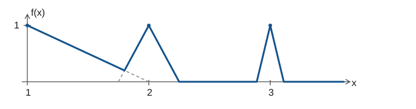

# CCINP MP — Mathématiques 1 2025 · Corrigé

*Corrigé rédigé par IA, non officiel. Signalez toute erreur.*

## Exercice I

### Question 1

Soient $u,v\in f'(]-1,1[)$. Choisissons $s,t\in]-1,1[$ tels que $f'(s)=u$ et $f'(t)=v$.

Pour tout $\tau\in[0,1]$, le point $(1-\tau)s+\tau t$ reste dans l’intervalle $]-1,1[$. Comme $f$ est de classe $\mathcal C^1$, l’application
$$\tau\longmapsto f'((1-\tau)s+\tau t)$$
est continue. Elle trace un chemin de $u$ à $v$ dans $f'(]-1,1[)$. **Cette image est donc connexe par arcs.**

### Question 2

**a)** Pour $t<0$, le taux d’accroissement en $0$ vaut $(0,0)$. Pour $t>0$, il vaut
$$\frac{f(t)-f(0)}{t}=\bigl(t\sin(1/t),\,t\cos(1/t)\bigr).$$
Sa norme euclidienne vaut $t$, qui tend vers $0$. Ainsi $f$ est dérivable en $0$ avec $f'(0)=(0,0)$.

Sur $]-1,0[$, $f$ est constante. Sur $]0,1[$, ses composantes sont dérivables par produit et composition. On obtient
$$\boxed{f'(t)=
\begin{cases}
(0,0) & \text{si }-1<t\le 0,\\
\bigl(2t\sin(1/t)-\cos(1/t),\,2t\cos(1/t)+\sin(1/t)\bigr)
& \text{si }0<t<1.
\end{cases}}$$

**b)** Pour $t>0$, les vecteurs $(\sin(1/t),\cos(1/t))$ et $(-\cos(1/t),\sin(1/t))$ sont orthonormés. L’expression de $f'(t)$ dans cette base donne
$$\boxed{\|f'(t)\|_2^2=4t^2+1.}$$
L’image de $f'$ contient l’origine et, par exemple, $f'(1/2)$ de norme supérieure à $1$.

Elle ne contient aucun point de norme strictement comprise entre $0$ et $1$. Si un chemin continu dans l’image reliait ces deux points, sa norme, fonction continue du paramètre, prendrait la valeur $1/2$ par le théorème des valeurs intermédiaires. **L’image de $f'$ n’est donc pas connexe par arcs.**

## Exercice II

### Question 3

La fonction $f$ est polynomiale, donc de classe $\mathcal C^2$. Ses dérivées partielles sont
$$\begin{aligned}
\partial_x f(x,y)&=12x+6y-10,\\
\partial_y f(x,y)&=6x+4y-6.
\end{aligned}$$
L’annulation du gradient donne $6x+3y=5$ et $6x+4y=6$. Par soustraction, $y=1$, puis $x=1/3$. C’est l’unique point critique. La hessienne vaut
$$H=\begin{pmatrix}12&6\\6&4\end{pmatrix}.$$
Elle est symétrique réelle, donc ses valeurs propres sont réelles. Leur produit vaut $\det H=12>0$ et leur somme $\operatorname{tr}H=16>0$.

Elles sont donc toutes deux positives et la hessienne est définie positive. Le critère du second ordre donne un minimum local strict au point critique. En admettant qu’il soit global, on évalue $f(1/3,1)$ en sommant trois carrés égaux à $(2/3)^2$. Ainsi
$$\boxed{\min_{\mathbb R^2} f=\frac43.}$$

### Question 4

Par définition du projeté orthogonal sur $F$, le vecteur $a-b$ appartient à $F^\perp$. Comme $u$ et $v$ sont dans $F$, ses produits scalaires avec ces deux vecteurs sont nuls.

Les vecteurs $u$ et $v$ sont indépendants et on écrit $b=xu+yv$. En calculant les produits scalaires, on obtient
$$\begin{cases}
6x+3y=5,\\
3x+2y=3.
\end{cases}$$
Le double de la seconde équation, diminué de la première, donne $y=1$, puis $x=1/3$. Ainsi $\boxed{b=(4/3,1/3,5/3)}$.

Pour tout $(x,y)$, on a $f(x,y)=\|a-(xu+yv)\|^2$. Comme $a-b\in F^\perp$ et $b-(xu+yv)\in F$, le théorème de Pythagore donne
$$\|a-(xu+yv)\|^2=\|a-b\|^2+\|b-(xu+yv)\|^2.$$
Le second terme est nul pour $xu+yv=b$. Le minimum est donc
$$\boxed{\|a-b\|^2=(2/3)^2+(2/3)^2+(-2/3)^2=\frac43.}$$

## Problème — Autour du théorème de comparaison avec une intégrale

## Partie I — Théorème de comparaison avec une intégrale

### Question 5

On a $S_{n+1}-S_n=f(n+1)\ge0$. De même, $J_{n+1}-J_n=I_{n+1}\ge0$ par positivité de $f$. **Les deux suites sont croissantes au sens large.**

Pour $t\in[k-1,k]$, la décroissance donne $f(k)\le f(t)\le f(k-1)$. Par croissance de l’intégrale et puisque l’intervalle est de longueur $1$,
$$\boxed{f(k)\le I_k\le f(k-1).}$$

### Question 6

En sommant Q5 pour $k=1,\ldots,n$ et en utilisant la relation de Chasles pour les intégrales, on obtient
$$\boxed{S_n-f(0)\le J_n\le S_{n-1}.}$$

### Question 7

**(1)** Si $f$ est intégrable sur $\mathbb R_+$, alors $(J_n)$ est majorée par l’intégrale de $f$. Par Q6, $(S_n)$ est majorée. Comme elle est croissante, elle converge.

Réciproquement, si la série converge, alors $S_n$ est majorée par sa limite $S$. Par Q6, $J_n\le S$ pour tout $n$.

Pour tout réel $x\ge0$, la positivité de $f$ donne $\int_0^x f(t)\,dt\le J_{\lceil x\rceil}\le S$.

L’intégrale partielle est croissante en $x$ et majorée, donc elle a une limite finie. La positivité de $f$ assure alors son intégrabilité. **L’intégrabilité de $f$ équivaut à la convergence de $\sum f(n)$.**

**(2)** Pour $n\ge1$, Q5 donne
$$0\le I_n-f(n)\le f(n-1)-f(n).$$
Les sommes partielles des différences sont croissantes par positivité des termes. De plus, par télescopage,
$$\begin{aligned}
\sum_{n=1}^N\bigl(I_n-f(n)\bigr)&\le f(0)-f(N)\\
&\le f(0).
\end{aligned}$$
**La série $\sum_{n\ge1}(I_n-f(n))$ converge.**

### Question 8

**a)** Sur $[2,+\infty[$, les fonctions $t\mapsto t$ et $t\mapsto(\ln t)^\alpha$ sont strictement croissantes et positives, donc leur produit croît strictement et $f$ décroît strictement. Le changement de variable $u=\ln t$ donne
$$\int_2^x f(t)\,dt=\int_{\ln 2}^{\ln x}u^{-\alpha}\,du.$$
On en déduit
$$\boxed{\int_2^x f(t)\,dt=
\begin{cases}
\displaystyle\frac{(\ln x)^{1-\alpha}-(\ln 2)^{1-\alpha}}{1-\alpha}
&\text{si }\alpha\ne1,\\[4pt]
\ln(\ln x)-\ln(\ln 2)&\text{si }\alpha=1.
\end{cases}}$$
Cette expression a une limite finie exactement lorsque $\alpha>1$. La fonction translatée $s\mapsto f(s+2)$ est continue, positive et décroissante sur $\mathbb R_+$. Par Q7(1), **la série $\sum_{n\ge2}1/(n(\ln n)^\alpha)$ converge exactement pour $\alpha>1$.**

**b)** Pour $\alpha=2$, l’intégrale sur $[2,+\infty[$ vaut $1/\ln 2$. La comparaison de Q6 appliquée à la fonction translatée donne, à la limite,
$$\begin{aligned}
\sum_{n=2}^{+\infty}f(n)&\ge\int_2^{+\infty}f(t)\,dt,\\
\sum_{n=2}^{+\infty}f(n)&\le f(2)+\int_2^{+\infty}f(t)\,dt.
\end{aligned}$$
D’où
$$\boxed{\begin{aligned}
\sum_{n=2}^{+\infty}\frac1{n(\ln n)^2}&\ge\frac1{\ln 2},\\
\sum_{n=2}^{+\infty}\frac1{n(\ln n)^2}&\le\frac1{\ln 2}+\frac1{2(\ln 2)^2}.
\end{aligned}}$$

### Question 9

**a)** Posons $h(t)=1/(1+t)$ sur $\mathbb R_+$. Cette fonction est continue, positive et décroissante.

Pour $n\ge2$, la somme partielle de la série de Q7(2) associée à $h$ vaut
$$\begin{aligned}
\sum_{k=1}^{n-1}\left(\int_{k-1}^{k}h(t)\,dt-h(k)\right)
&=\int_0^{n-1}h(t)\,dt-\sum_{k=1}^{n-1}\frac1{k+1}\\
&=\ln n-\sum_{k=2}^n\frac1k\\
&=1-T_n.
\end{aligned}$$
Par Q7(2), ces sommes partielles convergent. **La suite $(T_n)$ converge donc vers une limite, notée $\gamma$.**

**b)** La convergence signifie que $T_n=\gamma+o(1)$. En remplaçant $T_n$ par son expression,
$$\boxed{\sum_{k=1}^n\frac1k=\ln n+\gamma+o(1).}$$
Comme $\ln n$ tend vers $+\infty$, la division par $\ln n$ donne un quotient qui tend vers $1$. **Ainsi $\sum_{k=1}^n 1/k\sim\ln n$.**

### Question 10

**a)** Pour $x>0$, on a $n^2+x^2\ge 2nx$ car $(x-n)^2\ge0$. Cela donne
$$0<g_n(x)\le \frac1{2n}.$$

Il y a égalité pour $x=n$. Ainsi
$$\sup_{x>0}|g_n(x)|=\frac1{2n}.$$
La série de ces normes uniformes diverge. **La convergence n’est pas normale sur $]0,+\infty[$.**

**b)** On fixe $x>0$, domaine sur lequel les $g_n$ sont définies dans le sujet. Si l’on prolonge la définition à $x<0$, le signe de $f$ change et les inégalités de cette sous-question s’inversent.

Pour $x>0$, la fonction $t\mapsto x/(t^2+x^2)$ est continue, positive et décroissante sur $\mathbb R_+$.

Pour $1\le k\le n$, on compare $f(k)$ à l’intégrale sur $[k,k+1]$ à gauche et à celle sur $[k-1,k]$ à droite. La somme donne
$$\boxed{\begin{aligned}
\sum_{k=1}^n f(k)&\ge\int_1^{n+1}f(t)\,dt,\\
\sum_{k=1}^n f(k)&\le\int_0^n f(t)\,dt.
\end{aligned}}$$

**c)** Fixons toujours $x>0$. Comme $0\le g_k(x)\le x/k^2$, la série en $k$ converge.

Une primitive en $t$ de $f(t)$ est $\arctan(t/x)$. Les bornes de Q10b convergent lorsque $n\to+\infty$, d’où
$$\boxed{\begin{aligned}
\sum_{k=1}^{+\infty}g_k(x)&\ge\frac\pi2-\arctan(1/x),\\
\sum_{k=1}^{+\infty}g_k(x)&\le\frac\pi2.
\end{aligned}}$$
L’extension formelle de cette inégalité à $x<0$ est fausse, puisqu’alors chaque terme de la série serait négatif tandis que la borne inférieure serait positive.

**d)** Comme $\arctan(1/x)\to0$ lorsque $x\to+\infty$, le théorème d’encadrement donne
$$\boxed{\lim_{x\to+\infty}\sum_{k=1}^{+\infty}g_k(x)=\frac\pi2.}$$
Chaque somme partielle finie tend vers $0$ à l’infini, puisque chaque $g_k$ tend vers $0$.

Si $G$ désigne la somme et $G_n$ la somme partielle d’ordre $n$, la différence $G-G_n$ tend donc vers $\pi/2$ à l’infini pour chaque $n$ fixé.

Ainsi $\sup_{x>0}|G(x)-G_n(x)|\ge\pi/2$ pour tout $n$. **La convergence n’est pas uniforme.**

## Partie II — Contre-exemples

### Question 11

**a)** Sur $[n,n+1/2]$, le sinus est positif ou nul, tandis qu’il est négatif ou nul sur $[n+1/2,n+1]$. L’intégration donne
$$\begin{aligned}
\int_n^{n+1}|\sin(2\pi t)|\,dt
&=\left[-\frac{\cos(2\pi t)}{2\pi}\right]_n^{n+1/2}
+\left[\frac{\cos(2\pi t)}{2\pi}\right]_{n+1/2}^{n+1}\\
&=\frac2\pi.
\end{aligned}$$
**L’intégrale sur chaque intervalle unité vaut $2/\pi$.**

**b)** Pour $x\ge1$, posons $m=\lfloor x\rfloor$. Comme $f\ge0$, l’intégrale jusqu’à $x$ est au moins l’intégrale jusqu’à $m$.

On somme Q11a sur les $m-1$ intervalles unité entre $1$ et $m$, avec somme vide si $m=1$. Ainsi
$$\boxed{\int_1^x f(t)\,dt\ge\frac2\pi(\lfloor x\rfloor-1).}$$
Le membre de droite diverge vers $+\infty$. **La fonction $f$ n’est pas intégrable, tandis que $\sum_{n\ge1} f(n)$ converge et vaut $0$**, puisque $f(n)=0$ pour tout entier.

### Question 12

Un triangle de base $2a_n$ et de hauteur $1$ a pour aire $a_n$, d’où $\boxed{a_n=1/n^2}$.

Les deux premiers intervalles sont $[0,2]$ et $[7/4,9/4]$. Sur leur chevauchement, les deux tracés prescrits ne coïncident pas. Par exemple, à $x=2$, le premier triangle vaut $0$ alors que le second vaut $1$. Pour rendre la construction univoque, gardons les triangles demandés et prenons leur enveloppe supérieure. Sur $[1,+\infty[$, posons
$$\begin{aligned}
T_n(x)&=\max\{1-n^2|x-n|,0\},\\
f(x)&=\max_{n\ge1}T_n(x).
\end{aligned}$$

Sur chaque intervalle $[1,R]$, seuls un nombre fini de triangles interviennent, puisque $n-a_n\ge n-1$. Le maximum définit donc une fonction continue et positive ou nulle, nulle hors des intervalles indiqués.

Pour tout entier $n\ge1$, $T_n(n)=1$ et tous les triangles sont majorés par $1$, donc $f(n)=1$.

Pour $R\ge1$, sur $[1,R]$ le maximum est majoré par la somme des triangles qui rencontrent cet intervalle. L’intégrale de chacun y est majorée par son aire totale, soit $1/n^2$. Il s’ensuit que
$$\begin{aligned}
\int_1^R f(x)\,dx&\le\sum_{n=1}^{+\infty}\frac1{n^2}\\
&<+\infty.
\end{aligned}$$
Par positivité, l’intégrale partielle est croissante en $R$ et la majoration assure une limite finie. En revanche, les termes $f(n)=1$ ne tendent pas vers zéro. **La fonction $f$ est intégrable et la série $\sum_{n\ge1}f(n)$ diverge.**

FIN
