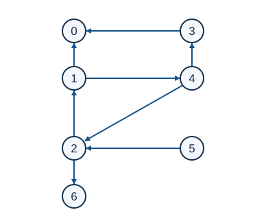

# CCINP MP — Mathématiques 2 2025 · Corrigé guidé

*Corrigé rédigé par IA, non officiel. Signalez toute erreur.*


## Présentation du sujet

Le sujet comporte 25 questions réparties en trois ensembles indépendants. L’exercice 1 traite les graphes orientés représentés par dictionnaires et se termine par deux requêtes SQL. L’exercice 2 construit une base orthonormale de polynômes pour un poids singulier aux extrémités. Le problème étudie ensuite les matrices de rang un, d’abord à travers des exemples aléatoires ou explicites, puis par des résultats de réduction.

Sur quatre heures, les quatre premières questions et les deux requêtes permettent d’avancer rapidement si les parcours de dictionnaires et les agrégats sont maîtrisés. En algèbre, les questions d’exemples peuvent se traiter indépendamment de la classification finale. Gardez du temps pour justifier le caractère défini du produit scalaire et pour construire effectivement les bases demandées à Q17, Q23 et Q24.

## Exercice 1

Une clé du dictionnaire désigne un sommet, tandis que sa liste de valeurs énumère les destinations de ses arcs. Les requêtes SQL utilisent ensuite les agrégats, dont l’un par groupe.

### Question 1

> [!INDICATION]
> Parcourez les clés du dictionnaire pour accéder aux listes d’adjacence. Que mesure la taille de chacune ?

> [!INDICATION]
> Gardez un accumulateur et décidez à chaque sommet si sa valeur doit être mise à jour.

#### Solution

La longueur de chaque liste d’adjacence est le degré sortant du sommet correspondant. La variable de maximum mémorise le plus grand degré déjà rencontré, en partant de $0$.

```python
def degreMax(d: dict) -> int:
    maximum = 0
    for sommet in d.keys():
        degre = len(d[sommet])
        if degre > maximum:
            maximum = degre
    return maximum
```

Pour un graphe vide, cette fonction renvoie $0$ par convention.

> [!JURY]
> Le rapport rappelle que la fonction Python max() ne doit pas être utilisée ici. La comparaison explicite des longueurs suffit.

### Question 2

> [!INDICATION]
> Inversez les arcs un par un sur le dessin en gardant le même ensemble de sommets.

> [!INDICATION]
> Commencez le dictionnaire de sortie avec une liste vide par sommet, puis ajoutez chaque arc en échangeant ses extrémités.

#### Solution

Les listes d’adjacence du graphe inverse sont

```python
{0: [], 1: [0, 4], 2: [1, 6], 3: [0], 4: [2, 3], 5: [2], 6: []}
```



On crée une liste vide distincte pour chaque sommet afin de conserver tous les sommets. Pour chaque arc parcouru, on ajoute l’arc de sens contraire.

```python
def grapheInv(d: dict) -> dict:
    inverse = {}
    for sommet in d.keys():
        inverse[sommet] = []
    for depart, voisins in d.items():
        for arrivee in voisins:
            inverse[arrivee].append(depart)
    return inverse
```

> [!JURY]
> Le rapport note que la représentation du graphe inverse et la fonction Python sont deux éléments demandés. Vérifiez que tous les sommets figurent dans les deux représentations.

### Question 3

> [!INDICATION]
> Chaque comparaison porte sur deux indices de la liste de couleurs, obtenus à partir d’un arc.

> [!INDICATION]
> À quel moment un échec est-il certain ? À quel moment le succès est-il certain ?

#### Solution

On compare les couleurs aux extrémités de chaque arc. Une égalité suffit pour rejeter la coloration. On l’accepte après avoir fait toutes les comparaisons sans égalité.

```python
def colorationValide(d: dict, L: list) -> bool:
    for depart, voisins in d.items():
        for arrivee in voisins:
            if L[depart] == L[arrivee]:
                return False
    return True
```

> [!PIEGE]
> Une instruction de retour met fin à toute la fonction. Un premier arc correctement colorié autorise la poursuite du parcours, tandis qu’un conflit permet de conclure immédiatement.

### Question 4

> [!INDICATION]
> Comptez séparément les entrées du dictionnaire et la somme des longueurs des listes d’adjacence.

> [!INDICATION]
> Choisissez une coloration qui ne provoque jamais de sortie anticipée.

#### Solution

Le parcours extérieur effectue au plus $N$ itérations. Les parcours intérieurs visitent ensemble au plus $M$ arcs, et le test de couleur a un coût constant pour chaque arc. Sur un graphe sans boucle, attribuer des couleurs toutes distinctes fait parcourir les $N$ listes et examiner les $M$ arcs. Le coût dans le pire des cas est donc **$\Theta(N+M)$** pour un graphe non vide, en comptant l’accès à un élément d’une liste et la comparaison de couleurs en temps constant.

> [!METHODE]
> Dans un parcours avec des sous-listes de tailles variables, additionnez les tailles effectivement visitées. Le nombre d’itérations intérieures est ici le nombre total d’arcs.

### Question 5

> [!INDICATION]
> Identifiez dans quelle table se trouve la durée et choisissez l’agrégat adapté.

#### Solution

```sql
SELECT MAX(duree) AS duree_maximale
FROM LOCATIONS;
```

### Question 6

> [!INDICATION]
> Réunissez les deux tables par la colonne qui identifie un film.

> [!INDICATION]
> Constituez les groupes avant de filtrer les résultats sur une moyenne. Vérifiez le sens du tri.

#### Solution

La jointure associe chaque location au film concerné. Le filtre s’applique à la moyenne de chaque groupe.

```sql
SELECT f.codefilm, f.nomfilm, AVG(l.duree) AS duree_moyenne
FROM FILMS AS f
JOIN LOCATIONS AS l ON l.codefilm = f.codefilm
GROUP BY f.codefilm, f.nomfilm
HAVING AVG(l.duree) < 2
ORDER BY duree_moyenne DESC;
```

> [!METHODE]
> Le filtre WHERE porte sur des lignes avant regroupement. La clause HAVING permet de filtrer sur un agrégat calculé pour un groupe. Grouper par code et par nom permet d’afficher les deux informations du film.

## Exercice 2

La récurrence des polynômes de Tchebychev recoupe une identité trigonométrique. Le changement de variable dans le produit scalaire rend alors accessible l’orthogonalité.

### Question 7

> [!INDICATION]
> Comparez les degrés des deux termes à droite de la relation de récurrence.

> [!INDICATION]
> Suivez le facteur affectant le coefficient dominant à partir du rang 1.

#### Solution

On a $\deg P_0=0$ et $\deg P_1=1$.

Si $P_n$ et $P_{n+1}$ sont de degrés $n$ et $n+1$, le terme $2XP_{n+1}$ a degré $n+2$.

Son terme dominant survit à la soustraction de $P_n$.

On obtient par récurrence que $\deg P_n=n$.

Le coefficient dominant, égal à $1$ au rang $1$, double à chaque étape suivante. **Le terme dominant est $2^{n-1}X^n$ pour $n\ge1$, et $1$ pour $n=0$.**

### Question 8

> [!INDICATION]
> Vérifiez les deux premiers rangs. Quelle formule relie les cosinus de trois angles consécutifs de la forme $j\theta$ ?

> [!INDICATION]
> Comparez cette formule à la relation qui définit la suite des polynômes évalués en $\cos\theta$.

#### Solution

Fixons $\theta\in\mathbb R$. Pour $n=0$ et $n=1$, les deux expressions coïncident par définition. Les formules d’addition donnent
$$
\cos((n+2)\theta)=2\cos\theta\cos((n+1)\theta)-\cos(n\theta).
$$
C’est la même récurrence d’ordre deux que celle vérifiée par les $P_n(\cos\theta)$. Par récurrence à deux rangs, **$P_n(\cos\theta)=\cos(n\theta)$ pour tout $n\in\mathbb N$**.

> [!JURY]
> Le rapport signale des erreurs dans la récurrence double. Le démarrage aux rangs 0 et 1 et l’emploi des deux rangs dans l’hérédité doivent apparaître.

### Question 9

> [!INDICATION]
> Le produit de polynômes est borné sur le segment. Il reste à contrôler le poids au voisinage des deux bornes.

> [!INDICATION]
> Factorisez $1-t^2$ et repérez quel facteur peut tendre vers zéro à chacune des extrémités.

#### Solution

Le produit $PQ$ est borné en valeur absolue sur $[-1,1]$ par un réel $C\ge0$. L’intégrande est continue sur $]-1,1[$ et son module est majoré par $C/\sqrt{1-t^2}$.

Pour $0\le t<1$, on a $1-t^2\ge1-t$. Pour $-1<t\le0$, on a $1-t^2\ge1+t$. Les deux majorants correspondants, $C(1-t)^{-1/2}$ et $C(1+t)^{-1/2}$, sont intégrables aux bornes respectives. **L’intégrale converge absolument.**

> [!JURY]
> Le rapport attend la régularité de l’intégrande avant l’étude des bornes. Les comparaisons s’appliquent à une fonction positive, ici le module de l’intégrande.

### Question 10

> [!INDICATION]
> Pour le caractère défini, étudiez l’intégrande lorsque les deux arguments sont identiques.

> [!INDICATION]
> Une intégrale nulle peut-elle coexister avec une valeur strictement positive pour une fonction continue et positive ? Utilisez ensuite le nombre de racines d’un polynôme.

#### Solution

La symétrie résulte de la commutativité du produit et la bilinéarité de la linéarité de l’intégrale, dont l’existence est établie à Q9. La positivité découle de $P(t)^2/\sqrt{1-t^2}\ge0$.

Si $\langle P,P\rangle=0$, cette fonction continue et positive ou nulle sur $]-1,1[$ est identiquement nulle. En effet, une valeur strictement positive donnerait par continuité une intégrale strictement positive sur un segment intérieur. Ainsi $P$ s’annule pour tout $t\in]-1,1[$. Un polynôme non nul ayant un nombre fini de racines, on a $P=0$. **La forme est un produit scalaire sur $\mathbb R_k[X]$.**

> [!JURY]
> Le rapport recommande d’exploiter le nombre de racines. La continuité donne l’annulation sur l’intervalle ouvert, puis cette propriété permet de conclure dans l’espace des polynômes.

### Question 11

> [!INDICATION]
> Transformez le produit de deux cosinus en une somme.

> [!INDICATION]
> Distinguez les cas où l’une ou les deux fréquences dans la somme sont nulles.

#### Solution

Pour tout entier non nul $j$, on a $\int_0^\pi\cos(j\theta)\,d\theta=0$, par évaluation de la primitive $\sin(j\theta)/j$. Pour $j=0$, l’intégrale vaut $\pi$. L’identité produit-somme donne
$$
2\cos(n\theta)\cos(m\theta)=\cos((n-m)\theta)+\cos((n+m)\theta).
$$
Les valeurs sont donc
$$
\boxed{\int_0^\pi\cos(n\theta)\cos(m\theta)\,d\theta
=
\begin{cases}
0 & \text{si }n\ne m,\\
\pi/2 & \text{si }n=m\ge1,\\
\pi & \text{si }n=m=0.
\end{cases}}
$$

> [!JURY]
> Le rapport relève que les fréquences nulles ont souvent été oubliées. Le calcul de la primitive par division par la fréquence exige qu’elle soit non nulle.

### Question 12

> [!INDICATION]
> Faites apparaître Q8 dans l’intégrale en introduisant un angle.

> [!INDICATION]
> Utilisez Q11 pour contrôler séparément l’orthogonalité et les normes avant de normaliser.

#### Solution

Dans le produit scalaire, on pose $t=\cos\theta$. Pour $0<\theta<\pi$, la dérivée du changement de variable est $-\sin\theta$ et $\sqrt{1-t^2}=\sin\theta$. On l’effectue sur des segments intérieurs, puis on passe à la limite aux bornes par Q9 et par continuité de l’intégrande en $\theta$. Par Q8,
$$
\langle P_n,P_m\rangle=\int_0^\pi\cos(n\theta)\cos(m\theta)\,d\theta.
$$
Par Q11, les $P_j$ sont deux à deux orthogonaux. Leurs normes sont $\sqrt\pi$ pour $j=0$ et $\sqrt{\pi/2}$ pour $j\ge1$.

Ces $k+1$ polynômes non nuls forment une famille libre dans l’espace de dimension $k+1$. Une base orthonormale est
$$
\boxed{\left(\frac{P_0}{\sqrt\pi},\,\sqrt{\frac{2}{\pi}}P_1,\ldots,
\sqrt{\frac{2}{\pi}}P_k\right),}
$$
réduite à son premier élément pour $k=0$.

## Problème — Matrices de rang 1

Lorsque l’image est une droite, la position de cette droite par rapport au noyau donne les deux formes possibles. Dans les exemples aléatoires, une somme de carrés permet de reconnaître les projections.

### Partie I — Exemples

Les premières questions exploitent directement le produit colonne-ligne. Pour la matrice constante, cherchez des vecteurs propres à partir de l’action sur un vecteur quelconque.

### Question 13

> [!INDICATION]
> Examinez les colonnes de $UU^\top$ sur une réalisation où $U$ est non nul.

> [!INDICATION]
> Exprimez l’événement où le rang vaut zéro à partir des valeurs des variables indépendantes.

#### Solution

Pour une réalisation $U\ne0$, toutes les colonnes de $UU^\top$ sont des multiples de $U$ et au moins l’une d’elles est non nulle. Le rang est alors $1$.

Pour $U=0$, $M=0$ et le rang est $0$.

L’événement $U=0$ est l’intersection des événements $X_i=0$, indépendants. Sa probabilité vaut $(1-p)^n$. Ainsi **$Y$ suit la loi de Bernoulli de paramètre $1-(1-p)^n$**.

### Question 14

> [!INDICATION]
> Regardez les coefficients diagonaux et exploitez les deux valeurs possibles de chaque $X_i$.

#### Solution

Chaque variable $X_i$ ne prend que les valeurs $0$ et $1$, donc $X_i^2=X_i$. On a
$$
\begin{aligned}
\operatorname{Tr}(M)&=\sum_{i=1}^n X_i^2\\
&=\sum_{i=1}^n X_i.
\end{aligned}
$$
C’est une somme de $n$ variables indépendantes de loi de Bernoulli de même paramètre $p$. **$\operatorname{Tr}(M)$ suit la loi binomiale $\mathcal B(n,p)$.**

### Question 15

> [!INDICATION]
> Associez les facteurs du produit $UU^\top UU^\top$ pour faire apparaître un scalaire.

> [!INDICATION]
> Traitez séparément la matrice nulle et utilisez la loi trouvée en Q14.

#### Solution

Le produit $U^\top U$ est le scalaire $\sum_i X_i^2=\operatorname{Tr}(M)$. Par associativité,
$$
M^2=U(U^\top U)U^\top=\operatorname{Tr}(M)M.
$$
Une matrice de projection vérifie $M^2=M$. Si $M=0$, cette condition est satisfaite et la trace est nulle. Si $M\ne0$, la condition équivaut à $\operatorname{Tr}(M)=1$.

Réciproquement, la trace est une somme de carrés et une trace nulle implique $M=0$. L’événement demandé est donc $\{\operatorname{Tr}(M)\in\{0,1\}\}$. Par Q14,
$$
\boxed{\mathbb P(M\text{ est une matrice de projection})
=(1-p)^n+np(1-p)^{n-1}.}
$$

> [!JURY]
> Le rapport relève l’oubli fréquent de la matrice nulle. L’égalité de projection est satisfaite dans ce cas, même si la trace ne vaut pas un.

### Question 16

> [!INDICATION]
> Reprenez le critère de Q15 puis caractérisez les configurations où une somme de carrés d’entiers vaut zéro ou un.

> [!INDICATION]
> Additionnez les probabilités des configurations disjointes, en distinguant la position de l’éventuel terme non nul.

#### Solution

Le calcul de $M^2$ et le critère de Q15 restent valables. Les $X_i$ sont maintenant à valeurs entières positives ou nulles. Ainsi $\sum_i X_i^2\in\{0,1\}$ exactement lorsque tous les $X_i$ sont nuls ou qu’un seul vaut $1$, les autres valant $0$.

Ces $n+1$ événements sont disjoints. Par indépendance et puisque $\mathbb P(X_i=0)=e^{-\lambda}$ et $\mathbb P(X_i=1)=\lambda e^{-\lambda}$, on obtient
$$
\boxed{\mathbb P(M\text{ est une matrice de projection})=(1+n\lambda)e^{-n\lambda}.}
$$

### Question 17

> [!INDICATION]
> Décrivez l’image d’un vecteur par $J$ d’après la somme de ses coordonnées.

> [!INDICATION]
> Construisez une base dans l’hyperplan des vecteurs dont les coordonnées somment à zéro. Complétez-la par un vecteur propre de coordonnées toutes égales.

#### Solution

Notons $(e_1,\ldots,e_n)$ la base canonique et $v=e_1+\cdots+e_n$. Pour $x=(x_1,\ldots,x_n)^\top$, $Jx=(\sum_i x_i)v$. Ainsi **$\operatorname{rg}(J)=1$ et $\operatorname{Tr}(J)=n$**, la seconde égalité venant des entrées diagonales.

On a $Jv=nv$ et $J(e_i-e_1)=0$ pour $2\le i\le n$. Les $n-1$ différences sont indépendantes en regardant les coordonnées $2$ à $n$.

Leurs combinaisons ont des coordonnées de somme nulle alors que celles de $v$ ont pour somme $n$.

Les $n$ colonnes de
$$
S=(v\ \ e_2-e_1\ \ \cdots\ \ e_n-e_1)
$$
forment donc une base et
$$
\boxed{S^{-1}JS=\operatorname{diag}(n,0,\ldots,0).}
$$

> [!METHODE]
> Pour construire une matrice de passage, écrivez les vecteurs propres en colonnes et justifiez qu’ils forment une base. L’action de la matrice sur un vecteur arbitraire révèle souvent son noyau et son image.

### Question 18

> [!INDICATION]
> Cherchez une matrice avec une seule entrée non nulle.

> [!INDICATION]
> Placez cette entrée de manière que le carré de la matrice soit nul. Que donnerait alors une éventuelle diagonalisation ?

#### Solution

Prenons
$$
A=\begin{pmatrix}0&1&0\\0&0&0\\0&0&0\end{pmatrix}.
$$
Une seule colonne est non nulle, donc $A$ est de rang $1$. Sa trace est nulle. De plus, $A^2=0$ et $A\ne0$.

Si $A$ était diagonalisable, elle serait semblable à une matrice diagonale dont le carré est nul. Cette diagonale serait nulle, contradiction. **$A$ est de rang $1$, de trace nulle et non diagonalisable.**

### Partie II — Résultats généraux

Le rang un force toutes les colonnes à être colinéaires. On en tire un polynôme annulateur puis une classification par construction de bases.

### Question 19

> [!INDICATION]
> Toutes les colonnes appartiennent à un espace de dimension un. Écrivez-les dans la base formée de $C$.

> [!INDICATION]
> Comparez les colonnes du produit $CL$ aux colonnes de $A$.

#### Solution

L’espace des colonnes de $A$ a dimension $1$. La colonne $C$ est non nulle et en forme une base. Chaque colonne $C_j$ s’écrit donc $C_j=\ell_j C$ pour un scalaire $\ell_j$.

Avec $L=(\ell_1,\ldots,\ell_n)$, le produit $CL$ a précisément pour colonnes les $C_j$.

Le coefficient correspondant à $C$ vaut $1$, d’où **$A=CL$ avec $L\ne0$**.

### Question 20

> [!INDICATION]
> Calculez la diagonale de $CL$ en fonction des coordonnées de $C$ et de $L$.

> [!INDICATION]
> Dans $(CL)(CL)$, associez les facteurs de manière à obtenir un scalaire au milieu.

#### Solution

Écrivons $C=(c_i)_{1\le i\le n}$ et $L=(\ell_1,\ldots,\ell_n)$. Le coefficient diagonal d’indice $i$ de $CL$ est $c_i\ell_i$. Ainsi
$$
\begin{aligned}
LC&=\sum_{i=1}^n\ell_i c_i\\
&=\operatorname{Tr}(A).
\end{aligned}
$$
Comme ce produit est un scalaire, $A^2=C(LC)L$. On en déduit **$A^2=\operatorname{Tr}(A)A$**.

### Question 21

> [!INDICATION]
> Commencez une base de l’espace par une base du noyau. Quelles colonnes de la matrice sont alors nulles ?

> [!INDICATION]
> Q20 fournit un polynôme annulateur. Que signifierait l’existence d’un polynôme annulateur unitaire de degré un ?

#### Solution

Notons $\tau=\operatorname{Tr}(A)$ et adoptons la convention $\chi_A(X)=\det(XI_n-A)$. Le noyau a dimension $n-1$ par le théorème du rang.

On complète une base du noyau par un vecteur. Dans cette base les $n-1$ premières colonnes sont nulles, donc la matrice est triangulaire supérieure. Son dernier coefficient diagonal vaut $\tau$, par invariance de la trace. Alors
$$
\boxed{\chi_A(X)=X^{n-1}(X-\tau).}
$$

Par Q20, $X(X-\tau)$ est un polynôme annulateur unitaire. Aucun polynôme unitaire de degré un n’annule $A$, car il imposerait que $A$ soit scalaire, donc de rang $0$ ou $n$.

Comme $n\ge2$ et $\operatorname{rg}(A)=1$, le polynôme annulateur unitaire de degré deux est minimal. Ainsi **$\mu_A(X)=X(X-\tau)$**, ce qui inclut $\mu_A(X)=X^2$ si $\tau=0$.

> [!PIEGE]
> Le polynôme caractéristique a degré égal à l’ordre de la matrice. Pour le polynôme minimal, cherchez le plus petit degré d’un polynôme unitaire annulateur.

### Question 22

> [!INDICATION]
> Appliquez le critère de diagonalisabilité au polynôme minimal et distinguez les deux valeurs possibles de la multiplicité de sa racine nulle.

#### Solution

D’après Q21, le polynôme minimal est scindé à racines simples exactement lorsque $\tau\ne0$. Par le critère de diagonalisation sur $\mathbb R$,
$$
\boxed{A\text{ est diagonalisable}\ \Longleftrightarrow\ \operatorname{Tr}(A)\ne0.}
$$

### Question 23

> [!INDICATION]
> Que peut-on dire d’une droite qui rencontre un sous-espace en un vecteur non nul ?

> [!INDICATION]
> Prenez d’abord un vecteur dont l’image est non nulle. Placez cette image en deuxième position et complétez à l’aide du noyau.

#### Solution

L’image est une droite. Elle contient un vecteur non nul du noyau par hypothèse, donc elle est incluse dans le noyau.

Choisissons $e_1$ hors du noyau et posons $e_2=u(e_1)$. Ce vecteur est non nul et appartient au noyau.

On complète $e_2$ en une base $(e_2,e_3,\ldots,e_n)$ du noyau, possible puisque ce dernier a dimension $n-1$.

L’ajout de $e_1$ donne une base de $\mathbb R^n$.

Dans cette base, $u(e_1)=e_2$ et $u(e_j)=0$ pour $j\ge2$. **La matrice demandée a pour seul coefficient non nul $1$ en position $(2,1)$.**

### Question 24

> [!INDICATION]
> Comparez les dimensions de l’image et du noyau en tenant compte de leur intersection.

> [!INDICATION]
> Choisissez un vecteur non nul dans l’image, puis demandez-vous ce que signifierait son annulation par $u$.

#### Solution

Par le théorème du rang, les dimensions de l’image et du noyau ont pour somme $n$. Leur intersection étant nulle, ces sous-espaces sont supplémentaires.

Prenons $e_1\ne0$ dans l’image et complétons par une base $(e_2,\ldots,e_n)$ du noyau.

Comme l’image est la droite engendrée par $e_1$, le vecteur $u(e_1)$ est de la forme $a e_1$. Si $a=0$, $e_1$ serait dans l’intersection, contradiction.

Dans cette base, **$u$ est représenté par $\operatorname{diag}(a,0,\ldots,0)$ avec $a=\operatorname{Tr}(A)\ne0$**.

> [!JURY]
> Le rapport souligne que la non-nullité de la valeur propre sur l’image doit être justifiée. L’intersection supposée nulle est l’hypothèse qui y sert.

### Question 25

> [!INDICATION]
> La trace est invariante par similitude. Pour la réciproque, comparez les formes obtenues en Q23 et Q24.

#### Solution

Deux matrices semblables ont même trace. Réciproquement, soient deux matrices de rang $1$ et de même trace $\tau$. Le cas de Q23 donne une matrice de trace nulle, tandis que celui de Q24 donne une matrice de trace non nulle.

Ainsi, si $\tau=0$, les deux matrices sont semblables à la même matrice élémentaire de Q23. Si $\tau\ne0$, elles sont toutes deux semblables à $\operatorname{diag}(\tau,0,\ldots,0)$ par Q24. **Deux matrices de rang $1$ sont donc semblables exactement lorsqu’elles ont la même trace.**

## Bilan

Pour vérifier un graphe représenté par un dictionnaire, distinguez les sommets, qui sont les clés, des destinations des arcs, qui figurent dans les listes. En SQL, repérez le niveau auquel s’applique chaque condition. Une moyenne se filtre après regroupement.

Pour un produit scalaire avec poids, vérifiez d’abord l’intégrabilité. Pour la positivité stricte, combinez la continuité sur l’intervalle ouvert et la structure de l’espace considéré. Une base orthogonale exige ensuite un calcul des normes pour devenir orthonormale.

Pour les matrices de rang un, la factorisation colonne-ligne permet de calculer le carré sans développer tous ses coefficients. Dans les questions de réduction, la position de la droite image par rapport au noyau dicte le choix d’une base qui donne une forme explicite.
