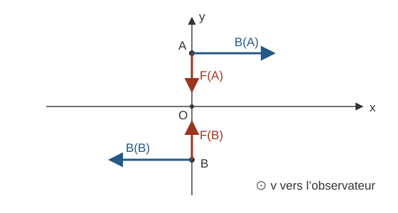
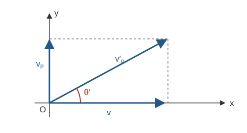
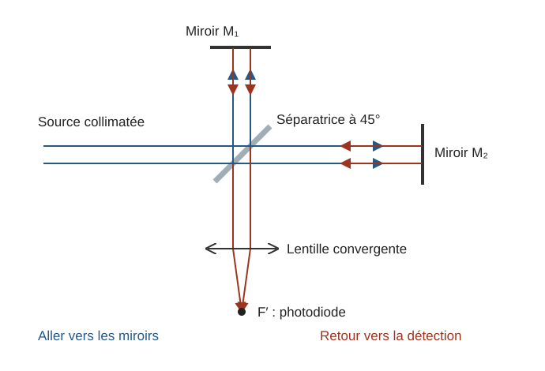
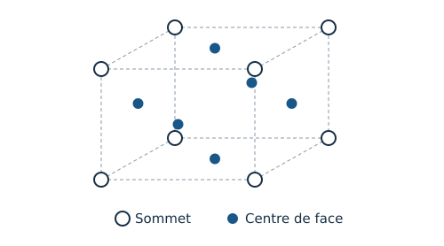

# CCINP MP — Physique-chimie 2025 · Corrigé brut

*Corrigé rédigé par IA, non officiel. Signalez toute erreur.*

## Problème I — Le synchrotron SOLEIL

### Partie I — Généralités

### Question 1

Le champ électrostatique est $\vec E=-\operatorname{grad}V$. La force sur l’électron est $\vec F=-e\vec E=e\operatorname{grad}V$. Comme $\vec F=-\operatorname{grad}E_p$, on obtient **$E_p=-eV$ à une constante près**.

### Question 2

La force électrostatique est conservative. Avec une vitesse initiale nulle, la conservation de l’énergie mécanique donne $E_c=e(V_f-V_i)$. Ainsi
$$
\boxed{V_f-V_i=\frac{E_c}{e}\simeq 1\times10^3\ \mathrm V.}
$$

### Question 3

L’expression classique impliquerait
$$
\frac vc=\sqrt{\frac{2E_c}{m_ec^2}}
\simeq \sqrt{\frac{2\times10^5}{5{,}1\times10^2}}.
$$
Elle donnerait **$v\simeq6\times10^9\ \mathrm{m\,s^{-1}}$**, soit environ vingt fois $c$. Ce résultat exclut l’emploi de la mécanique classique.

### Question 4

La relation relativiste donne
$$
\boxed{\gamma=1+\frac{E_c}{m_ec^2}\simeq2\times10^2.}
$$
Le rapport est calculé en exprimant $E_c$ et $m_ec^2$ en keV.

### Question 5

Chaque électron traverse une section de l’anneau une fois par période $T=2\pi R/c$. En valeur absolue, la charge traversant la section en une période est $Ne$. Donc $i=Ne/T$, d’où
$$
\boxed{N=\frac{2\pi R i}{e c}\simeq3\times10^{12}\ \text{électrons}.}
$$

### Question 6

À cette très faible pression, le dihydrogène est assimilé à un gaz parfait. Avec $n$ le nombre de molécules par unité de volume, $PV=(nV/N_A)RT$. Comme $P=6\times10^{-8}\ \mathrm{Pa}$,
$$
n=\frac{PN_A}{RT}=\frac{6\times10^{-8}\times6{,}0\times10^{23}}{8{,}3\times298}
\simeq\boxed{1\times10^{13}\ \mathrm{m^{-3}}}.
$$
La valeur avant arrondi est $1{,}46\times10^{13}\ \mathrm{m^{-3}}$.

### Question 7

L'effectif $N$ et sa variation sont sans dimension. Puisque $[n]=L^{-3}$ et $[\mathrm dx]=L$, on a $[\sigma]=1/(L^{-3}L)=L^2$. La section efficace a donc la dimension d'une aire et s'exprime en $\mathrm{m^2}$.

### Question 8

À la vitesse $c$, on a $\mathrm dx=c\,\mathrm dt$. L'intégration de $\mathrm dN/N=-\sigma nc\,\mathrm dt$ avec $N(0)=N_0$ donne $N(t)=N_0\exp(-\sigma nc\,t)$. Comme $N(\tau)=0{,}63N_0$,
$$
\boxed{\tau=\frac{-\ln(0{,}63)}{\sigma nc}=\frac{0{,}46}{\sigma nc}.}
$$

### Question 9

La conversion donne $\sigma=2{,}0\times10^{-27}\ \mathrm{m^2}$. Avec la formule de Q8 et $n=1{,}46\times10^{13}\ \mathrm{m^{-3}}$, on obtient $5{,}3\times10^4\ \mathrm s$, soit **$5\times10^4\ \mathrm s$** à un chiffre significatif, de l'ordre d'une quinzaine d'heures. Puisque le courant à vitesse et géométrie fixées est proportionnel à $N$, des injections régulières d'électrons depuis le booster compensent les pertes et maintiennent le courant près de sa consigne.

### Partie II — Éléments magnétiques

### Question 10

On utilise **un teslamètre et sa sonde**. On place la sonde au point étudié, on règle le zéro en l’absence du champ à mesurer, puis on l’oriente pour mesurer la composante suivant son axe sensible. Avec une sonde monoaxe, trois mesures suivant des axes orthogonaux donnent le vecteur champ.

### Question 11

La force $\vec F=-e\vec v\times\vec B$ est orthogonale à la vitesse. Son travail est nul et la norme de la vitesse reste $v_0$. Elle est également orthogonale au champ, de sorte que la vitesse, initialement perpendiculaire à celui-ci, le reste. L’accélération normale vaut $v_0^2/R_B$ et la force a pour norme $e v_0B_0$. Ainsi
$$
\begin{aligned}
B_0&=\boxed{\frac{m_ev_0}{eR_B}=\frac{p}{eR_B}},\\
\omega_B&=\boxed{\frac{v_0}{R_B}=\frac{eB_0}{m_e}}.
\end{aligned}
$$

### Question 12

Dans le régime ultrarelativiste, l’énergie totale est assimilable à $E_c$ dans la relation $p\simeq E/c$. On obtient
$$
\boxed{B_0\simeq \frac{E_c/e}{cR_B}\simeq2\ \mathrm T.}
$$
On a utilisé $E_c/e=2{,}7\times10^9\ \mathrm V$.

### Question 13

Le champ magnétique est un vecteur axial. Dans un plan de symétrie des courants, il est normal au plan. Dans un plan d’antisymétrie des courants, il appartient au plan.

Le plan $xOy$ est plan d’antisymétrie des courants. Chaque bobine est alors réfléchie sur elle-même en inversant le courant orienté. Donc $\vec B$ appartient à $xOy$ en tout point de ce plan.

Les plans $xOz$ et $yOz$ sont des plans de symétrie des courants.

On le vérifie en réfléchissant les bobines de la figure 2b et en suivant le sens de leurs courants.

Ainsi, sur $Ox$, le champ est dirigé suivant $Oy$ et, sur $Oy$, il est dirigé suivant $Ox$.

À l’origine, les deux contraintes s’appliquent simultanément, d’où **$\vec B(O)=\vec 0$**.

Par la règle de la main droite, les faces tournées vers l’origine des bobines du haut à gauche et du bas à droite sont des pôles nord. Les deux autres sont des pôles sud. Du côté $x>0$, la bobine du bas est nord et celle du haut sud, ce qui oriente le champ suivant $+\vec e_y$. Du côté $y>0$, le nord est à gauche et le sud à droite, ce qui oriente le champ suivant $+\vec e_x$. Les sens sont inversés sur les demi-axes négatifs par symétrie.

### Question 14

En régime stationnaire, les équations locales sont $\operatorname{div}\vec B=0$ et $\operatorname{rot}\vec B=\mu_0\vec j$. Au voisinage de l’origine, hors des bobines, $\vec j=\vec0$. Dans le champ proposé, la divergence est nulle. La seule composante éventuellement non nulle du rotationnel est $\partial_x B_y-\partial_y B_x=K-K=0$. Comme $\vec B(O)=K'(\vec e_x+\vec e_y)=\vec0$ par Q13, **$K'=0$**.

### Question 15

Sur $Oy$, $\vec B=Ky\vec e_x$, d’où
$$
\vec F=-e v_0 \vec e_z\times (Ky\vec e_x)=-e v_0 K y\,\vec e_y .
$$
En $A$, le champ pointe vers $+x$ et la force vers $-y$. En $B$, le champ pointe vers $-x$ et la force vers $+y$.

**Les forces sont dirigées vers le centre du faisceau en $y$.**

### Question 16

Sur $Ox$, $\vec B=Kx\vec e_y$, donc $\vec F=e v_0 Kx\vec e_x$. Elle éloigne chaque électron de l’axe en $x$. Un second quadrupôle tourné de $90^\circ$ autour de l’axe du faisceau échange les plans focalisant et défocalisant. **Une succession de quadrupôles alternés, de forces et d’espacements ajustés, permet de confiner le faisceau dans les deux plans.**

### Partie III — Rayonnement

### Question 17

Un rayonnement est **anisotrope** si sa puissance surfacique dépend de la direction d’observation. Il est **polarisé** si les variations temporelles de la direction de son champ électrique transverse présentent une organisation déterminée, par exemple une direction fixe pour une polarisation rectiligne.

### Question 18

Tout plan méridien passant par $Oz$ est plan de symétrie de la distribution de charges et de courants. Le champ électrique, vecteur polaire, est dans ce plan. Le champ magnétique, vecteur axial, est normal à ce plan. Au point considéré, cela donne **$E_\varphi=B_r=B_\theta=0$**. L’invariance de la distribution par rotation autour de $Oz$ rend les composantes dans la base sphérique indépendantes de $\varphi$.

### Question 19

En dérivant deux fois la position de l’électron, on obtient $\vec a(t)=-l\omega^2\cos(\omega t)\vec e_z$. Le moment dipolaire est la somme des positions pondérées par les charges. Ici,
$$
\vec p(t)=-el\cos(\omega t)\,\vec e_z.
$$
Son amplitude est $p_0=el$. Dans l’expression demandée, $a=l\omega^2$ désigne l’amplitude de l’accélération. La norme instantanée vaut $a|\cos(\omega t)|$. **$p_0=ea/\omega^2$.**

### Question 20

La zone de rayonnement se situe loin de la source et à une distance grande devant la longueur d’onde $\lambda=2\pi c/\omega$.

Le champ en $1/r$ y domine les termes proches.

Le terme $r/c$ est le temps nécessaire pour parcourir la distance $r$ à la vitesse $c$ dans le vide.

**Le champ observé à l’instant $t$ dépend de la source à l’instant retardé $t-r/c$.**

### Question 21

Les champs sont transverses et, puisque $\vec e_r\times\vec e_\theta=\vec e_\varphi$, ils vérifient
$$
\boxed{\vec B=\frac{\vec e_r\times\vec E}{c}.}
$$
Sur une petite région loin de la source, la direction radiale et l’amplitude varient peu. Cette relation et la phase retardée donnent la structure locale d’une onde plane progressive dans la direction $\vec e_r$. Le champ électrique oscille parallèlement à $\vec e_\theta$, donc la polarisation est rectiligne.

Pour vérifier les unités, on part de
$$
\begin{aligned}
[\mu_0]&=\mathrm{kg\,m\,s^{-2}\,A^{-2}},\\
[p_0]&=\mathrm{A\,s\,m},\\
[\omega]&=\mathrm{s^{-1}}.
\end{aligned}
$$
Le facteur $\mu_0p_0\omega^2/r$ a donc l’unité $\mathrm{kg\,m\,s^{-3}\,A^{-1}}$, soit $\mathrm{V\,m^{-1}}$. Le facteur supplémentaire $1/c$ dans $\vec B$ donne $\mathrm{kg\,s^{-2}\,A^{-1}}$, soit le tesla.

### Question 22

Le vecteur de Poynting vaut $\vec\Pi=\vec E\times\vec B/\mu_0$. Avec la relation de Q21,
$$
\vec\Pi(r,\theta,t)=
\frac{\mu_0 p_0^2\omega^4}{16\pi^2cr^2}\sin^2\theta
\cos^2\!\bigl(\omega(t-r/c)\bigr)\vec e_r.
$$
La moyenne de $\cos^2$ vaut $1/2$. À distance fixée, la puissance surfacique moyenne est maximale pour $\theta=\pi/2$, dans toutes les directions perpendiculaires à l’axe du dipôle. Avec $p_0=ea/\omega^2$ et $\mu_0\varepsilon_0c^2=1$,
$$
\boxed{\|\langle\vec\Pi\rangle\|_{\max}
=\frac{e^2a^2}{32\pi^2\varepsilon_0 c^3 r^2}.}
$$

### Partie IV — Directivité du rayonnement synchrotron

### Question 23

Dans la formule relativiste, $1-(v/c)\cos\theta$ est minimal quand $\cos\theta=1$. Le maximum est donc dans la direction et le sens de la vitesse. À distance et amplitude d’accélération comparables, **le rapport des maxima relativiste et dipolaire est $(1-v/c)^{-4}$**. Il est très supérieur à $1$ lorsque $v$ est proche de $c$. Le rayonnement est fortement concentré vers l’avant.

### Question 24

Avec la composition galiléenne, $\vec v'_p=\vec v_p+v\vec e_x$. Pour une émission à $\theta=\pi/2$, $\vec v_p=v_p\vec e_y$. Par conséquent,
$$
\begin{aligned}
\vec v'_p&=\boxed{v\vec e_x+v_p\vec e_y},\\
\theta'&=\boxed{\arctan(v_p/v)}.
\end{aligned}
$$

Les particules émises dans le demi-plan avant sont dans ce cône après composition.

En effet, leur composante suivant $x$ est au moins $v$ et la composante transverse a un module au plus $v_p$.

**Cela représente au moins la moitié des particules, et exactement la moitié si $v_p\geq v$**, cas pertinent pour la comparaison avec les photons.

Dans ce cas, la direction du vecteur somme parcourt les angles dans le même ordre que la direction initiale, car l’origine est à l’intérieur du cercle des extrémités de $\vec v'_p$ ou sur son bord.

Pour $v_p<v$, posons $\rho=v/v_p>1$.

Pour une émission dans le demi-plan arrière, posons $u=-\cos\theta>0$.

La condition d’appartenance au cône devient $\rho\sqrt{1-u^2}\leq\rho-u$.

En élevant au carré les membres positifs, elle équivaut à $u\geq2\rho/(1+\rho^2)$.

La proportion totale est alors
$$
\boxed{\frac12+\frac1\pi\arccos\left(\frac{2\rho}{1+\rho^2}\right).}
$$

### Question 25

Dans le vide, la vitesse d’un photon a pour norme $c$ dans tout référentiel inertiel. La composition galiléenne donnerait pour un photon émis transversalement la norme $\sqrt{c^2+v^2}>c$. **La transformation relativiste des vitesses est indispensable.**

### Question 26

Pour un photon, $v_p=c$. À l’émission transverse, les formules données donnent $v'_{p\parallel}=v$ et $v'_{p\perp}=c/\gamma$. La transformation conserve l’ordre des directions : en divisant la composante parallèle par $c$, on trouve $\cos\theta_{\mathcal R'}=(\cos\theta+v/c)/(1+(v/c)\cos\theta)$, croissante en $\cos\theta$. Ainsi, la direction transverse délimite bien l’image du demi-plan avant.

Comme $v\simeq c$ et $\gamma\gg1$,
$$
\tan\theta'=\frac{c}{\gamma v}\simeq\frac1\gamma.
$$
Le petit angle vérifie donc **$\theta'\simeq1/\gamma\simeq2\times10^{-5}\ \mathrm{rad}$**. La moitié du rayonnement est concentrée dans un cône très étroit.

### Partie V — Principe de la spectrométrie d’absorption

### Question 27

La séparatrice à $45^\circ$ partage le faisceau collimaté en deux faisceaux parallèles dans deux bras orthogonaux. Après réflexion à incidence normale sur les miroirs, une partie de chaque faisceau revient vers le port de sortie. Une lentille convergente rassemble ces deux faisceaux au foyer image $F'$, où se trouve la photodiode.

### Question 28

En incidence normale, la différence de marche vaut $\delta=2d$. Pour deux faisceaux de même intensité qui se superposent avec la même polarisation,
$$
\boxed{I(F')=\frac{I_{\max}}2
 \left[1+\cos\left(\frac{4\pi d}{\lambda_m}\right)\right].}
$$
Le contraste est maximal lorsque les deux faisceaux recombinés ont la même intensité. Dans un Michelson idéal, chacun subit une réflexion et une transmission à la même séparatrice, et les miroirs ont des réflectivités égales. Cette symétrie équilibre les voies.

### Question 29

Avec $d=v_0t$, la période de l’interférogramme vaut $T_m=\lambda_m/(2v_0)$. Sur la figure 5, vingt périodes séparent le maximum à l’origine du maximum situé vers $7{,}7\ \mathrm s$. Cette lecture donne environ $0{,}39\ \mathrm s$ par période avant arrondi. D’où
$$
\boxed{\lambda_m=2v_0T_m\simeq5\times10^{-7}\ \mathrm m.}
$$
Pour estimer l’incertitude de lecture, prenons une demi-largeur de $0{,}1\ \mathrm s$ sur la position de chaque maximum extrême, indépendante et à distribution uniforme. En l’absence d’incertitude indiquée sur $v_0$,
$$
u(\lambda_m)=\frac{2v_0}{20}\sqrt{2}\,
\frac{0{,}1\ \mathrm s}{\sqrt3}.
$$
On trouve **$u(\lambda_m)\simeq6\times10^{-9}\ \mathrm m$** avec cette convention de lecture.

### Question 30

Sur la figure 6b, l’amplitude de l’enveloppe autour du niveau moyen est de l’ordre de la moitié de sa valeur initiale après environ $30\ \mathrm s$. Si $t_{\mathrm{env}}$ désigne cette durée de balayage, la différence de marche correspondante est
$$
\boxed{L_c\simeq2v_0 t_{\mathrm{env}}\simeq4\times10^{-5}\ \mathrm m.}
$$
Le temps de cohérence physique vaut $\tau_c\simeq L_c/c$, et diffère du temps de balayage. Avec $\nu=c/\lambda$, pour une bande étroite, $\Delta\nu\simeq(c/\lambda_m^2)\Delta\lambda$. En utilisant $\Delta\nu\,\tau_c\simeq1$ et la lecture de Q29 avant arrondi,
$$
\boxed{\Delta\lambda\simeq\frac{\lambda_m^2}{L_c}\simeq7\times10^{-9}\ \mathrm m.}
$$

## Problème 2 — La batterie au plomb

### Question 31

Le numéro atomique $Z=82$ donne **82 protons**. Le noyau contient $A=207$ nucléons, donc $207-82=\mathbf{125}$ **neutrons**. L'atome est neutre et possède **82 électrons**.

### Question 32

Deux isotopes d’un même élément ont **le même nombre de protons et des nombres de neutrons différents**. Les pourcentages totalisent $100$ et la masse molaire moyenne est la moyenne pondérée des masses molaires isotopiques. En assimilant ces dernières à leur nombre de masse en $\mathrm{g\,mol^{-1}}$, on obtient
$$
\boxed{\begin{cases}
x+y+22+52=100,\\
204 x+206 y+207\times22+208\times52=100\times207{,}2.
\end{cases}}
$$

### Question 33

La maille conventionnelle comporte huit sites aux sommets et six sites au centre des faces. Chaque sommet est commun à huit mailles et chaque face à deux mailles. Cela représente $8/8+6/2=4$ atomes par maille.

Une maille a une masse $4M_{\mathrm{Pb}}/N_A$ et un volume $a^3$. Avec $a=5{,}0\times10^{-10}\ \mathrm m$ et $M_{\mathrm{Pb}}=0{,}207\ \mathrm{kg\,mol^{-1}}$,
$$
\rho=\frac{4M_{\mathrm{Pb}}}{N_Aa^3}\simeq1{,}1\times10^4\ \mathrm{kg\,m^{-3}}
\simeq\boxed{1\times10^4\ \mathrm{kg\,m^{-3}}}
$$
à un chiffre significatif.

### Question 34

Dans $1{,}00\ \mathrm{kg}$ de solution, on a $0{,}33\ \mathrm{kg}$ de $\mathrm{H_2SO_4}$ et $0{,}67\ \mathrm{kg}$ d'eau. La quantité d'acide vaut $0{,}33/0{,}098\simeq3{,}37\ \mathrm{mol}$.

En supposant les volumes additifs et en prenant les masses volumiques $1{,}8$ et $1{,}0\ \mathrm{kg\,L^{-1}}$, on estime
$$
V\simeq\frac{0{,}33}{1{,}8}+\frac{0{,}67}{1{,}0}=0{,}853\ \mathrm L,\qquad
C\simeq\frac{3{,}37}{0{,}853}\simeq\boxed{4\ \mathrm{mol\,L^{-1}}}.
$$
L'additivité des volumes est une approximation pour un mélange aussi concentré.

### Question 35

Dans le modèle des deux acidités fortes,
$$
\mathrm{H_2SO_4}(aq)+2\mathrm{H_2O}(l)\longrightarrow
2\mathrm{H_3O^+}(aq)+\mathrm{SO_4^{2-}}(aq).
$$
Ainsi $[\mathrm{H_3O^+}]\simeq2C=8\ \mathrm{mol\,L^{-1}}$ et $\mathrm{pH}\simeq-\log_{10}(8)=\boxed{-0{,}9}$. Un pH négatif est possible et traduit ici la forte acidité. L'approximation des activités par les concentrations et celle de deux acidités fortes limitent la portée quantitative de la valeur obtenue.

### Question 36

Pour $\mathrm{PbSO_4}(s)\rightleftharpoons\mathrm{Pb^{2+}}(aq)+\mathrm{SO_4^{2-}}(aq)$, à la saturation, dans l'approximation des activités du sujet,
$$
K_s=\frac{[\mathrm{Pb^{2+}}][\mathrm{SO_4^{2-}}]}{(C^0)^2}.
$$
Avec $[\mathrm{SO_4^{2-}}]\simeq4\ \mathrm{mol\,L^{-1}}$, le seuil est **$[\mathrm{Pb^{2+}}]_{\rm sat}\simeq4\times10^{-9}\ \mathrm{mol\,L^{-1}}$**. Au-delà de ce seuil en plomb(II) apporté, l'excédent précipite sous forme de $\mathrm{PbSO_4}(s)$. Dès que la quantité apportée excède nettement le seuil, le solide est la forme prépondérante et la concentration dissoute reste voisine du seuil tant que le sulfate est en large excès.

### Question 37

Pendant la décharge, le plomb est oxydé à l’anode et le dioxyde de plomb est réduit à la cathode.
$$
\begin{aligned}
\text{Anode}\quad&
\mathrm{Pb}(s)+\mathrm{SO_4^{2-}}(aq)
\longrightarrow \mathrm{PbSO_4}(s)+2e^-,\\
\text{Cathode}\quad&
\mathrm{PbO_2}(s)+\mathrm{SO_4^{2-}}(aq)+4\mathrm{H^+}(aq)+2e^-
\longrightarrow\mathrm{PbSO_4}(s)+2\mathrm{H_2O}(l).
\end{aligned}
$$
Les électrons se simplifient dans le bilan.
$$
\boxed{\begin{aligned}
\mathrm{Pb}(s)+\mathrm{PbO_2}(s)+2\mathrm{SO_4^{2-}}(aq)+4\mathrm{H^+}(aq)
&\longrightarrow 2\mathrm{PbSO_4}(s)+2\mathrm{H_2O}(l).
\end{aligned}}
$$

À la recharge, le générateur impose la transformation inverse. Le bilan devient
$$
\boxed{2\mathrm{PbSO_4}(s)+2\mathrm{H_2O}(l)\longrightarrow
\mathrm{Pb}(s)+\mathrm{PbO_2}(s)+2\mathrm{SO_4^{2-}}(aq)+4\mathrm{H^+}(aq).}
$$

### Question 38

Posons $s=[\mathrm{SO_4^{2-}}]/C^0$ et $a=[\mathrm{H^+}]/C^0$. L’activité des solides purs et celle de l’eau solvant sont prises égales à $1$. La loi de Nernst pour les deux couples, écrits dans le sens de la réduction, donne
$$
\begin{aligned}
E_1&=E_1^\circ-\frac{RT}{2F}\ln s,\\
E_2&=E_2^\circ+\frac{RT}{2F}\ln(sa^4).
\end{aligned}
$$
La fém est donc
$$
\begin{aligned}
e&=E_2-E_1\\
&=E_2^\circ-E_1^\circ+\frac{RT}{F}\ln(sa^2).
\end{aligned}
$$
Avec $sa^2=100$, le terme logarithmique vaut $2(RT/F)\ln10$. On trouve **$e\simeq2\ \mathrm V$ à un chiffre significatif**. Avant arrondi, $e\simeq2{,}16\ \mathrm V$ et $12/e\simeq5{,}6$. Il faut **six éléments en série** pour une batterie de tension nominale $12\ \mathrm V$.

### Question 39

Les courants positifs correspondent à des oxydations, les courants négatifs à des réductions.

- **(1)** Oxydation du plomb $\mathrm{Pb}$ en $\mathrm{PbSO_4}$ à l'électrode négative.
- **(2)** Oxydation de $\mathrm{PbSO_4}$ en $\mathrm{PbO_2}$ à l'électrode positive.
- **(3)** Oxydation de l'eau en dioxygène, via $2\mathrm{H_2O}\to\mathrm{O_2}+4\mathrm{H^+}+4e^-$.
- **(4)** Réduction des ions $\mathrm{H^+}$ en dihydrogène, via $2\mathrm{H^+}+2e^-\to\mathrm{H_2}$.
- **(5)** Réduction de $\mathrm{PbSO_4}$ en plomb $\mathrm{Pb}$ à l'électrode négative.
- **(6)** Réduction de $\mathrm{PbO_2}$ en $\mathrm{PbSO_4}$ à l'électrode positive.

### Question 40

En décharge, la branche (1) est lue à $+I_0$ et la branche (6) à $-I_0$. La figure 8 donne environ $E_-\simeq-0{,}20\ \mathrm V$ et $E_+\simeq1{,}5\ \mathrm V$. Il reste donc environ $1{,}7\ \mathrm V$ par élément. Les six éléments sont en série et leurs tensions s'additionnent. La tension disponible est **$U_{\mathrm d}\simeq1{,}0\times10^1\ \mathrm V$** à deux chiffres significatifs.

### Question 41

La recharge impose $+I_0$ sur la branche (2) et $-I_0$ sur la branche (5). Sur la figure 8, on lit environ $E_+\simeq1{,}9\ \mathrm V$ et $E_-\simeq-0{,}55\ \mathrm V$. La tension du générateur vaut
$$
U_{\mathrm g}=6(E_+-E_-)\simeq 6(1{,}9+0{,}55)\ \mathrm V=14{,}7\ \mathrm V.
$$
Avec ces lectures, on donne **$1\times 10^1\ \mathrm V$** au chiffre significatif demandé.

Une tension plus élevée favorise l'électrolyse de l'eau aux branches (3) et (4), qui dégage du dioxygène et du dihydrogène. Dans une batterie scellée, l'accumulation des gaz augmente la pression et peut endommager ou rompre l'enveloppe.

### Question 42

À mi-décharge, la charge extraite vaut $Q_{\mathrm d}=20\ \mathrm{A\,h}=20\times3600\ \mathrm C$. La réaction anodique libère deux électrons par atome de plomb. Dans chaque élément, la masse oxydée vaut
$$
\boxed{m_{\mathrm{Pb,él}}=\frac{M(\mathrm{Pb})Q_{\mathrm d}}{2F}
\simeq8\times10^{-2}\ \mathrm{kg}.}
$$
La même charge traverse chaque élément en série. Dans les six éléments de la batterie, la masse totale de plomb oxydée vaut donc **$6m_{\mathrm{Pb,él}}\simeq5\times10^{-1}\ \mathrm{kg}$**, en multipliant avant arrondi.

### Question 43

La figure 7 indique $12\ \mathrm V$ et $40\ \mathrm{A\,h}$. En assimilant la tension à sa valeur nominale au cours de la décharge, l’énergie est estimée par $UQ$. Ainsi,
$$
\boxed{w=\frac{UQ}{m}
\simeq 5\times10^1\ \mathrm{W\,h\,kg^{-1}}.}
$$
Le calcul en $\mathrm{W\,h}$ utilise directement la capacité en $\mathrm{A\,h}$.

### Question 44

Le plomb passe du degré d'oxydation $0$ à $+\mathrm{IV}$. En milieu acide, l'équation s'écrit
$$
\boxed{\mathrm{Pb}(s)+2\mathrm{H_2O}(l)\longrightarrow
\mathrm{PbO_2}(s)+4\mathrm{H^+}(aq)+4e^-.}
$$
Cette oxydation a lieu lors de la **recharge**, où l'électrode positive joue le rôle d'anode.

FIN
