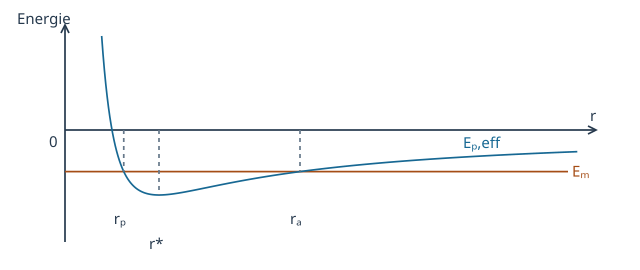
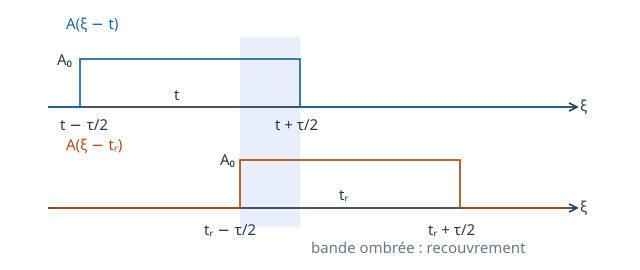
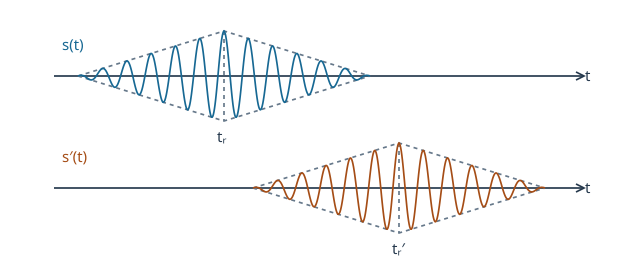
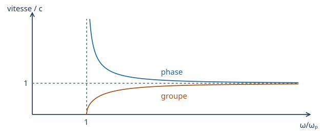

# CCINP MP — Physique 2025 · Corrigé guidé

*Corrigé rédigé par IA, non officiel. Signalez toute erreur.*

## Présentation du sujet

Trois problèmes indépendants suivent un satellite en orbite, un signal de radar altimétrique, puis un vaisseau à voile solaire. Le sujet combine mécanique, électromagnétisme et simulation par la méthode d’Euler explicite. Le formulaire et l’annexe NumPy font partie du sujet.

Les questions 1 à 10 et 20 à 24 offrent des points d’entrée en mécanique et en électromagnétisme. Réservez du temps au calcul de la correction ionosphérique en Q33–35 et à la simulation avec NumPy en Q46–52.

## Partie I — Étude du mouvement d’un satellite

### I.1 — Force centrale conservative

### Question 1

> [!INDICATION]
> Précisez l’origine, l’orientation des axes et la propriété dynamique qui définit un référentiel galiléen.

#### Solution

Le référentiel géocentrique a pour origine le centre de la Terre et des axes dirigés vers des étoiles lointaines supposées fixes. Dans un référentiel galiléen, le principe d’inertie est vérifié. Un point matériel isolé ou soumis à une résultante nulle a un mouvement rectiligne uniforme, le repos étant un cas particulier.

### Question 2

> [!INDICATION]
> Utilisez les symétries de la Terre avant de choisir la surface de Gauss.

#### Solution

Les plans passant par le centre et par $M$ sont des plans de symétrie. Leur intersection est la direction radiale. Par invariance par rotation autour de $O$, le coefficient radial ne dépend que de $r$. Sur la sphère de rayon $r>R_T$, le théorème de Gauss gravitationnel donne $4\pi r^2G_r=-4\pi GM_T$. Ainsi
$$
\begin{aligned}
\vec G(M)&=-\frac{GM_T}{r^2}\vec u,\\
\vec F_g(M)&=-\frac{GM_Tm}{r^2}\vec u.
\end{aligned}
$$

### Question 3

> [!INDICATION]
> Calculez le moment de la force au centre puis exploitez l’orthogonalité du moment cinétique au rayon.

#### Solution

Dans le référentiel géocentrique supposé galiléen, $\mathrm d\vec L_O/\mathrm dt=\overrightarrow{OM}\wedge\vec F_g=\vec0$, car la force est centrale. Si $\vec L_O\ne0$, $\overrightarrow{OM}$ est en permanence dans le plan fixe passant par $O$ et orthogonal à $\vec L_O$. Si le moment cinétique est nul, la vitesse est radiale et la trajectoire est portée par une droite passant par $O$.

### Question 4

> [!INDICATION]
> Intégrez la composante radiale de la relation entre la force et le potentiel.

#### Solution

Posons $\mu=GM_T$. Le gradient d’une fonction radiale vaut $E_p'(r)\vec e_r$. La relation $-E_p'(r)=-\mu m/r^2$ donne $E_p(r)=-\mu m/r+\mathrm{constante}$. La convention à l’infini fixe la constante à zéro. **Ainsi $E_p(r)=-GM_Tm/r$.**

### Question 5

> [!INDICATION]
> Utilisez le bilan énergétique, puis éliminez la vitesse angulaire grâce au moment cinétique.

#### Solution

La gravitation est la seule force et elle est conservative. Dans le référentiel galiléen, le théorème de l’énergie cinétique donne $\mathrm d(E_c+E_p)/\mathrm dt=0$. Or $E_c=m(\dot r^2+r^2\dot\theta^2)/2$ et $L_0=mr^2\dot\theta$. On obtient
$$
\begin{aligned}
E_m&=\frac m2\dot r^2+E_{p,\mathrm{eff}}(r),\\
E_{p,\mathrm{eff}}(r)&=\frac{L_0^2}{2mr^2}-\frac{\mu m}{r}.
\end{aligned}
$$

### Question 6

> [!INDICATION]
> Quel est le signe du terme restant dans l’équation (1) ?

#### Solution

Par Q5, $E_m-E_{p,\mathrm{eff}}=m\dot r^2/2\geq0$. Une position radiale ne peut être atteinte que si $E_{p,\mathrm{eff}}(r)\leq E_m$.

### Question 7

> [!INDICATION]
> Repérez les limites, l’unique rayon où la dérivée s’annule et les intersections avec une énergie de liaison.

#### Solution

Pour une orbite non radiale, $L_0\ne0$. Le potentiel effectif tend vers $+\infty$ en zéro et vers zéro par valeurs négatives à l’infini. Sa dérivée a le signe de $\mu m^2r-L_0^2$ pour $r>0$. Il décroît puis croît, avec un minimum atteint en $r_*=L_0^2/(\mu m^2)$. Pour une ellipse non circulaire, le niveau $E_m$ est compris strictement entre ce minimum et zéro.



Ce tracé décrit le potentiel du modèle extérieur, restreint à $r\geq R_T$ pour une orbite réelle. Si $L_0=0$, le terme centrifuge disparaît et le mouvement est radial.

### Question 8

> [!INDICATION]
> Interprétez l’égalité énergétiquement, puis distinguez deux rayons extrêmes et un minimum unique.

#### Solution

L’égalité signifie $\dot r=0$. Pour une ellipse non circulaire, elle a lieu au **périgée et à l’apogée**, où la distance au foyer est extrémale. Ce sont les deux rayons de rebroussement repérés sur la figure 1 de la Q7.

Si $E_m=E_{p,\mathrm{eff}}(r_*)$, la seule valeur admissible est $r_*$. Le rayon est constant et $\dot\theta=L_0/(mr_*^2)$ aussi. Le mouvement est alors **circulaire uniforme**.

### Question 9

> [!INDICATION]
> Reliez la vitesse circulaire à l’accélération centripète avant de former l’énergie.

#### Solution

La relation radiale donne $v^2/R=\mu/R^2$. L’énergie cinétique vaut donc $\mu m/(2R)$ et l’énergie potentielle vaut $-\mu m/R$. Ainsi
$$
\boxed{E_{m,\mathrm{alt}}=-\frac{GM_Tm}{2R}.}
$$

### Question 10

> [!INDICATION]
> Combinez la vitesse de Q9 avec le temps nécessaire pour parcourir une circonférence.

#### Solution

L’orbite est circulaire uniforme. Comme $v=2\pi R/T$ et $v^2=\mu/R$, on obtient
$$
\boxed{\frac{T^2}{R^3}=\frac{4\pi^2}{GM_T}.}
$$

### I.2 — Jason-2 et transfert orbital

### Question 11

> [!INDICATION]
> Écrivez l’équation (1) aux deux extrémités du grand axe, puis éliminez le moment cinétique.

#### Solution

Sur l’orbite de transfert, $\dot r=0$ à l’apogée et au périgée. En notant $H=L_0^2/(2m)$ pour cette orbite, l’équation (1) donne
$$
E_{m,\mathrm{tr}}=\frac{H}{R^2}-\frac{\mu m}{R}
=\frac{H}{R_c^2}-\frac{\mu m}{R_c}.
$$
L’égalité de ces expressions et $R_c<R$ donnent $H=\mu mRR_c/(R+R_c)$. En réinjectant,
$$
\boxed{E_{m,\mathrm{tr}}=-\frac{GM_Tm}{R+R_c}.}
$$

### Question 12

> [!INDICATION]
> Soustrayez les deux énergies au point de manœuvre et comparez les deux rayons.

#### Solution

Les Q9 et Q11 donnent
$$
\Delta E_m=\frac{GM_Tm(R_c-R)}{2R(R+R_c)}<0.
$$
Au point de manœuvre, la position et l’énergie potentielle ne changent pas. L’énergie cinétique doit donc diminuer. **Le satellite est freiné à l’apogée.**

### Question 13

> [!INDICATION]
> Comparez les énergies à même rayon au périgée, avant et après la seconde manœuvre.

#### Solution

À $r=R_c$, l’énergie à atteindre est celle de l’orbite circulaire, $-\mu m/(2R_c)$. Elle est plus basse que $-\mu m/(R+R_c)$, car $2R_c<R+R_c$. Comme la position ne change pas pendant la manœuvre, l’énergie cinétique diminue. **Il faut de nouveau freiner le satellite en $P$.**

## Partie II — Mesure du niveau des océans

### II.1 — Radar à impulsions

### II.1.1 — Onde sinusoïdale tronquée

### Question 14

> [!INDICATION]
> Écrivez le produit du signal retardé et du conjugué de la référence, puis simplifiez les phases.

#### Solution

On a $\underline e(\xi)=A(\xi)e^{2i\pi f_0\xi}$ et $\underline u(\xi)=\alpha\underline e(\xi-t_R)$. Le produit $\underline e^*(\xi-t)\underline u(\xi)$ contient les deux phases opposées en $\xi$. Leur produit est indépendant de $\xi$, d’où
$$
\underline s(t)=\alpha e^{2i\pi f_0(t-t_R)}
\int_{\mathbb R}A(\xi-t)A(\xi-t_R)\,\mathrm d\xi.
$$

### Question 15

> [!INDICATION]
> Placez les centres et les bords des deux créneaux, puis mesurez leur intersection.

#### Solution

Pour $t_R-\tau\leq t\leq t_R$, la première fenêtre est centrée en $t$ et la seconde en $t_R$. Elles ont la même largeur $\tau$. Leur intersection va de $t_R-\tau/2$ à $t+\tau/2$.



Le produit des amplitudes vaut $A_0^2$ sur ce recouvrement de longueur $\tau+t-t_R$ et vaut zéro ailleurs. D’après Q14,
$$
\underline s(t)=\alpha A_0^2(\tau+t-t_R)e^{2i\pi f_0(t-t_R)}.
$$

### Question 16

> [!INDICATION]
> Prenez les parties réelles et repérez les centres des enveloppes triangulaires.

#### Solution

L’écho réel $s(t)$ est un cosinus de phase $2\pi f_0(t-t_R)$ multiplié par $\alpha A_0^2\Lambda(t-t_R)$.

Pour le second, on remplace $t_R$ par $t_R'$ et on utilise le coefficient propre à cet écho.

Les maxima des enveloppes positives sont atteints en **$t_R$ et $t_R'$**, et chacune s’annule à une distance $\tau$ de son centre.



### Question 17

> [!INDICATION]
> La durée mesurée correspond à la somme des temps aller et retour.

#### Solution

Le critère donne un retard relatif minimal de $\tau$. Comme $t_R=2d/c$, il correspond à
$$
\boxed{\Delta d_{\min}=\frac{c\tau}{2}\simeq1{,}65\times10^4\ \mathrm m.}
$$
Une résolution d’environ $17\ \mathrm{km}$ ne permet pas de mesurer les variations du niveau océanique.

### II.1.2 — Compression d’impulsion

### Question 18

> [!INDICATION]
> Dérivez la phase et calculez l’écart des fréquences aux deux extrémités temporelles.

#### Solution

La phase est $2\pi(f_0t+Kt^2/2)$, donc $f_e(t)=f_0+Kt$. La fréquence centrale est **$f_c=f_0$**, et la largeur balayée est **$B=|K|\tau$**.

### Question 19

> [!INDICATION]
> Le premier zéro non trivial du sinus cardinal correspond à un argument de module $\pi$.

#### Solution

Le premier zéro après le maximum est atteint pour $t-t_R=1/(|K|\tau)=1/B$. En tenant compte du trajet aller-retour,
$$
\boxed{\Delta d_{\min}=\frac{c}{2B}
=\frac{3{,}0\times10^8}{2\times320\times10^6}\ \mathrm m\simeq0{,}47\ \mathrm m.}
$$
La compression abaisse fortement l’écart minimal résoluble, tout en gardant une impulsion longue.

### II.2 — Traversée de l’ionosphère

### Question 20

> [!INDICATION]
> Distinguez la direction du champ de la direction de variation de la phase.

#### Solution

La dépendance spatiale est selon l’axe $Oz$, et la polarisation est **rectiligne suivant $Ox$**. Pour un $k$ réel positif, la phase constante avance selon $+\vec e_z$, du satellite vers l’océan. En l’absence de partie réelle de $k$, cette écriture ne décrit plus une phase qui se propage.

### Question 21

> [!INDICATION]
> Comparez les ordres de grandeur des deux termes de la force de Lorentz.

#### Solution

Le rapport des amplitudes est majoré en ordre de grandeur par $vB/E$. Puisque $B/E$ est de l’ordre de $1/c$, la force magnétique est négligeable si **$v\ll c$** pour les particules considérées.

### Question 22

> [!INDICATION]
> En régime harmonique, remplacez la dérivation temporelle par la multiplication par $i\omega$.

#### Solution

Au premier ordre de la réponse des particules au champ, on applique le principe fondamental de la dynamique avec la seule force électrique. Pour une charge $q$, $i\omega m\underline{\vec v}=q\underline{\vec E}$. Ainsi
$$
\begin{aligned}
\underline{\vec v}_e&=\frac{ie}{m_e\omega}\underline{\vec E},\\
\underline{\vec v}_c&=-\frac{ie}{m_c\omega}\underline{\vec E}.
\end{aligned}
$$

### Question 23

> [!INDICATION]
> Additionnez les deux courants en tenant compte du signe des charges.

#### Solution

La densité de courant vaut $ne(\underline{\vec v}_c-\underline{\vec v}_e)$. La conductivité est donc $-ine^2(1/m_e+1/m_c)/\omega$. Comme $m_c\gg m_e$, on obtient
$$
\begin{aligned}
\gamma(\omega)&\simeq-i\varepsilon_0\frac{\omega_p^2}{\omega},\\
\omega_p&=\sqrt{\frac{ne^2}{\varepsilon_0m_e}}.
\end{aligned}
$$

### Question 24

> [!INDICATION]
> Regardez la divergence du champ électrique et reliez-la à la densité de charge.

#### Solution

L’onde est transverse électrique. Seule la composante $E_x$ est non nulle et elle ne dépend pas de $x$. La divergence du champ est donc nulle et la loi de Maxwell–Gauss donne **$\rho=0$**. De même, le courant transverse ne produit pas de variation de densité par l’équation locale de conservation de la charge.

### Question 25

> [!INDICATION]
> Utilisez Maxwell–Faraday pour éliminer le champ magnétique de Maxwell–Ampère.

#### Solution

En notation complexe, avec les variables spatiales laissées explicites,
$$
\begin{aligned}
\nabla\cdot\underline{\vec E}&=0,&\quad
\nabla\cdot\underline{\vec B}&=0,\\
\nabla\wedge\underline{\vec E}&=-i\omega\underline{\vec B},&
\nabla\wedge\underline{\vec B}&=\mu_0(\gamma+i\omega\varepsilon_0)\underline{\vec E}.
\end{aligned}
$$
La dérivation selon $z$ revient à multiplier par $-ik$. Maxwell–Faraday donne $\underline B_y=(k/\omega)\underline E_x$. Le rotationnel de ce champ magnétique a pour composante selon $x$ la valeur $ik\underline B_y$. Maxwell–Ampère et Q23 donnent alors
$$
\frac{ik^2}{\omega}\underline E_x
=i\mu_0\varepsilon_0\left(\omega-\frac{\omega_p^2}{\omega}\right)\underline E_x.
$$
Comme $\mu_0\varepsilon_0=c^{-2}$,
$$
\boxed{k^2=\frac{\omega^2-\omega_p^2}{c^2}.}
$$

### Question 26

> [!INDICATION]
> Choisissez la racine qui rend le champ décroissant dans le plasma, puis prenez la partie réelle des deux champs.

#### Solution

Pour $\omega<\omega_p$, posons $\kappa=\sqrt{\omega_p^2-\omega^2}/c>0$.

Le facteur spatial est $e^{-ik(z-z_0)}$.

Pour une onde incidente à l’entrée $z_0$, la solution décroissante vers les $z>z_0$ impose $k=-i\kappa$.

La longueur caractéristique est $\delta=1/\kappa$.

Par Q25, $\underline B_y=(-i\kappa/\omega)\underline E_x$. Les champs réels sont
$$
\begin{aligned}
\vec E(M,t)&=E_0e^{-(z-z_0)/\delta}\cos(\omega t)\vec e_x,\\
\vec B(M,t)&=\frac{E_0}{\omega\delta}e^{-(z-z_0)/\delta}\sin(\omega t)\vec e_y.
\end{aligned}
$$
C’est une **onde évanescente**.

### Question 27

> [!INDICATION]
> Les deux champs réels sont en quadrature. Examinez la moyenne du produit temporel.

#### Solution

Le vecteur de Poynting est $\vec E\wedge\vec B/\mu_0$, selon $\vec e_z$, avec un facteur temporel $\cos(\omega t)\sin(\omega t)$. La moyenne de ce facteur sur une période est nulle. **Cette onde évanescente seule ne transporte pas d’énergie en moyenne dans la direction $Oz$.**

### Question 28

> [!INDICATION]
> Choisissez le signe qui convient à l’onde émise vers l’océan, puis utilisez la relation de Faraday.

#### Solution

Pour $\omega>\omega_p$, la propagation vers les $z$ croissants impose $k=\sqrt{\omega^2-\omega_p^2}/c>0$. En posant $\Psi=\omega t-k(z-z_0)$, on a
$$
\begin{aligned}
\vec E(M,t)&=E_0\cos(\Psi)\vec e_x,\\
\vec B(M,t)&=\frac{k E_0}{\omega}\cos(\Psi)\vec e_y.
\end{aligned}
$$
C’est une **onde plane progressive harmonique**, sans atténuation dans le modèle considéré.

### Question 29

> [!INDICATION]
> Comparez les domaines de pulsation associés aux deux solutions précédentes.

#### Solution

Les hautes pulsations se propagent et les basses pulsations donnent une onde évanescente. Le plasma se comporte donc comme un **filtre passe-haut de pulsation de coupure $\omega_p$**. À la coupure, $k=0$.

### Question 30

> [!INDICATION]
> Relevez la plus grande densité du profil jour ou nuit. Comparez sa fréquence plasma à toute la bande du radar.

#### Solution

La densité maximale est de l’ordre de $10^{12}\ \mathrm{m^{-3}}$, sur la courbe de jour de la figure 9. Il faut que la fréquence reste au-dessus de la fréquence plasma maximale traversée. Avec les valeurs fournies,
$$
f_{p,\max}\simeq\frac1{2\pi}\sqrt{\frac{10^{12}e^2}{\varepsilon_0 m_e}}
\simeq9\ \mathrm{MHz}.
$$
Même le bord bas de la bande Jason est à $13{,}6-0{,}16=13{,}44\ \mathrm{GHz}$, très au-dessus de cette coupure. Toute la bande satisfait le critère de propagation de ce modèle.

### Question 31

> [!INDICATION]
> Calculez la vitesse de phase par quotient et la vitesse de groupe par dérivation de la relation de dispersion.

#### Solution

Pour $\omega>\omega_p$, $v_\varphi=\omega/k$ et $v_g=\mathrm d\omega/\mathrm dk=c^2k/\omega$. Ainsi
$$
\begin{aligned}
\frac{v_\varphi}{c}&=\frac1{\sqrt{1-\omega_p^2/\omega^2}},\\
\frac{v_g}{c}&=\sqrt{1-\omega_p^2/\omega^2}.
\end{aligned}
$$
À droite de la coupure, la première courbe décroît de $+\infty$ vers 1, et la seconde croît de 0 vers 1.



### Question 32

> [!INDICATION]
> Comparez les vitesses pour des pulsations différentes dans le domaine propagatif.

#### Solution

La vitesse de phase dépend de la pulsation. **L’ionosphère est dispersive** dans ce modèle. La vitesse de groupe dépend également de la pulsation.

### Question 33

> [!INDICATION]
> Décomposez l’aller-retour entre vide et plasma. Développez l’inverse de la vitesse de groupe aux deux fréquences.

#### Solution

Pour $j=0,1$, le temps d’aller-retour est $t_j=2(d-\ell)/c+2\ell/v_g(\omega_j)$. Comme $\omega_p^2/\omega_j^2\ll1$, la Q31 donne au premier ordre
$$
t_j\simeq\frac{2d}{c}+\frac{\ell\omega_p^2}{c\omega_j^2}.
$$
La différence vaut
$$
\boxed{\Delta t\simeq\frac{\ell\omega_p^2}{c}
\left(\frac1{\omega_1^2}-\frac1{\omega_0^2}\right).}
$$

### Question 34

> [!INDICATION]
> Éliminez le facteur commun qui dépend de l’ionosphère entre le temps principal et le retard différentiel.

#### Solution

D’après Q33, $ct_0/2\simeq d+\ell\omega_p^2/(2\omega_0^2)$. La valeur de $\ell\omega_p^2$ déduite de $\Delta t$ donne
$$
\begin{aligned}
d&\simeq\frac{ct_0}{2}-\varepsilon,\\
\varepsilon&=\frac{c\Delta t}{2}\frac{\omega_1^2}{\omega_0^2-\omega_1^2}.
\end{aligned}
$$

### Question 35

> [!INDICATION]
> Calculez le biais de la conversion directe du temps en distance et exprimez la pulsation plasma avec Q23.

#### Solution

En prenant à tort $v_g=c$, on surestime $d$ de
$$
\varepsilon\simeq\frac{\ell\omega_p^2}{2\omega_0^2}
=\frac{\ell ne^2}{2\varepsilon_0m_e\omega_0^2}.
$$
Avec $\ell=5{,}0\times10^5\ \mathrm m$, $n=5\times10^{11}\ \mathrm{m^{-3}}$ et $\omega_0=2\pi\times13{,}6\times10^9\ \mathrm{rad\,s^{-1}}$, on trouve **$\varepsilon\simeq5{,}4\times10^{-2}\ \mathrm m$**. Le biais atteint plusieurs centimètres, ce qui justifie la correction pour l’altimétrie.

## Partie III — Voile solaire

### III.1 — Pression de radiation

### Question 36

> [!INDICATION]
> Imposez la continuité de la composante tangentielle du champ électrique à la surface du conducteur.

#### Solution

Au voisinage intérieur de la voile, le champ est nul. La discontinuité autorisée du champ électrique est normale à la surface. Par conséquent, la somme des champs incidents et réfléchis dans le plan $yOz$ est nulle en $x=0$. On trouve $E'_{0y}=0$ et $E'_{0z}=-E_0$, d’où
$$
\underline{\vec E}_r(M,t)=-E_0 e^{i(\omega t+kx)}\vec e_z.
$$

### Question 37

> [!INDICATION]
> Déduisez les deux champs magnétiques par des produits vectoriels en respectant le sens de propagation. Orientez la normale vers le conducteur.

#### Solution

Pour l’onde incidente, $\underline{\vec B}_i=\vec e_x\wedge\underline{\vec E}_i/c$, selon $-\vec e_y$. Pour l’onde réfléchie, les signes associés à la direction et à la polarisation sont tous deux inversés. Ainsi, en $x=0^-$,
$$
\underline{\vec B}_{\mathrm{tot}}=-\frac{2E_0}{c}e^{i\omega t}\vec e_y.
$$
Le milieu 1 est le vide, le milieu 2 le conducteur et $\vec n_{12}=\vec e_x$. La relation de passage donne $-\vec B_{\mathrm{tot}}=\mu_0\vec j_s\wedge\vec e_x$. Comme $\vec e_z\wedge\vec e_x=\vec e_y$,
$$
\boxed{\vec j_s(t)=\frac{2E_0}{\mu_0 c}\cos(\omega t)\vec e_z.}
$$

### Question 38

> [!INDICATION]
> Utilisez la force de Laplace avec la moitié du champ total à l’extérieur, puis intégrez sur la largeur.

#### Solution

À la surface, la moitié du champ total égale le champ incident réel $\vec B_i(0,t)$. Avec l’élément de longueur orienté selon $\vec e_z$ et le courant $j_s(t)\,\mathrm dy$, la force vaut
$$
\delta\vec F_L=a j_s(t)\,\mathrm dy\,\vec e_z\wedge\vec B_i(0,t).
$$
Le courant surfacique et le champ ne dépendent pas de $y$. L’intégration sur une largeur $a$ donne
$$
\vec F_L=a^2j_s(t)\,\vec e_z\wedge\vec B_i(0,t).
$$

### Question 39

> [!INDICATION]
> Ramenez la force à une unité de surface. Exprimez ensuite l’intensité par le flux moyen de Poynting de l’onde incidente.

#### Solution

On a $\vec B_i(0,t)=-(E_0/c)\cos(\omega t)\vec e_y$. Avec Q37 et Q38, la force par unité de surface est dirigée vers $+\vec e_x$ et son coefficient vaut $2E_0^2\cos^2(\omega t)/(\mu_0c^2)$. La moyenne du cosinus carré vaut $1/2$.

L’intensité incidente vaut $I=E_0^2/(2\mu_0 c)$, d’après le vecteur de Poynting dans le vide. On obtient
$$
\begin{aligned}
\langle\vec f\rangle&=P_m\vec e_x,\\
P_m&=\frac{E_0^2}{\mu_0c^2}=\frac{2I}{c}.
\end{aligned}
$$

### Question 40

> [!INDICATION]
> Égalisez la poussée moyenne à la force nécessaire pour obtenir l’accélération visée.

#### Solution

Pour une incidence normale, la poussée maximale est $P_mS$. Pour produire une accélération $g/1000$, il faut
$$
S=\frac{mgc}{2000 I}\simeq2{,}9\times10^6\ \mathrm{m^2}.
$$
La surface est **de l’ordre de $3\ \mathrm{km^2}$**, soit un carré d’environ $1{,}7\ \mathrm{km}$ de côté. Cette dimension s’explique par la faible pression, d’environ $7\ \mathrm{\mu Pa}$.

### III.2 — Libération du vaisseau

### III.2.1 — Position du problème

### Question 41

> [!INDICATION]
> Dérivez la position puis la vitesse en tenant compte de la rotation de la base polaire.

#### Solution

Avec $\dot{\vec e}_r=\dot\theta\vec e_\theta$ et $\dot{\vec e}_\theta=-\dot\theta\vec e_r$, on obtient
$$
\begin{aligned}
\vec r&=r\vec e_r,\\
\vec v&=\dot r\vec e_r+r\dot\theta\vec e_\theta,\\
\vec a&=(\ddot r-r\dot\theta^2)\vec e_r
+(r\ddot\theta+2\dot r\dot\theta)\vec e_\theta.
\end{aligned}
$$

### Question 42

> [!INDICATION]
> Comparez l’angle absolu de la normale avec l’angle absolu du radial avant de projeter la force.

#### Solution

La normale fait l’angle $\phi$ avec $Ox$, tandis que $\vec e_r$ fait l’angle $\theta$. Ses composantes dans la base polaire sont donc $\cos(\phi-\theta)$ et $\sin(\phi-\theta)$. La gravitation est radiale, d’où
$$
\begin{aligned}
F_r &= -\frac{GM_Tm}{r^2}+L(r,\theta)P_m S\cos^2\phi\cos(\phi-\theta),\\
F_\theta &= L(r,\theta)P_m S\cos^2\phi\sin(\phi-\theta).
\end{aligned}
$$

### Question 43

> [!INDICATION]
> Dérivez la vitesse écrite avec $v_r$ et $v_\theta$ et appliquez la dynamique à chaque composante.

#### Solution

Avec $\dot\theta=v_\theta/r$, les composantes de l’accélération sont $\dot v_r-v_\theta^2/r$ et $\dot v_\theta+v_rv_\theta/r$. Dans le référentiel supposé galiléen, le principe fondamental donne
$$
\begin{aligned}
\dot v_r&=F_r/m+v_\theta^2/r,\\
\dot v_\theta&=F_\theta/m-v_rv_\theta/r.
\end{aligned}
$$

### III.2.2 — Énergie et manœuvre optimale

### Question 44

> [!INDICATION]
> Additionnez l’énergie cinétique polaire et le potentiel gravitationnel nul à l’infini.

#### Solution

L’énergie mécanique vaut
$$
\boxed{E_m=\frac m2(v_r^2+v_\theta^2)-\frac{GM_Tm}{r}.}
$$

### Question 45

> [!INDICATION]
> Dans la dérivée de l’énergie mécanique, identifiez la puissance de la force extérieure non incluse dans le potentiel.

#### Solution

La seule force dont la puissance reste au bilan mécanique est la pression de radiation. D’après Q42, sa puissance s’obtient en prenant le produit scalaire de la poussée et de la vitesse.
$$
\begin{aligned}
\frac{\mathrm dE_m}{\mathrm dt}
&=K_mL(r,\theta)\cos^2\phi\,
   (v_r\cos(\phi-\theta)+v_\theta\sin(\phi-\theta)),\\
K_m&=P_m S.
\end{aligned}
$$

### III.3 — Simulation numérique du mouvement du vaisseau

### III.3.1 — Résolution numérique

### Question 46

> [!INDICATION]
> Choisissez la fonction de l’annexe qui prend le pas en argument et exclut la borne supérieure.

#### Solution

```python
T = np.arange(0, tmax, dt)
```

On suppose $dt>0$. Pour les données numériques de l’énoncé, cela donne 604 800 instants, de 0 à 604 799 secondes.

### Question 47

> [!INDICATION]
> Échantillonnez l’intervalle angulaire et évaluez le facteur de la puissance qui dépend de l’orientation.

#### Solution

On parcourt 2 001 valeurs de $\phi$. L’écart entre deux angles proposés vaut $\pi/2000<2\times10^{-3}\ \mathrm{rad}$. En lumière, les facteurs $K_m$ et $L$ sont positifs et indépendants de l’angle. Dans l’ombre, toute orientation donne la même puissance.

```python
def recherche_phi_optimal(vr, vth, theta):
    angles = np.linspace(-np.pi / 2, np.pi / 2, 2001)
    meilleur_angle = angles[0]
    if vr * np.sin(theta) + vth * np.cos(theta) > 0:
        meilleur_angle = angles[len(angles) - 1]
    meilleure_puissance = 0.0
    for i in range(1, len(angles) - 1):
        phi = angles[i]
        projection = vr * np.cos(phi - theta) + vth * np.sin(phi - theta)
        puissance = np.cos(phi)**2 * projection
        if puissance > meilleure_puissance:
            meilleur_angle = phi
            meilleure_puissance = puissance
    return meilleur_angle
```

Les deux extrémités donnent exactement zéro. L’initialisation choisit celle située sur la moitié d’intervalle de même signe que la composante verticale de la vitesse, ce qui couvre un maximum très proche d’une extrémité. Le temps est linéaire en nombre d’angles testés.

Pour justifier la précision angulaire, soient $A,B$ les composantes cartésiennes de la vitesse.

La fonction à maximiser est $\cos^2\phi(A\cos\phi+B\sin\phi)$.

Si $B\ne0$, une inclinaison du signe de $B$ donne la meilleure valeur entre deux angles opposés.

Sur cette moitié d’intervalle, posons $u=|\tan\phi|$.

L’objectif vaut $(A+|B|u)/(1+u^2)^{3/2}$.

Sa dérivée a le signe de $|B|-3Au-2|B|u^2$, dont l’unique racine positive sépare croissance et décroissance.

Sur la grille, le meilleur point est donc l’un des deux angles qui encadrent le maximum, à moins d’un pas.

Si $B=0$, le maximum est déjà sur la grille, en zéro lorsque $A>0$, et à une extrémité sinon.

### Question 48

> [!INDICATION]
> Dans le modèle de rayons parallèles, l’ombre se trouve en aval de la Terre et à moins d’un rayon terrestre de l’axe du rayonnement.

#### Solution

Dans le plan d’étude, les coordonnées cartésiennes sont $x=r\cos\theta$ et $y=r\sin\theta$. L’ombre est modélisée par $x>0$ et $|y|<R_T$. On utilise les constantes globales de l’énoncé et les projections de Q42.

```python
def derivees_comp_vitesse(r, theta, vr, vth, phi):
    x = r * np.cos(theta)
    y = r * np.sin(theta)
    lumiere = 1
    if x > 0 and -RT < y and y < RT:
        lumiere = 0
    force = lumiere * Km * np.cos(phi)**2
    fr = -G * MT * m / r**2 + force * np.cos(phi - theta)
    fth = force * np.sin(phi - theta)
    return fr / m + vth**2 / r, fth / m - vr * vth / r
```

### Question 49

> [!INDICATION]
> Utilisez exclusivement les valeurs au début du pas pour calculer les quatre incréments.

#### Solution

Avec les noms de la boucle, une affectation simultanée convient.
```python
r, theta, vr, vth = (
    r + dt * vr,
    theta + dt * vth / r,
    vr + dt * vr_pt,
    vth + dt * vth_pt,
)
```

Les opérandes de droite sont évalués avant les affectations. Le canevas utilise plusieurs graphies pour la vitesse orthoradiale. Dans la fonction complète, on peut renommer son paramètre `vtheta` en `vth` à la ligne 1 et la liste `Vtheta` en `Vth` à la ligne 18. On conserve `theta` pour l’angle. Les listes d’état étant alimentées après la mise à jour, leurs entrées représentent les instants `T + dt`, alors que les valeurs de `Phi` sont celles utilisées au début de chaque pas.

### III.3.2 — Exploitation de la simulation

### Question 50

> [!INDICATION]
> Près du sommet de l’orbite, regardez le sens de la vitesse et celui que peut prendre la poussée.

#### Solution

La trajectoire part du bas vers les $x$ croissants. Au voisinage du haut, elle est dirigée approximativement vers les $x$ décroissants. Or la poussée due au Soleil a une projection sur $Ox$ positive ou nulle. Si elle était importante, sa puissance serait donc principalement négative et freinerait le vaisseau.

En plaçant la voile presque parallèlement au plan $xOz$, sa normale devient presque orthogonale au rayonnement. La poussée est alors très faible, car elle est proportionnelle à $\cos^2\phi$. C’est l’orientation qui évite de perdre de l’énergie dans cette situation.

### Question 51

> [!INDICATION]
> Utilisez la conservation de l’énergie et la limite du potentiel gravitationnel lorsque la distance augmente indéfiniment.

#### Solution

Sans voile, pour atteindre l’infini il faut $E_m\geq0$, puisque le potentiel y tend vers zéro. Pour un mouvement de départ vers l’extérieur, l’énergie nulle correspond au seuil de libération. En effet, au seuil, si le moment cinétique est non nul, le potentiel effectif de Q5 reste négatif au-delà de son unique zéro. Si le moment cinétique est nul, il est négatif à tout rayon positif. Une fois le rayon initial accessible, aucune barrière extérieure ne bloque l’éloignement. On impose donc $mv_{\rm lib}^2/2-GM_Tm/r=0$, d’où
$$
\boxed{v_{\rm lib}(r)=\sqrt{\frac{2GM_T}{r}}.}
$$

### Question 52

> [!INDICATION]
> Exprimez le rapport des vitesses à partir du bilan énergétique. Pour comprendre les oscillations, comparez périgée et apogée sur une ellipse.

#### Solution

Sans voile, $\|\vec v\|^2=2E_m/m+2GM_T/r$. La Q51 donne
$$
\boxed{\frac{\|\vec v\|}{v_{\rm lib}}=\sqrt{1+\frac{E_m r}{GM_Tm}}.}
$$
Pour une ellipse, $E_m<0$. À énergie fixée, le rapport décroît avec $r$, atteint son maximum au périgée et son minimum à l’apogée. Ainsi la succession des passages près des deux extrémités radiales produit des oscillations. Pour le vaisseau sous voile, l’énergie et le rayon orbital évoluent, et cette lecture par des ellipses instantanées est surtout pertinente lors des premiers tours, quand la poussée reste une perturbation de la gravitation.

Pour préciser l’effet de l’excentricité $e$, une ellipse de demi-grand axe $a$ a $E_m=-GM_Tm/(2a)$ d’après le calcul de Q11 aux deux rayons extrêmes. Les carrés des rapports au périgée et à l’apogée valent respectivement $(1+e)/2$ et $(1-e)/2$. Une ellipse plus excentrique donne donc une amplitude plus forte. La poussée augmente principalement l’énergie sur la portion où la vitesse est orientée vers les $x$ croissants, près du bas de l’orbite, et reste faible sur la portion opposée. Sur une orbite presque circulaire, une poussée tangentielle dans le sens de la vitesse fait dépasser la vitesse circulaire à rayon presque inchangé. Le rayon tend ensuite à croître, ce qui relève l’apogée par rapport à la zone de poussée. Répétée surtout d’un côté de l’orbite, cette action accentue les écarts radiaux et explique la croissance initiale des oscillations.

## Bilan

- Pour un mouvement à force centrale, le moment cinétique permet de réduire le problème à une énergie radiale.
- En altimétrie, un retard est mesuré sur un aller-retour. Dans un milieu dispersif, le temps de trajet de l’enveloppe dépend de la vitesse de groupe.
- Pour une simulation d’Euler explicite, calculez tous les incréments à partir du même état de départ.
