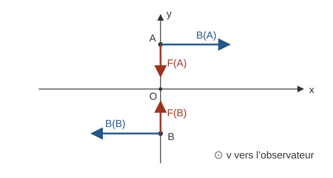
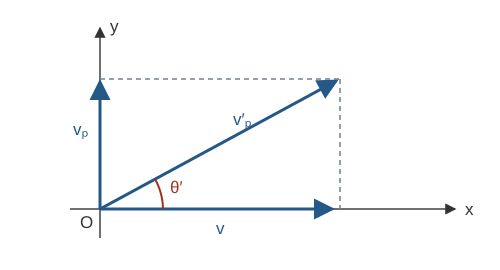
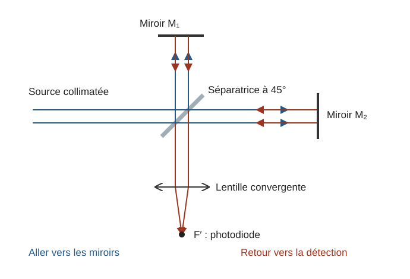

# CCINP MPI — Physique-chimie 2025 · Corrigé brut

*Corrigé rédigé par IA, non officiel. Signalez toute erreur.*

## Problème I — Le synchrotron SOLEIL

### Partie I — Généralités

### Question 1

Le champ électrostatique est $\vec E=-\operatorname{grad}V$. La force sur l’électron est $\vec F=-e\vec E=e\operatorname{grad}V$. Comme $\vec F=-\operatorname{grad}E_p$, on obtient **$E_p=-eV$ à une constante près**.

### Question 2

La force électrostatique est conservative. Avec une vitesse initiale nulle, la conservation de l’énergie mécanique donne $E_c=e(V_f-V_i)$. Ainsi
$$
\boxed{V_f-V_i=\frac{E_c}{e}\simeq 1\times10^3\ \mathrm V.}
$$

### Question 3

L’expression classique impliquerait
$$
\frac vc=\sqrt{\frac{2E_c}{m_ec^2}}
\simeq \sqrt{\frac{2\times10^5}{5{,}1\times10^2}}.
$$
Elle donnerait **$v\simeq6\times10^9\ \mathrm{m\,s^{-1}}$**, soit environ vingt fois $c$. Ce résultat exclut l’emploi de la mécanique classique.

### Question 4

La relation relativiste donne
$$
\boxed{\gamma=1+\frac{E_c}{m_ec^2}\simeq2\times10^2.}
$$
Le rapport est calculé en exprimant $E_c$ et $m_ec^2$ en keV.

### Question 5

Chaque électron traverse une section de l’anneau une fois par période $T=2\pi R/c$. En valeur absolue, la charge traversant la section en une période est $Ne$. Donc $i=Ne/T$, d’où
$$
\boxed{N=\frac{2\pi R i}{e c}\simeq3\times10^{12}\ \text{électrons}.}
$$

### Partie II — Éléments magnétiques

### Question 6

On utilise **un teslamètre et sa sonde**. On place la sonde au point étudié, on règle le zéro en l’absence du champ à mesurer, puis on l’oriente pour mesurer la composante suivant son axe sensible. Avec une sonde monoaxe, trois mesures suivant des axes orthogonaux donnent le vecteur champ.

### Question 7

La force $\vec F=-e\vec v\times\vec B$ est orthogonale à la vitesse. Son travail est nul et la norme de la vitesse reste $v_0$. Elle est également orthogonale au champ, de sorte que la vitesse, initialement perpendiculaire à celui-ci, le reste. L’accélération normale vaut $v_0^2/R_B$ et la force a pour norme $e v_0B_0$. Ainsi
$$
\begin{aligned}
B_0&=\boxed{\frac{m_ev_0}{eR_B}=\frac{p}{eR_B}},\\
\omega_B&=\boxed{\frac{v_0}{R_B}=\frac{eB_0}{m_e}}.
\end{aligned}
$$

### Question 8

Dans le régime ultrarelativiste, l’énergie totale est assimilable à $E_c$ dans la relation $p\simeq E/c$. On obtient
$$
\boxed{B_0\simeq \frac{E_c/e}{cR_B}\simeq2\ \mathrm T.}
$$
On a utilisé $E_c/e=2{,}7\times10^9\ \mathrm V$.

### Question 9

Le champ magnétique est un vecteur axial. Dans un plan de symétrie des courants, il est normal au plan. Dans un plan d’antisymétrie des courants, il appartient au plan.

Le plan $xOy$ est plan d’antisymétrie des courants. Chaque bobine est alors réfléchie sur elle-même en inversant le courant orienté. Donc $\vec B$ appartient à $xOy$ en tout point de ce plan.

Les plans $xOz$ et $yOz$ sont des plans de symétrie des courants.

On le vérifie en réfléchissant les bobines de la figure 2b et en suivant le sens de leurs courants.

Ainsi, sur $Ox$, le champ est dirigé suivant $Oy$ et, sur $Oy$, il est dirigé suivant $Ox$.

À l’origine, les deux contraintes s’appliquent simultanément, d’où **$\vec B(O)=\vec 0$**.

Par la règle de la main droite, les faces tournées vers l’origine des bobines du haut à gauche et du bas à droite sont des pôles nord. Les deux autres sont des pôles sud. Du côté $x>0$, la bobine du bas est nord et celle du haut sud, ce qui oriente le champ suivant $+\vec e_y$. Du côté $y>0$, le nord est à gauche et le sud à droite, ce qui oriente le champ suivant $+\vec e_x$. Les sens sont inversés sur les demi-axes négatifs par symétrie.

### Question 10

En régime stationnaire, les équations locales sont $\operatorname{div}\vec B=0$ et $\operatorname{rot}\vec B=\mu_0\vec j$. Au voisinage de l’origine, hors des bobines, $\vec j=\vec0$. Dans le champ proposé, la divergence est nulle. La seule composante éventuellement non nulle du rotationnel est $\partial_x B_y-\partial_y B_x=K-K=0$. Comme $\vec B(O)=K'(\vec e_x+\vec e_y)=\vec0$ par Q9, **$K'=0$**.

### Question 11

Sur $Oy$, $\vec B=Ky\vec e_x$, d’où
$$
\vec F=-e v_0 \vec e_z\times (Ky\vec e_x)=-e v_0 K y\,\vec e_y .
$$
En $A$, le champ pointe vers $+x$ et la force vers $-y$. En $B$, le champ pointe vers $-x$ et la force vers $+y$.

**Les forces sont dirigées vers le centre du faisceau en $y$.**

### Question 12

Sur $Ox$, $\vec B=Kx\vec e_y$, donc $\vec F=e v_0 Kx\vec e_x$. Elle éloigne chaque électron de l’axe en $x$. Un second quadrupôle tourné de $90^\circ$ autour de l’axe du faisceau échange les plans focalisant et défocalisant. **Une succession de quadrupôles alternés, de forces et d’espacements ajustés, permet de confiner le faisceau dans les deux plans.**

### Partie III — Rayonnement

### Question 13

Un rayonnement est **anisotrope** si sa puissance surfacique dépend de la direction d’observation. Il est **polarisé** si les variations temporelles de la direction de son champ électrique transverse présentent une organisation déterminée, par exemple une direction fixe pour une polarisation rectiligne.

### Question 14

Tout plan méridien passant par $Oz$ est plan de symétrie de la distribution de charges et de courants. Le champ électrique, vecteur polaire, est dans ce plan. Le champ magnétique, vecteur axial, est normal à ce plan. Au point considéré, cela donne **$E_\varphi=B_r=B_\theta=0$**. L’invariance de la distribution par rotation autour de $Oz$ rend les composantes dans la base sphérique indépendantes de $\varphi$.

### Question 15

En dérivant deux fois la position de l’électron, on obtient $\vec a(t)=-l\omega^2\cos(\omega t)\vec e_z$. Le moment dipolaire est la somme des positions pondérées par les charges. Ici,
$$
\vec p(t)=-el\cos(\omega t)\,\vec e_z.
$$
Son amplitude est $p_0=el$. Dans l’expression demandée, $a=l\omega^2$ désigne l’amplitude de l’accélération. La norme instantanée vaut $a|\cos(\omega t)|$. **$p_0=ea/\omega^2$.**

### Question 16

La zone de rayonnement se situe loin de la source et à une distance grande devant la longueur d’onde $\lambda=2\pi c/\omega$.

Le champ en $1/r$ y domine les termes proches.

Le terme $r/c$ est le temps nécessaire pour parcourir la distance $r$ à la vitesse $c$ dans le vide.

**Le champ observé à l’instant $t$ dépend de la source à l’instant retardé $t-r/c$.**

### Question 17

Les champs sont transverses et, puisque $\vec e_r\times\vec e_\theta=\vec e_\varphi$, ils vérifient
$$
\boxed{\vec B=\frac{\vec e_r\times\vec E}{c}.}
$$
Sur une petite région loin de la source, la direction radiale et l’amplitude varient peu. Cette relation et la phase retardée donnent la structure locale d’une onde plane progressive dans la direction $\vec e_r$. Le champ électrique oscille parallèlement à $\vec e_\theta$, donc la polarisation est rectiligne.

Pour vérifier les unités, on part de
$$
\begin{aligned}
[\mu_0]&=\mathrm{kg\,m\,s^{-2}\,A^{-2}},\\
[p_0]&=\mathrm{A\,s\,m},\\
[\omega]&=\mathrm{s^{-1}}.
\end{aligned}
$$
Le facteur $\mu_0p_0\omega^2/r$ a donc l’unité $\mathrm{kg\,m\,s^{-3}\,A^{-1}}$, soit $\mathrm{V\,m^{-1}}$. Le facteur supplémentaire $1/c$ dans $\vec B$ donne $\mathrm{kg\,s^{-2}\,A^{-1}}$, soit le tesla.

### Question 18

Le vecteur de Poynting vaut $\vec\Pi=\vec E\times\vec B/\mu_0$. Avec la relation de Q17,
$$
\vec\Pi(r,\theta,t)=
\frac{\mu_0 p_0^2\omega^4}{16\pi^2cr^2}\sin^2\theta
\cos^2\!\bigl(\omega(t-r/c)\bigr)\vec e_r.
$$
La moyenne de $\cos^2$ vaut $1/2$. À distance fixée, la puissance surfacique moyenne est maximale pour $\theta=\pi/2$, dans toutes les directions perpendiculaires à l’axe du dipôle. Avec $p_0=ea/\omega^2$ et $\mu_0\varepsilon_0c^2=1$,
$$
\boxed{\|\langle\vec\Pi\rangle\|_{\max}
=\frac{e^2a^2}{32\pi^2\varepsilon_0 c^3 r^2}.}
$$

### Question 19

Dans la formule relativiste, $1-(v/c)\cos\theta$ est minimal quand $\cos\theta=1$. Le maximum est donc dans la direction et le sens de la vitesse. À distance et amplitude d’accélération comparables, **le rapport des maxima relativiste et dipolaire est $(1-v/c)^{-4}$**. Il est très supérieur à $1$ lorsque $v$ est proche de $c$. Le rayonnement est fortement concentré vers l’avant.

### Partie IV — Directivité du rayonnement synchrotron

### Question 20

Avec la composition galiléenne, $\vec v'_p=\vec v_p+v\vec e_x$. Pour une émission à $\theta=\pi/2$, $\vec v_p=v_p\vec e_y$. Par conséquent,
$$
\begin{aligned}
\vec v'_p&=\boxed{v\vec e_x+v_p\vec e_y},\\
\theta'&=\boxed{\arctan(v_p/v)}.
\end{aligned}
$$

Les particules émises dans le demi-plan avant sont dans ce cône après composition.

En effet, leur composante suivant $x$ est au moins $v$ et la composante transverse a un module au plus $v_p$.

**Cela représente au moins la moitié des particules, et exactement la moitié si $v_p\geq v$**, cas pertinent pour la comparaison avec les photons.

Dans ce cas, la direction du vecteur somme parcourt les angles dans le même ordre que la direction initiale, car l’origine est à l’intérieur du cercle des extrémités de $\vec v'_p$ ou sur son bord.

Pour $v_p<v$, posons $\rho=v/v_p>1$.

Pour une émission dans le demi-plan arrière, posons $u=-\cos\theta>0$.

La condition d’appartenance au cône devient $\rho\sqrt{1-u^2}\leq\rho-u$.

En élevant au carré les membres positifs, elle équivaut à $u\geq2\rho/(1+\rho^2)$.

La proportion totale est alors
$$
\boxed{\frac12+\frac1\pi\arccos\left(\frac{2\rho}{1+\rho^2}\right).}
$$

### Question 21

Dans le vide, la vitesse d’un photon a pour norme $c$ dans tout référentiel inertiel. La composition galiléenne donnerait pour un photon émis transversalement la norme $\sqrt{c^2+v^2}>c$. **La transformation relativiste des vitesses est indispensable.**

### Question 22

Pour un photon, $v_p=c$. À l’émission transverse, les formules données donnent $v'_{p\parallel}=v$ et $v'_{p\perp}=c/\gamma$. La transformation conserve l’ordre des directions : en divisant la composante parallèle par $c$, on trouve $\cos\theta_{\mathcal R'}=(\cos\theta+v/c)/(1+(v/c)\cos\theta)$, croissante en $\cos\theta$. Ainsi, la direction transverse délimite bien l’image du demi-plan avant.

Comme $v\simeq c$ et $\gamma\gg1$,
$$
\tan\theta'=\frac{c}{\gamma v}\simeq\frac1\gamma.
$$
Le petit angle vérifie donc **$\theta'\simeq1/\gamma\simeq2\times10^{-5}\ \mathrm{rad}$**. La moitié du rayonnement est concentrée dans un cône très étroit.

### Question 23

Les tangentes à la trajectoire en $A_1$ et $A_2$ forment chacune un angle de module $\theta'$ avec la direction de la corde sur la figure 5, de part et d’autre de celle-ci. L’angle au centre entre les deux rayons vaut donc $2\theta'$. **La longueur de l’arc est $\ell=2R\theta'$.**

### Question 24

Les photons se propagent à la vitesse $c$. Les dates de réception sont
$$
\begin{aligned}
t'_1&=t_1+\frac{A_1M}{c},\\
t'_2&=t_2+\frac{A_2M}{c}.
\end{aligned}
$$
Puisque $M$ est sur le prolongement de la corde, $A_1M-A_2M=A_1A_2$. Dans l’approximation géométrique du sujet, corde et arc sont assimilés à $2R/\gamma$. Avec $t_2-t_1=\ell/v$, on obtient
$$
\boxed{\Delta t\simeq\frac{2R}{\gamma v}\left(1-\frac vc\right).}
$$
Or $1-v/c=(1-v^2/c^2)/(1+v/c)=1/[\gamma^2(1+v/c)]$. Dans cette approximation, en prenant $v\simeq c$, **$\Delta t\simeq R/(c\gamma^3)$**.

Si l’on conserve la géométrie circulaire exacte, la corde vaut $2R\sin\theta'$. Le terme supplémentaire $2R(\theta'-\sin\theta')/c$ est également d’ordre $R/(c\gamma^3)$. L’approximation du sujet donne donc l’échelle de durée, avec un coefficient numérique associé à l’assimilation de la corde à l’arc.

### Question 25

Avec l’échelle de durée de Q24,
$$
\boxed{f_{\max}\simeq\frac{c\gamma^3}{R}\simeq7\times10^{20}\ \mathrm{Hz}.}
$$
Cela correspond à une énergie de photon de l’ordre du MeV. **Ce rayonnement appartient au domaine gamma.**

### Partie V — Principe de la spectrométrie à transformée de Fourier

### Question 26

La séparatrice à $45^\circ$ partage le faisceau collimaté en deux faisceaux parallèles dans deux bras orthogonaux. Après réflexion à incidence normale sur les miroirs, une partie de chaque faisceau revient vers le port de sortie. Une lentille convergente rassemble ces deux faisceaux au foyer image $F'$, où se trouve la photodiode.

### Question 27

En incidence normale, la différence de marche vaut $\delta=2d$. Pour deux faisceaux de même intensité qui se superposent avec la même polarisation,
$$
\boxed{I(F')=\frac{I_{\max}}2
 \left[1+\cos\left(\frac{4\pi d}{\lambda_m}\right)\right].}
$$
Le contraste est maximal lorsque les deux faisceaux recombinés ont la même intensité. Dans un Michelson idéal, chacun subit une réflexion et une transmission à la même séparatrice, et les miroirs ont des réflectivités égales. Cette symétrie équilibre les voies.

### Question 28

Avec $d=v_0t$, la période de l’interférogramme vaut $T_m=\lambda_m/(2v_0)$. Sur la figure 6, vingt périodes séparent le maximum à l’origine du maximum situé vers $7{,}7\ \mathrm s$. Cette lecture donne environ $0{,}39\ \mathrm s$ par période avant arrondi. D’où
$$
\boxed{\lambda_m=2v_0T_m\simeq5\times10^{-7}\ \mathrm m.}
$$
Pour estimer l’incertitude de lecture, prenons une demi-largeur de $0{,}1\ \mathrm s$ sur la position de chaque maximum extrême, indépendante et à distribution uniforme. En l’absence d’incertitude indiquée sur $v_0$,
$$
u(\lambda_m)=\frac{2v_0}{20}\sqrt{2}\,
\frac{0{,}1\ \mathrm s}{\sqrt3}.
$$
On trouve **$u(\lambda_m)\simeq6\times10^{-9}\ \mathrm m$** avec cette convention de lecture.

### Question 29

Sur la figure 7b, l’amplitude de l’enveloppe autour du niveau moyen est de l’ordre de la moitié de sa valeur initiale après environ $30\ \mathrm s$. Si $t_{\mathrm{env}}$ désigne cette durée de balayage, la différence de marche correspondante est
$$
\boxed{L_c\simeq2v_0 t_{\mathrm{env}}\simeq4\times10^{-5}\ \mathrm m.}
$$
Le temps de cohérence physique vaut $\tau_c\simeq L_c/c$, et diffère du temps de balayage. Avec $\nu=c/\lambda$, pour une bande étroite, $\Delta\nu\simeq(c/\lambda_m^2)\Delta\lambda$. En utilisant $\Delta\nu\,\tau_c\simeq1$ et la lecture de Q28 avant arrondi,
$$
\boxed{\Delta\lambda\simeq\frac{\lambda_m^2}{L_c}\simeq7\times10^{-9}\ \mathrm m.}
$$

### Question 30

La durée $T$ doit être grande devant la durée caractéristique de variation du signal utile. Pour l’interférogramme quasi monochromatique de la figure 7b, elle doit couvrir la décroissance significative de l’enveloppe et contenir un grand nombre de périodes de franges. La largeur instrumentale associée à la fenêtre d’acquisition est de l’ordre de $1/T$, dans la variable de fréquence du balayage. Elle doit être petite devant la largeur spectrale du signal mesuré dans cette même variable.

### Question 31

Le pas temporel est $\Delta t_{\mathrm e}=T/N$. Donc **$f_{\mathrm e}=N/T$**. Sur le rectangle $[t_n,t_n+\Delta t_{\mathrm e}[$, on remplace l’intégrande par sa valeur au bord gauche, $s_n e^{-2\mathrm i\pi f t_n}$. Le rectangle a pour largeur $\Delta t_{\mathrm e}$. La somme des $N$ contributions donne
$$
\boxed{F(f)\simeq \frac TN\sum_{n=0}^{N-1}s_n
 e^{-2\mathrm i\pi f nT/N}.}
$$

### Question 32

À l’échantillonnage, deux exponentielles dont les fréquences diffèrent de $f_{\mathrm e}$ ont les mêmes valeurs aux instants $t_n$.

Le spectre est périodique de période $f_{\mathrm e}$.

Le signal est réel, donc les fréquences opposées donnent des coefficients conjugués.

**Les fréquences non négatives jusqu’à $f_{\mathrm e}/2$ suffisent**, cette borne étant la fréquence de Nyquist.

Pour un $N$ pair, l’implémentation compte $N/2+1$ fréquences si l’on inclut les deux extrémités $0$ et $f_{\mathrm e}/2$.

### Question 33

**$a$ est le pas d’échantillonnage** en secondes. **$b=Na$ est la durée de la fenêtre d’acquisition** en secondes, avec $N$ rectangles. **$c=1/a$ est la fréquence d’échantillonnage** en hertz.

### Question 34

La fréquence du pic de l’interférogramme lue sur la figure 8 est voisine de $2{,}8\ \mathrm{Hz}$ avant arrondi. La phase est $4\pi v_0t/\lambda_m$, donc cette fréquence vérifie $f=2v_0/\lambda_m$. Ainsi,
$$
\boxed{\lambda_m=\frac{2v_0}{f}\simeq5\times10^{-7}\ \mathrm m.}
$$

### Partie VI — La ligne de lumière DESIRS

### Question 35

Puisque $\lambda=1/\sigma$, un petit écart vérifie $\delta\lambda\simeq\delta\sigma/\sigma^2$. Ainsi le pouvoir de résolution vaut $\sigma/\delta\sigma$. Sur le zoom inférieur de la figure 9, les composantes d’un doublet voisin de $112\,845\ \mathrm{cm^{-1}}$ sont séparées d’environ $0{,}3$ à $0{,}4\ \mathrm{cm^{-1}}$. L’écart minimal résolu est au plus de cet ordre. On en déduit

$$
\boxed{P_R\gtrsim3\times10^5.}
$$

Si le doublet est tout juste séparé, on estime $P_R$ à cet ordre de grandeur.
Les raies jaunes du sodium sont autour de $6\times10^2\ \mathrm{nm}$. Avec la séparation de $6\ \mathrm{nm}$ donnée par le sujet, **$P_{R,\mathrm{prisme}}\sim1\times10^2$**. À cet ordre de grandeur, le spectromètre résout des écarts relatifs environ trois mille fois plus petits.

### Question 36

Sur le zoom intermédiaire de la figure 9, les raies de la série se resserrent et deviennent indiscernables vers $\sigma_{\mathrm{lim}}\simeq1{,}13\times10^5\ \mathrm{cm^{-1}}$ avant arrondi. Cette limite correspond au seuil d’ionisation. En unités SI, ce nombre d’onde vaut environ $1{,}13\times10^7\ \mathrm{m^{-1}}$. L’énergie d’un photon vaut $hc\sigma$, donc
$$
\begin{aligned}
\frac{E_{\mathrm{ion}}}{1\ \mathrm{eV}}
&=\frac{hc\sigma_{\mathrm{lim}}}{1{,}6\times10^{-19}\ \mathrm J},\\
E_{\mathrm{ion}}&\simeq\boxed{1\times10^1\ \mathrm{eV}}.
\end{aligned}
$$
La valeur intermédiaire est voisine de $14\ \mathrm{eV}$ avant l’arrondi demandé. Le krypton est un gaz noble, de couche de valence complète. Arracher un électron demande donc une énergie élevée.

## Problème 2 — Les batteries de voiture

### Partie I — La batterie au plomb

### Question 37

Deux isotopes d’un même élément ont **le même nombre de protons et des nombres de neutrons différents**. Les pourcentages totalisent $100$ et la masse molaire moyenne est la moyenne pondérée des masses molaires isotopiques. En assimilant ces dernières à leur nombre de masse en $\mathrm{g\,mol^{-1}}$, on obtient
$$
\boxed{\begin{cases}
x+y+22+52=100,\\
204 x+206 y+207\times22+208\times52=100\times207{,}2.
\end{cases}}
$$

### Question 38

Pendant la décharge, le plomb est oxydé à l’anode et le dioxyde de plomb est réduit à la cathode.
$$
\begin{aligned}
\text{Anode}\quad&
\mathrm{Pb}(s)+\mathrm{SO_4^{2-}}(aq)
\longrightarrow \mathrm{PbSO_4}(s)+2e^-,\\
\text{Cathode}\quad&
\mathrm{PbO_2}(s)+\mathrm{SO_4^{2-}}(aq)+4\mathrm{H^+}(aq)+2e^-
\longrightarrow\mathrm{PbSO_4}(s)+2\mathrm{H_2O}(l).
\end{aligned}
$$
Les électrons se simplifient dans le bilan.
$$
\boxed{\begin{aligned}
\mathrm{Pb}(s)+\mathrm{PbO_2}(s)+2\mathrm{SO_4^{2-}}(aq)+4\mathrm{H^+}(aq)
&\longrightarrow 2\mathrm{PbSO_4}(s)+2\mathrm{H_2O}(l).
\end{aligned}}
$$

### Question 39

Posons $s=[\mathrm{SO_4^{2-}}]/C^0$ et $a=[\mathrm{H^+}]/C^0$. L’activité des solides purs et celle de l’eau solvant sont prises égales à $1$. La loi de Nernst pour les deux couples, écrits dans le sens de la réduction, donne
$$
\begin{aligned}
E_1&=E_1^\circ-\frac{RT}{2F}\ln s,\\
E_2&=E_2^\circ+\frac{RT}{2F}\ln(sa^4).
\end{aligned}
$$
La fém est donc
$$
\begin{aligned}
e&=E_2-E_1\\
&=E_2^\circ-E_1^\circ+\frac{RT}{F}\ln(sa^2).
\end{aligned}
$$
Avec $sa^2=100$, le terme logarithmique vaut $2(RT/F)\ln10$. On trouve **$e\simeq2\ \mathrm V$ à un chiffre significatif**. Avant arrondi, $e\simeq2{,}16\ \mathrm V$ et $12/e\simeq5{,}6$. Il faut **six éléments en série** pour une batterie de tension nominale $12\ \mathrm V$.

### Question 40

À mi-décharge, la charge extraite vaut $Q_{\mathrm d}=20\ \mathrm{A\,h}=20\times3600\ \mathrm C$. La réaction anodique libère deux électrons par atome de plomb. Dans chaque élément, la masse oxydée vaut
$$
\boxed{m_{\mathrm{Pb,él}}=\frac{M(\mathrm{Pb})Q_{\mathrm d}}{2F}
\simeq8\times10^{-2}\ \mathrm{kg}.}
$$
La même charge traverse chaque élément en série. Dans les six éléments de la batterie, la masse totale de plomb oxydée vaut donc **$6m_{\mathrm{Pb,él}}\simeq5\times10^{-1}\ \mathrm{kg}$**, en multipliant avant arrondi.

### Question 41

La figure 10 indique $12\ \mathrm V$ et $40\ \mathrm{A\,h}$. En assimilant la tension à sa valeur nominale au cours de la décharge, l’énergie est estimée par $UQ$. Ainsi,
$$
\boxed{w=\frac{UQ}{m}
\simeq 5\times10^1\ \mathrm{W\,h\,kg^{-1}}.}
$$
Le calcul en $\mathrm{W\,h}$ utilise directement la capacité en $\mathrm{A\,h}$.

### Partie II — La batterie Li-ion

### Question 42

À chaque mole d’électrons correspondent six moles de carbone à l’anode et une mole de $\mathrm{CoO_2}$ à la cathode. Une mole d’électrons transporte $F$ coulombs. Comme $1\ \mathrm{mA\,h}=3{,}6\ \mathrm C$, avec les masses molaires exprimées en $\mathrm{g\,mol^{-1}}$ on obtient
$$
\begin{aligned}
C_{\mathrm C}&=\frac{F}{3{,}6\times6M(\mathrm C)}
 \simeq\boxed{4\times10^2\ \mathrm{mA\,h\,g^{-1}}},\\
C_{\mathrm{CoO_2}}&=\frac{F}{3{,}6 M(\mathrm{CoO_2})}
 \simeq\boxed{3\times10^2\ \mathrm{mA\,h\,g^{-1}}}.
\end{aligned}
$$

### Question 43

Il faut les deux matières actives, chacune dimensionnée pour transférer la même charge $Q$. La quantité de matière d’électrons est $n_e=Q/F$ avec $Q$ exprimée en coulombs. Les masses correspondantes, calculées avant arrondi, sont
$$
\begin{aligned}
m_{\mathrm C}&=6n_e M(\mathrm C)\simeq1\times10^2\ \mathrm g,\\
m_{\mathrm{CoO_2}}&=n_e M(\mathrm{CoO_2})\simeq1\times10^2\ \mathrm g.
\end{aligned}
$$
La somme donne **$m_{\mathrm{act}}\simeq2\times10^{-1}\ \mathrm{kg}$** pour les deux matériaux hôtes définis en Q42.

### Question 44

La tension $E$ donne une estimation $EQ$ de l’énergie délivrée. En rapportant cette énergie à la masse calculée avec les valeurs non arrondies de Q43,
$$
\boxed{w_{\mathrm{Li-ion}}\simeq \frac{EQ}{m_{\mathrm{act}}}
\simeq6\times10^2\ \mathrm{W\,h\,kg^{-1}}.}
$$
Cette estimation est d’un ordre de grandeur supérieur à la valeur de Q41. Elle ne compte que les deux matériaux hôtes. La masse réelle comprend aussi le lithium, l’électrolyte, les collecteurs, le séparateur et le boîtier. La valeur effective d’une batterie complète est donc inférieure.

FIN
