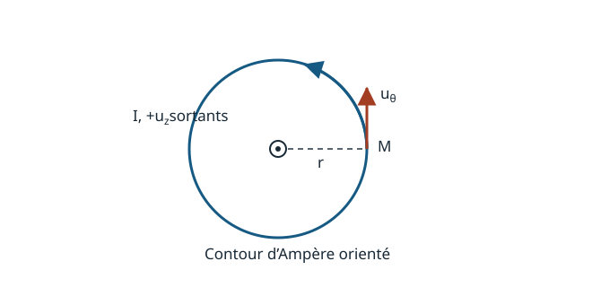
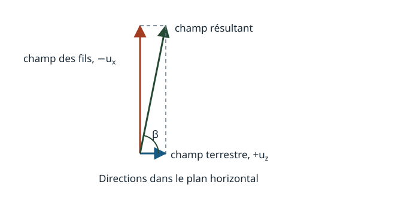
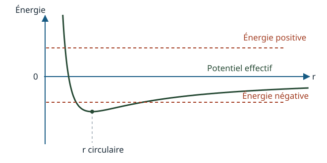
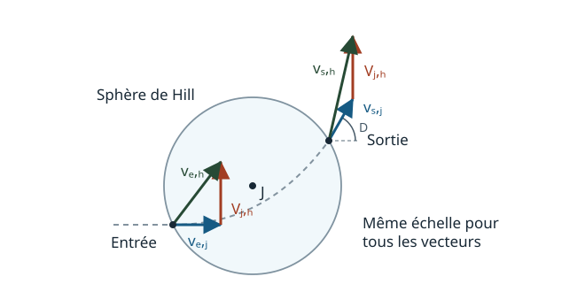

# CCINP PC — Physique 2025 · Corrigé guidé

*Corrigé rédigé par IA, non officiel. Signalez toute erreur.*

## Présentation du sujet

Cette épreuve de quatre heures étudie l’effet Seebeck et sa mise en évidence expérimentale (questions 1 à 12), la conversion thermoélectrique (questions 13 à 26), puis l’assistance gravitationnelle d’une sonde alimentée par ce type de générateur (questions 27 à 41). La troisième partie est indépendante.

Les questions 1 à 3, 13 à 16 et 27 à 32 mobilisent en grande partie des résultats de cours. Gardez du temps pour le bilan sur une tranche et le calcul du flux chaud aux questions 17 à 21, puis pour les signes et le développement limité aux questions 33 et 34. Dans la dernière sous-partie, la construction des vitesses prépare les calculs des questions 39 et 40.

## I. Effet Seebeck

### Question 1

> [!INDICATION]
> Intégrez le champ uniforme entre les deux sections, puis exprimez le courant traversant S.

#### Solution

La loi d’Ohm locale est $\vec j_{\rm él}=\sigma\vec E$. La densité de courant est uniforme, donc le champ est uniforme. Comme $\vec E=-\nabla V$ et $V_1>V_2$, le champ pointe de $x=0$ vers $x=L$, avec $E_x=(V_1-V_2)/L$.

On a $I=S\sigma E_x$, d’où $R_{\rm él}=L/(\sigma S)$.

### Question 2

> [!INDICATION]
> Comparez la différence de température et le débit thermique à la tension et à l’intensité.

#### Solution

La loi de Fourier donne $\vec j_{\rm th}=-\lambda\nabla T$. En régime stationnaire, le flux uniforme est orienté du côté chaud vers le côté froid et vaut $\Phi=S\lambda(T_1-T_2)/L$. La différence de température joue le rôle de la tension et $\Phi$ celui de l’intensité. Ainsi $R_{\rm th}=(T_1-T_2)/\Phi=L/(\lambda S)$, en $\mathrm{K\,W^{-1}}$.

### Question 3

> [!INDICATION]
> Intégrez la relation entre la dérivée du potentiel et celle de la température.

#### Solution

Le long du conducteur, $-\mathrm dV/\mathrm dx=\alpha\,\mathrm dT/\mathrm dx$. En intégrant de $0$ à $L$, avec $\alpha$ constant, on trouve
$$
e=V_1-V_2=-\alpha(T_1-T_2).
$$

### Question 4

> [!INDICATION]
> À densités initiales égales, comparez la vitesse d’agitation et les traversées de la séparation.

#### Solution

Dans le modèle de gaz d’électrons, l’agitation thermique moyenne est plus forte dans le compartiment chaud $A$, où l’énergie cinétique moyenne et la vitesse typique sont plus élevées. À densités initiales égales, le passage d’électrons de $A$ vers $B$ l’emporte. La densité augmente donc dans $B$ et diminue dans $A$. Dans un matériau dont la température varie continûment, ce mécanisme tend à enrichir les régions froides en électrons libres et à appauvrir les régions chaudes.

### Question 5

> [!INDICATION]
> Identifiez les régions chargées, puis comparez le sens du champ à celui du gradient.

#### Solution

Le côté chaud, déficitaire en électrons, devient positif et le côté froid, excédentaire, négatif. Le champ électrique pointe du chaud vers le froid. Le gradient de température pointe vers le chaud, donc $\vec E=\alpha\nabla T$ impose ici $\alpha<0$.

### Question 6

> [!INDICATION]
> Confrontez séparément le signe attendu aux deux signes mesurés.

#### Solution

Le signe prévu correspond à l’aluminium, dont le coefficient est négatif. Le cuivre a un coefficient positif, ce qui contredit le modèle proposé comme explication générale.

### Question 7

> [!INDICATION]
> Repérez pour les deux tensions la borne chaude et la borne froide.

#### Solution

Les deux différences de potentiel sont formulées du froid vers le chaud comme $V_{\rm chaud}-V_{\rm froid}$. Par la question 3, $e_{\rm Bi}=-\alpha_{\rm Bi}(T-T_0)>0$ et $e_{\rm Cu}=-\alpha_{\rm Cu}(T-T_0)<0$.

### Question 8

> [!INDICATION]
> Choisissez un tour du cadre et additionnez algébriquement les deux f.é.m.

#### Solution

En parcourant la branche de bismuth de $C'$ vers $C$, la f.é.m. contribue par $e_{\rm Bi}>0$. Le retour de $D$ vers $D'$ dans le cuivre donne l’élévation $-e_{\rm Cu}>0$.

Le courant positif circule donc selon $C'\to C\to D\to D'\to C'$.

### Question 9

> [!INDICATION]
> Convertissez la section en mètres carrés et conservez les deux f.é.m. dans la maille.

#### Solution

La loi des mailles donne $(R_{\rm él,Bi}+R_{\rm él,Cu})I=e_{\rm Bi}-e_{\rm Cu}$. En négligeant seulement la résistance du cuivre,
$$
I\simeq \frac{(\alpha_{\rm Cu}-\alpha_{\rm Bi})(T-T_0)}{L/(\sigma_{\rm Bi}S)}.
$$
Avec $S=10^{-3}\,\mathrm{m^2}$, la résistance du bismuth vaut $4{,}60\times10^{-4}\,\Omega$ et la f.é.m. de maille vaut $2{,}93\,\mathrm{mV}$. On obtient $I\simeq6{,}4\,\mathrm A$.

### Question 10

> [!INDICATION]
> Cherchez un plan de symétrie passant par M et un contour circulaire centré sur le fil.

#### Solution

La distribution de courant est invariante par translation le long du fil et rotation autour de son axe. Le plan méridien passant par $M$ est un plan de symétrie de la distribution.

Le champ magnétique, vecteur axial, est donc normal à ce plan et s’écrit $B_\theta(r)\vec u_\theta$.

Sur un cercle de rayon $r$ orienté par $+\vec u_z$, le courant enlacé est $+I$. L’équation $2\pi rB_\theta(r)=\mu_0I$ donne $\vec B_{f,\rm Bi}=\mu_0I\vec u_\theta/(2\pi r)$.

### Question 11

> [!INDICATION]
> Faites le produit vectoriel de la direction de chaque courant par son rayon vers M.

#### Solution

Au milieu des fils, pour le bismuth la direction azimutale vaut $\vec u_z\times\vec u_y=-\vec u_x$. Pour le cuivre, le courant et le rayon vers $M$ sont tous deux inversés, ce qui donne la même direction. Chaque contribution vaut $-\mu_0 I\vec u_x/(\pi d)$, donc, par superposition,
$$
\vec B_f=-\frac{2\mu_0 I}{\pi d}\,\vec u_x.
$$

### Question 12

> [!INDICATION]
> Tracez les deux champs dans le plan horizontal avant d’ajouter leurs vecteurs.

#### Solution

L’aiguille s’aligne sur $\vec B_{T,h}+\vec B_f$. Dans le plan horizontal, ces deux contributions sont perpendiculaires. Le triangle des champs donne $\tan\beta=\|\vec B_f\|/B_{T,h}$. Avec les données, $\|\vec B_f\|\simeq9{,}9\times10^{-5}\,\mathrm T$, d’où $\beta\simeq79^\circ$.

## II. Générateur thermoélectrique

### Question 13

> [!INDICATION]
> Prenez le module comme système et adoptez la convention des puissances reçues.

#### Solution

En fonctionnement moteur, le module reçoit de la chaleur de la source chaude, en cède à la source froide et fournit de l’énergie électrique. Ainsi $\mathcal P_C>0$, $\mathcal P_F<0$ et $\mathcal P_{\rm él}<0$. Le rendement est $\eta=-\mathcal P_{\rm él}/\mathcal P_C$.

### Question 14

> [!INDICATION]
> Combinez les deux bilans stationnaires, en isolant l’entropie créée.

#### Solution

L’état du module est stationnaire, donc $\mathrm dU=0$ et $\mathrm dS=0$. Le premier principe sans travail de pression donne $\mathcal P_C+\mathcal P_F+\mathcal P_{\rm él}=0$. Le bilan d’entropie donne
$$
0=\left(\frac{\mathcal P_C}{T_C}+\frac{\mathcal P_F}{T_F}\right)\mathrm dt+\mathrm dS_{\rm créée}.
$$
La création d’entropie est positive ou nulle, d’où $\mathcal P_F/\mathcal P_C\le -T_F/T_C$. Le rendement $1+\mathcal P_F/\mathcal P_C$ est donc au plus $\eta_{\rm Carnot}=1-T_F/T_C$. L’égalité correspond à un fonctionnement réversible.

### Question 15

> [!INDICATION]
> Comparez les directions du courant conventionnel et des porteurs dans chaque jambe.

#### Solution

Le courant descend la jambe $p$ et remonte la jambe $n$. Les trous positifs suivent le courant dans $p$ et les électrons se déplacent dans le sens inverse du courant dans $n$. Les deux types de porteurs se déplacent donc vers la source froide. Avec deux jambes identiques de même dopage, leurs f.é.m. s’annulent en série. Avec deux matériaux de même type mais de coefficients distincts, une f.é.m. différentielle reste possible, mais les contributions se soustraient. Les dopages opposés permettent ici de les additionner.

### Question 16

> [!INDICATION]
> Reliez le flux à travers une section droite à l’intensité orientée.

#### Solution

Le courant d’intensité $I>0$ traverse la section droite $S$ suivant $+\vec u_x$. Ainsi $\vec j_{\rm él}=(I/S)\vec u_x$.

### Question 17

> [!INDICATION]
> Comptez les flux sur les deux faces de la tranche et la puissance électrique produite dans son volume.

#### Solution

Pour la tranche fixe comprise entre $x$ et $x+\mathrm dx$, le régime stationnaire impose une variation d’énergie interne nulle. L’énergie thermique entrante nette vaut $S[j_{\rm th}(x)-j_{\rm th}(x+\mathrm dx)]\mathrm dt$. La puissance volumique électrique apporte $p_v S\,\mathrm dx\,\mathrm dt$. On en déduit $\mathrm dj_{\rm th}/\mathrm dx=p_v$.

### Question 18

> [!INDICATION]
> Écrivez la puissance électrique et la dérivée du flux thermique avec les mêmes variables.

#### Solution

En notant $j=I/S$, on a $p_v=j^2/\sigma_p+\alpha_p jT'$ et $j_{\rm th}'=\alpha_p jT'-\lambda_pT''$. Le terme en $T'$ s’annule dans le bilan, d’où
$$
\begin{aligned}
T''&=-k,\\
k&=\frac{I^2}{\sigma_p\lambda_pS^2}.
\end{aligned}
$$

### Question 19

> [!INDICATION]
> Intégrez deux fois et utilisez les températures aux deux extrémités.

#### Solution

Après deux intégrations, $T(x)=-kx^2/2+Ax+B$. Les températures aux extrémités imposent $B=T_C$ et $A=kL/2-\Delta T/L$. Ainsi
$$
T(x)=T_C-\frac{\Delta T}{L}x+\frac{k}{2}x(L-x).
$$

### Question 20

> [!INDICATION]
> Calculez la dérivée en x égal à zéro et reliez les coefficients de transport aux résistances.

#### Solution

Le flux thermique vers la jambe en $x=0$ vaut $S j_{\rm th}(0)=\alpha_p I T_C-\lambda_p S T'(0)$. Or $T'(0)=-\Delta T/L+kL/2$. Comme $\lambda_p SkL=R_{\rm él,p}I^2$, on trouve
$$
\mathcal P_{\rm th,p}(0)=\alpha_p I T_C+\frac{\Delta T}{R_{\rm th,p}}-\frac12 R_{\rm él,p}I^2.
$$

### Question 21

> [!INDICATION]
> Additionnez les deux puissances thermiques et utilisez le montage indiqué pour chaque transport.

#### Solution

Les deux puissances entrantes s’additionnent. Les jambes étant en série électriquement et en parallèle thermiquement, on a
$$
\begin{aligned}
R_{\rm él}&=R_{\rm él,p}+R_{\rm él,n},\\
\frac1{R_{\rm th}}&=\frac1{R_{\rm th,p}}+\frac1{R_{\rm th,n}} .
\end{aligned}
$$
Avec $\alpha=\alpha_p-\alpha_n$, le total vaut
$$
\mathcal P_C=\alpha I T_C+\frac{\Delta T}{R_{\rm th}}-\frac12R_{\rm él}I^2.
$$

### Question 22

> [!INDICATION]
> Appliquez le premier principe et regroupez séparément les contributions résistive, conductrice et thermoélectrique.

#### Solution

Le premier principe donne $\mathcal P_{\rm él}=-\mathcal P_C-\mathcal P_F$. Les termes de conduction s’annulent et les deux demi-termes résistifs s’additionnent. Ainsi $\mathcal P_{\rm él}=R_{\rm él}I^2-\alpha I\Delta T$.

### Question 23

> [!INDICATION]
> Égalisez la puissance Joule de la charge et la puissance électrique délivrée.

#### Solution

La charge reçoit $R_c I^2=-\mathcal P_{\rm él}=\alpha I\Delta T-R_{\rm él}I^2$. Comme $I>0$, on divise par $I$ et on trouve $I=\alpha\Delta T/(R_{\rm él}+R_c)$.

### Question 24

> [!INDICATION]
> Exprimez la puissance en fonction de la résistance de charge, puis dérivez.

#### Solution

La puissance reçue par la charge vaut $P_c=(\alpha\Delta T)^2 R_c/(R_{\rm él}+R_c)^2$. Sa dérivée vaut
$$
\frac{\mathrm dP_c}{\mathrm dR_c}=(\alpha\Delta T)^2\frac{R_{\rm él}-R_c}{(R_{\rm él}+R_c)^3}.
$$
Le signe passe de positif à négatif pour $R_c=R_{\rm él}$. Le maximum vaut $P_{c,\max}=(\alpha\Delta T)^2/(4R_{\rm él})$.

### Question 25

> [!INDICATION]
> Convertissez les micromètres carrés et calculez la puissance d’un module avant de diviser.

#### Solution

La différence de coefficients vaut $402\,\mathrm{\mu V\,K^{-1}}$. Avec $L=600\times10^{-6}\,\mathrm m$ et $S=6{,}4\times10^{-9}\,\mathrm{m^2}$, on obtient
$$
R_{\rm él}=\frac{L}{S}\left(\frac1{\sigma_p}+\frac1{\sigma_n}\right)\simeq1{,}47\,\Omega.
$$
Un module fournit environ $2{,}75\times10^{-8}\,\mathrm W$ à l’adaptation. Pour $15\,\mathrm{\mu W}$, il faut donc environ $5{,}5\times10^2$ modules, soit $545$ avec les données nominales et l’arrondi à l’entier supérieur.

### Question 26

> [!INDICATION]
> Convertissez la température en kelvins, puis lisez la courbe correspondant à la limite technologique.

#### Solution

À température chaude fixée, les courbes donnent un rendement maximal croissant avec le facteur de mérite. Pour $T_C\simeq773\,\mathrm K$ et $T_F=300\,\mathrm K$, la courbe de la figure 6 pour $Z_{pn}T_m=1$ donne environ $0{,}14$ à $0{,}15$. C’est un ordre de grandeur favorable pour cette technologie, inférieur aux quelques dizaines de pour cent d’une machine thermique motrice usuelle. Le rendement de Carnot à ces températures serait d’environ $61\,\%$.

## III. Assistance gravitationnelle

### Question 27

> [!INDICATION]
> Calculez le moment de la force centrale par rapport à J et examinez l’orientation du plan.

#### Solution

La gravitation est centrale, donc son moment par rapport à $J$ est nul. Le théorème du moment cinétique donne $\mathrm d\vec L_J/\mathrm dt=\vec 0$. Lorsque $\vec L_J\ne\vec0$, le vecteur position $\overrightarrow{JP}$ reste orthogonal à ce vecteur fixe. La trajectoire est plane. Si le moment est nul, le mouvement radial est rectiligne.

Dans le plan, $\vec v=\dot r\vec u_r+r\dot\theta\vec u_\theta$ et $\overrightarrow{JP}=r\vec u_r$. La composante radiale s’annule dans le produit vectoriel. Ainsi
$$
\vec L_J=\overrightarrow{JP}\times m\vec v=mr^2\dot\theta\vec u_z.
$$
La grandeur $C=r^2\dot\theta$ est constante.

### Question 28

> [!INDICATION]
> Intégrez l’opposé de la force radiale en fixant la référence à l’infini.

#### Solution

La relation $F_r=-\mathrm d\mathcal E_p/\mathrm dr=-\Gamma mM_J/r^2$ et la condition $\mathcal E_p(\infty)=0$ donnent $\mathcal E_p(r)=-\Gamma mM_J/r$.

### Question 29

> [!INDICATION]
> Éliminez la vitesse angulaire avec le moment cinétique, puis comparez les niveaux d’énergie au potentiel effectif.

#### Solution

La gravitation dérive de ce potentiel. Le théorème de l’énergie mécanique donne donc $\mathcal E_m$ constante. Avec $v^2=\dot r^2+r^2\dot\theta^2$, on obtient
$$
\begin{aligned}
\mathcal E_m&=\frac12m\dot r^2+\mathcal E_{p,\rm eff}(r),\\
\mathcal E_{p,\rm eff}(r)&=\mathcal E_p(r)+\frac{mC^2}{2r^2}.
\end{aligned}
$$
Pour $C\ne0$, le potentiel tend vers $+\infty$ au voisinage de zéro, présente un minimum en $r=C^2/(\Gamma M_J)$ et tend vers $0$ par valeurs négatives à l’infini.

Au minimum, l’orbite est circulaire. Entre le minimum et zéro, elle est elliptique et liée. Pour une énergie nulle, elle est parabolique. Pour une énergie positive, elle est hyperbolique. Le domaine de mouvement vérifie $\mathcal E_m\ge\mathcal E_{p,\rm eff}$.

### Question 30

> [!INDICATION]
> Choisissez l’énergie mécanique à la frontière entre états liés et ouverts.

#### Solution

Le seuil de libération correspond à $\mathcal E_m=0$, donc à une vitesse atteignant zéro à l’infini. Au point de départ, $mv_\ell^2/2=\Gamma mM_J/r$, d’où $v_\ell=\sqrt{2\Gamma M_J/r}$.

### Question 31

> [!INDICATION]
> Projetez la deuxième loi de Newton sur la direction radiale de l’orbite.

#### Solution

Sur son orbite circulaire, Jupiter subit l’accélération centripète $-d\Omega^2\vec u_{x'}$. La deuxième loi de Newton donne $M_Jd\Omega^2=\Gamma M_S M_J/d^2$. Ainsi
$$
\begin{aligned}
\Omega&=\sqrt{\frac{\Gamma M_S}{d^3}},\\
V_{J,h}&=d\Omega=\sqrt{\frac{\Gamma M_S}{d}}.
\end{aligned}
$$
Avec $d=7{,}8\times10^{11}\,\mathrm m$, on obtient $V_{J,h}\simeq13{,}1\,\mathrm{km\,s^{-1}}$.

### Question 32

> [!INDICATION]
> Considérez l’accélération d’un point fixe du repère tournant.

#### Solution

Le référentiel $\mathcal R'$ tourne par rapport au référentiel héliocentrique supposé galiléen. Ses points fixes hors de l’axe sont accélérés dans $\mathcal R_h$, donc $\mathcal R'$ est non galiléen.

### Question 33

> [!INDICATION]
> Écrivez les distances au Soleil et à Jupiter, puis opposez la force d’inertie à l’accélération d’entraînement.

#### Solution

Avec $\overrightarrow{SP}=(d-r)\vec u_{x'}$, le Soleil attire vers $-\vec u_{x'}$ et Jupiter vers $+\vec u_{x'}$. Les forces gravitationnelles sont
$$
\begin{aligned}
\vec F_S&=-\frac{\Gamma mM_S}{(d-r)^2}\vec u_{x'},\\
\vec F_J&=\frac{\Gamma mM_J}{r^2}\vec u_{x'}.
\end{aligned}
$$
L’accélération d’entraînement est centripète. La force d’inertie d’entraînement, son opposée multipliée par $m$, est donc centrifuge, $m\Omega^2(d-r)\vec u_{x'}$. La force de Coriolis est nulle puisque la sonde est au repos dans $\mathcal R'$. La rotation uniforme exclut une force d’Euler.

### Question 34

> [!INDICATION]
> Éliminez la vitesse angulaire, puis développez la différence de cubes au premier ordre non nul.

#### Solution

La projection de l’équilibre et la valeur de $\Omega^2$ donnent
$$
\begin{aligned}
0&=\frac{M_J}{r^2}-\frac{M_S}{(d-r)^2}+\frac{M_S}{d^3}(d-r),\\
M_Jd^3(d-r)^2&=-M_Sr^2\big[(d-r)^3-d^3\big].
\end{aligned}
$$
Pour $r/d\ll1$, le membre de gauche vaut au premier ordre utile $M_Jd^5$. À droite la différence de cubes commence par $-3d^2r$, d’où $M_Jd^5\simeq3M_Sd^2r^3$. On en déduit $r_H=d(M_J/(3M_S))^{1/3}\simeq5{,}3\times10^7\,\mathrm{km}$. Ce rayon lointain devant la planète est employé comme frontière sphérique dans la suite, conformément à l’approximation du sujet.

### Question 35

> [!INDICATION]
> Comparez les potentiels gravitationnels aux deux intersections avec la sphère.

#### Solution

Dans le référentiel jupiterocentrique de l’étude, l’énergie mécanique se conserve. Les deux vitesses sont évaluées à la même distance $r_H$ de Jupiter, donc au même potentiel gravitationnel. Les énergies cinétiques sont égales, d’où $v_{e,j}=v_{s,j}$.

### Question 36

> [!INDICATION]
> Reliez l’état de diffusion au signe de l’énergie mécanique jovicentrique.

#### Solution

La sonde arrive de loin et repart après le survol. Dans le modèle du mouvement gravitationnel autour de Jupiter, cet état de diffusion impose une énergie mécanique non négative. Par conséquent $v_j\ge v_\ell(r_H)$. Numériquement, $v_\ell(r_H)\simeq2{,}2\,\mathrm{km\,s^{-1}}$, inférieur à $v_j=10\,\mathrm{km\,s^{-1}}$.

### Question 37

> [!INDICATION]
> Ajoutez la même vitesse d’entraînement à l’entrée et à la sortie.

#### Solution

Dans la translation du référentiel jupiterocentrique par rapport au référentiel héliocentrique, la vitesse d’entraînement est uniformément $\vec V_{J,h}$. Ainsi $\vec v_{e,h}=\vec v_{e,j}+\vec V_{J,h}$ et $\vec v_{s,h}=\vec v_{s,j}+\vec V_{J,h}$.

### Question 38

> [!INDICATION]
> Tracez les sommes vectorielles à la même échelle, puis regardez la projection de la vitesse de sortie.

#### Solution

À l’entrée, $\vec v_{e,j}$ est perpendiculaire à $\vec V_{J,h}$. À la sortie, $\vec v_{s,j}$ est de même norme que $\vec v_{e,j}$ et a une projection positive sur $\vec V_{J,h}$.

L’addition du même vecteur d’entraînement donne donc une résultante plus longue à la sortie. À géométrie d’entrée fixée, le gain serait maximal si $\vec v_{s,j}$ devenait parallèle et de même sens que $\vec V_{J,h}$, soit $D=90^\circ$ dans cette configuration.

### Question 39

> [!INDICATION]
> Utilisez le produit scalaire avec la vitesse de Jupiter dans chacune des deux sommes.

#### Solution

À l’entrée, la composition est orthogonale. À la sortie, le produit scalaire entre les vitesses jovicentrique et d’entraînement vaut $v_jV_{J,h}\sin D$ puisque $\vec v_{s,j}$ pointe vers $+\vec u_y$. On trouve
$$
\begin{aligned}
v_{e,h}&=\sqrt{v_j^2+V_{J,h}^2},\\
v_{s,h}&=\sqrt{v_j^2+V_{J,h}^2+2v_jV_{J,h}\sin D}.
\end{aligned}
$$

### Question 40

> [!INDICATION]
> Calculez les normes avant la différence, puis comparez directement leurs carrés pour l’énergie.

#### Solution

Avec $D=60^\circ$, on trouve $v_{e,h}\simeq16{,}5\,\mathrm{km\,s^{-1}}$ et $v_{s,h}\simeq22{,}3\,\mathrm{km\,s^{-1}}$. Le gain vaut $\Delta v_h\simeq5{,}85\,\mathrm{km\,s^{-1}}$. La différence d’énergie cinétique est
$$
\Delta\mathcal E_{c,h}=m v_j V_{J,h}\sin D\simeq8{,}2\times10^{10}\,\mathrm J.
$$
Elle est prélevée sur l’énergie orbitale de Jupiter par interaction gravitationnelle. L’effet sur le mouvement de Jupiter est imperceptible à l’échelle de l’étude, vu le rapport des masses.

### Question 41

> [!INDICATION]
> Convertissez les vitesses en unités communes avant de former leur rapport.

#### Solution

Le gain de $5{,}85\,\mathrm{km\,s^{-1}}$ représente environ $97$ fois celui de $60\,\mathrm{m\,s^{-1}}$ indiqué pour la consommation de la moitié des ergols. Le survol fournit donc un gain de vitesse de l’ordre de cent fois supérieur tout en préservant les ergols pour les manœuvres.

## Bilan

Le générateur associe deux coefficients Seebeck et fournit sa puissance maximale lorsque la résistance de charge égale sa résistance interne. Les bilans de chaleur déterminent le rendement, dont la borne réversible est celle de Carnot. Le survol, lui, conserve la norme de la vitesse dans le référentiel de Jupiter et peut l’augmenter dans le référentiel du Soleil par changement de direction. La construction vectorielle explique le gain que les propulseurs auraient du mal à fournir.

FIN
