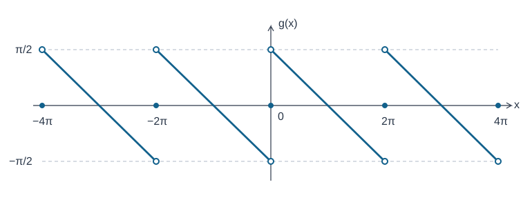

# CCINP PSI — Mathématiques 2025 · Corrigé brut

*Corrigé rédigé par IA, non officiel. Signalez toute erreur.*

## Exercice — Probabilités

### Question 1

Pour la loi de Poisson de paramètre $\lambda$, **$\mathbb E(X)=\lambda$ et $\operatorname{Var}(X)=\lambda$**.

### Question 2

Pour une variable $Y$ de variance finie et $a>0$, l’inégalité de Bienaymé-Tchebychev donne $\mathbb P(|Y-\mathbb E(Y)|\ge a)\le\operatorname{Var}(Y)/a^2$. Avec $Y=X$ et $a=\lambda>0$, on obtient
$$
\boxed{\mathbb P(|X-\lambda|\ge\lambda)\le\frac1\lambda.}
$$

### Question 3

Si $X(\omega)\ge2\lambda$, alors $X(\omega)-\lambda\ge\lambda>0$. Sa valeur absolue est donc au moins $\lambda$. Ainsi **$\{X\ge2\lambda\}\subset\{|X-\lambda|\ge\lambda\}$**.

### Question 4

Par croissance de la probabilité et d’après Q2,
$$
\boxed{\mathbb P(X\ge2\lambda)\le\frac1\lambda.}
$$

### Question 5

En $t=0$, la série ne comporte que son terme constant, avec la convention usuelle $t^0=1$. Pour $t\ne0$, le quotient des modules de deux termes consécutifs vaut $\lambda|t|/(n+1)$ et tend vers zéro. La série converge donc absolument pour tout $t$ réel. **L’ensemble de définition est $\mathbb R$.**

### Question 6

Par la formule de la loi de Poisson et la série entière de l’exponentielle, pour tout $t\in\mathbb R$,
$$
\begin{aligned}
G_X(t)&=e^{-\lambda}\sum_{n=0}^{+\infty}\frac{(\lambda t)^n}{n!}\\
&=\boxed{e^{\lambda(t-1)}}.
\end{aligned}
$$

### Question 7

Pour $t\ge1$, la fonction $u\mapsto t^u$ est croissante au sens large.

Ainsi $\{X\ge\alpha\}\subset\{t^X\ge t^\alpha\}$ pour tout $\alpha\in\mathbb R$, y compris $t=1$.

La variable $t^X$ est positive et intégrable, d’espérance $G_X(t)$ par la formule de transfert.

Markov au seuil strictement positif $t^\alpha$ donne
$$
\boxed{\mathbb P(X\ge\alpha)\le\frac{G_X(t)}{t^\alpha}.}
$$

### Question 8

Pour $\alpha=2\lambda$, le membre de droite de Q7 est $\exp(\lambda[t-1-2\ln t])$. Sur $[1,+\infty[$, la dérivée du terme entre crochets vaut $1-2/t$, négative avant $2$ et positive après. Le minimum est donc atteint en $t=2$. Il vient
$$
\boxed{\mathbb P(X\ge2\lambda)\le(e/4)^\lambda.}
$$

### Question 9

Posons $c=\ln 4-1>0$.

La fonction $\lambda\mapsto\lambda e^{-c\lambda}$ a pour dérivée $e^{-c\lambda}(1-c\lambda)$ et atteint son maximum en $1/c$.

D’après la donnée, ce maximum vaut $1/(ec)\le1/1{,}05<1$.

Ainsi $\lambda(e/4)^\lambda<1$ pour tout $\lambda>0$.

**La borne (2) est strictement plus précise que (1).**

## Problème 1 — Séries de Fourier

### Partie I — Calcul des coefficients de Fourier d’une fonction

### Question 10

Dans l’intégrale de $-\pi$ à $0$, posons $u=-t$. Par Chasles,
$$
\int_{-\pi}^{\pi}f(t)\,\mathrm dt
=\int_0^\pi\bigl[f(u)+f(-u)\bigr]\,\mathrm du.
$$
Si $f$ est paire, l’intégrande est $2f(u)$. Si $f$ est impaire, il est nul. **On obtient les deux identités demandées.**

### Question 11

L’imparité impose $g(0)=0$ et fixe les valeurs négatives à partir des positives. Comme $g(\pi)=0$, la valeur imposée en $-\pi$ vaut aussi zéro, ce qui permet la prolongation périodique. Toute valeur réelle est ainsi fixée. Explicitement, pour $k\in\mathbb Z$,
$$
\boxed{\begin{cases}
g(2k\pi)=0,\\
g(x)=\dfrac{(2k+1)\pi-x}{2} & \text{si }2k\pi<x<2(k+1)\pi.
\end{cases}}
$$
Cette fonction est $2\pi$-périodique, impaire par la substitution $x\mapsto-x$, et affine entre deux multiples consécutifs de $2\pi$. Les limites latérales aux points de saut sont finies. Elle est donc continue par morceaux.

### Question 12

Par imparité de $g(t)\cos(nt)$, Q10 donne $a_n(g)=0$ pour tout $n$.

On a $b_0(g)=0$ car le sinus est nul.

Pour $n\ge1$, le produit $g(t)\sin(nt)$ est pair.

On peut calculer l’intégrale sur $[0,\pi]$ avec la branche affine prolongée en $0$, puisqu’une valeur isolée ne change pas une intégrale.

Par intégration par parties,
$$
\begin{aligned}
b_n(g)&=\frac1\pi\int_0^\pi(\pi-t)\sin(nt)\,\mathrm dt\\
&=\frac1\pi\left[-\frac{(\pi-t)\cos(nt)}n\right]_0^\pi
-\frac1{\pi n}\int_0^\pi\cos(nt)\,\mathrm dt\\
&=\boxed{\frac1n}.
\end{aligned}
$$

### Partie II — Convergence d’une série de Fourier

### Question 13

L’égalité équivaut à $te^{\mathrm ix}=1$. En prenant les modules, $t=1$. On a alors $e^{\mathrm ix}=1$ exactement lorsque $x\in2\pi\mathbb Z$. **Les couples sont $(2k\pi,1)$ pour $k\in\mathbb Z$.**

### Question 14

La fonction $(x,t)\mapsto|1-te^{\mathrm ix}|$ est continue sur le compact $[a,b]\times[0,1]$. Elle n’y est jamais nulle d’après Q13 et $0<a<b<\pi$. Par le théorème des bornes atteintes, son minimum $m$ est donc strictement positif. **Ce même $m$ convient pour tous les couples du rectangle.**

### Question 15

Pour un $x\in]0,\pi[$ fixé, choisissons $0<a<x<b<\pi$. Avec $m$ donné par Q14,
$$
0\le\int_0^1\frac{t^n}{|1-te^{\mathrm ix}|}\,\mathrm dt
\le\frac1{m(n+1)}.
$$
Le majorant tend vers zéro. **L’intégrale tend vers zéro par encadrement.**

### Question 16

Les termes s’écrivent $e^{\mathrm ix}(te^{\mathrm ix})^{n-1}$. La raison est différente de $1$ par Q13. La somme géométrique finie donne directement, y compris en $t=0$,
$$
\boxed{\sum_{n=1}^N t^{n-1}e^{\mathrm inx}
=e^{\mathrm ix}\frac{1-t^N e^{\mathrm iNx}}{1-te^{\mathrm ix}}.}
$$

### Question 17

Pour $x$ fixé dans $]0,\pi[$, les fonctions qui interviennent dans Q16 sont continues sur $[0,1]$. En intégrant cette somme finie,
$$
\sum_{n=1}^N\frac{e^{\mathrm inx}}n
=\int_0^1\frac{e^{\mathrm ix}}{1-te^{\mathrm ix}}\,\mathrm dt
-\int_0^1\frac{t^Ne^{\mathrm i(N+1)x}}{1-te^{\mathrm ix}}\,\mathrm dt.
$$
Le module du dernier terme est majoré par l’intégrale de Q15. Il tend donc vers zéro. **La série converge et sa somme est la première intégrale du membre de droite.**

### Question 18

Pour $-1<\lambda<1$, le dénominateur est $(t-\lambda)^2+1-\lambda^2>0$. L’intégrande est donc continue sur $[0,1]$. En posant $u=(t-\lambda)/\sqrt{1-\lambda^2}$ et en utilisant la primitive $\arctan$, on obtient
$$
\boxed{I(\lambda)=\frac1{\sqrt{1-\lambda^2}}
\left[\arctan\!\left(\frac{1-\lambda}{\sqrt{1-\lambda^2}}\right)
+\arctan\!\left(\frac{\lambda}{\sqrt{1-\lambda^2}}\right)\right].}
$$
Le signe plus vient de l’imparité de l’arctangente à la borne inférieure.

### Question 19

Pour $0<x<\pi$, on a $\lambda=\cos x\in]-1,1[$ et $\sqrt{1-\lambda^2}=\sin x>0$. Dans Q18, les deux arguments s’écrivent
$$
\begin{aligned}
\frac{1-\cos x}{\sin x}
&=\frac{2\sin^2(x/2)}{2\sin(x/2)\cos(x/2)}\\
&=\tan(x/2),\\
\frac{\cos x}{\sin x}&=\tan(\pi/2-x).
\end{aligned}
$$
Les deux angles $x/2$ et $\pi/2-x$ appartiennent à $]-\pi/2,\pi/2[$. Leurs arctangentes correspondantes sont donc ces angles eux-mêmes. Leur somme vaut $(\pi-x)/2$. Ainsi
$$
\boxed{\int_0^1\frac{\mathrm dt}{1-2t\cos x+t^2}=\frac{\pi-x}{2\sin x}.}
$$

### Question 20

Pour $0<x<\pi$, prenons la partie imaginaire dans Q17. Après multiplication de la fraction par le conjugué du dénominateur, sa partie imaginaire vaut $\sin x/(1-2t\cos x+t^2)$. Q19 donne $S_g(x)=(\pi-x)/2=g(x)$.

Les sommes partielles sont impaires et $2\pi$-périodiques. Leurs limites simples héritent de ces propriétés. En $0$ et en $\pi$, chaque sinus de la série est nul, et $g$ vaut aussi zéro. L’imparité puis la périodicité étendent l’égalité. **$S_g=g$ sur $\mathbb R$.**

## Problème 2 — Inégalité et matrices de Hadamard

### Partie I — Inégalité arithmético-géométrique

### Question 21

Pour $f(x)=e^x-1-x$, la dérivée vaut $e^x-1$, strictement négative pour $x<0$ et strictement positive pour $x>0$.

La fonction a donc un unique minimum en $0$, de valeur nulle.

**$e^x\ge1+x$, avec égalité exactement pour $x=0$.**

### Question 22

Les $\lambda_i$ sont positifs ou nuls et non tous nuls, donc $A>0$. En appliquant Q21 à $x=\lambda_i/A-1$,
$$
\boxed{\frac{\lambda_i}{A}\le\exp(\lambda_i/A-1).}
$$

### Question 23

Tous les membres de Q22 sont positifs ou nuls. En multipliant les inégalités, le produit des membres de droite vaut $\exp(\sum_i\lambda_i/A-n)=1$. On a donc $(G/A)^n\le1$. En prenant la racine positive, **$G\le A$**.

### Question 24

Si toutes les $\lambda_i$ sont égales, on a immédiatement $G=A$, y compris si elles sont toutes nulles.

Dans l’autre sens, lorsque $A>0$, l’hypothèse $G=A$ entraîne l’égalité dans le produit de Q23.

En divisant chaque inégalité de Q22 par son membre de droite strictement positif, on obtient des facteurs dans $[0,1]$ de produit $1$.

Chacun vaut donc $1$.

Le cas d’égalité de Q21 impose $\lambda_i/A-1=0$ pour chaque $i$.

**L’égalité a lieu exactement lorsque tous les $\lambda_i$ sont égaux.**

### Partie II — Inégalité de Hadamard

### Question 25

La matrice $S$ est réelle symétrique. D’après le théorème spectral, elle est diagonalisable dans une base orthonormée. Si $\lambda_1,\ldots,\lambda_n$ sont ses valeurs propres comptées avec multiplicité,
$$
\boxed{\begin{aligned}
\det S&=\prod_{i=1}^n\lambda_i,\\
\operatorname{Tr} S&=\sum_{i=1}^n\lambda_i.
\end{aligned}}
$$

### Question 26

Pour tout vecteur propre unitaire $V$ associé à $\lambda_i$, on a $\lambda_i=V^\top SV>0$ par définition positive. L’application de Q23 à ces valeurs propres, puis Q25, donne
$$
\boxed{(\det S)^{1/n}\le\frac{\operatorname{Tr} S}{n}.}
$$

### Question 27

D’après Q24, l’égalité de Q26 équivaut à l’égalité de toutes les valeurs propres de $S$. En cas d’égalité, la matrice diagonale dans une base propre vaut $\lambda I_n$ avec $\lambda>0$. Une matrice scalaire a la même matrice dans toute base, donc $S=\lambda I_n$. Réciproquement, cette matrice donne l’égalité. **Le critère annoncé est établi.**

### Question 28

Si $E_j$ est le $j$-ième vecteur canonique, $s_{j,j}=E_j^\top SE_j>0$ puisque $E_j\ne0$ et $S$ est définie positive.

### Question 29

Posons $B=D^{-1}SD^{-1}$. La multiplication à gauche par $D^{-1}$ multiplie la ligne $i$ par $1/\sqrt{s_{i,i}}$. Celle à droite multiplie la colonne $j$ par $1/\sqrt{s_{j,j}}$. Ainsi
$$
\boxed{b_{i,j}=\frac{s_{i,j}}{\sqrt{s_{i,i}s_{j,j}}}.}
$$
En particulier, $b_{j,j}=1$. Comme $D^{-1}$ et $S$ sont symétriques, on a $B^\top=D^{-1}SD^{-1}=B$. Pour $X\ne0$, $D^{-1}X\ne0$ et
$$
X^\top BX=(D^{-1}X)^\top S(D^{-1}X)>0.
$$
**Donc $B$ est symétrique définie positive, de diagonale égale à $1$.**

### Question 30

Par Q26 appliquée à $B$, $(\det B)^{1/n}\le\operatorname{Tr}(B)/n=1$. Or $\det B=\det S/(\det D)^2$, avec $(\det D)^2=\prod_j s_{j,j}>0$. Il vient
$$
\boxed{\det S\le\prod_{j=1}^n s_{j,j}.}
$$
D’après Q27 et la diagonale de $B$, l’égalité équivaut à $B=I_n$.

Ceci équivaut à $S=D^2$, puisque $D$ est inversible.

Lorsque $S$ est diagonale, elle coïncide bien avec $D^2$.

**L’égalité a donc lieu exactement lorsque $S$ est diagonale.**

### Question 31

La matrice $M^\top M$ est symétrique. Pour $X\ne0$, $MX\ne0$ par inversibilité et $X^\top M^\top MX=\|MX\|^2>0$. **Ainsi $M^\top M\in\mathcal S_n^{++}(\mathbb R)$.**

### Question 32

Si $M$ est inversible, appliquons Q30 à $S=M^\top M$. Son déterminant vaut $(\det M)^2$. Son coefficient diagonal d’indice $j$ vaut $\|C_j\|^2$. En prenant les racines carrées, on obtient
$$
\boxed{|\det M|\le\prod_{j=1}^n\|C_j\|.}
$$
Dans ce cas, l’égalité équivaut à la diagonalité de $M^\top M$, donc à l’orthogonalité deux à deux des colonnes, car $s_{i,j}=\langle C_i,C_j\rangle$.

Si $M$ est singulière, le membre de gauche est nul. L’inégalité vaut et l’égalité équivaut à la présence d’une colonne nulle. Il peut exister une colonne nulle alors que deux autres colonnes ne sont pas orthogonales. Par exemple, lorsque $n=3$, prenons les colonnes $(0,E_1,E_1)$. L’égalité vaut mais $\langle E_1,E_1\rangle=1$.

**Le cas d’égalité exact est donc « au moins une colonne nulle ou les colonnes sont orthogonales deux à deux ».** Si toutes les colonnes sont non nulles, le critère annoncé par le sujet est valable.

### Question 33

Chaque colonne vérifie $\|C_j\|^2=\sum_i m_{i,j}^2\le n$. Par Q32,
$$
\boxed{|\det M|\le n^{n/2}.}
$$
Si l’égalité a lieu, le déterminant est non nul et les deux majorations intermédiaires sont des égalités. Toutes les normes de colonnes valent alors $\sqrt n$, donc chacun des $n$ carrés de coefficients de chaque colonne vaut $1$. Q32 impose aussi l’orthogonalité des colonnes. On a ainsi $M^\top M=nI_n$.

Réciproquement, ces conditions donnent $\det(M^\top M)=n^n$, donc $|\det M|=n^{n/2}$. **Le cas d’égalité est celui annoncé.**

### Partie III — Matrices de Hadamard

### Question 34

L’identité $M^\top M=nI_n$ donne un inverse à gauche, qui est l’inverse puisque $M$ est carrée.

Ainsi **$M^{-1}=M^\top/n$**.

Ses coefficients ont module $1/n$.

Pour $n>1$, ils n’ont donc pas le module demandé pour $\mathcal H_n$.

Pour $n=1$, $M$ vaut $[1]$ ou $[-1]$, et son inverse lui est égal.

**$M^{-1}\in\mathcal H_n$ exactement lorsque $n=1$.**

### Question 35

Posons $B=\begin{pmatrix}M&M\\M&-M\end{pmatrix}$. Tous ses coefficients ont module $1$. Par multiplication par blocs,
$$
B^\top B=\begin{pmatrix}2M^\top M&0\\0&2M^\top M\end{pmatrix}=2nI_{2n}.
$$
Ainsi $B\in\mathcal H_{2n}$. Comme $[1]\in\mathcal H_1$, la construction se répète. **$2^p\in H$ pour tout $p\in\mathbb N$.**

### Question 36

L’orthogonalité à la première colonne normalisée donne $\langle C_1,C_2\rangle=\sum_i m_{i,2}=0$. Si $a$ est le nombre de $1$ dans la deuxième colonne, cette somme vaut $a-(n-a)$. On obtient $n=2a$. **$n$ est pair.**

### Question 37

Les quatre types de lignes définis par le sujet partitionnent les $n$ lignes. Pour les produits avec $C_1$, la contribution d’une ligne est le signe correspondant de la deuxième ou de la troisième colonne. Pour le produit $\langle C_2,C_3\rangle$, elle vaut $1$ quand ces signes coïncident et $-1$ sinon. Par conséquent,
$$
\begin{aligned}
\langle C_1,C_2\rangle&=x+y-z-t,\\
\langle C_1,C_3\rangle&=x-y+z-t,\\
\langle C_2,C_3\rangle&=x-y-z+t.
\end{aligned}
$$
Comme les colonnes distinctes sont orthogonales,
$$
\boxed{\begin{cases}
x+y+z+t=n,\\
x+y-z-t=0,\\
x-y+z-t=0,\\
x-y-z+t=0.
\end{cases}}
$$

### Question 38

La somme des quatre équations de Q37 donne $4x=n$. Comme $x$ est entier, **$n$ est un multiple de $4$ pour tout ordre $n>2$ admissible**.

Les ordres $1$ et $2$ sont déjà admissibles. La conjecture évoquée en fin d’énoncé concerne les ordres $n>2$ et prédit que tout multiple positif de $4$ est admissible.
