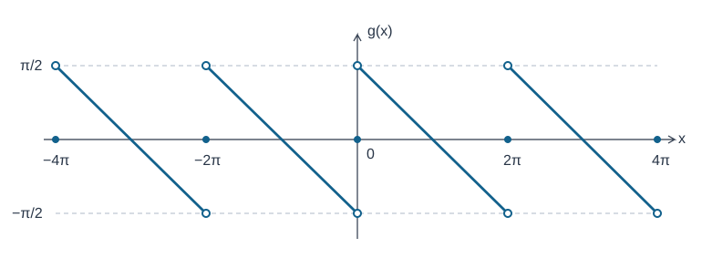

# CCINP PSI — Mathématiques 2025 · Corrigé guidé

*Corrigé rédigé par IA, non officiel. Signalez toute erreur.*

## Présentation du sujet

L’épreuve comporte 38 questions réparties en trois ensembles indépendants. L’exercice compare deux bornes pour une probabilité de queue de la loi de Poisson. Le premier problème étudie une fonction en dents de scie et identifie sa série de Fourier par un calcul direct, sans théorème général de convergence de Fourier. Le second établit une majoration du déterminant par les normes des colonnes, puis étudie les ordres possibles des matrices de Hadamard.

Les questions de calcul direct et de cours offrent de bons points de départ en quatre heures. Dans le premier problème, ne passez pas directement sous le signe intégral en Q17. Dans le second, gardez du temps pour les cas d’égalité et les questions de construction, qui sont largement autonomes.

## Exercice — Probabilités

La variance donne une première borne. Une transformation exponentielle, suivie d’un choix du paramètre, en fournit une seconde à comparer.

### Question 1

> [!INDICATION]
> Retrouvez les deux moments usuels associés au paramètre de Poisson.

#### Solution

Pour la loi de Poisson de paramètre $\lambda$, **$\mathbb E(X)=\lambda$ et $\operatorname{Var}(X)=\lambda$**.

### Question 2

> [!INDICATION]
> Écrivez l’inégalité générale avec le seuil demandé et les moments de Q1.

#### Solution

Pour une variable $Y$ de variance finie et $a>0$, l’inégalité de Bienaymé-Tchebychev donne $\mathbb P(|Y-\mathbb E(Y)|\ge a)\le\operatorname{Var}(Y)/a^2$. Avec $Y=X$ et $a=\lambda>0$, on obtient
$$
\boxed{\mathbb P(|X-\lambda|\ge\lambda)\le\frac1\lambda.}
$$

> [!JURY]
> Le rapport attend l’énoncé général de l’inégalité, suivi de son application au cas de Poisson.

### Question 3

> [!INDICATION]
> Testez un élément de l’événement à gauche et examinez le signe de la différence avec la moyenne.

#### Solution

Si $X(\omega)\ge2\lambda$, alors $X(\omega)-\lambda\ge\lambda>0$. Sa valeur absolue est donc au moins $\lambda$. Ainsi **$\{X\ge2\lambda\}\subset\{|X-\lambda|\ge\lambda\}$**.

### Question 4

> [!INDICATION]
> Comparez les probabilités grâce à l’inclusion puis appliquez Q2.

#### Solution

Par croissance de la probabilité et d’après Q2,
$$
\boxed{\mathbb P(X\ge2\lambda)\le\frac1\lambda.}
$$

### Question 5

> [!INDICATION]
> Testez séparément le point $t=0$.

> [!INDICATION]
> Pour $t\ne0$, utilisez le rapport de deux termes en module.

#### Solution

En $t=0$, la série ne comporte que son terme constant, avec la convention usuelle $t^0=1$. Pour $t\ne0$, le quotient des modules de deux termes consécutifs vaut $\lambda|t|/(n+1)$ et tend vers zéro. La série converge donc absolument pour tout $t$ réel. **L’ensemble de définition est $\mathbb R$.**

### Question 6

> [!INDICATION]
> Faites apparaître une série entière usuelle en insérant la formule de la loi.

#### Solution

Par la formule de la loi de Poisson et la série entière de l’exponentielle, pour tout $t\in\mathbb R$,
$$
\begin{aligned}
G_X(t)&=e^{-\lambda}\sum_{n=0}^{+\infty}\frac{(\lambda t)^n}{n!}\\
&=\boxed{e^{\lambda(t-1)}}.
\end{aligned}
$$

### Question 7

> [!INDICATION]
> Pour $t\ge1$, la transformation exponentielle permet de comparer deux événements.

> [!INDICATION]
> Appliquez Markov après avoir vérifié le seuil et calculé l’espérance de la variable transformée.

#### Solution

Pour $t\ge1$, la fonction $u\mapsto t^u$ est croissante au sens large.

Ainsi $\{X\ge\alpha\}\subset\{t^X\ge t^\alpha\}$ pour tout $\alpha\in\mathbb R$, y compris $t=1$.

La variable $t^X$ est positive et intégrable, d’espérance $G_X(t)$ par la formule de transfert.

Markov au seuil strictement positif $t^\alpha$ donne
$$
\boxed{\mathbb P(X\ge\alpha)\le\frac{G_X(t)}{t^\alpha}.}
$$

> [!JURY]
> Le rapport relève les oublis du rôle de la condition portant sur le paramètre de l’exponentielle. Elle donne la bonne monotonie même pour un seuil réel non entier.

### Question 8

> [!INDICATION]
> Cherchez un choix favorable de $t$ après avoir fixé le seuil.

> [!INDICATION]
> Comparez les logarithmes des membres de droite pour faire apparaître un terme simple à dériver.

#### Solution

Pour $\alpha=2\lambda$, le membre de droite de Q7 est $\exp(\lambda[t-1-2\ln t])$. Sur $[1,+\infty[$, la dérivée du terme entre crochets vaut $1-2/t$, négative avant $2$ et positive après. Le minimum est donc atteint en $t=2$. Il vient
$$
\boxed{\mathbb P(X\ge2\lambda)\le(e/4)^\lambda.}
$$

### Question 9

> [!INDICATION]
> Comparez le quotient des deux bornes sur tout l’intervalle de paramètres autorisés.

> [!INDICATION]
> Posez $c=\ln4-1$, puis cherchez le maximum d’un produit de $\lambda$ par une exponentielle décroissante.

#### Solution

Posons $c=\ln 4-1>0$.

La fonction $\lambda\mapsto\lambda e^{-c\lambda}$ a pour dérivée $e^{-c\lambda}(1-c\lambda)$ et atteint son maximum en $1/c$.

D’après la donnée, ce maximum vaut $1/(ec)\le1/1{,}05<1$.

Ainsi $\lambda(e/4)^\lambda<1$ pour tout $\lambda>0$.

**La borne (2) est strictement plus précise que (1).**

> [!PIEGE]
> La donnée porte sur le produit de e par toute la différence entre le logarithme et un. Cette expression intervient après l’optimisation sur le paramètre de Poisson.

## Problème 1 — Séries de Fourier

Le prolongement impair et périodique rend simple le calcul des coefficients. Pour la convergence, la somme géométrique et un contrôle du reste remplacent l’usage d’un théorème général.

### Partie I — Calcul des coefficients de Fourier d’une fonction

La parité réduit les intégrales et fixe la valeur de la fonction aux points de saut qui sont multiples de la période.

### Question 10

> [!INDICATION]
> Repliez le demi-intervalle négatif sur le positif par un changement de variable.

> [!INDICATION]
> Que devient la somme des deux valeurs de la fonction selon sa parité ?

#### Solution

Dans l’intégrale de $-\pi$ à $0$, posons $u=-t$. Par Chasles,
$$
\int_{-\pi}^{\pi}f(t)\,\mathrm dt
=\int_0^\pi\bigl[f(u)+f(-u)\bigr]\,\mathrm du.
$$
Si $f$ est paire, l’intégrande est $2f(u)$. Si $f$ est impaire, il est nul. **On obtient les deux identités demandées.**

### Question 11

> [!INDICATION]
> Qu’impose l’imparité en zéro et sur le demi-intervalle négatif ?

> [!INDICATION]
> Vérifiez la compatibilité aux deux bouts d’une période et tracez les segments avec leurs extrémités.

#### Solution

L’imparité impose $g(0)=0$ et fixe les valeurs négatives à partir des positives. Comme $g(\pi)=0$, la valeur imposée en $-\pi$ vaut aussi zéro, ce qui permet la prolongation périodique. Toute valeur réelle est ainsi fixée. Explicitement, pour $k\in\mathbb Z$,
$$
\boxed{\begin{cases}
g(2k\pi)=0,\\
g(x)=\dfrac{(2k+1)\pi-x}{2} & \text{si }2k\pi<x<2(k+1)\pi.
\end{cases}}
$$
Cette fonction est $2\pi$-périodique, impaire par la substitution $x\mapsto-x$, et affine entre deux multiples consécutifs de $2\pi$. Les limites latérales aux points de saut sont finies. Elle est donc continue par morceaux.

> [!JURY]
> Le rapport signale des erreurs de signe dans le prolongement et des points de saut mal représentés. Sur le tracé, un point plein correspond à une valeur prise et un point creux à une limite latérale exclue.

### Question 12

> [!INDICATION]
> Regardez la parité de chaque produit qui définit un coefficient.

> [!INDICATION]
> Sur le demi-intervalle positif, utilisez l’expression affine et intégrez par parties.

#### Solution

Par imparité de $g(t)\cos(nt)$, Q10 donne $a_n(g)=0$ pour tout $n$.

On a $b_0(g)=0$ car le sinus est nul.

Pour $n\ge1$, le produit $g(t)\sin(nt)$ est pair.

On peut calculer l’intégrale sur $[0,\pi]$ avec la branche affine prolongée en $0$, puisqu’une valeur isolée ne change pas une intégrale.

Par intégration par parties,
$$
\begin{aligned}
b_n(g)&=\frac1\pi\int_0^\pi(\pi-t)\sin(nt)\,\mathrm dt\\
&=\frac1\pi\left[-\frac{(\pi-t)\cos(nt)}n\right]_0^\pi
-\frac1{\pi n}\int_0^\pi\cos(nt)\,\mathrm dt\\
&=\boxed{\frac1n}.
\end{aligned}
$$

> [!METHODE]
> Une valeur isolée peut être modifiée pour calculer une intégrale. On peut ainsi intégrer par parties la branche affine continue jusqu’en zéro.

### Partie II — Convergence d’une série de Fourier

L’intégrale d’une somme finie fournit une écriture avec reste. Quand l’angle est fixé à l’intérieur de l’intervalle, un minorant du dénominateur permet de faire tendre ce reste vers zéro.

### Question 13

> [!INDICATION]
> Une égalité entre nombres complexes entraîne celle de leurs modules.

> [!INDICATION]
> Une fois $t$ fixé, déterminez les angles possibles.

#### Solution

L’égalité équivaut à $te^{\mathrm ix}=1$. En prenant les modules, $t=1$. On a alors $e^{\mathrm ix}=1$ exactement lorsque $x\in2\pi\mathbb Z$. **Les couples sont $(2k\pi,1)$ pour $k\in\mathbb Z$.**

### Question 14

> [!INDICATION]
> Étudiez la fonction des deux variables sur le rectangle fermé et borné.

> [!INDICATION]
> Pourquoi la non-annulation donne-t-elle un minimum strictement positif ?

#### Solution

La fonction $(x,t)\mapsto|1-te^{\mathrm ix}|$ est continue sur le compact $[a,b]\times[0,1]$. Elle n’y est jamais nulle d’après Q13 et $0<a<b<\pi$. Par le théorème des bornes atteintes, son minimum $m$ est donc strictement positif. **Ce même $m$ convient pour tous les couples du rectangle.**

> [!JURY]
> Le rapport insiste sur le théorème des bornes atteintes. Une quantité positive en chaque point peut avoir une borne inférieure nulle si le minimum n’est pas assuré.

### Question 15

> [!INDICATION]
> Pour l’angle fixé, placez-le dans un intervalle auquel s’applique Q14.

> [!INDICATION]
> Intégrez une borne simple du terme qui contient $t^n$.

#### Solution

Pour un $x\in]0,\pi[$ fixé, choisissons $0<a<x<b<\pi$. Avec $m$ donné par Q14,
$$
0\le\int_0^1\frac{t^n}{|1-te^{\mathrm ix}|}\,\mathrm dt
\le\frac1{m(n+1)}.
$$
Le majorant tend vers zéro. **L’intégrale tend vers zéro par encadrement.**

### Question 16

> [!INDICATION]
> Faites apparaître une somme géométrique commençant à la puissance zéro.

> [!INDICATION]
> Vérifiez que sa raison est différente de un, même aux extrémités.

#### Solution

Les termes s’écrivent $e^{\mathrm ix}(te^{\mathrm ix})^{n-1}$. La raison est différente de $1$ par Q13. La somme géométrique finie donne directement, y compris en $t=0$,
$$
\boxed{\sum_{n=1}^N t^{n-1}e^{\mathrm inx}
=e^{\mathrm ix}\frac{1-t^N e^{\mathrm iNx}}{1-te^{\mathrm ix}}.}
$$

### Question 17

> [!INDICATION]
> Intégrez la somme finie de Q16 avant de passer à la limite.

> [!INDICATION]
> Identifiez le terme en $t^N$ et bornez son module grâce à Q15.

#### Solution

Pour $x$ fixé dans $]0,\pi[$, les fonctions qui interviennent dans Q16 sont continues sur $[0,1]$. En intégrant cette somme finie,
$$
\sum_{n=1}^N\frac{e^{\mathrm inx}}n
=\int_0^1\frac{e^{\mathrm ix}}{1-te^{\mathrm ix}}\,\mathrm dt
-\int_0^1\frac{t^Ne^{\mathrm i(N+1)x}}{1-te^{\mathrm ix}}\,\mathrm dt.
$$
Le module du dernier terme est majoré par l’intégrale de Q15. Il tend donc vers zéro. **La série converge et sa somme est la première intégrale du membre de droite.**

> [!METHODE]
> Intégrer d’abord une identité finie laisse un terme d’erreur explicite. Sa convergence suffit pour justifier le passage à la limite.

### Question 18

> [!INDICATION]
> Complétez le carré et vérifiez le signe du dénominateur sur tout le segment.

> [!INDICATION]
> Choisissez une substitution affine qui donne une primitive usuelle.

#### Solution

Pour $-1<\lambda<1$, le dénominateur est $(t-\lambda)^2+1-\lambda^2>0$. L’intégrande est donc continue sur $[0,1]$. En posant $u=(t-\lambda)/\sqrt{1-\lambda^2}$ et en utilisant la primitive $\arctan$, on obtient
$$
\boxed{I(\lambda)=\frac1{\sqrt{1-\lambda^2}}
\left[\arctan\!\left(\frac{1-\lambda}{\sqrt{1-\lambda^2}}\right)
+\arctan\!\left(\frac{\lambda}{\sqrt{1-\lambda^2}}\right)\right].}
$$
Le signe plus vient de l’imparité de l’arctangente à la borne inférieure.

### Question 19

> [!INDICATION]
> Dans Q18, prenez comme paramètre le cosinus de l’angle.

> [!INDICATION]
> Réécrivez les deux arguments comme des tangentes et contrôlez les intervalles des angles.

#### Solution

Pour $0<x<\pi$, on a $\lambda=\cos x\in]-1,1[$ et $\sqrt{1-\lambda^2}=\sin x>0$. Dans Q18, les deux arguments s’écrivent
$$
\begin{aligned}
\frac{1-\cos x}{\sin x}
&=\frac{2\sin^2(x/2)}{2\sin(x/2)\cos(x/2)}\\
&=\tan(x/2),\\
\frac{\cos x}{\sin x}&=\tan(\pi/2-x).
\end{aligned}
$$
Les deux angles $x/2$ et $\pi/2-x$ appartiennent à $]-\pi/2,\pi/2[$. Leurs arctangentes correspondantes sont donc ces angles eux-mêmes. Leur somme vaut $(\pi-x)/2$. Ainsi
$$
\boxed{\int_0^1\frac{\mathrm dt}{1-2t\cos x+t^2}=\frac{\pi-x}{2\sin x}.}
$$

> [!JURY]
> Le rapport demande de justifier les simplifications d’arctangente. L’inversion de la tangente vaut sur une branche précise.

### Question 20

> [!INDICATION]
> La série cherchée est la partie imaginaire de celle de Q17.

> [!INDICATION]
> Traitez les extrémités de l’intervalle puis exploitez les symétries des sommes partielles.

#### Solution

Pour $0<x<\pi$, prenons la partie imaginaire dans Q17. Après multiplication de la fraction par le conjugué du dénominateur, sa partie imaginaire vaut $\sin x/(1-2t\cos x+t^2)$. Q19 donne $S_g(x)=(\pi-x)/2=g(x)$.

Les sommes partielles sont impaires et $2\pi$-périodiques. Leurs limites simples héritent de ces propriétés. En $0$ et en $\pi$, chaque sinus de la série est nul, et $g$ vaut aussi zéro. L’imparité puis la périodicité étendent l’égalité. **$S_g=g$ sur $\mathbb R$.**

> [!PIEGE]
> Les calculs de la partie II commencent sur l’intervalle ouvert. Les extrémités et les autres périodes demandent un argument séparé.

## Problème 2 — Inégalité et matrices de Hadamard

La moyenne des valeurs propres intervient via le théorème spectral. Les propriétés des matrices qui atteignent la borne se déduisent ensuite des produits scalaires des colonnes.

### Partie I — Inégalité arithmético-géométrique

Une inégalité sur l’exponentielle se multiplie terme à terme. Suivez ce qui impose l’égalité.

### Question 21

> [!INDICATION]
> Étudiez les variations de la différence entre l’exponentielle et sa tangente en zéro.

#### Solution

Pour $f(x)=e^x-1-x$, la dérivée vaut $e^x-1$, strictement négative pour $x<0$ et strictement positive pour $x>0$.

La fonction a donc un unique minimum en $0$, de valeur nulle.

**$e^x\ge1+x$, avec égalité exactement pour $x=0$.**

### Question 22

> [!INDICATION]
> Vérifiez que la moyenne est strictement positive puis choisissez l’argument à donner dans Q21.

#### Solution

Les $\lambda_i$ sont positifs ou nuls et non tous nuls, donc $A>0$. En appliquant Q21 à $x=\lambda_i/A-1$,
$$
\boxed{\frac{\lambda_i}{A}\le\exp(\lambda_i/A-1).}
$$

### Question 23

> [!INDICATION]
> Multipliez les inégalités de Q22 après avoir vérifié les signes.

> [!INDICATION]
> Exprimez le produit d’exponentielles comme l’exponentielle d’une somme.

#### Solution

Tous les membres de Q22 sont positifs ou nuls. En multipliant les inégalités, le produit des membres de droite vaut $\exp(\sum_i\lambda_i/A-n)=1$. On a donc $(G/A)^n\le1$. En prenant la racine positive, **$G\le A$**.

### Question 24

> [!INDICATION]
> Dans le cas non nul, comparez chaque quotient du membre gauche par le membre droit à un.

> [!INDICATION]
> Quand le produit de ces quotients vaut un, que peut-on dire de chacun ?

#### Solution

Si toutes les $\lambda_i$ sont égales, on a immédiatement $G=A$, y compris si elles sont toutes nulles.

Dans l’autre sens, lorsque $A>0$, l’hypothèse $G=A$ entraîne l’égalité dans le produit de Q23.

En divisant chaque inégalité de Q22 par son membre de droite strictement positif, on obtient des facteurs dans $[0,1]$ de produit $1$.

Chacun vaut donc $1$.

Le cas d’égalité de Q21 impose $\lambda_i/A-1=0$ pour chaque $i$.

**L’égalité a lieu exactement lorsque tous les $\lambda_i$ sont égaux.**

> [!METHODE]
> Pour remonter d’une égalité de produit aux facteurs, ramenez-les d’abord à des nombres entre zéro et un. Cette étape fonctionne aussi si un facteur initial est nul.

### Partie II — Inégalité de Hadamard

Normaliser la diagonale permet de comparer le déterminant à la trace. Le cas singulier doit ensuite être traité séparément.

### Question 25

> [!INDICATION]
> Identifiez l’hypothèse matricielle qui donne accès au théorème spectral.

> [!INDICATION]
> Calculez trace et déterminant dans la base propre.

#### Solution

La matrice $S$ est réelle symétrique. D’après le théorème spectral, elle est diagonalisable dans une base orthonormée. Si $\lambda_1,\ldots,\lambda_n$ sont ses valeurs propres comptées avec multiplicité,
$$
\boxed{\begin{aligned}
\det S&=\prod_{i=1}^n\lambda_i,\\
\operatorname{Tr} S&=\sum_{i=1}^n\lambda_i.
\end{aligned}}
$$

### Question 26

> [!INDICATION]
> Justifiez le signe des valeurs propres avant d’appliquer Q23.

#### Solution

Pour tout vecteur propre unitaire $V$ associé à $\lambda_i$, on a $\lambda_i=V^\top SV>0$ par définition positive. L’application de Q23 à ces valeurs propres, puis Q25, donne
$$
\boxed{(\det S)^{1/n}\le\frac{\operatorname{Tr} S}{n}.}
$$

### Question 27

> [!INDICATION]
> Reprenez le cas d’égalité de Q24 sur les valeurs propres.

> [!INDICATION]
> Quelle forme la matrice prend-elle alors, et que devient cette forme après changement de base ?

#### Solution

D’après Q24, l’égalité de Q26 équivaut à l’égalité de toutes les valeurs propres de $S$. En cas d’égalité, la matrice diagonale dans une base propre vaut $\lambda I_n$ avec $\lambda>0$. Une matrice scalaire a la même matrice dans toute base, donc $S=\lambda I_n$. Réciproquement, cette matrice donne l’égalité. **Le critère annoncé est établi.**

### Question 28

> [!INDICATION]
> Appliquez la définition positive à un vecteur canonique.

#### Solution

Si $E_j$ est le $j$-ième vecteur canonique, $s_{j,j}=E_j^\top SE_j>0$ puisque $E_j\ne0$ et $S$ est définie positive.

### Question 29

> [!INDICATION]
> Une multiplication par une matrice diagonale agit simplement sur les lignes ou sur les colonnes.

> [!INDICATION]
> Pour la positivité, regroupez la forme quadratique autour du même vecteur transformé à gauche et à droite.

#### Solution

Posons $B=D^{-1}SD^{-1}$. La multiplication à gauche par $D^{-1}$ multiplie la ligne $i$ par $1/\sqrt{s_{i,i}}$. Celle à droite multiplie la colonne $j$ par $1/\sqrt{s_{j,j}}$. Ainsi
$$
\boxed{b_{i,j}=\frac{s_{i,j}}{\sqrt{s_{i,i}s_{j,j}}}.}
$$
En particulier, $b_{j,j}=1$. Comme $D^{-1}$ et $S$ sont symétriques, on a $B^\top=D^{-1}SD^{-1}=B$. Pour $X\ne0$, $D^{-1}X\ne0$ et
$$
X^\top BX=(D^{-1}X)^\top S(D^{-1}X)>0.
$$
**Donc $B$ est symétrique définie positive, de diagonale égale à $1$.**

> [!PIEGE]
> La positivité définie est une propriété de la forme quadratique. La congruence par une matrice inversible la préserve.

### Question 30

> [!INDICATION]
> Appliquez Q26 au résultat de Q29 et calculez le déterminant du produit.

> [!INDICATION]
> Pourquoi, dans le cas d’égalité, la diagonale de $B$ fixe-t-elle toute la matrice ?

#### Solution

Par Q26 appliquée à $B$, $(\det B)^{1/n}\le\operatorname{Tr}(B)/n=1$. Or $\det B=\det S/(\det D)^2$, avec $(\det D)^2=\prod_j s_{j,j}>0$. Il vient
$$
\boxed{\det S\le\prod_{j=1}^n s_{j,j}.}
$$
D’après Q27 et la diagonale de $B$, l’égalité équivaut à $B=I_n$.

Ceci équivaut à $S=D^2$, puisque $D$ est inversible.

Lorsque $S$ est diagonale, elle coïncide bien avec $D^2$.

**L’égalité a donc lieu exactement lorsque $S$ est diagonale.**

### Question 31

> [!INDICATION]
> Testez la forme quadratique de $M^\top M$ sur un vecteur non nul.

> [!INDICATION]
> À quel moment l’inversibilité est-elle nécessaire ?

#### Solution

La matrice $M^\top M$ est symétrique. Pour $X\ne0$, $MX\ne0$ par inversibilité et $X^\top M^\top MX=\|MX\|^2>0$. **Ainsi $M^\top M\in\mathcal S_n^{++}(\mathbb R)$.**

### Question 32

> [!INDICATION]
> Dans le cas inversible, considérez la matrice des produits scalaires des colonnes.

> [!INDICATION]
> Dans le cas singulier, le déterminant est nul. Dans quelles conditions le produit des normes s’annule-t-il ?

#### Solution

Si $M$ est inversible, appliquons Q30 à $S=M^\top M$. Son déterminant vaut $(\det M)^2$. Son coefficient diagonal d’indice $j$ vaut $\|C_j\|^2$. En prenant les racines carrées, on obtient
$$
\boxed{|\det M|\le\prod_{j=1}^n\|C_j\|.}
$$
Dans ce cas, l’égalité équivaut à la diagonalité de $M^\top M$, donc à l’orthogonalité deux à deux des colonnes, car $s_{i,j}=\langle C_i,C_j\rangle$.

Si $M$ est singulière, le membre de gauche est nul. L’inégalité vaut et l’égalité équivaut à la présence d’une colonne nulle. Il peut exister une colonne nulle alors que deux autres colonnes ne sont pas orthogonales. Par exemple, lorsque $n=3$, prenons les colonnes $(0,E_1,E_1)$. L’égalité vaut mais $\langle E_1,E_1\rangle=1$.

**Le cas d’égalité exact est donc « au moins une colonne nulle ou les colonnes sont orthogonales deux à deux ».** Si toutes les colonnes sont non nulles, le critère annoncé par le sujet est valable.

> [!PIEGE]
> Une colonne nulle annule le produit des normes sans renseigner sur les produits scalaires entre les autres colonnes. C’est le cas où l’énoncé doit être complété.

### Question 33

> [!INDICATION]
> Majorez la norme de chaque colonne, puis appliquez Q32.

> [!INDICATION]
> Si le déterminant atteint la borne, contrôlez les deux étapes de majoration et le cas singulier.

#### Solution

Chaque colonne vérifie $\|C_j\|^2=\sum_i m_{i,j}^2\le n$. Par Q32,
$$
\boxed{|\det M|\le n^{n/2}.}
$$
Si l’égalité a lieu, le déterminant est non nul et les deux majorations intermédiaires sont des égalités. Toutes les normes de colonnes valent alors $\sqrt n$, donc chacun des $n$ carrés de coefficients de chaque colonne vaut $1$. Q32 impose aussi l’orthogonalité des colonnes. On a ainsi $M^\top M=nI_n$.

Réciproquement, ces conditions donnent $\det(M^\top M)=n^n$, donc $|\det M|=n^{n/2}$. **Le cas d’égalité est celui annoncé.**

### Partie III — Matrices de Hadamard

Un calcul par blocs produit de nouveaux ordres. La normalisation et l’orthogonalité imposent ensuite des conditions arithmétiques sur les effectifs de signes.

### Question 34

> [!INDICATION]
> Trouvez un inverse à gauche explicitement.

> [!INDICATION]
> Contrôlez le module des coefficients de l’inverse avant de répondre à la dernière question.

#### Solution

L’identité $M^\top M=nI_n$ donne un inverse à gauche, qui est l’inverse puisque $M$ est carrée.

Ainsi **$M^{-1}=M^\top/n$**.

Ses coefficients ont module $1/n$.

Pour $n>1$, ils n’ont donc pas le module demandé pour $\mathcal H_n$.

Pour $n=1$, $M$ vaut $[1]$ ou $[-1]$, et son inverse lui est égal.

**$M^{-1}\in\mathcal H_n$ exactement lorsque $n=1$.**

### Question 35

> [!INDICATION]
> Calculez le produit de la transposée de la matrice par blocs avec elle-même.

> [!INDICATION]
> Commencez la récurrence au plus petit ordre souhaité.

#### Solution

Posons $B=\begin{pmatrix}M&M\\M&-M\end{pmatrix}$. Tous ses coefficients ont module $1$. Par multiplication par blocs,
$$
B^\top B=\begin{pmatrix}2M^\top M&0\\0&2M^\top M\end{pmatrix}=2nI_{2n}.
$$
Ainsi $B\in\mathcal H_{2n}$. Comme $[1]\in\mathcal H_1$, la construction se répète. **$2^p\in H$ pour tout $p\in\mathbb N$.**

> [!METHODE]
> Dans une construction par doublement, la donnée de départ détermine les ordres que la récurrence couvre. L’ordre un permet d’inclure l’exposant zéro.

### Question 36

> [!INDICATION]
> Le produit scalaire avec la première colonne additionne les signes de la deuxième colonne.

#### Solution

L’orthogonalité à la première colonne normalisée donne $\langle C_1,C_2\rangle=\sum_i m_{i,2}=0$. Si $a$ est le nombre de $1$ dans la deuxième colonne, cette somme vaut $a-(n-a)$. On obtient $n=2a$. **$n$ est pair.**

### Question 37

> [!INDICATION]
> Examinez la contribution de chacun des quatre types de lignes à chaque produit scalaire.

> [!INDICATION]
> Les types de lignes partitionnent l’ensemble des indices. Utilisez cette relation pour compléter le système.

#### Solution

Les quatre types de lignes définis par le sujet partitionnent les $n$ lignes. Pour les produits avec $C_1$, la contribution d’une ligne est le signe correspondant de la deuxième ou de la troisième colonne. Pour le produit $\langle C_2,C_3\rangle$, elle vaut $1$ quand ces signes coïncident et $-1$ sinon. Par conséquent,
$$
\begin{aligned}
\langle C_1,C_2\rangle&=x+y-z-t,\\
\langle C_1,C_3\rangle&=x-y+z-t,\\
\langle C_2,C_3\rangle&=x-y-z+t.
\end{aligned}
$$
Comme les colonnes distinctes sont orthogonales,
$$
\boxed{\begin{cases}
x+y+z+t=n,\\
x+y-z-t=0,\\
x-y+z-t=0,\\
x-y-z+t=0.
\end{cases}}
$$

### Question 38

> [!INDICATION]
> Cherchez une combinaison des quatre équations qui isole un des effectifs.

#### Solution

La somme des quatre équations de Q37 donne $4x=n$. Comme $x$ est entier, **$n$ est un multiple de $4$ pour tout ordre $n>2$ admissible**.

Les ordres $1$ et $2$ sont déjà admissibles. La conjecture évoquée en fin d’énoncé concerne les ordres $n>2$ et prédit que tout multiple positif de $4$ est admissible.

## Bilan

Une transformation croissante permet parfois de choisir une variable mieux adaptée à Markov. Optimisez le paramètre sur son domaine, puis comparez les bornes sans supposer que l’ordre asymptotique les classe pour tous les paramètres.

Pour une série sous une intégrale, une identité finie avec un reste contrôlé évite une interversion injustifiée. Dans un calcul trigonométrique, indiquez l’intervalle sur lequel une fonction inverse est utilisée.

Dans une majoration par produit, les cas d’égalité demandent autant d’attention que la borne. Pour Hadamard, la matrice des produits scalaires encode les normes sur sa diagonale et l’orthogonalité hors diagonale. Lorsque le déterminant est nul, comparez directement avec le produit des normes.
