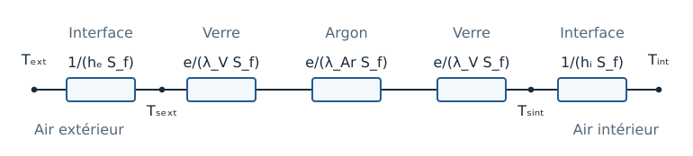
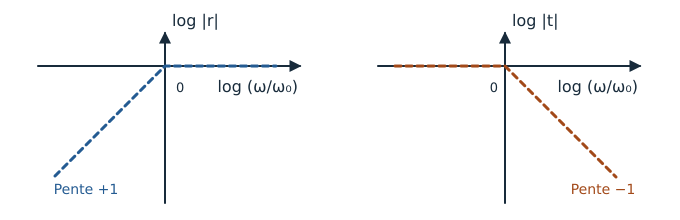
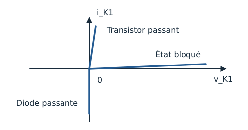
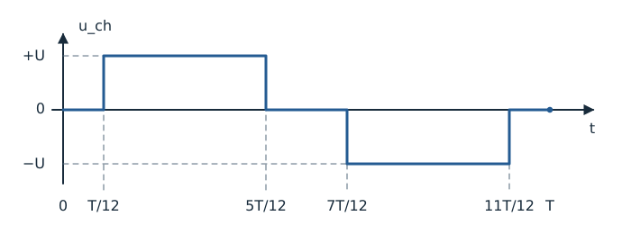

# CCINP PSI — Physique-chimie 2025 · Corrigé brut

*Corrigé rédigé par IA, non officiel. Signalez toute erreur.*

## Partie I — Isolation thermique

### I.1 — Étude d'une paroi plane

**Question 1**

La loi de Fourier relie le vecteur densité de courant thermique à la température par
$$
\vec j_Q=-\lambda\,\operatorname{grad} T.
$$
La densité de courant $\vec j_Q$ est en $\mathrm{W\,m^{-2}}$, la conductivité thermique $\lambda$ en $\mathrm{W\,m^{-1}\,K^{-1}}$, la température en $\mathrm K$ et son gradient en $\mathrm{K\,m^{-1}}$. Le signe traduit un transfert vers les températures décroissantes.

**Question 2**

On prend une tranche d'épaisseur $\mathrm dx$, de section $S_0$. Entrent par la gauche $S_0j_{Q,x}(x)$ et sortent par la droite $S_0j_{Q,x}(x+\mathrm dx)$, en unités de puissance. Sans source interne,
$$
\rho c\,S_0\mathrm dx\,\frac{\partial T}{\partial t}
=-S_0\mathrm dx\,\frac{\partial j_{Q,x}}{\partial x}.
$$
Fourier donne $j_{Q,x}=-\lambda\partial_x T$. Pour une conductivité uniforme, $\partial_t T=(\lambda/\rho c)\partial_x^2T$.

**Question 3**

En régime stationnaire, $T''(x)=0$. Les conditions $T(0)=T_1$ et $T(e_0)=T_2$ donnent
$$
T(x)=T_1+\frac{T_2-T_1}{e_0}x.
$$

**Question 4**

Pour la normale $+\vec e_x$, le flux stationnaire est
$$
\Phi=S_0j_{Q,x}=\frac{\lambda S_0}{e_0}(T_1-T_2).
$$
La loi $\Phi=(T_1-T_2)/R_{\rm th}$ donne $R_{\rm th}=e_0/(\lambda S_0)$, en $\mathrm{K\,W^{-1}}$.

### I.2 — Étude d'une fenêtre double vitrage

**Question 5**

Le flux est commun aux cinq éléments en série. De l'extérieur vers l'intérieur, leurs résistances sont
$$
\frac{1}{h_eS_f},\qquad \frac{e}{\lambda_V S_f},\qquad
\frac{e}{\lambda_{\rm Ar} S_f},\qquad \frac{e}{\lambda_V S_f},\qquad \frac{1}{h_iS_f}.
$$
Les deux résistances extrêmes découlent de la loi de Newton, les trois autres de la conduction. Les nœuds $T_{\rm Sext}$ et $T_{\rm Sint}$ sont situés du côté verre des deux résistances d'interface.

**Question 6**

**Profil b.** Le flux est orienté vers l'extérieur, donc $T$ croît avec $x$. À flux fixé, la pente est proportionnelle à $1/\lambda$ et elle est maximale dans l'argon.

### I.3 — Étude d'une pièce d'habitation

**Question 7**

À l'équilibre, la puissance du radiateur compense exactement les pertes à travers l'ensemble de la pièce. Ainsi
$$
\begin{aligned}
R_1&=\frac{T_{\rm fin}-T_{\rm ext}}{P} \\
&=\frac{294-274}{500} \\
&=0{,}040\ \mathrm{K\,W^{-1}}.
\end{aligned}
$$

**Question 8**

En régime quasi stationnaire, les parois évacuent à chaque instant $(T-T_{\rm ext})/R_1$. Le bilan énergétique de la pièce donne
$$
C\frac{\mathrm dT}{\mathrm dt}=P-\frac{T-T_{\rm ext}}{R_1}
=\frac{T_{\rm fin}-T}{R_1}.
$$
Avec $T(0)=T_{\rm ext}$,
$$
T(t)=T_{\rm fin}+(T_{\rm ext}-T_{\rm fin})\,\exp\!\left(-\frac{t}{R_1C}\right).
$$

**Question 9**

Dans le modèle conductif du plafond, $R_{\rm pl}=e_p/(\lambda_p S_p)=0{,}050\ \mathrm{K\,W^{-1}}$. Chaque branche relie la pièce au même extérieur, donc
$$
\begin{aligned}
\frac1{R_1}&=\frac1{R_{\rm pl}}+\frac1{R_{\rm mf}}, \\
R_{\rm mf}&=\frac{R_1R_{\rm pl}}{R_{\rm pl}-R_1} \\
&=0{,}20\ \mathrm{K\,W^{-1}}.
\end{aligned}
$$
À même écart de température, le plafond laisse passer quatre fois plus de puissance que l'ensemble mur–fenêtre.

**Question 10**

La même puissance traverse le plafond puis l'isolant, d'où
$$
R'_{\rm pl}=R_{\rm pl}+\frac{e_{\rm isol}}{\lambda_{\rm isol} S_p}.
$$
À écart de température et durée identiques, les pertes sont inversement proportionnelles à la résistance thermique totale. Elles sont divisées par $R_2/R_1=0{,}12/0{,}04=3$.

## Partie II — Acoustique d'une cloison

### II.1 — Modélisation de l'onde acoustique

**Question 11**

On développe au premier ordre autour d'un état de repos uniforme. Les perturbations vérifient $|p|\ll P_0$ et $|\mu|\ll \rho_0$. La vitesse particulaire est petite devant la célérité acoustique. On néglige les produits de perturbations et le terme convectif d'ordre deux.

**Question 12**

Sans pesanteur ni viscosité, la force de pression sur $\mathrm dV$ est $-\operatorname{grad}P\,\mathrm dV$. La masse est $\rho\,\mathrm dV$, donc $\rho D\vec v/Dt=-\operatorname{grad}P$. La projection selon $x$ s'écrit
$$
(\rho_0+\mu)(\partial_tv+v\partial_xv)=-\partial_x p.
$$
Le terme convectif et le produit $\mu\partial_t v$ sont d'ordre deux. Il reste $\rho_0\partial_t v=-\partial_xp$.

**Question 13**

L'équation exacte est $\partial_t\rho+\operatorname{div}(\rho\vec v)=0$. Ici, $\partial_t\mu+\rho_0\partial_xv+\partial_x(\mu v)=0$. Au premier ordre,
$$
\partial_t\mu+\rho_0\partial_xv=0.
$$

**Question 14**

Avec $\mu=\rho_0\chi_S p$, la masse impose $\partial_xv=-\chi_S\partial_t p$. En dérivant cette égalité par rapport à $t$ et l'équation dynamique par rapport à $x$, on élimine $\partial_x\partial_t v$.
$$
\begin{aligned}
\partial_x^2p-\rho_0\chi_S\partial_t^2p&=0, \\
c_0&=\frac1{\sqrt{\rho_0\chi_S}}.
\end{aligned}
$$

### II.2 — Transmission du son à travers une cloison

#### II.2.1 — Onde incidente

**Question 15**

On adopte la convention temporelle $\mathrm e^{\mathrm i\omega t}$. L'onde incidente se propage suivant $+x$ et l'impédance est le quotient de ses amplitudes de pression et de vitesse.
$$
\begin{aligned}
\underline p_i&=p_{im}\,\mathrm e^{\mathrm i(\omega t-kx)}, \\
\underline v_i&=\frac{p_{im}}{Z}\,\mathrm e^{\mathrm i(\omega t-kx)}.
\end{aligned}
$$

**Question 16**

L'insertion de l'onde incidente dans $\rho_0\partial_t v_i=-\partial_xp_i$ donne $\rho_0\omega\underline v_i=k\underline p_i$. Donc $Z=\rho_0\omega/k=\rho_0c_0$, en $\mathrm{Pa\,s\,m^{-1}}$.

### II.2.2 — Onde réfléchie

**Question 17**

Pour une propagation vers $-x$, la phase vaut $\omega t+kx$. Euler donne alors $\rho_0\omega\underline v_r=-k\underline p_r$, de sorte que
$$
\begin{aligned}
\underline p_r&=p_{rm}\,\mathrm e^{\mathrm i(\omega t+kx)}, \\
\underline v_r&=-\frac{p_{rm}}{Z}\,\mathrm e^{\mathrm i(\omega t+kx)}.
\end{aligned}
$$

### II.2.3 — Onde transmise

**Question 18**

L'onde transmise continue vers $+x$ dans le même air.
$$
\begin{aligned}
\underline p_t&=p_{tm}\,\mathrm e^{\mathrm i(\omega t-kx)}, \\
\underline v_t&=\frac{p_{tm}}{Z}\,\mathrm e^{\mathrm i(\omega t-kx)}.
\end{aligned}
$$

### II.2.4 — Réponse fréquentielle de la cloison

**Question 19**

On place les deux faces en $x=0$ à l'ordre retenu en $ke_c$. La pression à gauche pousse vers $+x$, celle à droite vers $-x$, et les pressions statiques se compensent. Pour le déplacement complexe $X_m\mathrm e^{\mathrm i\omega t}$, la dynamique donne
$$
-M_c\omega^2X_m=S_c(p_{im}+p_{rm}-p_{tm}).
$$

**Question 20**

Les vitesses normales de l'air à gauche et à droite sont égales à la vitesse de la cloison. L'égalité entre les deux vitesses de l'air donne $(p_{im}-p_{rm})/Z=p_{tm}/Z$, soit $p_{im}-p_{rm}=p_{tm}$.

**Question 21**

La vitesse de l'air du côté incident coïncide avec la dérivée du déplacement de la cloison. Donc
$$
\frac{p_{im}-p_{rm}}{Z}=\mathrm i\omega X_m.
$$

**Question 22**

La définition imprimée de $t$ reprend par erreur l'amplitude réfléchie. On utilise $t=p_{tm}/p_{im}$ pour la transmission, et $r=p_{rm}/p_{im}$ pour la réflexion.

La relation $p_{im}-p_{rm}=p_{tm}$ ramène le saut de pression à $2p_{rm}$. Avec $\mathrm i\omega X_m=p_{tm}/Z$, la relation dynamique devient
$$
2S_cp_{rm}=\mathrm i\omega\,M_c p_{tm}/Z.
$$
Posons $u=\omega/\omega_0$, avec $\omega_0=2S_c Z/M_c$.

Il vient $r=\mathrm iut$, tandis que la continuité des vitesses s'écrit $1-r=t$.

Par conséquent
$$
\boxed{\begin{aligned}
t&=\frac1{1+\mathrm iu}, \\
r&=\frac{\mathrm iu}{1+\mathrm iu}.
\end{aligned}}
$$

**Question 23**

Les modules sont $|r|=u/\sqrt{1+u^2}$ et $|t|=1/\sqrt{1+u^2}$. Avec $a=\log u$, les diagrammes asymptotiques changent de pente à l'origine.

Les asymptotes de $\log|r|$ valent $a$ pour $a<0$ puis $0$ pour $a>0$.

Celles de $\log|t|$ valent $0$ pour $a<0$ puis $-a$ pour $a>0$.

À $u=1$, les deux courbes exactes passent par $-\log\sqrt2$.

**Question 24**

À basse pulsation, $|t|\simeq1$ et $|r|\simeq u$. À forte pulsation, $|t|\simeq1/u$ et $|r|\simeq1$. La cloison transmet donc mieux les graves et l'écho réfléchi est plus intense dans les aigus, pour une même intensité incidente. Le rapport d'intensités est le carré du module correspondant car le milieu est identique de part et d'autre.

## Partie III — Alimentation en eau

### III.1 — Dosage des ions calcium et magnésium

**Question 25**

Les constantes $K_1=10^{10{,}7}$ et $K_2=10^{8{,}6}$ sont très supérieures à l'unité. Dans les conditions du dosage, les deux complexations par $\mathrm{Y^{4-}}$ sont considérées comme quasi totales. Un ion divalent fixe un ligand dans chaque cas.

**Question 26**

On titre le mélange préparé dans l'erlenmeyer avec la solution d'EDTA de concentration $C_3=0{,}010\ \mathrm{mol\,L^{-1}}$, versée depuis une burette graduée. On agite et on repère le virage par comparaison avec le témoin, placé à côté.

**Question 27**

Le tampon maintient le pH à $10{,}3$ pendant le titrage. Cette valeur coïncide avec le $\mathrm pK_a$ du couple $\mathrm{HY^{3-}/Y^{4-}}$, si bien que ces deux formes libres sont en proportions voisines.

Les espèces plus protonées sont minoritaires, puisque le $\mathrm pK_a$ suivant vaut $6{,}2$. La forme $\mathrm{Y^{4-}}$ est disponible pour complexer les ions et sa consommation est compensée par la déprotonation de $\mathrm{HY^{3-}}$.

**Question 28**

Le témoin est bleu, car les ions calcium et magnésium sont absents de l'eau distillée et le NET reste sous forme libre. Le témoin donne la teinte du NET libéré attendue au virage. Dans le prélèvement étudié, les ions métalliques sont alors complexés par l'EDTA.

**Question 29**

À l'équivalence, $n(\mathrm{Ca^{2+}})+n(\mathrm{Mg^{2+}})=C_3V_{\rm eq}$ lorsque $V_{\rm eq}$ est exprimé en litres. La concentration totale dans l'eau initiale vaut donc $C_3V_{\rm eq}/V_1$ en $\mathrm{mol\,L^{-1}}$, avec les deux volumes dans la même unité.
$$
d=10^4\frac{C_3V_{\rm eq}}{V_1}\quad\text{en degrés français}.
$$
En effet, un degré français correspond à $0{,}1\ \mathrm{mol\,m^{-3}}=10^{-4}\ \mathrm{mol\,L^{-1}}$. Les $50\ \mathrm{mL}$ de tampon diluent l'échantillon sans changer les quantités d'ions à doser.

### III.2 — Dépôt de calcaire

**Question 30**

Par la loi de Hess, l'enthalpie standard de dissolution vaut
$$
\Delta_r H^\circ=-542{,}83-677{,}14+1207{,}6
=-12{,}37\ \mathrm{kJ\,mol^{-1}}.
$$
La dissolution est exothermique. La relation de Van 't Hoff donne $\mathrm d\ln K_s/\mathrm dT=\Delta_r H^\circ/(RT^2)<0$. Quand la température augmente, $K_s$ diminue. À composition initiale identique, le produit ionique atteint plus facilement la saturation et le dépôt est favorisé.

**Question 31**

Les domaines du système carbonaté sont séparés par les pH $6{,}4$ et $10{,}3$.

Au-dessous de $6{,}4$, $\mathrm{H_2CO_3}$ prédomine. Entre les deux seuils prédomine $\mathrm{HCO_3^-}$, puis au-dessus de $10{,}3$ prédomine $\mathrm{CO_3^{2-}}$.

L'acide acétique, de $\mathrm pK_a=4{,}7$, peut successivement protoner le carbonate puis l'hydrogénocarbonate.

En notant $\mathrm{AcH=CH_3COOH}$ et $\mathrm{Ac^-=CH_3COO^-}$, les transferts sont
$$
\begin{aligned}
\mathrm{CO_3^{2-}+AcH}&\rightleftharpoons\mathrm{HCO_3^-+Ac^-},\\
\mathrm{HCO_3^-+AcH}&\rightleftharpoons\mathrm{H_2CO_3+Ac^-}.
\end{aligned}
$$
Leurs constantes valent respectivement $10^{10{,}3-4{,}7}$ et $10^{6{,}4-4{,}7}$. La consommation du carbonate déplace l'équilibre de dissolution du solide. En assimilant le produit final à $\mathrm{CO_2+H_2O}$, le bilan est
$$
\mathrm{CaCO_3(s)+2\,CH_3COOH(aq)
\longrightarrow Ca^{2+}(aq)+2\,CH_3COO^-(aq)+CO_2(g)+H_2O(l)}.
$$
Le dégagement de $\mathrm{CO_2}$ favorise la dissolution.

### III.3 — Phase de régénération dans un adoucisseur d'eau domestique

**Question 32**

Soit $Q$ le débit d'eau brute. On néglige les pertes de charge et la variation d'altitude de l'eau brute entre les deux sections. À l'amorçage, la saumure atteint le col à vitesse négligeable. Son équilibre hydrostatique impose alors $P_2=P_{\rm atm}-\rho_sgh$ en pression absolue.

Prenons $S_1=\pi D^2/4$ et $S_2=\pi d^2/4$. Par conservation du débit, $v_j=Q/S_j$. En notant $P_1$ la pression du réseau ramenée à la même référence que $P_{\rm atm}$, Bernoulli donne
$$
P_1-P_2=\frac{\rho_b Q^2}{2}\left(S_2^{-2}-S_1^{-2}\right).
$$
La baisse de pression croît avec $Q$ puisque $d<D$. Le débit minimal est donc
$$
\boxed{Q_{\min}=\frac{\pi}{4}\sqrt{\frac{2(P_1-P_{\rm atm}+\rho_sgh)}
{\rho_b(d^{-4}-D^{-4})}}.}
$$
Si la pression effective indiquée $P_{\rm rés}$ est mesurée par rapport à l'atmosphère, on a $P_1-P_{\rm atm}=P_{\rm rés}$. Si $P_{\rm rés}$ et $P_{\rm atm}$ sont déjà donnés sur la même échelle absolue, on prend $P_1=P_{\rm rés}$. La racine suppose un numérateur positif. Si le seuil hydrostatique est déjà atteint au repos, le débit minimal du modèle est nul.

## Partie IV — Convertisseur de puissance

**Question 33**

a. Du continu vers l'alternatif, un **onduleur**.

b. De l'alternatif vers le continu, un **redresseur**.

c. Du continu vers le continu par modification de la valeur moyenne, un **hacheur**.

**Question 34**

Les orientations de la figure 8 donnent $i_{K1}=i_{T1}-i_{D1}$ et $v_{D1}=-v_{K1}$. Pour $i_{K1}>0$, le transistor commandé à la fermeture assure la conduction.

Pour $i_{K1}<0$, la diode antiparallèle conduit spontanément et impose $v_{K1}=0$. À l'ouverture avec tension positive, la diode est bloquée.

La caractéristique de $K_1$ comporte donc trois branches. Le schéma représente les faibles pentes et chutes du transistor dans l'esprit de la figure 8, avec la branche de diode idéale sur l'axe vertical négatif.

**Question 35**

La tension de charge est le potentiel de la borne gauche moins celui de la borne droite. La commande de $K_1$ et $K_4$ fixe ces bornes respectivement aux rails haut et bas. Les commandes $K_2,K_3$ réalisent l'inverse. Les autres intervalles relient les deux bornes au même rail.
$$
u_{\rm ch}(t)=
\begin{cases}
+U&\text{de }T/12\text{ à }5T/12,\\
-U&\text{de }7T/12\text{ à }11T/12,\\
0&\text{ailleurs sur une période}.
\end{cases}
$$
Les créneaux opposés ont même durée, donc **$U_{\rm moy}=0$**. La tension au carré vaut $U^2$ pendant $2T/3$, d'où **$U_{\rm eff}=U\sqrt{2/3}$**.

**Question 36**

Brancher le multimètre en dérivation aux bornes de la charge, avec les bornes COM et V et un calibre adapté. En tension continue (DC), il mesure la composante moyenne $U_{\rm moy}$. En tension alternative (AC), utiliser un appareil à valeur efficace vraie avec une bande passante adaptée au créneau. Le mode AC mesure la valeur efficace de la composante alternative, qui est celle du signal entier ici puisque sa moyenne est nulle.

**Question 37**

Sur la figure 10, deux maxima successifs se lisent à environ $7{,}5$ et $27{,}5\ \mathrm{ms}$. On en déduit $T\simeq20\ \mathrm{ms}$ et $f\simeq50\ \mathrm{Hz}$, fréquence du secteur.

**Question 38**

Le fondamental de la tension est en $\sin(\omega t)$ avec un coefficient positif. En effet, la tension est symétrique autour de $T/4$ sur la première demi-période, et opposée sur la seconde. Le courant passe par zéro en croissant vers $2{,}5\ \mathrm{ms}$, avec un retard sur ce fondamental.
$$
\varphi=-2\pi\,\frac{2{,}5}{20}=-\frac{\pi}{4}\simeq-0{,}79\ \mathrm{rad}.
$$
La charge est donc de nature inductive à la fréquence fondamentale.

**Question 39**

Quand $K_1$ est commandé fermé, $i_{K1}=i_{\rm ch}$ et s'annule en dehors de cet intervalle dans le modèle. Pendant le début de l'intervalle, le courant traversant $K_1$ est négatif. La diode seule le conduit, avec $i_{D1}=-i_{K1}>0$. Après le passage par zéro, c'est le transistor qui conduit.

- $i_{K1}$ correspond au **cas d**.
- $i_{T1}$ correspond au **cas c**.
- $i_{D1}$ correspond au **cas b**.
- $i_S$ correspond au **cas e**. Sur les deux intervalles actifs, il vaut respectivement $i_{\rm ch}$ et $-i_{\rm ch}$. Pendant les états de roue libre, le courant circule dans le pont sans passer par la source.

**Question 40**

À $t=T/12\simeq1{,}67\ \mathrm{ms}$, le courant de charge est négatif. $D_1$ conduit déjà dans le sens correspondant, si bien que commander immédiatement $T_1$ est facultatif. La commande devient nécessaire au passage par zéro croissant, vers
$$
t_0=-\frac{\varphi}{\omega}\simeq\frac{T}{8}=2{,}5\ \mathrm{ms},
$$
pour permettre le passage du courant positif ensuite.

**Question 41**

Le pont parfait ne dissipe ni ne stocke d'énergie, donc la puissance fournie est $U i_S=u_{\rm ch}i_{\rm ch}$. Les deux créneaux actifs donnent la même contribution puisque la tension et le courant changent de signe après une demi-période. Avec $\theta=\omega t$,
$$
\langle P\rangle=\frac{U I_{\max}}{\pi}
\int_{\pi/6}^{5\pi/6}\sin(\theta+\varphi)\,\mathrm d\theta.
$$
Le terme en $\cos\theta$ s'intègre à zéro sur cet intervalle, qui est symétrique autour de $\pi/2$. L'intégrale de $\sin\theta$ vaut $\sqrt3$. Ainsi
$$
\boxed{\langle P\rangle=\frac{\sqrt3}{\pi}U I_{\max}\cos\varphi.}
$$
