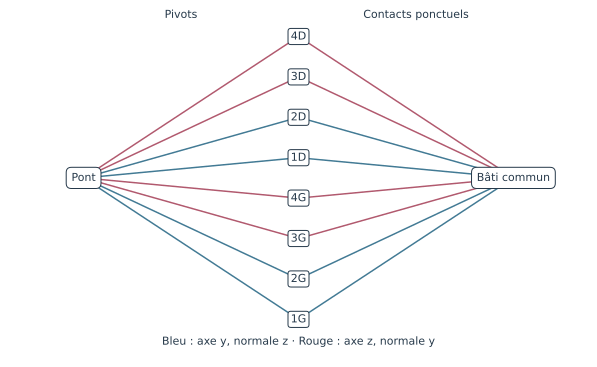
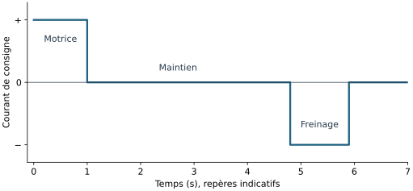
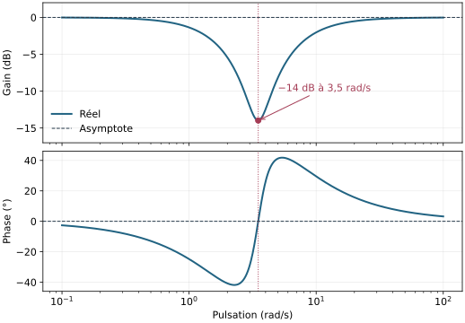

# CCINP PSI — Sciences industrielles de l’ingénieur 2025 · Corrigé guidé

*Corrigé rédigé par IA, non officiel. Signalez toute erreur.*

## Présentation du sujet

L’épreuve dure quatre heures sans calculatrice. Le pont roulant sert à étudier son guidage et sa motorisation, puis les stratégies de commande qui déplacent une charge tout en limitant son balancement. Les 34 réponses se reportent sur le document réponse officiel, avec un schéma à câbler en Q1, du code à compléter en Q25 et les diagrammes à tracer en Q31.

On peut réserver environ 65 minutes à la mécanique et à la motorisation, 45 à la commande en trapèze et au frottement, 95 à la charge et à l’asservissement, puis 35 à la synthèse et à la relecture. Q2, Q6–Q9, Q13–Q16 et Q18 sont des points d’entrée. Gardez du temps pour les fonctions de transfert, les valeurs lues sur les courbes et les conclusions chiffrées.

## I — Performances du pont roulant

### Question 1

> [!INDICATION]
> Séparez les ports électriques, mécaniques de rotation et mécaniques de translation. Suivez les repères R, S, O, A et P du DR.

#### Solution

Sur le DR, relier le positif de la source commandée au positif des deux moteurs, et le négatif aux deux bornes négatives et à la masse électrique. Le bloc d’alimentation commande déjà la source.

Pour chacun des côtés G et D, connecter le port rotor R du moteur au port S du réducteur et au port R du codeur. Le port O du réducteur se raccorde au port A de la roue. Les ports P des deux roues se raccordent au même chariot.

Le port C de chaque codeur se raccorde à la référence mécanique du carter moteur. La sortie W, déjà reliée à l’afficheur, indique la vitesse de l’arbre moteur. La sortie A correspondant à l’angle peut rester libre sur ce montage.

### Question 2

> [!INDICATION]
> Ramenez la vitesse du moteur à celle de la roue avant d’utiliser le roulement.

#### Solution

Le rapport cinématique et le roulement sans glissement donnent
$$
\begin{aligned}V_{\max}&=rk\omega_{\max}\\&=0{,}2\times\frac{180}{24}=1{,}5\,\mathrm{m\,s^{-1}}.\end{aligned}
$$
À cette vitesse constante, $D/V_{\max}\simeq2{,}7\,\mathrm s<6\,\mathrm s$. Les phases de démarrage et d’arrêt devront ensuite être prises en compte.

### Question 3

> [!INDICATION]
> Les deux rails appartiennent au même bâti. Donnez un sommet à chacun des galets.

#### Solution

Les deux rails constituent le même bâti $0$. Le pont $P$ est relié à chacun des huit galets par un pivot.

Pour chaque côté, les galets 1 et 2 ont un axe parallèle à $\vec y$ et un contact de normale $\vec z$ avec $0$. Les galets 3 et 4 ont un axe parallèle à $\vec z$ et un contact de normale $\vec y$.



### Question 4

> [!INDICATION]
> Comptez séparément les mouvements du pont et les rotations libres. Vérifiez les contraintes de chaque branche.

#### Solution

Le pont et les huit galets sont neuf solides mobiles. Les huit pivots introduisent $8\times5$ contraintes et les huit contacts ponctuels de guidage ajoutent huit contraintes. En l’absence de toute condition tangentielle de roulement dans ce comptage de liaisons, chaque galet peut tourner indépendamment autour de son axe. On compte huit mobilités internes et une mobilité utile, la translation du pont suivant $\vec x$.
$$
h=9-(6\times9-8\times5-8)=3.
$$
Il y a huit cycles indépendants, un par branche pont–galet–bâti. Les cinq contraintes de guidage indépendantes bloquent la translation suivant $y$ et $z$ et les trois rotations.

### Question 5

> [!INDICATION]
> Gardez le minimum de normales indépendantes pour bloquer les cinq mouvements non souhaités.

#### Solution

On conserve trois contacts verticaux non alignés, par exemple $1_G$, $2_G$ et $1_D$, pour régler l’altitude et les deux basculements autour d’axes horizontaux. Deux contacts latéraux de positions longitudinales différentes, par exemple $3_G$ et $4_G$, fixent le déplacement latéral et le lacet.

Les réglages dans la direction de la normale des trois galets restants, $2_D$, $3_D$ et $4_D$, permettent de reprendre les écarts de montage. Le réglage peut être réalisé par des axes excentrés ou des cales adaptés.

### Question 6

> [!INDICATION]
> Pour éliminer l’action du pivot, prenez le moment autour de son axe.

#### Solution

On isole la roue 2 seule. La liaison pivot exerce une force en $O_2$, mais aucun moment autour de l’axe du pivot. Le poids et l’inertie de la roue sont négligés. Au point $O_2$ et suivant $\vec y$, le théorème du moment dynamique donne donc $rT_2=0$. Ainsi $T_2=0$.

### Question 7

> [!INDICATION]
> Projetez la résultante, puis prenez le moment au centre de masse.

#### Solution

On isole le demi-pont et ses deux roues, de masse totale $M/2$. Les actions extérieures sont le poids et les deux réactions du rail. Les actions du motoréducteur et des pivots sont internes. Les projections du théorème de la résultante suivant $-\vec x$ et $\vec z$, puis celle du moment dynamique en $G$ suivant $\vec y$, donnent
$$
\begin{aligned}
T_1&=(M/2)\gamma,\\
N_1+N_2&=(M/2)g,\\
(L_c/2)(N_2-N_1)&=h_cT_1.
\end{aligned}
$$
La dernière relation utilise la translation sans rotation du demi-pont.

### Question 8

> [!INDICATION]
> Utilisez d’abord la somme des réactions, puis leur différence.

#### Solution

En résolvant les deux équations sur les normales,
$$
\begin{aligned}
N_1&=(M/2)(B-A\gamma),\\
N_2&=(M/2)(B+A\gamma),\\
A&=h_c/L_c,\qquad B=g/2.
\end{aligned}
$$
La roue motrice est déchargée pendant la phase étudiée.

### Question 9

> [!INDICATION]
> À la limite, comparez l’effort tangentiel à la réaction normale de la roue motrice multipliée par f.

#### Solution

L’adhérence impose $T_1\le fN_1$. En substituant les expressions précédentes et en simplifiant par $M/2$,
$$
\gamma_{\rm lim}=\frac{fB}{1+fA}=\frac{2}{1{,}2}\simeq1{,}67\,\mathrm{m\,s^{-2}}.
$$
À cette limite, la réaction normale est encore positive.

### Question 10

> [!INDICATION]
> Exprimez toutes les puissances et les énergies cinétiques dans la variable vitesse moteur.

#### Solution

On isole le pont et ses deux motoréducteurs, roues comprises. Sous les hypothèses de liaisons parfaites et de roulement sans glissement, les réactions du bâti ne fournissent pas de puissance. Le théorème de l’énergie cinétique donne
$$
\frac{\mathrm d}{\mathrm dt}\left(\tfrac12 M V^2+2\tfrac12 J_m\omega_m^2\right)
=2C_m\omega_m-F_rV.
$$
Avec $V=rk\omega_m$, on obtient l’équation demandée, où $J=2J_m+M(rk)^2$ et $C_r=rkF_r$. La division par $\omega_m$ est réalisée en mouvement, et l’équation mécanique s’étend au démarrage par continuité.

### Question 11

> [!INDICATION]
> Éliminez d’abord le courant, puis la vitesse du moteur.

#### Solution

Avec $C_r=0$, les équations donnent $J\dot\omega_m=2k_m(u_m-k_m\omega_m)/R_m$. Sous conditions initiales nulles,
$$
\begin{aligned}
\frac{V(p)}{U_m(p)}&=\frac{K_v}{1+\tau p},\\
K_v&=\frac{rk}{k_m},\\
\tau&=\frac{JR_m}{2k_m^2}.
\end{aligned}
$$
Ici $K_v\simeq0{,}0417\,\mathrm{m\,s^{-1}\,V^{-1}}$ et $\tau\simeq0{,}40\,\mathrm s$.

### Question 12

> [!INDICATION]
> Calculez la dérivée de la réponse à l’origine.

#### Solution

Pour un échelon de tension d’amplitude $U_0$, la vitesse est $K_vU_0(1-e^{-t/\tau})$. Sa pente initiale est
$$
\gamma_{\max}=\frac{K_vU_0}{\tau}=\frac{2rk k_m U_0}{JR_m}.
$$
Sous $36\,\mathrm V$, elle vaut $3{,}75\,\mathrm{m\,s^{-2}}$, au-dessus de $1{,}67\,\mathrm{m\,s^{-2}}$. La commande par échelon maximal peut donc faire patiner la roue.

## II — Commande par loi trapèze

### Question 13

> [!INDICATION]
> L’aire des deux triangles se ramène à celle d’un rectangle.

#### Solution

L’intégrale de la vitesse est la somme de l’aire du plateau et des deux triangles. Puisque $t_d=t_a$,
$$
\begin{aligned}D&=V_{\max}(T_m+t_a),\\ T_m&=D/V_{\max}-t_a=3{,}6\,\mathrm s .\end{aligned}
$$
La durée de la consigne complète est de $4{,}4\,\mathrm s$.

### Question 14

> [!INDICATION]
> Lisez une durée et deux valeurs extrêmes avant de comparer aux exigences.

#### Solution

Sur la figure 6, la position atteint le voisinage de $4\,\mathrm m$ vers 5 à 6 s. Le sommet d’accélération et le creux de freinage, de l’ordre de $1{,}6\,\mathrm{m\,s^{-2}}$ en valeur absolue, restent au voisinage et du bon côté de la limite de $1{,}67\,\mathrm{m\,s^{-2}}$ à la précision de lecture. Le déplacement simulé satisfait donc les critères de temps et d’adhérence du modèle sans perturbation. Ce premier modèle ne valide pas la tenue à une charge suspendue de 50 kg.

### Question 15

> [!INDICATION]
> Comparez les deux nombres de lignes imprimés par le programme.

#### Solution

La base comporte 1 481 couples vitesse–force, avec une variable d’entrée. Le partage laisse 1 281 observations pour l’apprentissage et 200 pour le test.

### Question 16

> [!INDICATION]
> Repérez les entrées, la cible, les couches et le jeu de données associé à chaque score.

#### Solution

C’est une régression supervisée. Le réseau perceptron multicouche possède deux couches cachées de 600 puis 50 neurones. L’entraînement fixe une tolérance de $10^{-3}$, au plus 1 000 itérations et une graine 9. Les coefficients de détermination $R^2$ valent 0,98 sur l’apprentissage et 0,97 sur le test. La prédiction suit bien les mesures du domaine échantillonné. Ces valeurs ne valident pas une extrapolation à toute vitesse.

### Question 17

> [!INDICATION]
> Prenez deux points sur une branche affine. Convertissez la vitesse en mètres par seconde.

#### Solution

Sur la branche positive de la figure 8, l’ordonnée extrapolée près de zéro vaut environ $20\,\mathrm N$. Vers $1\,\mathrm{m\,s^{-1}}$, la force est voisine de $45$ à $47\,\mathrm N$.

On en déduit $F_0\simeq20\,\mathrm N$ et $A_0\simeq25\,\mathrm{N\,s\,m^{-1}}$.

$F_0$ représente le frottement sec opposé au mouvement. $A_0$ représente la contribution visqueuse. Il faut convertir l’abscisse de la figure, donnée en millimètres par seconde.

## III — Déplacement d’une charge

### Question 18

> [!INDICATION]
> Dérivez le vecteur fixe dans le câble au moyen des dérivées de la base mobile.

#### Solution

On a $\overrightarrow{B_2B_c}=-L\vec z_c$ et $\dot{\vec z}_c=\dot\theta\vec x_c$. Donc
$$
\begin{aligned}
\vec V(B_c,c/0)&=\dot x\,\vec x-L\dot\theta\,\vec x_c,\\
\vec a(B_c,c/0)&=\ddot x\,\vec x-L\ddot\theta\,\vec x_c
                  +L\dot\theta^2\,\vec z_c .
\end{aligned}
$$
On a utilisé $\dot{\vec x}_c=-\dot\theta\vec z_c$.

### Question 19

> [!INDICATION]
> Choisissez une résultante qui élimine la glissière et un moment qui élimine la résultante du pivot.

#### Solution

Pour l’isolement $\{1+c\}$, les forces extérieures sont les deux poids, la réaction de glissière, la traction et le frottement du pont. On projette la résultante dynamique sur $\vec x$ pour éliminer la réaction idéale de la glissière. Pour l’isolement $c$, les actions extérieures sont le poids et l’action du pivot, avec son couple visqueux. On projette le moment dynamique en $B_2$ suivant $\vec y$ pour éliminer la résultante du pivot. Le couple visqueux reste dans cette équation. Les deux projections à développer sont
$$
\begin{aligned}
F-F_r&=M\ddot x+m\vec a(B_c,c/0)\cdot\vec x,\\
[\overrightarrow{B_2B_c}\times(m\vec g)]\cdot\vec y-f_c\dot\theta
&=[\overrightarrow{B_2B_c}\times m\vec a(B_c,c/0)]\cdot\vec y.
\end{aligned}
$$

### Question 20

> [!INDICATION]
> Gardez les termes linéaires en angle et vitesse angulaire, sans les annuler.

#### Solution

La projection de la résultante dynamique du système complet donne
$$
(M+m)\ddot x-mL\ddot\theta\cos\theta
+mL\dot\theta^2\sin\theta=F-F_r .
$$
Pour la charge, on calcule le moment dynamique avec $\overrightarrow{B_2B_c}\times m\vec a(B_c,c/0)$, ce qui tient compte du déplacement de $B_2$. Le moment du poids est $-mgL\sin\theta\,\vec y$ et celui du frottement $-f_c\dot\theta\vec y$. D’où
$$
L\ddot\theta-\ddot x\cos\theta+g\sin\theta+\frac{f_c}{mL}\dot\theta=0.
$$
Au premier ordre, $\cos\theta\simeq1$, $\sin\theta\simeq\theta$ et le terme en $\dot\theta^2$ disparaît. On retrouve (5) et (6) avec $f_v=f_c/(mL)$.

### Question 21

> [!INDICATION]
> Éliminez la position entre les deux relations transformées.

#### Solution

Avec conditions initiales nulles et $F_r=0$, la deuxième équation donne $p^2X=(Lp^2+f_vp+g)\Theta$. Posons $D_p=MLp^2+(M+m)f_vp+(M+m)g$. En reportant dans la première,
$$
\begin{aligned}
H_\theta(p)&=\frac{K}{D_p},\\
H_x(p)&=\frac{K(Lp^2+f_vp+g)}{p^2D_p}.
\end{aligned}
$$

### Question 22

> [!INDICATION]
> Comparez la classe des deux fonctions et calculez le plateau de l’angle.

#### Solution

$H_\theta$ est un second ordre stable de gain statique $K/[(M+m)g]$. La courbe montre un régime sous-amorti. Pour $i_0=4\,\mathrm A$,
$$
\theta(\infty)=\frac{Ki_0}{(M+m)g}=0{,}08\,\mathrm{rad}\simeq4{,}6^\circ,
$$
compatible avec le plateau proche de $4{,}5^\circ$. La position comporte deux intégrateurs. À long terme l’accélération tend vers $Ki_0/(M+m)=0{,}80\,\mathrm{m\,s^{-2}}$, d’où une croissance quadratique, proche de 40 m après 10 s.

### Question 23

> [!INDICATION]
> Reliez les changements de pente de la position à des phases de traction et de freinage.

#### Solution

La pente de $x$ augmente au départ, reste à peu près constante, puis décroît jusqu’à zéro. Avec le modèle de translation, cela correspond à un créneau de courant positif, un intervalle proche de zéro et un créneau négatif de freinage, puis zéro. Les excitations du pendule aux transitions sont visibles.



La barre des 4 m est franchie avant 6 s, mais le pont s’arrête vers $4{,}8\,\mathrm m$ et dépasse la consigne de position. L’angle atteint environ $+9^\circ$ puis $-9^\circ$, au-dessus de $6^\circ$ en module. Après le passage à 4 m vers 4,6 s, les oscillations restent supérieures à $1^\circ$ au-delà de 6,6 s. Le critère de stabilisation est également manqué. La limite d’accélération ne peut pas être vérifiée précisément sur les seuls tracés de position et d’angle.

### Question 24

> [!INDICATION]
> Isolez chaque composante de X et vérifiez l’unité du membre de droite de l’équation du quatrième ordre.

#### Solution

On lit $x=w+L w''/g$, $\dot x=w'+L w'''/g$, $\theta=w''/g$ et $\dot\theta=w'''/g$.

Par (5) et (6) sans frottement, $F=ML\ddot\theta+(M+m)g\theta$. Le second terme de (11) imprimée doit donc contenir $\theta$, sans dérivée. L’équation est alors homogène et fournit $F=(M+m)w''+(ML/g)w^{(4)}$. Ainsi, dans l’ordre des vecteurs du sujet,
$$
Q=\begin{pmatrix}
1&0&L/g&0&0\\
0&1&0&L/g&0\\
0&0&1/g&0&0\\
0&0&0&1/g&0\\
0&0&M+m&0&ML/g
\end{pmatrix}.
$$

### Question 25

> [!INDICATION]
> Utilisez les deux différences arrière déjà annoncées dans le squelette, puis reconstruisez x.

#### Solution

On remplit les deux premiers angles avec $\delta$, conformément à $\theta(0)=\delta$ et $\dot\theta(0)=0$ au premier ordre. À partir de l’indice 2, on approxime la dérivée seconde en prenant la différence des deux pentes arrière. La reconstruction de $x$ réutilise ensuite l’angle obtenu.

```python
def calcXetTheta(sol_w, dt):
    N = len(sol_w)
    x = [0.0] * N
    theta = [0.0] * N
    if N == 0:
        return x, theta
    theta[0] = delta
    if N > 1:
        theta[1] = delta
        x[1] = sol_w[1] + L * theta[1]
    for i in range(2, N):
        dw0 = (sol_w[i - 1] - sol_w[i - 2]) / dt
        dw1 = (sol_w[i] - sol_w[i - 1]) / dt
        dw2 = (dw1 - dw0) / dt
        theta[i] = dw2 / g
        x[i] = sol_w[i] + L * theta[i]
    return x, theta
```

L’initialisation donne bien $x(0)=0$. Dans le squelette du DR, laisser également $x[1]=0$ revient à une approximation de démarrage compatible avec la vitesse initiale nulle. On suppose $dt>0$.

### Question 26

> [!INDICATION]
> Comparez séparément la durée, l’angle maximal et l’état final. Pensez aux perturbations non compensées.

#### Solution

Sur la figure 12, le pont atteint $4\,\mathrm m$ vers 5 s. L’angle sort pour la dernière fois de la bande de $\pm1^\circ$ vers $4{,}6\,\mathrm s$, avant l’arrivée. Les extrema de l’ordre de $\pm9^\circ$ dépassent néanmoins la limite de $\pm6^\circ$ en mouvement.

Les équations (5) et (6) du modèle sans frottement donnent $\ddot x=(F-mg\theta)/M$. En lisant $F$ et $\theta$ sur la figure 12 et en convertissant l’angle en radians, on estime les pics à $+1{,}07$ et $-1{,}09\,\mathrm{m\,s^{-2}}$, sous la limite de $1{,}7\,\mathrm{m\,s^{-2}}$.

La commande calculée suppose des paramètres et des perturbations connus. Un asservissement corrige les écarts de vitesse en fonctionnement. Une consigne filtrée limite l’excitation du pendule.

### Question 27

> [!INDICATION]
> Additionnez les phases du PI et de la plante au voisinage du gain unité.

#### Solution

La fonction de transfert en boucle ouverte est
$$
L_{\rm BO}(p)=\frac{K_p(1+T_i p)}{T_i p}\,pH_x(p).
$$
Pour $K_p,T_i>0$, le PI a une phase strictement comprise entre $-90^\circ$ et $0^\circ$ à toute pulsation finie. La phase de la plante lue sur la figure est supérieure ou égale à $-90^\circ$. Au passage à 0 dB, la somme est donc strictement supérieure à $-180^\circ$. Le lieu ne coupe pas le demi-axe réel négatif au-delà de $-1$. Avec le contournement usuel des pôles à l’origine, le critère du revers donne la stabilité pour ces gains positifs dans le modèle représenté.

### Question 28

> [!INDICATION]
> Lisez les pentes et phases loin du relief, puis examinez la structure qui peut le produire.

#### Solution

Le gain décroît d’environ 20 dB par décade loin de la zone de résonance, avec une phase proche de $-90^\circ$. Le relief autour de quelques radians par seconde correspond à un zéro et un pôle du second ordre. On peut écrire
$$
pH_x(p)=\frac{K_x}{p}
       \frac{1+a_np+b_np^2}{1+a_dp+b_dp^2}.
$$
À $1\,\mathrm{rad\,s^{-1}}$, l’asymptote de basse fréquence prolongée donne environ $-2\,\mathrm{dB}$ sur la figure 13, soit $K_x\simeq0{,}8\,\mathrm{m\,s^{-2}\,A^{-1}}$ pour une entrée en courant et une sortie en vitesse. L’expression de Q21 avec $K=50\,\mathrm{N\,A^{-1}}$ donne $K/(M+m)=0{,}20\,\mathrm{m\,s^{-2}\,A^{-1}}$ dans le modèle de cette question. Le réglage qui suit utilise la courbe de la figure 13.

### Question 29

> [!INDICATION]
> Identifiez la classe de la boucle avant de former la fonction de transfert de l’erreur.

#### Solution

Le retour est unitaire. L’intégrateur de la plante et celui du PI donnent une boucle ouverte de classe 2. Dans la boucle fermée stable, $E/V_c=1/(1+L_{\rm BO})$ est d’ordre $p^2$ en zéro. Le théorème de la valeur finale donne donc une erreur statique nulle pour l’échelon et une erreur de traînage nulle pour la rampe.

### Question 30

> [!INDICATION]
> Lisez le gain de la plante à la pulsation demandée et simplifiez le module du PI.

#### Solution

À $\omega=100\,\mathrm{rad\,s^{-1}}$, la figure 13 donne environ $-40\,\mathrm{dB}$, soit un module de $10^{-2}$. Avec $T_i\omega=1000$, le PI est pratiquement proportionnel et son module vaut $K_p$ à la précision de lecture. Pour atteindre 0 dB, il faut ajouter 40 dB, donc $K_p\simeq100$.

### Question 31

> [!INDICATION]
> Comparez le numérateur et le dénominateur à basse fréquence, à la résonance et à haute fréquence.

#### Solution

Les deux formes du second ordre ont la même pulsation propre. Leur gain statique est 1 et leurs termes dominants de haute fréquence se simplifient. Les asymptotes classiques du gain se compensent à 0 dB et celles de phase à $0^\circ$. Avec $u=\omega/\omega_0$,
$$
F(j\omega)=\frac{1-u^2+2j\xi_1u}{1-u^2+2j\xi_2u}.
$$
À $\omega=\omega_0$, le rapport vaut $\xi_1/\xi_2=0{,}2$. Le gain réel est $20\log_{10}(0{,}2)\simeq-14\,\mathrm{dB}$ et la phase est nulle. La phase est négative en dessous de $\omega_0$ puis positive au-dessus.



### Question 32

> [!INDICATION]
> Mesurez l’intervalle de temps entre deux maxima successifs de l’angle.

#### Solution

Le filtre atténue, dans la consigne, les composantes qui excitent le pendule, sans modifier le gain statique. Les maxima successifs de la figure 10 sont séparés d’environ $1{,}8\,\mathrm s$, soit $\omega\simeq2\pi/1{,}8\simeq3{,}5\,\mathrm{rad\,s^{-1}}$. On centre donc le creux sur cette fréquence. Le rapport $\xi_1/\xi_2<1$ fixe une atténuation au centre. Le filtre agit sur la consigne, en amont de la boucle.

## IV — Synthèse

### Question 33

> [!INDICATION]
> Suivez les retours du capteur de mouvement et du capteur de courant jusqu’aux correcteurs.

#### Solution

- a · Génération de la consigne de vitesse en trapèze.
- b · Filtre réjecteur de la consigne.
- c · Comparaison et correcteur de la boucle de vitesse.
- d · Comparaison et correcteur de la boucle de courant.
- e · Modèle mécanique, guidage du pont et charge pendulaire.
- f · Modèle de frottement de translation, avec référence au bâti.

### Question 34

> [!INDICATION]
> Lisez les valeurs d’arrivée et l’amplitude des oscillations avant et après filtrage.

#### Solution

La figure 15 montre que le filtre réduit fortement les oscillations, au prix d’un suivi instantané moins proche du trapèze. Le pont atteint environ $4\,\mathrm m$ vers 6 s à la résolution du graphe. Les extrema angulaires lus sont proches de $+5{,}7^\circ$ et $-5{,}9^\circ$, dans la plage de $\pm6^\circ$. L’angle entre définitivement dans la bande de $\pm1^\circ$ vers $5{,}7\,\mathrm s$, ce qui satisfait le critère de stabilisation.

Les premiers segments de la vitesse réelle au démarrage et au freinage donnent des pentes d’environ $+1{,}76$ et $-1{,}76\,\mathrm{m\,s^{-2}}$. Le seuil de $1{,}7\,\mathrm{m\,s^{-2}}$ est donc légèrement dépassé sur la courbe. **Le cahier des charges est partiellement satisfait dans la simulation à 50 kg.**


## Bilan

Le guidage introduit trois contraintes redondantes et le démarrage à tension maximale dépasse l’adhérence disponible. La loi trapèze traite cette première limite, tandis que la charge suspendue impose de contrôler le balancement. L’asservissement de vitesse corrige les écarts de suivi et le réjecteur réduit les excitations autour de la pulsation pendulaire. Pour conclure sur le cahier des charges, mesurez séparément le temps, l’angle, la durée de stabilisation et l’accélération.

FIN
