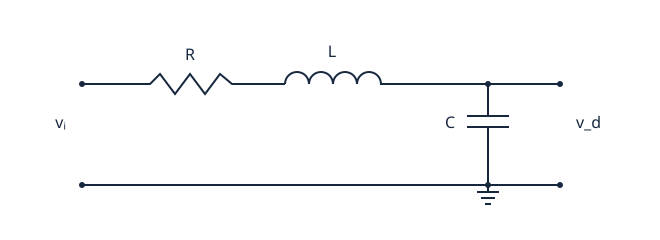
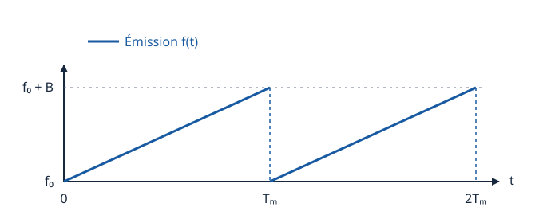
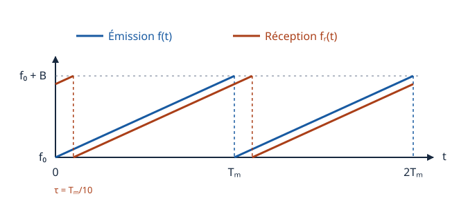
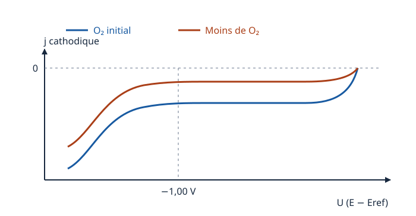
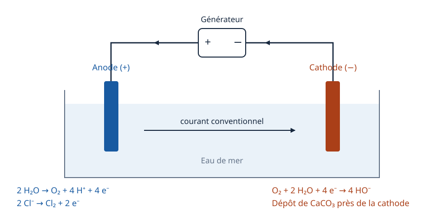
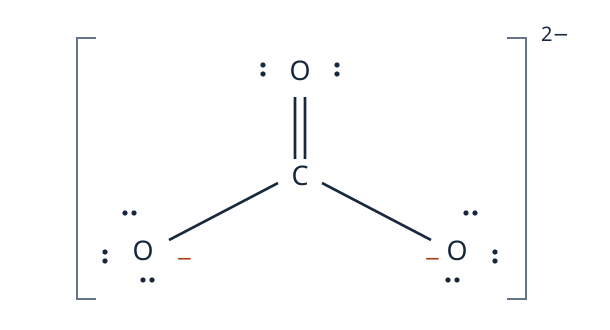

# Centrale-Supélec MP — Physique-chimie 1 2025 · Corrigé brut

*Corrigé rédigé par IA, non officiel. Signalez toute erreur.*

## Partie A — Principes physiques d’un radar océanographique

### I — Modèle optique et loi de Bragg

### Question 1

Soit $\mathbf d=L\mathbf u_x$ le déplacement d’un motif au suivant. Le retard de phase incident au signe près correspond à la projection $L\sin i$. Pour les ondes sortantes, la comparaison se fait sur un même plan d’onde perpendiculaire à la direction de détection. Le théorème de Malus–Dupin et le retour inverse ramènent la contribution sortante à la projection $L\sin\theta$.

Plus précisément, en prenant comme différence la phase du second motif moins celle du premier, l’écart est $(\mathbf K_i-\mathbf K_r)\cdot\mathbf d$. La composante tangentielle incidente est $k\sin i$ et la composante rétrodiffusée est $-k\sin\theta$, avec les angles algébriques de la figure et $k=2\pi/\lambda$. Ainsi **$\delta=L(\sin i+\sin\theta)$**. Inverser l’ordre des motifs change le signe de $\delta$.

### Question 2

La différence de phase entre motifs consécutifs vaut $2\pi\delta/\lambda$. Pour $\delta=p\lambda$, elle est un multiple de $2\pi$. Les contributions de tous les réflecteurs, éclairés par la même onde et cohérents, s’ajoutent alors en phase. Ce maximum d’interférences constructives donne la loi (1).

### II — Modèle du conducteur parfait

### Question 3

Dans le vide, $\operatorname{div}\mathbf E_i=0$ et $\operatorname{rot}\mathbf B_i=c^{-2}\partial_t\mathbf E_i$, avec $c^{-2}=\mu_0\varepsilon_0$. En prenant le rotationnel de $\operatorname{rot}\mathbf E_i=-\partial_t\mathbf B_i$, l’identité du double rotationnel donne
$$
\Delta\mathbf E_i-\frac1{c^2}\partial_t^2\mathbf E_i=0.
$$
Sur l’onde plane donnée, le laplacien multiplie par $-(k_i^2+q_i^2)$ et la dérivée seconde temporelle par $-\omega^2$. Donc **$k_i^2+q_i^2=\omega^2/c^2$**.

### Question 4

La longueur $\ell_a$ est l’épaisseur de peau.

Entre $3$ et $30\,\mathrm{MHz}$, elle varie de $0{,}145$ à $0{,}046\,\mathrm m$.

Dans la même bande, la longueur d’onde dans l’air varie de $100$ à $10\,\mathrm m$.

Ainsi $\ell_a/\lambda$ reste inférieur à $5\times10^{-3}$.

Les longueurs de vagues sélectionnées sont de plusieurs mètres ou dizaines de mètres, elles aussi très supérieures à la profondeur de pénétration.

Sur l’échelle horizontale du phénomène, le champ pénètre une couche très mince. Pour modéliser la réflexion sur une eau dont l’épaisseur dépasse largement cette couche, le conducteur parfait est une première approximation cohérente. Une conductivité finie reste nécessaire pour décrire les pertes et la structure du champ dans l’eau.

### Question 5

À $y=0$, la condition est $e^{\mathrm j k_i x}+r_0e^{\mathrm j k_0 x}=0$ pour tout $x$.

À $x=0$, elle donne $r_0=-1$, puis l’identité en $x$ donne $k_0=k_i$.

Les deux ondes vérifient la même relation de dispersion à pulsation $\omega$.

Donc $q_0^2=q_i^2$, et leurs définitions positives donnent **$q_0=q_i$**.

### Question 6

À l’interface, $\overrightarrow{OM}=x\mathbf u_x+h(x)\mathbf u_y+z\mathbf u_z$. Comme les vecteurs d’onde n’ont pas de composante suivant $z$, ce terme disparaît dans les phases. Après annulation du champ total et division par $A e^{-\mathrm j\omega t}$, les contributions incidentes et spéculaires donnent
$$
e^{\mathrm j k_i x}\bigl(e^{-\mathrm j q_i h}-e^{\mathrm j q_i h}\bigr).
$$
Le développement au premier ordre de la parenthèse donne $-2\mathrm j q_i h$. Pour la troisième onde, remplacer $e^{\mathrm j q_r h}$ par $1$ suffit. Sa correction est multipliée par $r_1$, déjà du premier ordre, et est donc du deuxième ordre. D’où
$$
-2\mathrm j q_i h(x)e^{\mathrm j k_i x}+r_1e^{\mathrm j k_r x}=0.
$$

### Question 7

Avec $h(x)=(h_0/2)e^{-\mathrm j k_v x}$, l’identité de Q6 impose que les deux exponentielles en $x$ coïncident. Leurs coefficients se compensent, d’où **$k_r=k_i-k_v$ et $r_1=\mathrm j q_i h_0$**. En particulier $h_0=|r_1|/q_i$. L’amplitude diffusée permet d’estimer l’amplitude de la composante de vague sélectionnée, après étalonnage du rapport de champs.

### Question 8

Avec $k=2\pi/\lambda$, on a $k_i=k\sin i$ et $k_r=-k\sin\theta$.

La relation de Q7 donne $k(\sin i+\sin\theta)=k_v=2\pi/L$.

En divisant par $k$ puis en multipliant par $L$, on retrouve **$L(\sin i+\sin\theta)=\lambda$**, soit l’ordre $p=1$ dans cette convention.

### Question 9

L’antenne reçoit l’écho au point d’émission. Le trajet utile repart donc dans la direction opposée à l’incidence, ce qui donne $\theta=i$ avec les conventions du sujet. La hauteur de quelques mètres est très faible devant les distances de plusieurs dizaines de kilomètres, donc le rayon arrive pratiquement tangent à la surface de référence. Les angles mesurés à partir de la normale sont proches de $\pi/2$. Pour l’ordre étudié $p=1$, on obtient $2L\simeq\lambda$.

### Question 10

Avec $\lambda=c/f$, la longueur des vagues sélectionnées est $L=c/(2f)$. Pour $c=3{,}00\times10^8\,\mathrm{m\,s^{-1}}$ et $f=12{,}3\,\mathrm{MHz}$, **$L\simeq12{,}2\,\mathrm m$**.

### III — Effet Doppler

### Question 11

Pour une propagation vers $+\mathbf u_x$, $h(x,t)=h_0\cos(k_vx-\omega_vt)$. Pour une propagation vers $-\mathbf u_x$, $h(x,t)=h_0\cos(k_vx+\omega_vt)$. Une phase constante se déplace à la vitesse algébrique $\pm\omega_v/k_v$, donc **$U=\omega_v/k_v$**.

### Question 12

Pour une vague qui s’éloigne, le produit fait apparaître la phase $(k_i-k_v)x-(\omega-\omega_v)t$. L’identification dans la condition de frontière donne **$k_r=k_i-k_v$ et $\omega_r=\omega-\omega_v$**.

### Question 13

Pour une vague qui s’éloigne, $k_r=-\omega_r/c$ et Q12 donnent $k_v=k_i+\omega_r/c$.

Or l’incidence est rasante, donc $k_i\simeq\omega/c$.

Comme $U\ll c$, la relation $\omega_r-\omega=-Uk_v$ donne au premier ordre $k_v\simeq 2\omega/c$.

Donc **$f_r-f\simeq-2U/\lambda$**.

Pour une vague qui s’approche, la composante retenue est proportionnelle à $e^{-\mathrm j(k_vx+\omega_vt)}$. Elle donne le même $k_r$ et $\omega_r=\omega+\omega_v$. La même approximation donne **$f_r-f\simeq+2U/\lambda$**.

### IV — Mesure de courants de surface

### Question 14

Par (5) et (7), $U=\sqrt{g\lambda/(4\pi)}$. D’après Q13, **$f_r-f=\pm f_B$** dans l’approximation précédente, avec
$$
f_B=\frac{2U}{\lambda}=\sqrt{\frac{g}{\pi\lambda}}.
$$

### Question 15

L’axe $+\mathbf u_x$ pointe du radar vers le large. Une vague se propageant vers le rivage dans le référentiel de l’eau a dans $\mathcal R$ la vitesse $(v_x-U)\mathbf u_x$. Celle se propageant vers le large a $(v_x+U)\mathbf u_x$. Si le courant est assez fort, le signe de la vitesse résultante donne le sens effectif dans $\mathcal R$.

Pour une vitesse algébrique $w$, Q13 donne le décalage $-2w/\lambda$. On obtient donc les deux branches $f_r-f=\pm f_B+f_D$, avec le signe positif pour la branche se propageant vers le rivage relativement à l’eau. Le décalage commun est **$f_D=-2v_x/\lambda=-2fv_x/c$**.

### Question 16

Pour deux pics aux fréquences algébriques $\nu_-$ et $\nu_+$, leur demi-écart est $f_B$ et leur moyenne est $f_D$.

La figure 3 donne pour Pendeen environ $(-0{,}29;\,0{,}43)\,\mathrm{Hz}$ et pour Perranporth environ $(-0{,}43;\,0{,}28)\,\mathrm{Hz}$.

Les demi-écarts sont $0{,}360$ et $0{,}355\,\mathrm{Hz}$.

Leur moyenne donne **$f_{B,\mathrm{exp}}\simeq0{,}36\,\mathrm{Hz}$**.

En évaluant l’incertitude-type de chaque lecture de pic à $0{,}02\,\mathrm{Hz}$ et en les supposant indépendantes, on trouve $u(f_B)\simeq0{,}014\,\mathrm{Hz}$ pour chaque spectre, puis $0{,}010\,\mathrm{Hz}$ pour la moyenne.

Pour $g=9{,}81\,\mathrm{m\,s^{-2}}$ et $\lambda\simeq24{,}4\,\mathrm m$, Q14 donne $0{,}358\,\mathrm{Hz}$.

L’écart normalisé est inférieur à $0{,}3$ compte tenu des lectures, donc bien inférieur à $2$.

Les milieux valent $+0{,}070\,\mathrm{Hz}$ et $-0{,}075\,\mathrm{Hz}$. Avec $v_x=-\lambda f_D/2$, on trouve respectivement **$v_{x1}\simeq-0{,}85\,\mathrm{m\,s^{-1}}$ vers la côte** et **$v_{x2}\simeq+0{,}91\,\mathrm{m\,s^{-1}}$ vers le large**, le long de chacun des axes radar. L’incertitude de lecture sur chaque projection est de l’ordre de $0{,}17\,\mathrm{m\,s^{-1}}$.

### Question 17

En substituant les lectures de Q16 et $\theta_1=64^\circ$, $\theta_2=189^\circ$ dans les deux expressions fournies, on trouve **$v_E\simeq-0{,}84\,\mathrm{m\,s^{-1}}$** et **$v_N\simeq-0{,}54\,\mathrm{m\,s^{-1}}$**.

La norme $\sqrt{v_E^2+v_N^2}$ vaut environ $1{,}0\,\mathrm{m\,s^{-1}}$.

La direction est à environ $33^\circ$ vers le sud à partir de l’ouest.

Au point $M$, les flèches de la carte pointent vers le sud-ouest et le code couleur indique une vitesse proche du haut de l’échelle, de l’ordre du mètre par seconde. Les lectures et les composantes sont compatibles à la précision du graphique.

## Partie B — Traitement des signaux radar

### I — Mesure d’une différence de fréquence par détection synchrone

### Question 18

Si $k_M$ est le coefficient du multiplieur, on a
$$
v_i(t)=\frac{k_MAB}{2}\left[
\cos(2\pi(f_2-f_1)t+\phi_0)+
\cos(2\pi(f_2+f_1)t+\phi_0)\right].
$$
Un spectre réel fait apparaître la valeur absolue de la fréquence différence. Comme $|f_2-f_1|\ll f_2+f_1$, un filtre passe-bas qui sépare ces fréquences laisse en sortie la composante de fréquence $|f_2-f_1|$.

### Question 19

On place une résistance $R$ et une bobine $L$ en série sur le trajet du signal d’entrée, puis un condensateur $C$ entre la sortie et la masse commune. La sortie est mesurée aux bornes de $C$ par une entrée de grande impédance. Ce montage passif est d’ordre deux.

### Question 20

En régime sinusoïdal, la sortie aux bornes de $C$ donne
$$
H(\mathrm j\omega)=\frac{1}{1-LC\omega^2+\mathrm jRC\omega}.
$$
On choisit par exemple $L=10\,\mathrm{mH}$, $C=100\,\mathrm{nF}$ et $R=470\,\Omega$ en comptant la résistance série totale.

On obtient $f_0=1/(2\pi\sqrt{LC})\simeq5{,}0\,\mathrm{kHz}$ et $Q=\sqrt{L/C}/R\simeq0{,}67$.

La réponse est sans résonance notable.

Elle transmet un signal de différence bien inférieur à $5\,\mathrm{kHz}$ et divise l’amplitude à $80\,\mathrm{kHz}$ par environ $250$.

À titre de vérification, pour $|f_2-f_1|\leq1\,\mathrm{kHz}$, le module de la réponse est supérieur à $0{,}99$. Si la bande de différence attendue est plus large, on doit ajuster $f_0$ en conservant $|f_2-f_1|\ll f_0\ll f_1+f_2$.

### Question 21

Posons $\Phi=2\pi(f_2-f_1)t+\phi_0$ et $K=k_MAB/2$ pour des voies de même gain. Le filtre idéal donne $v_d=K\cos\Phi$. L’ajout de $+\pi/2$ sur la première entrée retranche $\pi/2$ à la phase de différence. Donc **$v_{dQ}=K\sin\Phi$**.

Le point de coordonnées $(v_d,v_{dQ})$ tourne dans le sens trigonométrique si $f_2-f_1>0$, et dans le sens horaire si $f_2-f_1<0$. À écart nul, il est fixe. Le signe se lit aussi sur la pente de la phase déroulée de $v_d+\mathrm jv_{dQ}$.

### II — Mesure de distance par modulation de fréquence

### Question 22

Sur $[0,T_m[$, la phase vaut $2\pi(f_0t+Bt^2/(2T_m))$. Donc **$f(t)=f_0+Bt/T_m$**. Le prolongement est périodique. Chaque rampe monte de $f_0$ jusqu’à la limite $f_0+B$, puis revient à $f_0$ au début de la suivante. La fréquence instantanée est considérée hors des instants de réinitialisation.

### Question 23

Le retard est **$\tau=2d/c$**. À $d=10\,\mathrm{km}$, on trouve $\tau\simeq6{,}7\times10^{-5}\,\mathrm s$, très inférieur aux quelques dixièmes de seconde de $T_m$. La fréquence reçue est $f_r(t)=f(t-\tau)$. Le graphe suivant représente le retard volontairement agrandi à $T_m/10$ demandé pour le dessin.

### Question 24

Pour $\tau<t<T_m$ sur une période, $f(t)-f_r(t)=B\tau/T_m$. La fréquence différence reconstruite par détection synchrone vaut donc
$$
\boxed{\begin{aligned}
f_d&=\frac{B\tau}{T_m},\\
d&=\frac{cT_m}{2B}f_d.
\end{aligned}}
$$
Pendant le bref intervalle $0<t<\tau$, les deux signaux correspondent à deux rampes différentes. L’écart en valeur absolue vaut alors $B(1-\tau/T_m)$, proche de $B$. On exploite la partie commune des rampes, qui occupe l’essentiel de la période, ou on élimine cette composante transitoire.

### III — Questions liées à l’échantillonnage

#### III.1 — Analyse spectrale par TFD

### Question 25

Avec $f_e=1/T_e$, deux exponentielles de fréquences séparées de $kf_e$ donnent les mêmes échantillons, car leurs phases diffèrent de $2\pi kn$ à l’instant $nT_e$. Le spectre échantillonné se répète donc par translation de $f_e$. Les répétitions se chevauchent si le signal contient des fréquences au-delà de $f_e/2$. Pour un signal réel, ces fréquences peuvent apparaître à tort dans la bande utile par repliement.

On choisit $f_e>2f_{\mathrm{max}}$ pour un signal à bande limitée et on place un filtre analogique anti-repliement avant l’échantillonneur pour atténuer les composantes et le bruit hors bande.

### Question 26

Dans les deux cas, la fréquence maximale du signal utile est $160\,\mathrm{Hz}$, inférieure à $f_e/2$. L’écart entre deux points consécutifs du spectre est **$\delta f=1/(N_eT_e)$**.

- À gauche, $T_e=2\,\mathrm{ms}$ donne $f_e/2=250\,\mathrm{Hz}$ et $\delta f=5\,\mathrm{Hz}$. Les deux raies de $150$ et $160\,\mathrm{Hz}$ tombent sur des fréquences de calcul distinctes et séparées de deux pas. Elles sont résolues.
- À droite, $T_e=0{,}5\,\mathrm{ms}$ donne $f_e/2=1000\,\mathrm{Hz}$ et $\delta f=20\,\mathrm{Hz}$. La durée d’acquisition est quatre fois plus courte. Les deux composantes distantes de $10\,\mathrm{Hz}$ se confondent en un seul ensemble spectral. La raie à $150\,\mathrm{Hz}$ ne tombe pas sur la grille et répartit son énergie sur les points voisins.

#### III.2 — Limite et résolution en vitesse

### Question 27

Avec un échantillon par rampe, $f_e=1/T_m$. La bande utile va jusqu’à $1/(2T_m)\simeq1{,}91\,\mathrm{Hz}$ en valeur absolue. Pour observer les deux pics $f_D\pm f_B$, le plus grand module vaut $|f_D|+f_B$. Ainsi
$$
|f_D|_{\max}\simeq\frac1{2T_m}-f_B=1{,}35\,\mathrm{Hz}.
$$
En utilisant Q15 et $\lambda=c/f$, la valeur limite est **$|v_x|_{\max}=\lambda |f_D|_{\max}/2\simeq6{,}8\,\mathrm{m\,s^{-1}}$**. On reste en pratique en deçà de cette limite.

### Question 28

La durée d’acquisition vaut $NT_m\simeq1073\,\mathrm s$. Ainsi **$\delta f=1/(NT_m)\simeq9{,}32\times10^{-4}\,\mathrm{Hz}$**. La relation de Q15 donne
$$
\boxed{\Delta v_x=\frac{\lambda}{2NT_m}\simeq4{,}7\times10^{-3}\,\mathrm{m\,s^{-1}}.}
$$

#### III.3 — Limite et résolution en distance

### Question 29

Les échantillons sont espacés de $T_m/M$.

La limite de Nyquist est **$f_{d,\max}=M/(2T_m)$**.

Pour $d_{\max}=50\,\mathrm{km}$, Q24 donne $f_d\simeq159\,\mathrm{Hz}$.

Il faut $M>4Bd_{\max}/c\simeq83{,}3$. **$M=84$** est le plus petit entier satisfaisant cette condition idéale. $M=128$ donne une marge et permet un calcul par FFT de taille puissance de deux.

### Question 30

La durée est $T_m$, donc **$\delta f_d=1/T_m\simeq3{,}82\,\mathrm{Hz}$**. La distance est proportionnelle à $f_d$, d’où
$$
\boxed{\begin{aligned}
\Delta d&=\frac{cT_m}{2B}\delta f_d\\
&=\frac c{2B}\\
&=1{,}20\,\mathrm{km}.
\end{aligned}}
$$
Cela correspond au réglage annoncé de $1{,}2\,\mathrm{km}$. Dans ce modèle, $0{,}6$ et $0{,}3\,\mathrm{km}$ correspondent à des bandes de $250$ et $500\,\mathrm{kHz}$ respectivement.

## Partie C — Protection du littoral par dépôt électrolytique

### I — Composition de l’eau de mer

### Question 31

Pour un couple acide/base, l’acide prédomine si le pH est inférieur à son $pK_A$, et la base si le pH est supérieur. Les deux frontières sont donc $6{,}1$ et $10{,}2$.
$$
\begin{array}{c|c|c}
\mathrm{pH}<6{,}1 & 6{,}1<\mathrm{pH}<10{,}2 & \mathrm{pH}>10{,}2\\
\mathrm{CO_2(aq)} & \mathrm{HCO_3^-(aq)} & \mathrm{CO_3^{2-}(aq)}
\end{array}
$$
À chaque frontière, les deux espèces du couple ont même activité. À $\mathrm{pH}=8{,}1$, **l’ion hydrogénocarbonate $\mathrm{HCO_3^-}$ prédomine**.

### Question 32

La déprotonation de $\mathrm{HCO_3^-}$ par $\mathrm{HO^-}$ donne $\mathrm{CO_3^{2-}}$ et $\mathrm{H_2O}$, avec une constante $K_{A2}/K_E$.

La fixation de $\mathrm{Ca^{2+}}$ sur $\mathrm{CO_3^{2-}}$ pour former le solide est l’inverse de la dissolution et a pour constante $1/K_{S1}$.

Leur somme est la réaction (11), donc
$$
\boxed{K^\circ=\frac{K_{A2}}{K_E K_{S1}}=10^{12{,}2}\simeq1{,}6\times10^{12}.}
$$

### Question 33

En assimilant les activités dissoutes aux concentrations divisées par $c^\circ=1\,\mathrm{mol\,L^{-1}}$, le tableau donne
$$
\begin{aligned}
[\mathrm{Ca^{2+}}]&\simeq (1{,}46/147{,}0)\,\mathrm{mol\,L^{-1}},\\
[\mathrm{HCO_3^-}]&\simeq (0{,}20/84{,}0)\,\mathrm{mol\,L^{-1}}.
\end{aligned}
$$
La deuxième estimation assimile le carbone inorganique dissous à sa forme prédominante, ce qui est cohérent avec les écarts entre le pH et les deux $pK_A$. À $\mathrm{pH}=8{,}1$, l’activité de $\mathrm{HO^-}$ vaut $10^{-5{,}9}$. Pour la réaction (11), en prenant à un les activités du solide pur et de l’eau, on trouve
$$
Q_r=\frac1{a_{\mathrm{Ca^{2+}}}a_{\mathrm{HCO_3^-}}a_{\mathrm{HO^-}}}
\simeq 3{,}4\times10^{10}.
$$
Comme $Q_r/K^\circ\simeq0{,}021<1$, la précipitation est thermodynamiquement favorisée. **L’eau est sursaturée** dans le modèle de concentrations demandé. Une barrière cinétique peut empêcher l’apparition spontanée du dépôt.

### Question 34

Avant la précipitation, les deux sels de magnésium apportent chacun une mole de $\mathrm{Mg^{2+}}$ par mole de sel. En négligeant la dilution liée à l’ajout d’hydroxyde,
$$
[\mathrm{Mg^{2+}}]=\left(\frac{2{,}4}{95{,}2}+\frac{6{,}75}{246{,}5}\right)
\,\mathrm{mol\,L^{-1}}\simeq5{,}26\times10^{-2}\,\mathrm{mol\,L^{-1}}.
$$
À l’apparition du solide, $a_{\mathrm{Mg^{2+}}}a_{\mathrm{HO^-}}^2=K_{S2}$. Dans le modèle de Q33, cela donne $a_{\mathrm{HO^-}}\simeq1{,}55\times10^{-5}$, soit **$\mathrm{pH}\simeq9{,}19$**.

### II — Électrolyse de l’eau de mer et réactions cathodiques

### Question 35

Pour $\mathrm{O_2+4H^++4e^-\rightleftharpoons2H_2O}$, l’équation de Nernst s’écrit à $298\,\mathrm K$
$$
E_1=E_1^\circ-0{,}06\,\mathrm{pH}
+\frac{0{,}06}{4}\log_{10}\!\left(\frac{P(\mathrm{O_2})}{P^\circ}\right).
$$
À $P(\mathrm{O_2})=0{,}20\,\mathrm{bar}$ et $\mathrm{pH}=8{,}1$, on trouve **$E_1\simeq0{,}73\,\mathrm V$** par rapport à l’électrode standard à hydrogène, soit $E_1-E_{\rm ref}\simeq0{,}51\,\mathrm V$.

### Question 36

Pour $\mathrm{2H^++2e^-\rightleftharpoons H_2}$, Nernst donne
$$
E_3=E_3^\circ-0{,}06\,\mathrm{pH}
-\frac{0{,}06}{2}\log_{10}\!\left(\frac{P(\mathrm{H_2})}{P^\circ}\right).
$$
Avec $P(\mathrm{H_2})=P^\circ$, on obtient **$E_3\simeq-0{,}49\,\mathrm V$** par rapport à l’électrode standard à hydrogène, soit $E_3-E_{\rm ref}\simeq-0{,}71\,\mathrm V$.

### Question 37

Sur le graphe, $U=E-E_{\rm ref}$. Pour $-1{,}00\,\mathrm V<U<-0{,}45\,\mathrm V$, on observe la réduction du dioxygène en milieu aqueux
$$
\mathrm{O_2+2H_2O+4e^-\longrightarrow4HO^-}.
$$
Le courant cathodique augmente en module quand le potentiel devient plus négatif, puis présente un palier autour de $-0{,}6\,\mathrm{mA\,cm^{-2}}$. Sur ce palier, le dioxygène est consommé à l’électrode aussi vite qu’il y est amené, ce qui limite le courant.

Lorsque $U<-1{,}00\,\mathrm V$, la réduction de l’eau s’ajoute
$$
\mathrm{2H_2O+2e^-\longrightarrow H_2+2HO^-}.
$$
La première contribution reste proche de son courant limite et la seconde croît en module avec la polarisation. Les seuils lus sur la courbe dépendent des surtensions et ne se confondent pas avec les potentiels d’équilibre de Q35 et Q36.

### Question 38

La diminution de la concentration de dioxygène abaisse le flux vers la cathode. Comme le courant est représenté avec un signe négatif, le palier remonte vers zéro. À fort potentiel cathodique, la réduction de l’eau continue de faire croître le module du courant. À paramètres de transport et de cinétique comparables, le courant total y est moins négatif de la diminution du courant limite de dioxygène.

### Question 39

À $-0{,}80\,\mathrm V$ par rapport à l’ECS, la réduction de $\mathrm{O_2}$ produit des ions $\mathrm{HO^-}$ à la cathode. Leur production augmente le pH local et fait évoluer la réaction (11) vers $\mathrm{CaCO_3(s)}$, conformément à la sursaturation de Q33. Dans les conditions observées, le seuil local de précipitation de $\mathrm{Mg(OH)_2}$ n’est pas atteint.

À un potentiel plus négatif que $-1{,}10\,\mathrm V$, la réduction de l’eau ajoute une production d’hydroxyde. Le pH à la surface peut alors franchir le seuil voisin de $9{,}2$ estimé en Q34. Cela explique la présence de **$\mathrm{CaCO_3}$ et $\mathrm{Mg(OH)_2}$** dans le dépôt.

### Question 40

À l’anode inoxydable, les deux oxydations envisageables parmi les couples donnés sont
$$
\begin{aligned}
\mathrm{2H_2O}&\longrightarrow\mathrm{O_2+4H^++4e^-},\\
\mathrm{2Cl^-}&\longrightarrow\mathrm{Cl_2+2e^-}.
\end{aligned}
$$
Pour l’eau, Q35 donne un potentiel d’équilibre d’environ $0{,}73\,\mathrm V$ dans les conditions du sujet. La concentration en chlorure calculée avec les quatre sels chlorés du tableau est d’environ $0{,}53\,\mathrm{mol\,L^{-1}}$. Pour un état de référence de chlore gazeux à $1\,\mathrm{bar}$, Nernst donne
$$
E_2=1{,}36-0{,}06\log_{10}(a_{\mathrm{Cl^-}})
\simeq1{,}38\,\mathrm V .
$$
Une polarisation anodique suffisante permet chacune de ces oxydations. Le potentiel d’équilibre de l’oxydation de l’eau est plus bas dans ces conditions. La répartition effective dépend aussi du potentiel appliqué et des surtensions sur le matériau.

### Question 41

Le générateur impose l’oxydation à l’anode reliée à sa borne positive et la réduction à la cathode d’acier reliée à sa borne négative. Le courant conventionnel va de la borne positive à l’anode, de l’anode à la cathode dans l’électrolyte, puis de la cathode à la borne négative. Les électrons circulent en sens opposé au courant dans chaque fil. À la cathode, on retient la réduction de $\mathrm{O_2}$ de Q37, suivie du dépôt de carbonate. Les oxydations possibles à l’anode sont celles de Q40.

### III — Structure cristalline du dépôt de carbonate de calcium

### Question 42

L’ion a $4+3\times6+2=24$ électrons de valence, soit douze doublets. Dans une formule mésomère, le carbone central est lié à trois oxygènes, par une double liaison et deux liaisons simples. L’oxygène doublement lié a deux doublets non liants. Chacun des deux oxygènes simplement liés a trois doublets non liants et une charge formelle $-1$. On compte quatre doublets liants et huit non liants.

Trois formules mésomères équivalentes s’obtiennent en déplaçant la double liaison d’un oxygène à l’autre.

### Question 43

Le carbone central porte trois domaines liants et aucun doublet non liant. Le modèle VSEPR est **$\mathrm{AX_3}$**, donc la géométrie est trigonale plane, avec des angles proches de $120^\circ$. Les trois oxygènes sont équivalents par mésomérie.

### Question 44

La cohésion de l’aragonite est essentiellement **ionique**, due aux attractions électrostatiques entre les cations $\mathrm{Ca^{2+}}$ et les anions $\mathrm{CO_3^{2-}}$. À l’intérieur de chaque anion, les liaisons carbone–oxygène sont covalentes.

### Question 45

Sur la figure 8, la maille contient quatre ions calcium et quatre groupes carbonate. Elle contient donc $Z=4$ unités de formule. Le terme « rhomboédrique » est impropre ici. Les trois angles droits et les longueurs d’arête distinctes décrivent une maille orthorhombique, de volume $V=abc$. Avec $1\,\mathrm{pm}=10^{-10}\,\mathrm{cm}$, on trouve
$$
\boxed{\rho=\frac{4M(\mathrm{CaCO_3})}{N_Aabc}
\simeq 2{,}93\,\mathrm{g\,cm^{-3}}.}
$$
La densité supérieure à celle de la calcite est cohérente avec une stabilisation relative de l’aragonite quand la pression augmente. À température fixée, sa plus petite valeur de volume molaire fait croître son potentiel chimique moins vite avec la pression. La stabilité de la calcite à la pression atmosphérique est donnée par l’énoncé.
