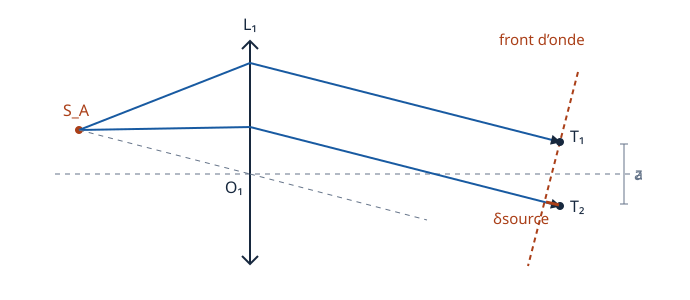
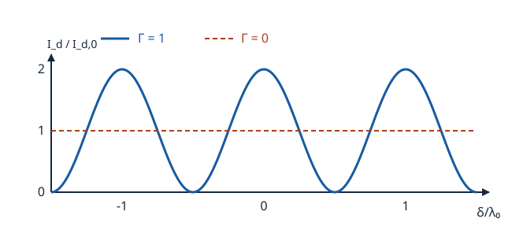
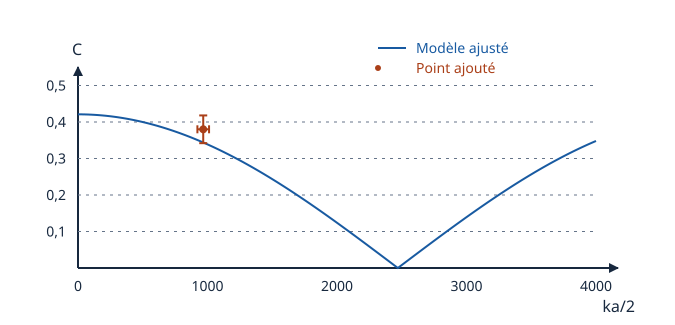
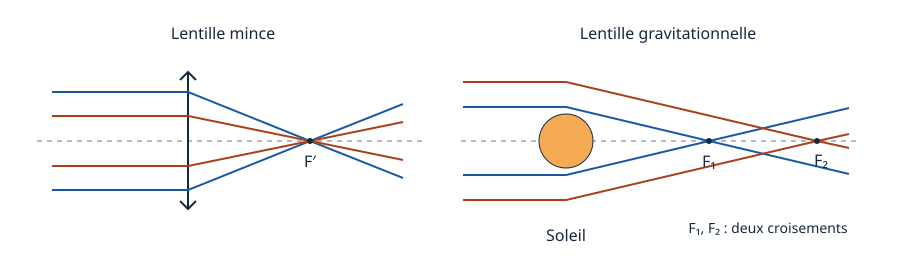
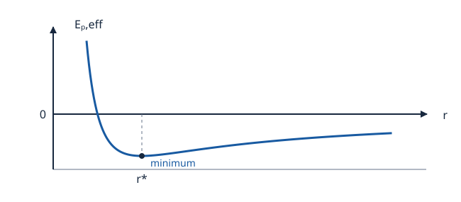

# Centrale-Supélec MP — Physique-chimie 2 2025 · Corrigé brut

*Corrigé rédigé par IA, non officiel. Signalez toute erreur.*

## Partie A — Utilisation du phénomène d’interférences

### I — Principe de la mesure sur un système équivalent

### Question 1

La source $S_A$, dans le plan focal objet de $L_1$, donne après la lentille une onde plane. Le rayon passant par $O_1$ est non dévié et donne la direction de propagation, inclinée vers $T_2$ d’un angle $\alpha/2$ par rapport à l’axe. Les chemins depuis $S_A$ jusqu’à un même front d’onde émergent ont même longueur optique.

Pour passer du front aux deux fentes, la différence de marche est la projection de $\overrightarrow{T_1T_2}$ sur la direction de propagation. Elle est positive avec l’ordre $T_2-T_1$ choisi. Ainsi **$\delta_{\rm source}=a\sin(\alpha/2)\simeq a\alpha/2$**.



### Question 2

Pour l’onde issue de $S_A$, on note $\mathcal L_1=(S_AT_1M)$ et $\mathcal L_2=(S_AT_2M)$. Sans décroissance d’amplitude,
$$
\begin{aligned}
s_1(t)&=s_0\cos(\omega t-k\mathcal L_1),\\
s_2(t)&=s_0\cos(\omega t-k\mathcal L_2).
\end{aligned}
$$

### Question 3

L’intensité est $I=K\langle(s_1+s_2)^2\rangle_t$, où $K$ est le facteur de conversion et la moyenne porte sur de nombreuses périodes. Chaque trajet seul apporte $I_0=Ks_0^2/2$. La moyenne du produit des deux cosinus vaut $\tfrac12\cos(k(\mathcal L_2-\mathcal L_1))$. Avec Q1,
$$
\boxed{I(\delta)=2I_0\bigl[1+\cos k(a\alpha/2+\delta)\bigr].}
$$

### Question 4

Les deux trajets issus d’une même source sont cohérents. Entre les sources $S_A$ et $S_B$, la phase relative fluctue et les termes croisés s’annulent en moyenne. On additionne donc leurs intensités. La source symétrique $S_B$ donne $\delta_{\rm source}\simeq-a\alpha/2$. La formule du cosinus somme et différence conduit à
$$
I_d(\delta)=4I_0\left[1+\cos(ka\alpha/2)\cos(k\delta)\right].
$$
Cela donne **$I_{d,0}=4I_0$ et $\Gamma(a,\alpha)=\cos(ka\alpha/2)$**.

### Question 5

Pour $\Gamma=1$, l’intensité varie de $0$ à $2I_{d,0}$, avec des maxima en $\delta=m\lambda_0$ et des minima en $\delta=(m+\tfrac12)\lambda_0$.

Pour $\Gamma=0$, elle est constante et vaut $I_{d,0}$.



### Question 6

On calcule $ka/2=\pi a/\lambda_0$. Avec $a=200\,\mathrm{\mu m}$ et $\lambda_0=650\,\mathrm{nm}$, **$ka/2\simeq967$**.

### Question 7

Posons $X=ka/2$. Seule l’incertitude-type sur $\lambda_0$ est fournie. À l’ordre linéaire,
$$
u(X)=\frac{\pi a}{\lambda_0^2}u(\lambda_0)
=X\frac{u(\lambda_0)}{\lambda_0}.
$$
Avec $u(\lambda_0)=30\,\mathrm{nm}$, on obtient **$u(X)\simeq45$**.

### Question 8

La figure 4 donne un maximum central autour de $112$ unités arbitraires et deux minima voisins autour de $49$ à $50$ unités. Avec $I_{\min}\simeq50$, le contraste vaut
$$
C=\frac{I_{\max}-I_{\min}}{I_{\max}+I_{\min}}
\simeq\frac{112-50}{112+50}\simeq0{,}38.
$$

### Question 9

Le point à ajouter est **$(X,C)\simeq(967;0{,}38)$**.

La barre horizontale s’étend de $X-u(X)$ à $X+u(X)$, soit environ de $922$ à $1012$.

La barre verticale va de $0{,}342$ à $0{,}418$, car $u(C)=0{,}10\,C\simeq0{,}038$.

On utilise la figure du document réponse, dont l’intitulé « Question Q8 » vise le graphique utilisé pour le placement demandé en Q9.



### Question 10

On réalise un Monte-Carlo sur les points. Pour chaque répétition, on tire les abscisses et les contrastes autour des valeurs mesurées, par exemple suivant des lois normales dont les écarts-types correspondent aux incertitudes-types fournies. On tient compte d’une éventuelle source commune d’incertitude en la tirant une seule fois par jeu de données.

Pour chaque jeu, on ajuste $C_0|\cos(\alpha X)|$, avec les mêmes conventions d’ajustement. Les écarts-types des valeurs obtenues pour $C_0$ et $\alpha$ estiment $u(C_0)$ et $u(\alpha)$.

### Question 11

Dans le plan focal objet de $L_1$, l’écart est $d=2f'_1\tan(\alpha/2)\simeq f'_1\alpha$. On néglige l’incertitude sur $f'_1$, qui n’est pas fournie. Alors $u(d)=f'_1u(\alpha)$. Avec $f'_1=0{,}80\,\mathrm m$, on trouve **$d=(0{,}509\pm0{,}009)\,\mathrm{mm}$**, où l’intervalle représente une incertitude-type.

### Question 12

Dans le montage sans fentes, chaque source produit un faisceau collimaté dont la direction correspond à sa position dans le plan focal objet de $L_1$. Dans le plan focal image de $L_2$, la séparation des images vaut $\Delta x\simeq f'_2\alpha$. On en déduit $d=\Delta x\,f'_1/f'_2$.

La figure 5 donne des maxima près de $-16\,\mathrm{\mu m}$ et $+16\,\mathrm{\mu m}$.

On lit $\Delta x\simeq32\,\mathrm{\mu m}$.

En raison de l’espacement des points et de la forme des pics, on adopte environ $2\,\mathrm{\mu m}$ d’incertitude-type par position.

Pour deux lectures indépendantes, $u(\Delta x)\simeq2{,}8\,\mathrm{\mu m}$.

Avec $f'_2=5{,}6\,\mathrm{cm}$ et sans incertitude fournie sur les focales, on obtient **$d_{\rm direct}\simeq(0{,}46\pm0{,}04)\,\mathrm{mm}$**.

En tenant les deux résultats pour indépendants, l’écart normalisé vaut
$$
z=\frac{|d_{\rm direct}-d_{\rm indirect}|}
{\sqrt{u(d_{\rm direct})^2+u(d_{\rm indirect})^2}}
\simeq 1{,}3.
$$
Les résultats sont compatibles au critère $z\leq2$ avec ces incertitudes. L’ajustement sur l’ensemble des contrastes donne l’incertitude-type la plus faible.

### II — Interférences à deux télescopes

### Question 13

La source est à l’infini et les fronts d’onde sont plans. Pour l’angle positif représenté, la projection de $\overrightarrow{T_1T_2}$ dans le sens de propagation est $a\sin(\alpha/2)$. Le retard ajouté sur la voie 2 s’ajoute à cette différence. Donc **$\delta_{\rm tot,2-1}=a\sin(\alpha/2)+\delta_r\simeq a\alpha/2+\delta_r$**. Le premier terme est celui de Q1, la lentille y ayant transformé une source située à sa distance focale en un faisceau parallèle. La ligne à retard joue ici le rôle du déphasage ajustable en aval des deux voies.

### Question 14

La condition de résolution donne $\alpha_{\rm res}=\pi/(ka)=\lambda_0/(2a)$. Pour $\lambda_0=5\,\mathrm{\mu m}$ et $a=1{,}0\,\mathrm{km}$, on trouve **$\alpha_{\rm res}=2{,}5\times10^{-9}\,\mathrm{rad}$**. À $100$ années-lumière, la séparation transverse minimale vaut
$$
d_{\rm res}=100\,(9{,}46\times10^{15})\,\alpha_{\rm res}
\simeq 2{,}4\times10^6\,\mathrm{km}.
$$
Cette distance dépasse même le diamètre du Soleil, d’environ $1{,}4\times10^6\,\mathrm{km}$. Le modèle ne donne donc pas accès aux détails de la surface d’une planète de taille comparable à la Terre à cette distance.

## Partie B — Utilisation d’une lentille gravitationnelle

### Question 15

Dans le modèle des deux demi-droites, $\tan\chi=b/SF_b$. Comme $\chi=2r_{\rm sch}/b\ll1$, on obtient
$$
SF_b=\frac{b}{\tan\chi}\simeq\frac{b^2}{2r_{\rm sch}}.
$$
Avec $r_{\rm sch}=2GM_s/c^2\simeq2{,}95\,\mathrm{km}$ et $b=R_s$, on trouve **$z_0\simeq8{,}2\times10^{13}\,\mathrm m\simeq5{,}5\times10^2\,\mathrm{au}$**. Cela représente environ dix-huit fois le rayon de l’orbite de Neptune.

### Question 16

Pour des rayons de paramètre $b$ donné, un observateur placé en amont de $F_b$ ne reçoit pas leur convergence sur l’axe.

Il peut cependant recevoir des rayons de plus petit paramètre $b'$, dont le point de convergence lui correspond, si sa distance $z$ satisfait $z\geq z_0$.

En effet, il faut $b'=\sqrt{2r_{\rm sch}z}\geq R_s$.

En deçà de $F_0$, ces rayons traverseraient le Soleil opaque et la focalisation recherchée est inaccessible.

### Question 17

Pour une lentille mince convergente en optique de Gauss, tous les rayons incidents parallèles à l’axe convergent au même foyer image. L’angle de déviation augmente avec le décentrage pour maintenir la même distance de convergence.

Pour le Soleil, la déviation varie comme $1/b$ et le croisement avec l’axe s’éloigne comme $b^2$. On dispose d’une **demi-droite focale à partir de $F_0$**, chaque position étant alimentée par un anneau différent de rayons incidents.



### Question 18

La droite $(B_0SB_1)$ et l’axe $(A_0SA_1)$ se coupent en $S$. Les segments $A_0B_0$ et $A_1B_1$ sont transversaux dans la géométrie de la figure. Par similitude des triangles,
$$
\boxed{A_1B_1=\frac{SA_1}{SA_0}A_0B_0.}
$$
Les deux écarts transversaux orientés ont des signes opposés, ce qui correspond au renversement de l’image.

### Question 19

Sur la figure 8b, les premiers minima entourant le maximum central sont approximativement à $-0{,}05$ et $+0{,}05\,\mathrm m$. En prenant pour tache centrale l’intervalle entre ces minima, deux taches de même profil ne se recouvrent pas lorsque leurs centres sont séparés d’environ cette largeur. On retient **$\rho_{\min}\simeq0{,}10\,\mathrm m$** pour le critère demandé.

### Question 20

D’après Q18 et Q19,
$$
A_0B_0=\rho_{\min}\frac{SA_0}{SA_1}
\simeq0{,}10\,\frac{100\times9{,}46\times10^{15}}{600\times1{,}50\times10^{11}}
\simeq1{,}1\,\mathrm{km}.
$$
Cette valeur est petite devant la taille d’une planète tellurique et bien inférieure à la résolution calculée en Q14. Elle provient d’un critère idéal de séparation des taches centrales. La reconstruction réelle dépend aussi de la collecte et du traitement de la lumière.

### Question 21

Au voisinage du point de croisement, $b\simeq\sqrt{2r_{\rm sch}z}$.

Le rayon angulaire de l’anneau vaut approximativement $\vartheta_E=b/z$, donc décroît comme $z^{-1/2}$.

Le rayon apparent du Soleil vaut $\vartheta_S=R_s/z$ et décroît plus vite.

Le rapport $\vartheta_E/\vartheta_S=b/R_s$ croît donc comme $\sqrt z$.

**L’anneau se détache du disque solaire en proportion de son rayon**, tout en rétrécissant en angle absolu.

Avec la bande de paramètres d’impact proposée, l’épaisseur angulaire est de l’ordre de $D/z$.

### Question 22

Pour un éclairement incident uniforme, la puissance collectée avec lentille est proportionnelle à l’aire $\pi[(b+D)^2-b^2]\simeq2\pi bD$, puisque $D\ll b$.

Sans lentille, l’aire de collecte est $\pi D^2/4$.

Le rapport vaut **$\mu\simeq8b/D$**.

À $F_0$, $b=R_s$ et pour $D=1{,}0\,\mathrm m$ on obtient **$\mu\simeq5{,}6\times10^9$**.

L’amplification géométrique est considérable dans ce modèle de collecte idéal.

## Partie C — Propulsion de la sonde

### I — Pression de radiation

### Question 23

Pour un rayonnement de longueur d’onde $\lambda$ dans le vide, un photon possède **$E_\gamma=h\nu=hc/\lambda$** et **$p_\gamma=E_\gamma/c=h/\lambda$**.

### Question 24

L’intensité $I_s$ est rapportée à une surface perpendiculaire au faisceau. La voile présente donc l’aire projetée $S\cos\beta$, avec $\cos\beta\geq0$. La puissance interceptée est $I_sS\cos\beta$. La voile parfaitement réfléchissante réfléchit tous les photons incidents, soit
$$
\boxed{\delta N=\frac{I_s S\cos\beta\,\lambda}{hc}\,\delta t.}
$$

### Question 25

La réflexion conserve la composante tangentielle et renverse la composante normale du moment d’un photon, de module $p_\gamma\cos\beta$. Ainsi chaque photon perd une quantité de mouvement normale $2p_\gamma\cos\beta$ dans le sens de la normale orientée vers la voile. La voile acquiert l’impulsion opposée à la variation des photons, soit $2p_\gamma\cos\beta\,\delta N$ suivant cette normale.

La force moyenne est cette impulsion divisée par $\delta t$. Elle est proportionnelle à $S$ et normale à la surface, ce qui définit la pression
$$
\boxed{p_r=\frac{F}{S}=\frac{2I_s\cos^2\beta}{c}.}
$$

### Question 26

À incidence normale, $p_r=2I_s/c\simeq9{,}1\times10^{-6}\,\mathrm{Pa}$. Avec $S=173\,\mathrm{m^2}$, la force idéale vaut **$F_{\rm id}\simeq1{,}57\,\mathrm{mN}$**. La valeur mesurée, $1{,}12\,\mathrm{mN}$, représente environ $71\,\%$ de cette force. L’ordre de grandeur est cohérent et une voile réelle restitue moins d’impulsion qu’un miroir parfait, notamment si une partie du flux est absorbée ou transmise.

### II — Voile solaire orthogonale au rayonnement solaire

### Question 27

Sur l’orbite initiale, l’accélération radiale vaut $-R_T\omega_T^2$. La gravitation donne $-GM_s/R_T^2$. Par identification, **$R_T^3\omega_T^2=GM_s$**, forme de la troisième loi de Kepler. La vitesse est **$v_T=R_T\omega_T=\sqrt{GM_s/R_T}$**.

### Question 28

La gravitation et la force de radiation sont radiales dans cette partie.

Leur moment en $O$ est nul, donc $L_z$ se conserve.

La composante azimutale de la vitesse vaut $r\dot\theta$, donc $L_z=mr^2\dot\theta$.

En orientant $\theta$ dans le sens du mouvement initial, $L_z>0$ et **$C=|L_z|/m=r^2\dot\theta$**.

Les conditions initiales donnent $C=R_T^2\omega_T$.

### Question 29

Notons $K=GM_sm-p_TR_T^2 S$. La force résultante vaut $-K\mathbf e_r/r^2$. L’énergie potentielle vérifie $F_r^{\rm res}=-dE_p/dr$. Avec $E_p(\infty)=0$,
$$
\boxed{E_p(r)=-\frac{GM_sm-p_TR_T^2S}{r}.}
$$

### Question 30

On a $E_c=m(\dot r^2+r^2\dot\theta^2)/2$. Comme $r^2\dot\theta=C$, on obtient $E_m=m\dot r^2/2+E_{p,\rm eff}(r)$, avec
$$
\boxed{E_{p,\rm eff}(r)=\frac{mC^2}{2r^2}
-\frac{GM_sm-p_TR_T^2S}{r}.}
$$
Les forces sont conservatives à voile fixée et cette énergie mécanique se conserve.

### Question 31

La dérivée de $E_{p,\rm eff}$ vaut $-mC^2/r^3+K/r^2$, avec $K$ défini en Q29. Comme $C\ne0$, elle ne s’annule pour $r>0$ que si $K>0$, c’est-à-dire
$$
\boxed{S<S_{\lim}=\frac{GM_sm}{p_TR_T^2}.}
$$
Dans ce cas, $r_*=mC^2/K$ est un minimum. La courbe descend depuis $+\infty$ à petit rayon, atteint le minimum négatif, puis remonte vers zéro par valeurs négatives.



À l’énergie du minimum, la trajectoire est circulaire. Entre ce minimum et zéro, elle est elliptique et liée. Pour $E_m=0$, elle est parabolique et atteint l’infini à vitesse asymptotique nulle. Pour $E_m>0$, elle est hyperbolique et non liée. Sous le minimum, aucun mouvement n’est permis à $C$ fixé.

### Question 32

Juste après ouverture, $r=R_T$ et $v=v_T$ en l’absence d’une impulsion de déploiement. Avec Q27 et Q29,
$$
E_m=\frac{mv_T^2}{2}-\frac{K}{R_T}
=-\frac{GM_sm}{2R_T}+p_TR_TS.
$$
À l’infini, le potentiel effectif tend vers zéro. L’échappement exige $E_m\geq0$. Cette condition suffit ici, car la réduction de la force attractive au déploiement amorce le mouvement radial vers l’extérieur et il n’y a plus de barrière extérieure.
$$
\boxed{S_{\min}=\frac{GM_sm}{2p_TR_T^2}\simeq1{,}8\times10^4\,\mathrm{m^2}.}
$$
Cela représente une voile carrée d’environ $136\,\mathrm m$ de côté.

### III — Influence de l’orientation de la voile sur le mouvement

### Question 33

Avec $\vec{OM}=R_T\vec\rho$ et $\tau=\omega_Tt$, l’accélération vaut $R_T\omega_T^2\,d^2\vec\rho/d\tau^2$. La relation de Kepler donne $R_T\omega_T^2=GM_s/R_T^2$. La division de l’équation du mouvement par $mR_T\omega_T^2$ donne
$$
\begin{aligned}
\frac{d^2\vec\rho}{d\tau^2}&=-\frac{\mathbf e_r}{\rho^2}
+\frac{\eta\cos^2\beta}{\rho^2}\,\mathbf u,\\
\eta&=\frac{p_TR_T^2S}{GM_sm}.
\end{aligned}
$$
Le nombre $\eta$ est le rapport de la poussée lumineuse à incidence normale à la force gravitationnelle, toutes deux à la même distance. À incidence quelconque, le rapport des modules vaut $\eta\cos^2\beta$.

### Question 34

On écrit $\mathbf u=\cos\beta\,\mathbf e_r+\sin\beta\,\mathbf e_\theta$. Avec des primes pour les dérivées en $\tau$, les deux composantes de l’accélération sont $\rho''-\rho(\theta')^2$ et $\rho\theta''+2\rho'\theta'$. On pose $u=\rho'$ et $w=\theta'$.
$$
\begin{cases}
\rho'=u,\\
\theta'=w,\\
u'=\rho w^2+(\eta\cos^3\beta-1)/\rho^2,\\
w'=\eta\cos^2\beta\sin\beta/\rho^3-2uw/\rho.
\end{cases}
$$

### Question 35

Comme $\rho=r/R_T$, on a $d\rho/d\tau=\dot r/(R_T\omega_T)$ et $d\theta/d\tau=\dot\theta/\omega_T$. Ainsi la liste attendue est **`[1, 0, 0, 1]`**, dans l’ordre imposé par la ligne 6.

### Question 36

La fonction renvoie le second membre de Q34 dans l’ordre de l’état fourni à `odeint`. L’équation est autonome, donc le temps n’apparaît pas dans le calcul.

```python
import numpy as np


def voile_solaire_beta(y, tau, eta, beta):
    rho, theta, u, w = y
    cos_beta = np.cos(beta)
    sin_beta = np.sin(beta)
    poussee = eta * cos_beta**2
    du = rho * w**2 + (poussee * cos_beta - 1) / rho**2
    dw = poussee * sin_beta / rho**3 - 2 * u * w / rho
    return [u, w, du, dw]
```

### Question 37

Pour $\beta=\pm90^\circ$, $\cos\beta=0$. La force radiative s’annule et seule subsiste la gravitation solaire. Les conditions initiales sont celles de l’orbite circulaire de rayon $R_T$. Donc **$\rho(\tau)=1$**, en particulier à cinq mois.

### Question 38

La figure 13 donne un maximum pour **$\beta_e\simeq+20^\circ$**, avec $\rho_f\simeq2{,}0$.

Le minimum se lit vers **$\beta_a\simeq-50^\circ$**, avec $\rho_f\simeq0{,}65$.

On retrouve ces lectures en exécutant la boucle de Q36 avec $\eta=0{,}41$.

Pour le pas de $0{,}5^\circ$ de l’énoncé, elle donne $\beta_e=20{,}0^\circ$ et $\beta_a=-52{,}0^\circ$.

Ces angles optimisent le rayon atteint après la durée fixée, dans ce modèle.

### IV — Trajectoire proposée

### Question 39

L’inclinaison initiale permet de réduire le rayon en modifiant notamment le mouvement azimutal. Au voisinage du Soleil, le flux lumineux est plus intense et la voile procure une force plus grande. La réorientation permet de donner à cette force une composante dans le sens du mouvement. Elle effectue alors un travail positif important pendant la phase de sortie, qui augmente l’énergie mécanique et la vitesse à grande distance. La gravitation seule conserve l’énergie mécanique et ne procure aucun gain net entre deux points à même distance de l’astre.

### Question 40

On suppose que la voile est en quasi-équilibre thermique avec le rayonnement local pendant le passage près du Soleil. On adopte d’abord le flux émis donné pour une face de surface $S$. L’équilibre impose
$$
\xi I_s S\cos\beta\left(\frac{R_T}{r}\right)^2
=\epsilon\sigma S T^4.
$$
Dans les deux orientations retenues, l’absorption est la plus grande pour $\beta_e\simeq20^\circ$, qui donne le plus grand cosinus. Employer ce cosinus à la distance minimale est une estimation prudente. La contrainte $T\leq700\,\mathrm K$ exige alors
$$
\frac{r_{\min}}{R_T}\ \gtrsim\
\sqrt{\frac{\xi I_s\cos\beta_e}{\epsilon\sigma T_{\max}^4}}
\simeq0{,}110.
$$
La courbe de la figure 14 croît localement avec $r_{\min}$. Le temps minimal compatible dans cette famille correspond donc à la plus petite distance admissible, soit environ $0{,}11\,\mathrm{au}$. On lit **environ 52 ans** pour atteindre $500\,\mathrm{au}$.

Si le flux indiqué s’applique à chacune de deux faces rayonnant librement, la puissance émise est doublée. Le seuil tombe à environ $0{,}078\,\mathrm{au}$, ce qui donne de l’ordre de **44 ans** sur le même graphe. Le choix du nombre de faces et l’hypothèse de quasi-équilibre limitent la précision de ces lectures.
