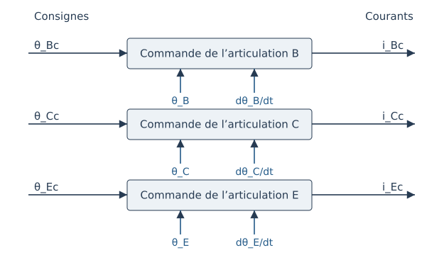
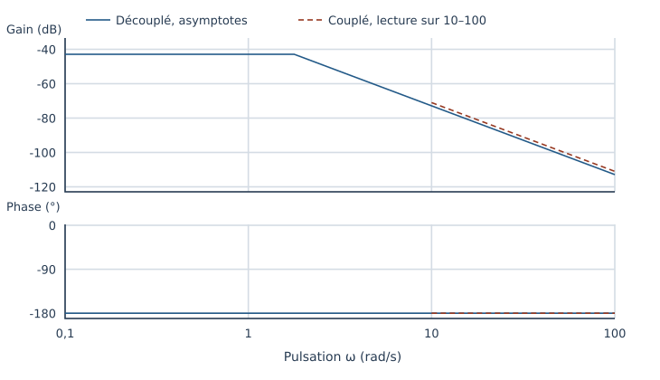
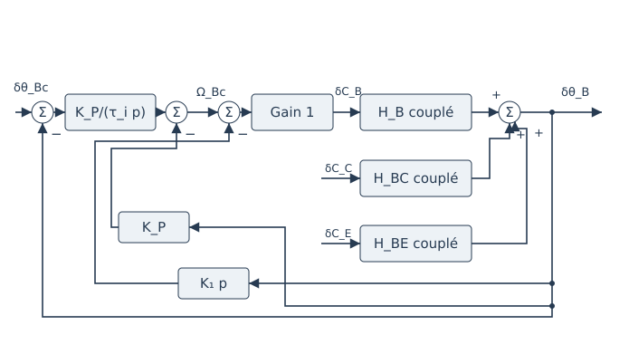

# Centrale-Supélec MP — Sciences industrielles 2025 · Corrigé guidé

*Corrigé rédigé par IA, non officiel. Signalez toute erreur.*

## Présentation du sujet

Le sujet 2025 de l’option S2I porte sur le déplacement de la tête d’impression d’un robot de construction laser additive. La partie A présente le contexte. Les 23 questions établissent les modèles cinématique et dynamique, règlent la commande puis vérifient les performances du cordon de référence. Le document-réponse est complété en Q1, Q13 et Q17.

Les questions 1 à 3, 6 et 8 sont de bons points d’entrée. Réservez du temps aux trois feuilles du document-réponse et à la lecture des courbes de validation en Q21.

## Partie B — Architecture du système de déplacement

### Question 1

> [!INDICATION]
> Associez chaque bloc aux trois informations du même axe.

#### Solution

Pour chaque articulation $k\in\{B,C,E\}$, raccorder sa consigne $\theta_{kc}$ au port d’entrée gauche de son bloc. Raccorder à ses deux ports inférieurs la position mesurée $\theta_k$ et la vitesse mesurée $\dot\theta_k$, puis relier son port droit au port de sortie $i_{kc}$. Les chaînes de mesure sont supposées parfaites, d’où les labels des grandeurs réelles. Les trois voies ne partagent aucun signal de mesure dans la commande monovariable.

> [!JURY]
> Le jury demande les labels de flux, en plus des raccordements des ports.

## Partie C — Modèle direct et erreur angulaire maximale

### Question 2

> [!INDICATION]
> Projetez la fermeture de la chaîne sur les axes fixes.

#### Solution

Posons $\varphi_2=\theta_B$, $\varphi_3=\theta_B+\theta_C$ et $\varphi_6=\theta_B+\theta_C+\theta_E$. La relation $\overrightarrow{BP}=\ell_2\vec x_2+\ell_3\vec x_3+\ell_6\vec x_6$ donne
$$
\begin{aligned}
x&=\ell_2\cos\varphi_2+\ell_3\cos\varphi_3+\ell_6\cos\varphi_6,\\
y&=\ell_2\sin\varphi_2+\ell_3\sin\varphi_3+\ell_6\sin\varphi_6,\\
\theta_6&=\varphi_6.
\end{aligned}
$$

### Question 3

> [!INDICATION]
> Les perturbations des orientations absolues valent une, deux et trois fois l’erreur articulaire commune.

#### Solution

En posant $h=\Delta\theta_B$, les perturbations des angles absolus sont $h,2h,3h$. Le développement du sinus au premier ordre donne
$$
\Delta y\simeq
\bigl[\ell_2\cos\theta_{B0}
+2\ell_3\cos(\theta_{B0}+\theta_{C0})
+3\ell_6\cos(\theta_{B0}+\theta_{C0}+\theta_{E0})\bigr]h.
$$
Les angles absolus nominaux sont $50^\circ,-50^\circ,-90^\circ$. Le coefficient vaut $(0{,}825+2\times0{,}625)\cos50^\circ\simeq1{,}334\ \mathrm{m\,rad^{-1}}$. La tolérance de Q3 est celle du positionnement vertical, soit $|\Delta y|\leq150\,\mathrm{\mu m}$. D’où
$$
\boxed{|\Delta\theta_B|\leq 1{,}12\times10^{-4}\ \mathrm{rad}}
$$
à l’ordre un, soit environ $0{,}0064^\circ$.

## Partie D — Modèle dynamique non linéaire couplé

### Question 4

> [!INDICATION]
> Au point E, la réaction de pivot idéale n’exerce aucun moment axial.

#### Solution

Le segment 6 subit le poids $-m_6g\vec y_1$ en $G_6$, la réaction de la liaison pivot 3–6 et le couple moteur $C_{E0}\vec z_1$. Le moment axial de la liaison en E est nul. La projection du moment du poids en E vaut $-m_6 g\ell_{G6}\cos\varphi_{60}$. Le théorème du moment statique en E projeté suivant $\vec z_1$ donne
$$
\begin{aligned}
C_{E0}&=A\cos\theta_{i0},\\
A&=m_6g\ell_{G6},\\
\theta_{i0}&=\theta_{B0}+\theta_{C0}+\theta_{E0}.
\end{aligned}
$$

### Question 5

> [!INDICATION]
> Transportez le moment dynamique du centre d’inertie au pivot et utilisez la composante suivant l’axe transversal du segment 6.

#### Solution

On isole le segment 6, soumis au poids en $G_6$, à la réaction du pivot en E de moment axial nul et au couple moteur $C_E\vec z_1$. Le théorème du moment dynamique en E projeté suivant $\vec z_1$ donne
$$
C_E-m_6g\ell_{G6}\cos\varphi_6
=I_6\ddot\varphi_6+m_6\ell_{G6}\,\vec a(G_6,6/1)\cdot\vec y_6.
$$
Le terme de transport est le moment en E de la résultante dynamique $m_6\vec a(G_6,6/1)$. Posons $L=\ell_{G6}$, $m=m_6$ et $s=\dot\theta_B+\dot\theta_C$. En groupant les accélérations du formulaire,
$$
\begin{aligned}
M_{13}&=I_6+mL\bigl[L+\ell_2\cos(\theta_C+\theta_E)+\ell_3\cos\theta_E\bigr],\\
M_{23}&=I_6+mL(L+\ell_3\cos\theta_E),\\
M_{33}&=I_6+mL^2.
\end{aligned}
$$
En écrivant $s^2=s\dot\theta_B+s\dot\theta_C$, un choix de coefficients conforme à la forme demandée est
$$
\begin{aligned}
C_{31}&=mL\bigl[\ell_2\dot\theta_B\sin(\theta_C+\theta_E)
+\ell_3s\sin\theta_E\bigr],\\
C_{32}&=mL\ell_3s\sin\theta_E,\\
Q_3&=m_6g\ell_{G6}\cos(\theta_B+\theta_C+\theta_E).
\end{aligned}
$$
Le choix de répartition des termes quadratiques entre les deux coefficients peut varier tant que leur somme pondérée est conservée.

> [!JURY]
> L’inventaire comprend aussi la réaction du pivot dont le moment axial est nul.

### Question 6

> [!INDICATION]
> Isolez tous les segments en aval de C pour éliminer les actions en E.

#### Solution

Isoler $\{3,6\}$. Les actions extérieures sont les deux poids en $G_3$ et $G_6$, la réaction du pivot 2–3 au point C et le couple moteur $C_C\vec z_1$. Les actions de l’articulation E sont internes à cet ensemble. Le moment axial de la réaction en C est nul. Appliquer le théorème du moment dynamique en C suivant $\vec z_1$, en sommant les moments dynamiques des segments transportés de leurs centres à C. Le bilan donne $C_C$ en fonction des mouvements et des poids.

### Question 7

> [!INDICATION]
> Déplacez la frontière du système jusqu’au pivot B.

#### Solution

Isoler $\{2,3,6\}$. Les actions extérieures sont les trois poids, la réaction du pivot du socle sur le segment 2 et le couple $C_B\vec z_1$. Les forces et couples en C et E sont internes. Au pivot B, la réaction a un moment axial nul. Le théorème du moment dynamique de l’ensemble en B projeté suivant $\vec z_1$ donne $C_B$, en additionnant les contributions des trois segments.

### Question 8

> [!INDICATION]
> Isolez le vecteur des accélérations à partir de la matrice d’inertie.

#### Solution

La matrice $M(q)$ doit être inversible. Elle représente la forme quadratique d’énergie cinétique pour les trois vitesses indépendantes, avec inerties positives. Alors
$$
\boxed{F(\Gamma,q,\dot q)=M(q)^{-1}\bigl[\Gamma-C(q,\dot q)\dot q-Q(q)\bigr].}
$$

## Partie E — Modèle dynamique linéaire couplé

### Question 9

> [!INDICATION]
> Les produits de deux perturbations ne contribuent pas au premier ordre.

#### Solution

À l’équilibre, $\Gamma_0=Q(q_0)$ et les vitesses et accélérations nominales sont nulles. Le produit de la variation de $M$ par $\delta\ddot q$ est du second ordre. Puisque $C(q_0,0)=0$, le terme $C(q,\dot q)\dot q$ est lui aussi d’ordre au moins deux. Au premier ordre,
$$
\begin{aligned}
\delta\Gamma&=A(q_0)\delta\ddot q+B(q_0)\delta q,\\
A(q_0)&=M(q_0),\\
B(q_0)&=\mathrm DQ(q_0).
\end{aligned}
$$
Ici $\mathrm DQ$ est la jacobienne du vecteur des couples de pesanteur.

### Question 10

> [!INDICATION]
> Utilisez la première ligne de chacune des deux matrices.

#### Solution

La composante selon B s’écrit
$$
\begin{aligned}
\delta C_B={}&A_{11}\delta\ddot\theta_B+A_{12}\delta\ddot\theta_C+A_{13}\delta\ddot\theta_E\\
&+B_{11}\delta\theta_B+B_{12}\delta\theta_C+B_{13}\delta\theta_E.
\end{aligned}
$$

## Partie F — Modèle dynamique linéaire découplé

### Question 11

> [!INDICATION]
> Dans la figure 10, le terme de couplage est soustrait au couple imposé.

#### Solution

Avec les conditions initiales de perturbation nulles, le passage en Laplace remplace chaque dérivée seconde par la multiplication par $p^2$. Les termes de C et E sont regroupés dans
$$
\boxed{D_B(p)=(A_{12}p^2+B_{12})\delta\theta_C(p)
+(A_{13}p^2+B_{13})\delta\theta_E(p).}
$$
Il reste $(B_{11}+A_{11}p^2)\delta\theta_B=\delta C_B-D_B$, conforme au signe du sommateur.

### Question 12

> [!INDICATION]
> L’existence de la fonction de transfert passe par l’inversibilité de la matrice de polynômes.

#### Solution

Avec conditions initiales nulles, posons $H(p)=p^2A_0+B_0$. On suppose $H(p)$ inversible comme matrice rationnelle, autrement dit son déterminant n’est pas identiquement nul. Pour $\delta C_C=\delta C_E=0$, la première composante de $\delta q=H^{-1}\delta\Gamma$ donne
$$
\delta\theta_B=(H^{-1})_{11}\delta C_B.
$$
Le coefficient de la première ligne et de la première colonne est $H_{B\,\mathrm{lin.couplé}}(p)$.

### Question 13

> [!INDICATION]
> Évaluez le signe de la réponse fréquentielle en remplaçant p par iω.

#### Solution

Avec $p=i\omega$, on a $H_B(i\omega)=-K_B/[1+(\omega/\omega_B)^2]$. Le gain asymptotique vaut $20\log_{10}K_B\simeq-42{,}9\ \mathrm{dB}$ jusqu’à $\omega_B=1{,}78\ \mathrm{rad\,s^{-1}}$, puis décroît de $40\ \mathrm{dB}$ par décade. La phase est **$-180^\circ$ pour toute pulsation positive**, car la réponse reste réelle négative.

Entre $10$ et $100\ \mathrm{rad\,s^{-1}}$, le tracé ajouté passe d’environ $-73$ à $-113\ \mathrm{dB}$.

Sur le document-réponse, le modèle couplé passe d’environ $-71$ à $-111\ \mathrm{dB}$, avec la même phase et la même pente dans cette bande. L’écart de quelques décibels et l’absence de déphasage supplémentaire dans la bande utile justifient l’emploi du modèle découplé pour le réglage. Les singularités du modèle couplé à plus basse pulsation sont hors de cette bande.

> [!JURY]
> Vérifiez la phase en calculant le signe de la réponse fréquentielle, puis quantifiez la comparaison dans la bande utile.

## Partie G — Synthèse de la commande monovariable de B

### Question 14

> [!INDICATION]
> Les deux gains du moteur et de sa correction se compensent. Identifiez ensuite les coefficients du dénominateur.

#### Solution

Avec $D_B=0$, le couple équivalent est $\Omega_{Bc}-K_1p\,\delta\theta_B$. Le retour tachymétrique conduit à
$$
\boxed{H_{TB}(p)=\frac{H_B(p)}{1+K_1pH_B(p)}
=\frac{-K_B}{1-K_BK_1p-p^2/\omega_B^2}.}
$$
L’identification au produit donné conduit à
$$
\begin{aligned}
\omega_{B\mathrm{BF}}&=\frac{\omega_B^2}{\omega_{B\mathrm{HF}}},\\
K_1&=\frac{1}{K_B}\left(\frac1{\omega_{B\mathrm{BF}}}
-\frac1{\omega_{B\mathrm{HF}}}\right).
\end{aligned}
$$
Avec $\omega_{B\mathrm{HF}}=300\ \mathrm{rad\,s^{-1}}$, on trouve le pôle **$+0{,}0106\ \mathrm{rad\,s^{-1}}$** et **$K_1\simeq1{,}32\times10^4\ \mathrm{N\,m\,s\,rad^{-1}}$**. L’autre pôle vaut $-300\ \mathrm{rad\,s^{-1}}$.

### Question 15

> [!INDICATION]
> Distinguez les deux contributions du retour de position, puis normalisez le dénominateur à un.

#### Solution

Posons $w=\omega_{B\mathrm{BF}}$, $H=H_{TB}$ avec le seul pôle dominant, et $c(p)=K_P/(\tau_i p)$. Le schéma donne $\Omega_{Bc}=c(\delta\theta_{Bc}-\delta\theta_B)-K_P\delta\theta_B$. En écrivant $\delta\theta_B=H\Omega_{Bc}$, on obtient
$$
\boxed{\frac{\delta\theta_B}{\delta\theta_{Bc}}
=\frac{1}{
1+\tau_i(1-1/(K_B K_P))p
+\left(\tau_i/(wK_B K_P)\right)p^2}.}
$$
Le gain statique est un. L’identification à la forme canonique donne
$$
\begin{aligned}
\tau_i&=\frac{2\zeta}{\omega_0}+\frac{w}{\omega_0^2},\\
K_P&=\frac{2\zeta\omega_0+w}{wK_B}.
\end{aligned}
$$
Pour $\zeta=0{,}7$ et $\omega_0=30\ \mathrm{rad\,s^{-1}}$, **$\tau_i\simeq0{,}0467\ \mathrm s$** et **$K_P\simeq5{,}56\times10^5\ \mathrm{N\,m\,rad^{-1}}$**.

## Partie H — Validation du principe de la commande monovariable

### Question 16

> [!INDICATION]
> Pour chacune des trois entrées, repérez la limite de l’axe sollicité et celle des deux axes perturbés.

#### Solution

Pour $q_{c1}$, B se stabilise vers $0{,}10\ \mathrm{rad}$ et C et E reviennent à zéro.

Pour $q_{c2}$, C se stabilise vers $0{,}10\ \mathrm{rad}$ et B et E reviennent à zéro.

Pour $q_{c3}$, E se stabilise vers $0{,}10\ \mathrm{rad}$ et B et C reviennent à zéro. Les transitoires s’éteignent sur la durée représentée, de l’ordre de $0{,}2\ \mathrm s$.

Les neuf signaux convergent. Les axes sollicités suivent les échelons sans erreur permanente. Les axes voisins sont temporairement perturbés par le mouvement mais l’erreur finale reste nulle dans les trois essais. Les critères de la figure 14 sont satisfaits pour les sollicitations simulées. Cela valide le principe de la commande monovariable à ce stade.

> [!JURY]
> Il faut distinguer les trois réponses à une entrée des trois entrées successives.

## Partie I — Enrichissement de la synthèse de la commande

### Question 17

> [!INDICATION]
> La première ligne de la matrice inverse donne les trois contributions à la position de B. Le retour tachymétrique part de leur somme.

#### Solution

Raccorder le signal $\Omega_{Bc}$ au sommateur tachymétrique positif et soustraire $K_1p\,\delta\theta_B$.

Placer le correcteur $1/K_{CB}$ et le gain moteur $K_{CB}$ après ce sommateur, ou leur gain équivalent un. Cela donne $\delta C_B$.

Dans les trois cases associées à $\delta C_B$, $\delta C_C$ et $\delta C_E$, placer respectivement $H_{B\,\mathrm{lin.couplé}}$, $H_{BC\,\mathrm{lin.couplé}}$ et $H_{BE\,\mathrm{lin.couplé}}$.

Additionner les trois contributions pour obtenir $\delta\theta_B$. Le retour de position déjà tracé sur le document subsiste et le retour tachymétrique est prélevé sur la même sortie totale.

### Question 18

> [!INDICATION]
> Lisez les trois ordonnées au même instant, dans la partie où les courbes sont parallèles.

#### Solution

Les deux réponses sont presque superposées sur la figure 17. La simplification reproduit donc le comportement du modèle linéaire couplé pour cette rampe. À $t=0{,}20\ \mathrm s$, on lit une consigne d’environ $7{,}3\times10^{-3}\ \mathrm{rad}$ et une réponse d’environ $5{,}6\times10^{-3}\ \mathrm{rad}$. L’écart permanent est de l’ordre de **$1{,}7\times10^{-3}\ \mathrm{rad}$**, supérieur d’un facteur voisin de 15 au maximum de Q3. La simplification est validée mais la commande sans anticipation est insuffisante en suivi.

### Commande par anticipation

### Question 19

> [!INDICATION]
> Sous suivi parfait, l’intégrateur ne reçoit aucune erreur et seule la branche anticipatrice compense le retour proportionnel.

#### Solution

Pour la réponse idéale et à conditions initiales nulles, l’erreur d’entrée de l’intégrateur est nulle. Le signal en entrée de $H_{TB}$ vaut alors $(C_{aB}^*-K_P)\delta\theta_{Bc}$. La sortie doit valoir $\delta\theta_{Bc}$, donc
$$
\boxed{C_{aB}^*(p)=K_P+H_{TB}(p)^{-1}
=K_P-\frac1{K_B}+\frac{p}{K_B\omega_{B\mathrm{BF}}}.}
$$
Cette fonction est impropre. Son terme dérivateur idéal a un gain non borné lorsque la fréquence augmente et demanderait notamment une impulsion pour une consigne en échelon.

### Question 20

> [!INDICATION]
> Pour une rampe, le facteur p² de l’expression fournie annule celui du dénominateur de la consigne.

#### Solution

Pour $\delta\theta_{Bc}(p)=a_r/p^2$, l’expression donnée se réduit à
$$
\varepsilon(p)=a_r\frac{4{,}2+p}{(90{,}2+4{,}2p+p^2)(300+p)}.
$$
Sous l’hypothèse de stabilité, tous les pôles pertinents sont strictement à gauche. Le théorème de la valeur finale donne $\lim_{t\to\infty}\varepsilon(t)=\lim_{p\to0}p\varepsilon(p)=0$. L’erreur permanente est donc nulle et satisfait la limite de Q3.

> [!JURY]
> La valeur finale demande un contrôle des pôles avant de calculer la limite.

## Partie J — Validation sur le modèle dynamique non linéaire

### Question 21

> [!INDICATION]
> Relevez les valeurs observées et comparez chacune au seuil correspondant. Examinez séparément les transitoires de raccordement et le plateau.

#### Solution

**Id1, position verticale et attitude.** La figure 25 donne environ $-0{,}311055$ à $-0{,}310960\ \mathrm m$, soit au plus $55\,\mathrm{\mu m}$ d’écart à $-0{,}311\ \mathrm m$. La tolérance est $150\,\mathrm{\mu m}$.

La figure 26 donne environ $-90{,}005^\circ$ à $-89{,}996^\circ$, soit moins de $0{,}005^\circ$ d’écart à $-90^\circ$ pour une tolérance de $0{,}1^\circ$. Les deux critères sont satisfaits.

**Id2, position longitudinale.** La figure 23 indique un trajet de $1{,}000$ à $1{,}100\ \mathrm m$. L’agrandissement de la figure 24 montre un maximum proche de $1{,}10003\ \mathrm m$, soit environ $0{,}03\ \mathrm{mm}$ au-delà du point final. Il reste dans la tolérance $0{,}1\ \mathrm{mm}$.

**Id3, accélération et dépassements.** Sur la figure 21 les rampes montante et descendante changent la vitesse d’environ $0{,}05\ \mathrm{m\,s^{-1}}$ en environ $0{,}20$ à $0{,}23\ \mathrm s$, soit des pentes de module proche de $0{,}22$ à $0{,}25\ \mathrm{m\,s^{-2}}$. Elles dépassent $0{,}15\ \mathrm{m\,s^{-2}}$.

L’écart transitoire le plus marqué à l’entrée du plateau vaut environ $-2{,}2\times10^{-3}\ \mathrm{m\,s^{-1}}$ (figure 22), soit $-4{,}4\,\%$ de la vitesse de consigne.

Le premier dépassement positif est voisin de $0{,}6\times10^{-3}\ \mathrm{m\,s^{-1}}$, soit $1{,}2\,\%$.

À la sortie, l’écart visible sur la figure 21 reste de l’ordre de $2\times10^{-3}\ \mathrm{m\,s^{-1}}$ ou moins, compatible avec la limite de $5\,\%$ de la vitesse de consigne.

**Id4, phase de consigne constante.** La figure 22 fixe la fenêtre de contrôle de $1{,}20$ à $3{,}00\ \mathrm s$. Le creux initial atteint environ $-2{,}2\times10^{-3}\ \mathrm{m\,s^{-1}}$, au-delà de la tolérance de $\pm10^{-3}\ \mathrm{m\,s^{-1}}$. L’écart rentre dans la bande vers $1{,}25\ \mathrm s$ et le plateau établi la respecte ensuite. **Id4 reste non satisfait sur la fenêtre prescrite.** Les critères Id1 à Id3 sont satisfaits, mais Id4 empêche de valider l’ensemble de la commande.

> [!JURY]
> Pour chaque exigence, indiquez l’identifiant, le résultat lu, le seuil et la conclusion.

## Partie K — Analyse de la validation des modèles

### Question 22

> [!INDICATION]
> Repérez les comparaisons entre une performance calculée ou simulée et un niveau effectivement exigé.

#### Solution

L’écart pertinent est **S–C**, entre système simulé et système souhaité. L’étude ne fournit pas de mesure de laboratoire.

- **H** compare les réponses aux échelons du modèle non linéaire couplé aux critères concepteur de stabilité et de précision de la figure 14.
- **I.I** compare aussi l’erreur de traînage simulée à la limite issue de Q3. La comparaison mutuelle des deux modèles faite dans la même partie est, quant à elle, une comparaison entre deux simulations.
- **I.II** vérifie que l’erreur permanente du modèle de commande avec anticipation sous une rampe respecte la même limite de Q3.
- **J** compare les performances du modèle non linéaire avec anticipation aux exigences de réalisation de la figure 6, à partir des figures 21 à 26.

La comparaison fréquentielle de F.II porte sur deux modèles entre eux. Les parties D, E, F.I et G construisent ou règlent les modèles sans constituer les étapes de validation précédentes.

### Question 23

> [!INDICATION]
> Associez chaque comparaison à deux entrées de la figure 28 soumises au même essai.

#### Solution

- **Représentations 1 et 2.** En F.II, la figure 10 mène au modèle linéaire couplé, puis la figure 11 au modèle linéaire découplé. Le document-réponse de Q13 superpose leurs réponses fréquentielles. Elles sont voisines de 10 à $100\ \mathrm{rad\,s^{-1}}$, ce qui valide le découplage dans la bande de réglage.
- **Simulations 4 et 5.** La figure 17 superpose les réponses à la même rampe de la commande monovariable sans anticipation sur le modèle linéaire couplé et le modèle linéaire simplifié découplé. Leur quasi-superposition valide le modèle simplifié pour ce test. L’écart commun à la consigne dépasse la tolérance de Q3, ce qui motive la modification de la commande.

La simulation 3 est confrontée aux critères de la figure 14 à l’aide de la figure 16. La simulation 6 est confrontée au cahier des charges de la figure 6 à l’aide des figures 21 à 26. Ces deux essais répondent à des sollicitations différentes.

## Bilan

- Écrivez les orientations absolues avant la linéarisation de la position.
- Dans une boucle, suivez les signes des sommateurs du schéma avant la mise sous forme canonique.
- Distinguez le contrôle de l’écart entre modèles du contrôle d’une performance simulée par rapport au cahier des charges.

FIN
