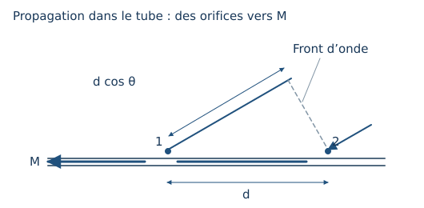
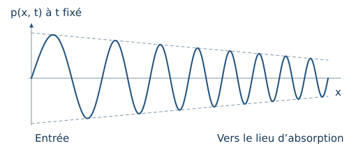
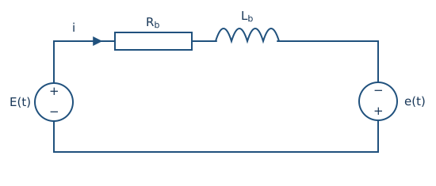

# Centrale-Supélec MPI — Physique-chimie 1 2025 · Corrigé guidé

*Corrigé rédigé par IA, non officiel. Signalez toute erreur.*

## Présentation du sujet

L’épreuve dure quatre heures, calculatrice autorisée. Les trois problèmes sont indépendants. Les Q1–Q11 relient le fonctionnement d’un microphone à l’interférence des ondes et à leur propagation dans la cochlée. Les Q12–Q29 étudient le couplage électromécanique et le filtrage de deux haut-parleurs. Les Q30–Q40 relient équilibre chimique, oxydoréduction et géométrie du sillon.

Les questions Q1–Q4, Q12–Q15, Q20–Q23 et Q30–Q32 permettent de démarrer par des outils de cours. Revenez au graphe pour mesurer un seuil en Q8 et un retard en Q28. Le signe du courant, la convention complexe et les activités de référence structurent ensuite les réponses.

## A — Capter le son

### I — Microphones électrostatiques et directivité

### I.1 — Microphone électrostatique

### Question 1

> [!INDICATION]
> Utilisez la symétrie du plan et une boîte de Gauss traversant l’armature mobile.

#### Solution

Les invariances dans le plan et la symétrie de réflexion imposent un champ normal au plan, de même module et de sens opposés de part et d’autre. Choisissons un cylindre de Gauss coupant l’armature, avec deux bases d’aire $A$ parallèles à celle-ci. Le flux latéral est nul et le flux par les bases vaut $2EA$. La charge intérieure est $QA/S$. Ainsi
$$
\boxed{\vec E_1(x)=\frac{Q}{2\varepsilon_0S}\operatorname{sgn}(x-X)\,\vec u_x,\qquad x\ne X.}
$$

> [!JURY]
> Le jury attend une surface de Gauss décrite précisément.

### Question 2

> [!INDICATION]
> Superposez les champs dans l’entrefer, puis intégrez la relation entre champ et potentiel depuis l’armature fixe.

#### Solution

La plaque fixe porte $-Q$, donc $\vec E_2=-Q\operatorname{sgn}(x-d)\vec u_x/(2\varepsilon_0S)$ hors du plan. Entre les plaques, les deux champs sont orientés vers $+x$ et s’additionnent. En utilisant $E_x=-\mathrm dV/\mathrm dx$ et $V(d)=0$,
$$
\begin{aligned}V(x)&=\frac{Q}{\varepsilon_0S}(d-x),\\
\boxed{C(t)}&=\frac{Q}{V_0}=\frac{\varepsilon_0S}{d-X(t)}.\end{aligned}
$$

### Question 3

> [!INDICATION]
> Dérivez la charge mobile $Q=CV_0$ avec $V_0$ fixé.

#### Solution

Le courant dans le sens indiqué alimente la plaque positive. Ainsi $i=\dot Q=V_0\dot C$. Comme $\mathrm d[(d-X)^{-1}]/\mathrm dt=\dot X/(d-X)^2$,
$$
\boxed{\begin{aligned}i(t)&=\frac{\varepsilon_0SV_0}{[d-X(t)]^2}\dot X(t),\\ K(X)&=\frac{\varepsilon_0SV_0}{(d-X)^2}.\end{aligned}}
$$

### Question 4

> [!INDICATION]
> Employez le champ créé par la seule armature fixe et intégrez l’opposé de la force.

#### Solution

La plaque fixe attire la charge $+Q$ vers $+x$. Son champ sur la membrane vaut $Q/(2\varepsilon_0S)$, d’où
$$
F_e(X)=\frac{Q^2}{2\varepsilon_0S}=\frac{\varepsilon_0SV_0^2}{2(d-X)^2}.
$$
Cette force de la seule position possède une primitive d’opposé
$$
\boxed{E_p(X)=-\frac{\varepsilon_0SV_0^2}{2(d-X)}+\mathrm{constante}=-W_e(X)+\mathrm{constante}.}
$$
En effet $W_e=CV_0^2/2$. Le générateur intervient dans le bilan énergétique à tension fixée.

> [!JURY]
> La membrane ne subit pas l’action de son propre champ.

### I.2 — Microphone canon

### Question 5

> [!INDICATION]
> Comparez l’avance de l’onde incidente d’un orifice à l’autre et le trajet supplémentaire dans le tube.

#### Solution

L’orifice 2 est plus loin de la membrane de $d$. Son onde a ainsi $d$ de trajet supplémentaire dans le tube. À l’extérieur, la projection de l’écart sur la direction incidente donne une avance de parcours de $d\cos\theta$. Le retard résultant vaut $d(1-\cos\theta)/c_a$, d’où
$$
\boxed{\begin{aligned}p_2&=p_1e^{-j\phi},\\ \phi&=\frac{2\pi f d}{c_a}(1-\cos\theta).\end{aligned}}
$$

### Question 6

> [!INDICATION]
> Mettez $p_1$ en facteur, puis calculez le module carré de la somme des phaseurs.

#### Solution

$$
I_{\rm tot}=I_0|1+e^{-j\phi}|^2=I_0(2+2\cos\phi).
$$
Ainsi $f_2(\phi)=4\cos^2(\phi/2)$. Les deux ondes donnent un maximum $4I_0$ en phase et s’annulent en opposition de phase. Additionner leurs intensités seules omettrait le terme d’interférence.

### Question 7

> [!INDICATION]
> Factorisez le polynôme $1+z+z^2+z^3$ pour $z=e^{-j\phi}$.

#### Solution

La somme des quatre pressions est $p_1(1+e^{-j\phi})(1+e^{-2j\phi})$. Son module carré donne $I_{\rm tot}=I_0 f_2(\phi)f_2(2\phi)$. La période fondamentale est $2\pi$, puisque le produit contient un terme non nul en $\cos\phi$.

Le maximum vaut $16I_0$ lorsque les quatre phases coïncident, pour $\phi=2\pi q$. Une variation de $2\pi$ du déphasage entre orifices rétablit toutes les phases relatives. Le maximum traduit une pression quadruplée par interférences constructives.

### Question 8

> [!INDICATION]
> Lisez le premier passage sous 20 % du maximum, puis vérifiez si un lobe principal peut réapparaître.

#### Solution

Sur la figure 4, le lobe axial atteint le seuil de 20 % vers $\phi_* \simeq1{,}0\ \mathrm{rad}$. On retrouve cette lecture en résolvant $\cos^2(\phi/2)\cos^2\phi=0{,}20$ sur le premier lobe. Cette coupure appartient au demi-espace avant si $2\pi f d/c_a\geq\phi_*$. Sinon l’intensité reste au-dessus du seuil dans tout le demi-espace avant. Lorsque la coupure est atteinte,
$$
\boxed{\theta_{\max}=\arccos\left(1-\frac{\phi_*c_a}{2\pi f d}\right).}
$$
Pour atteindre $5^\circ$, il faudrait $d>\phi_*c_a/[2\pi f(1-\cos5^\circ)]$, soit environ $15\ \mathrm m$ à $1\ \mathrm{kHz}$ et $150\ \mathrm m$ à $100\ \mathrm{Hz}$. C’est irréaliste pour un tube à quatre entrées.

Entre $\pi/2$ et $3\pi/2$, les lobes secondaires restent sous le seuil. En posant $x=\cos\phi\in[-1,0]$, l’intensité normalisée vaut $(1+x)x^2/2$. Son maximum sur cet intervalle est $2/27$, atteint pour $x=-2/3$.

L’intensité est périodique en $\phi$ de période $2\pi$. Le lobe suivant dépasse de nouveau le seuil dès $\phi=2\pi-\phi_*$. Pour conserver un unique cône significatif dans le demi-espace avant, il faut donc $2\pi f d/c_a<2\pi-\phi_*$. Cette borne supérieure est incompatible avec celle qui impose $5^\circ$. Le modèle prédit donc un compromis entre finesse du lobe axial et lobes supplémentaires.

### II — Oreille interne

### Question 9

> [!INDICATION]
> Imposez $k^2>0$ avant l’absorption et identifiez la limite où le modèle devient résonant.

#### Solution

Une onde propagative exige $\omega_r(x)>\omega$, donc $k^2(x)>0$. Le point où cette condition cesse d’être satisfaite est associé à la résonance $\omega_r(x_r)=\omega$ dans le modèle. Comme $\omega_r$ est monotone et que ses valeurs en amont sont supérieures à cette limite, $\omega_r$ décroît vers $x_r$.

### Question 10

> [!INDICATION]
> Dérivez deux fois en $x$ et séparez les parties réelle et imaginaire.

#### Solution

Le facteur complexe commun se simplifie et donne
$$
\begin{aligned}
A''+[k^2-(\phi')^2]A&=0,\\
2A'\phi'+A\phi''&=0.
\end{aligned}
$$
La seconde équation donne $(A^2\phi')'=0$. Une phase constante se déplace vers $+x$ avec la vitesse $\omega/\phi'$, donc $\phi'>0$. En écrivant la constante positive sous la forme $H^2$, on trouve $\boxed{A=H/\sqrt{\phi'}}$.

### Question 11

> [!INDICATION]
> Utilisez la dispersion pour la longueur d’onde et adoptez une approximation locale pour esquisser l’enveloppe.

#### Solution

Le dénominateur de $k^2$ décroît vers zéro, donc $k$ augmente et la longueur d’onde locale $2\pi/k$ diminue.

Pour le tracé, dans une zone où l’amplitude varie lentement à l’échelle d’une oscillation, $|A''|\ll k^2A$. L’équation réelle de Q10 donne alors $\phi'\simeq k$, et $A\simeq H/\sqrt k$ décroît. On dessine donc des oscillations de plus en plus serrées dans une enveloppe décroissante. Cette approximation locale ne décrit pas le voisinage immédiat de la singularité $x_r$. Les équations exactes seules ne fixent pas la monotonie de l’enveloppe sans information supplémentaire sur l’onde.

## B — Produire le son

### I — Haut-parleur électrodynamique

### Question 12

> [!INDICATION]
> Distinguez l’addition des résistances et celle des flux liés aux spires jointives.

#### Solution

Les spires sont en série, donc $R_b=NR_1$. Les spires jointives partagent, au couplage parfait près, le même flux. Pour un courant $i$, chaque spire reçoit le flux de $N$ spires, soit $NL_1i$. Le flux total lié est encore multiplié par $N$. Ainsi $\boxed{L_b=N^2L_1}$ dans ce modèle.

> [!JURY]
> La mise en série ne suffit pas à calculer l’inductance. Il faut compter les flux mutuels.

### Question 13

> [!INDICATION]
> Utilisez la surface cylindrique de la figure 6 et orientez-la par le sens positif du courant.

#### Solution

Le déplacement $\mathrm dz$ retranche à la surface cylindrique orientée une bande d’aire $2\pi r\,\mathrm dz$ traversée normalement par $B_0$. La fermeture hors champ ne contribue pas. Le flux lié aux $N$ tours varie donc de $\mathrm d\Phi=-2\pi rNB_0\,\mathrm dz$. Faraday donne
$$
\boxed{e=-\mathrm d\Phi/\mathrm dt=2\pi rNB_0\dot z.}
$$
On retrouve le signe par $\vec v\times\vec B_0=\dot zB_0\vec u_\theta$, projeté le long du fil orienté.

### Question 14

> [!INDICATION]
> Intégrez la force de Laplace et comparez sa puissance à celle de la fém induite.

#### Solution

Sur une spire, $i\,r\,\mathrm d\theta\,\vec u_\theta\times B_0\vec u_r=-irB_0\,\mathrm d\theta\,\vec u_z$. Posons $\gamma=2\pi rNB_0$. Alors $\boxed{\vec F=-\gamma i\vec u_z}$ et $\boxed{\vec F\cdot\vec v=-ei}$. Les deux puissances de couplage se compensent. Le couplage échange de l’énergie entre les domaines électrique et mécanique.

### Question 15

> [!INDICATION]
> Projetez la dynamique de la masse mobile sur $Oz$ avec rappel, frottement et force électromagnétique.

#### Solution

Le théorème de la résultante cinétique donne $M\ddot z=-Kz-\lambda\dot z-\gamma i$. En divisant par $M$,
$$
\begin{aligned}\ddot z+\frac{\omega_0}{Q_m}\dot z+\omega_0^2z&=-\beta i,\\\omega_0&=\sqrt{K/M},\\ Q_m&=M\omega_0/\lambda,\\ \beta&=\gamma/M.\end{aligned}
$$

### Question 16

> [!INDICATION]
> Placez la fém induite en série avec la bobine et écrivez la maille dans le sens du courant.

#### Solution

La tension à fournir s’obtient en retranchant la fém de mouvement aux chutes réceptrices. La maille donne
$$
\boxed{E(t)=R_bi+L_b\dot i-\gamma\dot z.}
$$
Ici $\gamma=2\pi rNB_0$ comme en Q14.

### Question 17

> [!INDICATION]
> Multipliez la maille électrique par $i$ et l’équation mécanique par $\dot z$, puis additionnez.

#### Solution

La maille fournit $P_G=R_bi^2+\dot E_m-\gamma i\dot z$. L’équation mécanique donne $\dot E_c+\dot E_e=-\lambda\dot z^2-\gamma i\dot z$. La puissance fournie à l’air vaut $P_a=\lambda\dot z^2$, opposée à celle de l’effort de l’air sur la membrane. Ainsi
$$
\boxed{P_G=\frac{\mathrm d}{\mathrm dt}(E_m+E_c+E_e)+R_bi^2+P_a.}
$$

### Question 18

> [!INDICATION]
> Éliminez l’amplitude complexe du déplacement entre les deux équations couplées.

#### Solution

Avec la convention $e^{j\omega t}$, le déplacement complexe satisfait $(\omega_0^2-\omega^2+j\omega\omega_0/Q_m)Z=-\beta I_0$. La maille donne $E_0=(R_b+j\omega L_b)I_0-j\omega\gamma Z$. D’où
$$
\boxed{Z_m=R_b+j\omega L_b+\frac{j\omega\beta\gamma}{\omega_0^2-\omega^2+j\omega\omega_0/Q_m}.}
$$
À très basse fréquence, les deux termes dépendant de $\omega$ tendent vers zéro et $Z_m\to R_b$.

### II — Sélectivité fréquentielle

### II.1 — Ordres de grandeur

### Question 19

> [!INDICATION]
> Choisissez des fréquences représentatives de part et d’autre de la séparation et estimez les demi-longueurs d’onde.

#### Solution

À $1\ \mathrm{kHz}$ la demi-longueur d’onde vaut $c_a/(2f_c)\simeq17\ \mathrm{cm}$. Elle fixe une référence. Un woofer destiné, par exemple, à $500\ \mathrm{Hz}$ donne une membrane d’environ $35\ \mathrm{cm}$. Un tweeter vers $5\ \mathrm{kHz}$ donne environ $3{,}5\ \mathrm{cm}$. Ces valeurs illustrent des ordres de grandeur. La seule fréquence de séparation ne détermine pas un diamètre unique pour chaque haut-parleur.

### Question 20

> [!INDICATION]
> Déduisez d’abord la résistance de la puissance maximale et égalisez les modules des réactances à la coupure.

#### Solution

Avec $P=U_{\rm eff}^2/R_b$, on obtient $R_b\simeq5\,\Omega$. À $1\ \mathrm{kHz}$, $\omega_cL\simeq R_b$ et $1/(\omega_c C)\simeq R_b$. D’où
$$
\boxed{L\simeq0{,}80\ \mathrm{mH},\qquad C\simeq32\ \mathrm{\mu F}.}
$$

### II.2 — Filtres de Butterworth

### Question 21

> [!INDICATION]
> Remplacez les dipôles à basse puis haute fréquence.

#### Solution

À basse fréquence, les condensateurs sont ouverts et les bobines court-circuitent leurs bornes. Le CLC coupe le trajet série et dérive son nœud intermédiaire, alors que le LCL transmet à $R_b$. À haute fréquence les rôles s’inversent. Le LCL est $H_1$, passe-bas pour le woofer. Le CLC est $H_2$, passe-haut pour le tweeter. Trois composants réactifs donnent un ordre maximal de trois.

### Question 22

> [!INDICATION]
> Calculez le module carré et annulez le terme en $x^2$.

#### Solution

$$
|B_2|^2=\frac{1}{(1-x^2)^2+\alpha^2x^2}
=\frac{1}{1+(\alpha^2-2)x^2+x^4}.
$$
Le terme en $x^2$ doit disparaître. Comme $\alpha>0$, $\boxed{\alpha=\sqrt2}$.

### Question 23

> [!INDICATION]
> Identifiez les coefficients en $x^2$ et $x^4$.

#### Solution

Le carré du module du dénominateur vaut $(1-\alpha'_2x^2)^2+(\alpha'_1x-x^3)^2$. Pour ne conserver que $1+x^6$, on impose $(\alpha'_1)^2=2\alpha'_2$ et $(\alpha'_2)^2=2\alpha'_1$. On obtient $(\alpha'_1)^4=8\alpha'_1$. Les deux coefficients positifs valent donc **$\alpha'_1=\alpha'_2=2$**.

> [!JURY]
> Le rapport insiste sur le calcul du module d’un nombre complexe.

### II.3 — Décalage entre les voies

### Question 24

> [!INDICATION]
> Comparez la différence de longueur nécessaire pour un décalage audible aux longueurs usuelles.

#### Solution

Un mètre de différence donne environ $1/c=3{,}3\ \mathrm{ns}$. Avec dix mètres, on reste à environ $33\ \mathrm{ns}$. Pour atteindre $0{,}1\ \mathrm{ms}$, il faudrait une différence d’environ $30\ \mathrm{km}$. Dans les câblages considérés, le retard est négligeable.

### Question 25

> [!INDICATION]
> Développez la phase autour de $\omega_0$ et repérez le terme qui décale l’enveloppe.

#### Solution

Sur la bande étroite, $\phi_k(\omega)\simeq\phi_k(\omega_0)+(\omega-\omega_0)\Upsilon_k$. Le terme linéaire combiné à $e^{j\omega t}$ remplace $t$ par $t+\Upsilon_k$ dans l’enveloppe. Le retard de groupe vaut donc $\tau_k=-\Upsilon_k$.
$$
\boxed{\Delta t_1=\tau_a-\tau_g=\Upsilon_g-\Upsilon_a.}
$$
Pour comparer la séparation temporelle à un seuil positif, on en prend le module. La phase constante ne décale pas l’enveloppe. Le rapport des fonctions de transfert idéales vaut $(jx)^3$, de phase constante pour $x>0$. Leurs retards de groupe sont donc identiques.

### Question 26

> [!INDICATION]
> Repérez les deux diviseurs de tension successifs et la charge vue après la première impédance.

#### Solution

Le nœud après $Z_1$ voit deux branches en parallèle, $Z_2$ et $Z_3+R$. Leur admittance est $Y=1/Z_2+1/(Z_3+R)$.

La tension de ce nœud rapportée à l’entrée vaut $1/(1+Z_1Y)$, soit $\mathrm{DT2}$.

Dans la branche de sortie, la fraction prise sur $R$ vaut $R/(R+Z_3)$, soit $\mathrm{DT1}$. CalcH calcule leur produit, fonction de transfert chargée, pour chaque point du tableau. Le raisonnement est valable pour des impédances complexes.

### Question 27

> [!INDICATION]
> Identifiez les différences au milieu du tableau et aux bords, puis choisissez les arguments pertinents.

#### Solution

Oper calcule des quotients de différences centrées au milieu du tableau et unilatérales aux deux bords. On choisit $x=\omega$ et $y$ la phase déroulée. L’opposé de la dérivée numérique donne le retard de groupe. Si $x$ contient les fréquences $f$ en hertz, on divise la dérivée par $2\pi$. La différence des deux retards donne le décalage signé.

### Question 28

> [!INDICATION]
> Lisez les extrema et comparez-les à $0{,}1\ \mathrm{ms}$.

#### Solution

Le décalage signé est légèrement négatif à basse fréquence et voisin de zéro à haute fréquence. Il atteint environ $-20\ \mathrm{\mu s}$ vers $0{,}6$ à $0{,}7\ \mathrm{kHz}$, puis $+16\ \mathrm{\mu s}$ un peu au-dessus de $1\ \mathrm{kHz}$. Le changement de signe échange la voie en avance. L’écart maximal est environ cinq fois plus petit que le seuil de $100\ \mathrm{\mu s}$.

### Question 29

> [!INDICATION]
> Écrivez les distances aux deux enceintes lorsque l’auditeur est décalé latéralement d’un mètre.

#### Solution

Pour un écart $s=0{,}50\ \mathrm m$ entre les haut-parleurs, une distance axiale $D=5\ \mathrm m$ et un décalage $a=1\ \mathrm m$, la différence de distances s’obtient en multipliant par le conjugué :
$$
\Delta D=\frac{2as}{\sqrt{D^2+(a+s/2)^2}+\sqrt{D^2+(a-s/2)^2}}\simeq0{,}098\ \mathrm m.
$$
Donc **$\Delta t_2\simeq0{,}28\ \mathrm{ms}$**. Le trajet acoustique peut dépasser le seuil et dominer le retard des filtres.

## C — Enregistrer le son

### I — Chimie et matériaux des vinyles

### Question 30

> [!INDICATION]
> Isolez la masse molaire du chlore dans celle du motif.

#### Solution

Le motif $\mathrm{C_2H_3Cl}$ a pour masse molaire $24+3+35{,}5=62{,}5\ \mathrm{g\,mol^{-1}}$. La fraction massique de chlore vaut $35{,}5/62{,}5=\boxed{56{,}8\,\%}$.

### Question 31

> [!INDICATION]
> Utilisez l’activité d’un corps pur condensé et comparez le quotient à la constante.

#### Solution

Les deux phases condensées sont pures. Dans le modèle de l’énoncé, leurs activités valent un. Dès coexistence, $Q_{r,1}=1<K_1^\circ$ et $\Delta_rG=RT\ln(Q_{r,1}/K_1^\circ)<0$. La formation du PVC est favorable, jusqu’à épuisement du monomère à la limite du modèle.

### Question 32

> [!INDICATION]
> Partez de la charge des espèces ou imposez la neutralité de la molécule.

#### Solution

Le palladium est à $+\mathrm{II}$ dans $\mathrm{Pd^{2+}}$ et à $0$ dans le métal. Dans $\mathrm{CO_2}$, chaque oxygène est à $-\mathrm{II}$, donc le carbone est à $+\mathrm{IV}$.

### Question 33

> [!INDICATION]
> Équilibrez les demi-équations puis reliez la constante à la différence des potentiels standard.

#### Solution

Dans le sens de la réduction, les demi-équations sont
$$
\begin{aligned}
\mathrm{Pd^{2+}}(aq)+2e^-&\longrightarrow\mathrm{Pd}(s),\\
\mathrm{CO_2}(g)+2\mathrm{H^+}(aq)+2e^-&\longrightarrow\mathrm{HCO_2H}(aq).
\end{aligned}
$$
En combinant la première et l’inverse de la seconde, on obtient
$$
\boxed{\mathrm{Pd^{2+}}(aq)+\mathrm{HCO_2H}(aq)\longrightarrow
\mathrm{Pd}(s)+\mathrm{CO_2}(g)+2\mathrm{H^+}(aq).}
$$
Les deux potentiels de Nernst coïncident à l’équilibre. Leur différence vaut $(0{,}99+0{,}20)-(0{,}06/2)\log_{10}Q_{r,2}$, donc $\log_{10}K_2^\circ\simeq39{,}7$ et $K_2^\circ\simeq5\times10^{39}$. La production de palladium est très favorable dans les conditions ordinaires de mise en présence.

### Question 34

> [!INDICATION]
> Comparez les potentiels de Nernst dans les deux milieux en conservant l’activité de palladium dissous.

#### Solution

Le métal peut s’oxyder si le potentiel du couple qui accepte ses électrons dépasse $E_{\rm Pd}=0{,}99+0{,}030\log_{10}a_{\mathrm{Pd^{2+}}}$.

Avec l’acide seul, à pression de dihydrogène de référence, $E_{\mathrm{H^+/H_2}}=-0{,}060\,\mathrm{pH}$. À $\mathrm{pH}\simeq0$, l’oxydation ne serait favorable que sous $a_{\mathrm{Pd^{2+}}}=10^{-33}$. Elle ne produit donc pas de dissolution appréciable à cette pression.

À $\mathrm{pH}=7$ sous air à environ $1\ \mathrm{bar}$, le potentiel du dioxygène vaut $1{,}23-0{,}060\times7+0{,}015\log_{10}(0{,}21)\simeq0{,}80\ \mathrm V$. Il dépasse $E_{\rm Pd}$ si $a_{\mathrm{Pd^{2+}}}$ est inférieure à environ $5\times10^{-7}$. Une oxydation à l’état de traces est donc possible si l’eau est initialement dépourvue de palladium dissous. À activité unitaire, elle est défavorisée. Les activités, la pression effective de dihydrogène et l’éventuelle complexation par les chlorures peuvent modifier les seuils.

> [!JURY]
> Le rapport demande de comparer les potentiels dans les conditions considérées ou de comparer le quotient à sa constante.

### Question 35

> [!INDICATION]
> Identifiez la forme dominante à pH faible et lisez le pH où les deux proportions sont égales.

#### Solution

La forme protonée $\mathrm{HCO_2H}$ prédomine à bas pH. Elle correspond au trait plein décroissant. Le pointillé croissant décrit $\mathrm{HCO_2^-}$. À l’intersection, les concentrations sont égales, donc $\mathrm{pH}=pK_a\simeq3{,}75$. On en déduit **$K_a\simeq1{,}8\times10^{-4}$**.

### Question 36

> [!INDICATION]
> Convertissez la quantité de matière visée en volume d’acide pur et choisissez une verrerie adaptée.

#### Solution

Il faut $0{,}13\times0{,}100=0{,}013\ \mathrm{mol}$, soit $0{,}598\ \mathrm g$ pour $M=46\ \mathrm{g\,mol^{-1}}$. Le volume d’acide pur vaut $0{,}598/1{,}22\simeq0{,}49\ \mathrm{mL}$.

Prélever $0{,}49\ \mathrm{mL}$ avec une pipette graduée de $1\ \mathrm{mL}$ ou une micropipette adaptée. Introduire le prélèvement dans une fiole jaugée de $100\ \mathrm{mL}$ contenant déjà de l’eau. Mélanger, laisser revenir à température ambiante, compléter au trait, boucher et homogénéiser.

### Question 37

> [!INDICATION]
> Introduisez l’avancement volumique de dissociation et appliquez la constante d’acidité.

#### Solution

$$
\mathrm{HCO_2H}(aq)+\mathrm{H_2O}(l)\rightleftharpoons
\mathrm{HCO_2^-}(aq)+\mathrm{H_3O^+}(aq).
$$
En négligeant l’autoprotolyse, les concentrations de formiate et d’oxonium ont la même valeur numérique $x$ en $\mathrm{mol\,L^{-1}}$. On a $x^2/(0{,}13-x)=K_a$. La racine positive vaut $4{,}7\times10^{-3}$. L’acide non dissocié reste à environ $0{,}125\ \mathrm{mol\,L^{-1}}$ et **$\mathrm{pH}\simeq2{,}32$**.

### Question 38

> [!INDICATION]
> Reliez la constante à la pression partielle du gaz en équilibre avec le liquide pur.

#### Solution

L’activité du liquide pur vaut un et celle du gaz est assimilée à $p/p^\circ$. La détection impose $\log_{10}(p/p^\circ)\geq-4$. Avec $14{,}1-5600/T\geq-4$, on trouve
$$
\boxed{T\geq5600/18{,}1\simeq309\ \mathrm K\simeq36^\circ\mathrm C.}
$$
Ce résultat vaut pour l’équilibre au-dessus de l’acide liquide pur, dans le domaine d’application de la loi fournie.

### II — Enregistrement sur un disque vinyle

### Question 39

> [!INDICATION]
> Comptez les tours et utilisez le rayon moyen d’un sillon de pas radial uniforme.

#### Solution

Le nombre de tours est $N=\omega\Delta t/(2\pi)$. À pas radial constant,
$$
e=\frac{2\pi(r_2-r_1)}{\omega\Delta t}.
$$
Comme $e\ll r_1$, chaque tour est presque circulaire. La longueur totale vaut approximativement $N$ fois la circonférence de rayon moyen $(r_1+r_2)/2$, soit
$$
L\simeq\frac{\omega\Delta t}{2}(r_1+r_2).
$$
À 33 tours par minute durant 23 minutes, $N=759$. On obtient **$e\simeq132\ \mathrm{\mu m}$** et **$L\simeq477\ \mathrm m$**.

### Question 40

> [!INDICATION]
> Calculez le rayon où le signal à $20\ \mathrm{kHz}$ atteint la longueur minimale gravable.

#### Solution

La vitesse de défilement à rayon $r$ vaut $\omega r$. La période spatiale minimale donne $f_{\max}(r)=\omega r/\ell_{\min}$. Aux rayons intérieur et extérieur, on trouve **$8{,}6\ \mathrm{kHz}$** et **$25{,}9\ \mathrm{kHz}$**.

Pour garantir $20\ \mathrm{kHz}$, il faut $r\geq r_*=(20\,000)\ell_{\min}/\omega\simeq0{,}116\ \mathrm m$. En enregistrant depuis le bord et avec le pas uniforme,
$$
\boxed{\Delta t_{\rm Hi-Fi}=\Delta t\,\frac{r_2-r_*}{r_2-r_1}\simeq7{,}9\ \mathrm{min}.}
$$

## Bilan

- Pour un microphone, comparez les trajets de propagation avant de sommer les amplitudes complexes. La directivité dépend du seuil choisi et des lobes susceptibles de réapparaître.
- Dans un haut-parleur, les puissances de couplage électrique et mécanique s’éliminent du bilan global. Pour les filtres, distinguez retard de groupe et différence de phase constante.
- Pour la chimie du vinyle, calculez les potentiels dans les conditions du problème. Pour le disque, la vitesse linéaire varie avec le rayon et fixe la limite locale de gravure.

FIN
