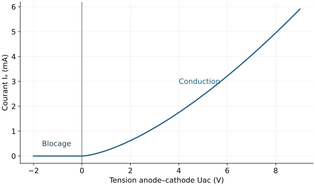
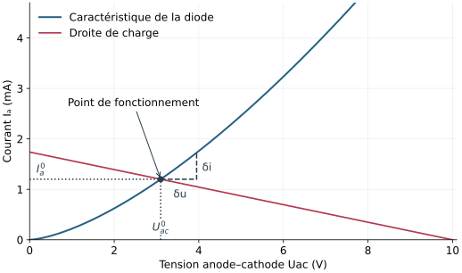
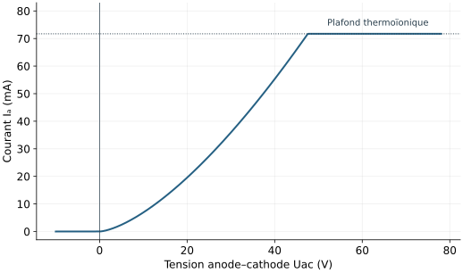
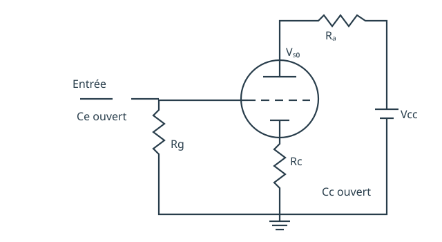

# CentraleSupélec MPI — Physique-Chimie 2 2025 · Corrigé brut

*Corrigé rédigé par IA, non officiel. Signalez toute erreur.*

## A — La diode à vide

### Question 1

En régime stationnaire, les équations sont
$$
\begin{aligned}
\nabla\cdot\vec E&=\rho/\varepsilon_0,&
\nabla\times\vec E&=\vec0,\\
\nabla\cdot\vec B&=0,&
\nabla\times\vec B&=\mu_0\vec j .
\end{aligned}
$$
La circulation électrostatique est nulle sur tout contour fermé et $\vec E=-\nabla V$. Maxwell-Gauss donne l’équation de Poisson $\Delta V=-\rho/\varepsilon_0$.

### Question 2

La hauteur $H=45\,\mathrm{mm}$ dépasse largement l’entrefer $r_2-r_1=3\,\mathrm{mm}$. Loin des extrémités, on approche les électrodes par des cylindres coaxiaux indéfinis. Les conditions aux limites sont invariantes par translation suivant $Oz$ et par rotation autour de cet axe. Dans le régime respectant ces symétries, $V$ dépend seulement de $r$.

### Question 3

Le poids vaut environ $9\times10^{-30}\,\mathrm N$. Avec une tension anodique de l’ordre de $10^2\,\mathrm V$, le champ caractéristique est de l’ordre de $10^4$ à $10^5\,\mathrm{V\,m^{-1}}$. La force électrique est de l’ordre de $10^{-14}\,\mathrm N$. Le poids est négligeable même avec quelques volts.

### Question 4

La charge de l’électron est $-e$. L’énergie mécanique $\tfrac12mv^2-eV$ est constante, égale à zéro à la cathode où l’électron part du repos. Sur la branche sortante,
$$
v(r)=\sqrt{\frac{2eV(r)}m}.
$$

### Question 5

L’équation de continuité est $\partial_t\rho+\nabla\cdot\vec j=0$. En stationnaire, $\nabla\cdot\vec j=0$. Le flux est donc constant entre deux cylindres coaxiaux de hauteur $H$, sans flux par les bases. Les électrons se déplacent suivant $+\vec e_r$ et $\vec j=\rho v\vec e_r$ pointe vers la cathode. Ainsi $I_a=-2\pi rH\rho v$.

### Question 6

En combinant Poisson en coordonnées cylindriques, l’expression du courant et celle de $v$,
$$
\begin{aligned}
\frac{\mathrm d}{\mathrm dr}\left(r\frac{\mathrm dV}{\mathrm dr}\right)
&=-\frac{r\rho}{\varepsilon_0}=k V^{-1/2},\\
k&=\frac{I_a}{2\pi H\varepsilon_0}\sqrt{\frac m{2e}} .
\end{aligned}
$$

### Question 7

Le premier membre s’exprime en $\mathrm{V\,m^{-1}}$.

Comme $I_a/(H\varepsilon_0)$ est en $\mathrm{V\,s^{-1}}$ et $\sqrt{m/e}$ en $\mathrm{s\,V^{1/2}\,m^{-1}}$, $k$ est en $\mathrm{V^{3/2}\,m^{-1}}$.

Le produit par $V^{-1/2}$ a l’unité requise.

### Question 8

La transformation $V\mapsto NV$, pour $N>0$, préserve les conditions aux limites en multipliant $V_a$ par $N$.

L’équation de Poisson donne $\rho\mapsto N\rho$ et l’énergie donne $v\mapsto N^{1/2}v$. Le courant est donc multiplié par $N^{3/2}$. Le second membre de Q6 est alors bien multiplié par $N$.

### Question 9

Le premier membre vaut $\alpha n^2 r^{n-1}$, et le second $k\alpha^{-1/2}r^{-n/2}$. En identifiant,
$$
\begin{aligned}
n-1&=-n/2,& n^2\alpha^{3/2}&=k,\\
n&=2/3,& \alpha&=(9k/4)^{2/3}.
\end{aligned}
$$

### Question 10

Notons $d=r_2-r_1$. Avec le profil approché décalé imposé par le sujet,
$$
\begin{aligned}
U_{ac}&=(9kd/4)^{2/3},\\
I_a&=\beta U_{ac}^{3/2},\\
\beta&=\frac49\frac{2\pi H\varepsilon_0}{d}\sqrt{\frac{2e}m}
 \simeq2{,}19\times10^{-4}\,\mathrm{A\,V^{-3/2}}.
\end{aligned}
$$

### Question 11

Pour $U_{ac}<0$, rejoindre l’anode demanderait une énergie cinétique finale $eU_{ac}<0$. Les électrons émis sans vitesse initiale ne peuvent donc atteindre l’anode et $I_a=0$.

### Question 12

La caractéristique est nulle pour $U_{ac}\le0$, puis croissante et convexe, avec tangente horizontale à l’origine du côté passant.

### Question 13

On trouve $U_{ac}^0=(I_a^0/\beta)^{2/3}\simeq3{,}11\,\mathrm V$ avec la valeur calculée en Q10.

### Question 14

La vitesse vaut $v_a[(r-r_1)/d]^{1/3}$, avec $v_a=\sqrt{2eU_{ac}^0/m}\simeq1{,}05\times10^6\,\mathrm{m\,s^{-1}}$. Le départ au repos donne une singularité intégrable :
$$
\tau=\frac d{v_a}\int_0^1 x^{-1/3}\,\mathrm dx
=\frac{3d}{2v_a}\simeq4{,}3\times10^{-9}\,\mathrm s.
$$
La fréquence caractéristique est proportionnelle à $1/\tau$. Avec le repère $\omega_c\tau\simeq1$, on obtient $f_c\simeq1/(2\pi\tau)\simeq3{,}7\times10^7\,\mathrm{Hz}$. Le calcul par temps de vol fournit une échelle, de quelques dizaines à quelques centaines de mégahertz selon le critère.

### Question 15

La pente locale est $(3/2)\beta\sqrt{U_{ac}}$. Son inverse donne
$$
r_d=\frac{2}{3\beta^{2/3}I_a^{1/3}}
=\frac{2U_{ac}}{3I_a}\simeq1{,}73\,\mathrm{k\Omega}
$$
au point de fonctionnement.

### Question 16

La loi des mailles s’écrit $V_{cc}=R_a I_a+U_{ac}$. La droite de charge est $I_a=(V_{cc}-U_{ac})/R_a$.

### Question 17

Avec $\beta=2{,}2\times10^{-4}\,\mathrm{A\,V^{-3/2}}$, on a $U_{ac}^0=3{,}10\,\mathrm V$. Donc $R_a=(10-3{,}10)/(1{,}2\times10^{-3})\simeq5{,}75\,\mathrm{k\Omega}$.

### Question 18

L’intersection fixe le point $(U_{ac}^0,I_a^0)$. La droite passe par $V_{cc}$ sur l’axe horizontal et par $V_{cc}/R_a$ sur l’axe vertical. Sur la caractéristique, une petite variation $\delta u$ donne $\delta i\simeq\delta u/r_d$. La pente de la tangente est la conductance dynamique $1/r_d$.

## B — Température et émission thermoïonique

### Question 19

La section du fil vaut $\pi r_f^2$. Sa résistance et la puissance reçue sont
$$
\begin{aligned}
R_f&=\frac L{\gamma\pi r_f^2}\simeq3{,}58\times10^{-2}\,\Omega,\\
P_{\rm el}&=\frac{U_f^2}{R_f}\simeq63\,\mathrm W.
\end{aligned}
$$

### Question 20

Les trois modes sont la conduction, la convection et le rayonnement. Entre le filament et la cathode, le vide et l’absence de liaison matérielle directe empêchent conduction et convection. La cathode est chauffée par rayonnement.

### Question 21

$\phi$ représente la puissance thermique totale émise par unité de surface du corps noir, intégrée sur les longueurs d’onde et sur le demi-espace d’émission. Son unité est $\mathrm{W\,m^{-2}}$.

### Question 22

Pour le filament de température uniforme, la capacité thermique est $C_f=\mu_W c\pi r_f^2L$. On néglige les deux sections terminales face à l’aire latérale $S_f=2\pi r_fL$. Entre $t$ et $t+\mathrm dt$, le premier principe donne
$$
C_f\,\mathrm dT=(P_{\rm el}-\sigma S_f T^4)\,\mathrm dt.
$$

### Question 23

À l’équilibre, la puissance émise compense la puissance électrique reçue :
$$
T_{\rm éq}=\left(\frac{P_{\rm el}}{\sigma S_f}\right)^{1/4}
\simeq2{,}16\times10^3\,\mathrm K.
$$

### Question 24

La montée réclame une énergie de l’ordre de $C_f T_{\rm éq}$, pour une puissance d’ordre $P_{\rm el}$. Le temps caractéristique $C_f T_{\rm éq}/P_{\rm el}$ vaut environ $0{,}43\,\mathrm s$. L’équilibre exact est asymptotique. Près de lui, le bilan linéarisé donne un temps de relaxation quatre fois plus court, soit $0{,}11\,\mathrm s$. Compter de l’ordre de la seconde pour l’installation du régime du filament. Le chauffage de la cathode et les transitoires électriques peuvent retarder la stabilisation de l’amplificateur réel.

### Question 25

Wien donne $\lambda_{\max}\simeq2{,}9\times10^{-3}/2160\simeq1{,}34\,\mathrm{\mu m}$, dans l’infrarouge. L’émission s’étend au visible, où elle favorise les grandes longueurs d’onde. Le filament apparaît rouge orangé.

### Question 26

L’émission suppose de décrire les états électroniques du métal et leur occupation. Ce problème relève de la mécanique quantique. La constante de Planck peut donc intervenir dans le nombre d’états et dans le coefficient d’émission.

### Question 27

On cherche $A\propto m^a e^b k_B^c h^d$. La densité de courant est une charge par unité de temps et de surface. L’unité de $A$ est donc $\mathrm{C\,s^{-1}\,m^{-2}\,K^{-2}}$. En prenant comme dimensions de base la masse, la longueur, le temps, la charge et la température,
$$
\begin{aligned}
a+c+d&=0,& 2c+2d&=-2,& -2c-d&=-1,\\
b&=1,& -c&=-2.
\end{aligned}
$$
On obtient $a=b=1$, $c=2$, $d=-3$. D’où
$$
A=4\pi\frac{m e k_B^2}{h^3}\simeq1{,}25\times10^6\,\mathrm{A\,m^{-2}\,K^{-2}}.
$$

### Question 28

La cathode cylindrique mince rayonne par ses deux faces latérales. Chacune a pour aire $S_1=2\pi r_1H\simeq5{,}65\times10^{-4}\,\mathrm{m^2}$. En régime stationnaire, elle reçoit $P_{\rm el}$ du filament et émet $2S_1\sigma T_c^4$ dans le modèle de l’énoncé. Ainsi
$$
T_c=\left(\frac{P_{\rm el}}{2S_1\sigma}\right)^{1/4}\simeq9{,}94\times10^2\,\mathrm K.
$$

### Question 29

Le courant d’émission de chaque face est $S_1AT_c^2e^{-W/(k_BT_c)}$. Il faut convertir le travail de sortie en joules. Pour la face tournée vers le filament, en nickel, et celle tournée vers l’anode, en oxyde de baryum, on trouve
$$
\begin{aligned}
I_{\rm th-F}&\simeq7{,}4\times10^{-15}\,\mathrm A,\\
I_{\rm th-A}&\simeq7{,}2\times10^{-2}\,\mathrm A.
\end{aligned}
$$
Le courant disponible côté anode dépasse d’un facteur d’environ 60 le courant de service. Le revêtement à faible travail de sortie est déterminant. Les valeurs dépendent fortement de la température par l’exponentielle.

### Question 30

Pour $U_{ac}<0$, le courant reste nul dans le modèle de départ sans vitesse initiale. Pour $U_{ac}>0$, la branche en puissance vaut tant que la charge d’espace limite le courant. À tension suffisante, le débit d’émission est la limite. Un modèle simple est $I_a=\min(\beta U_{ac}^{3/2},I_{\rm th-A})$, et le coude estimé se situe vers $48\,\mathrm V$.

## C — Amplificateur à triode

### Question 31

La loi de la triode contient une puissance $3/2$ de la combinaison de tensions. La réponse dépend donc non linéairement de l’excitation et le circuit complet n’obéit pas à la superposition.

### Question 32

Le signal d’entrée, de quelques dixièmes de volt, est très petit par rapport à $V_{cc}=350\,\mathrm V$. Cela motive de construire la réponse variable comme perturbation. La taille à comparer pour valider quantitativement la linéarisation est la variation de $\mu U_{gc}+U_{ac}$ devant sa valeur de polarisation. $V_{s0}$ est déterminée par $V_{cc}$. La réponse variable est due à $v_e$, et son gain dépend du point de polarisation fixé par $V_{cc}$.

### Question 33

En régime continu établi, $i=C\,\mathrm du/\mathrm dt=0$. Les deux condensateurs sont donc des interrupteurs ouverts. Le générateur d’entrée est isolé de la grille. L’anode reste alimentée via $R_a$, la cathode est reliée à la masse via $R_c$ et la grille via $R_g$.

### Question 34

La grille froide ne fournit pas d’électrons. Si elle en recevait, ils la porteraient à un potentiel négatif par rapport à la masse via $R_g$. La cathode reste à potentiel positif ou nul du fait de son courant dans $R_c$. La grille serait donc à un potentiel inférieur à la cathode et repousserait les électrons émis initialement au repos. Le régime stationnaire compatible est $I_g=0$.

### Question 35

Posons $X_0=(I_a^0/\beta')^{2/3}\simeq50{,}95\,\mathrm V$. Les relations du circuit ouvert en continu donnent
$$
\begin{aligned}
U_{gc}^0&=(X_0-U_{ac}^0)/\mu\simeq-1{,}99\,\mathrm V,\\
R_c&=-U_{gc}^0/I_a^0\simeq1{,}66\,\mathrm{k\Omega},\\
R_a&=(V_{cc}-U_{ac}^0+U_{gc}^0)/I_a^0\simeq81{,}7\,\mathrm{k\Omega}.
\end{aligned}
$$
Il n’y a pas de chute aux bornes de $R_g$ puisque $I_g=0$.

### Question 36

La sortie est le potentiel d’anode par rapport à la masse. On obtient $V_{s0}=V_{cc}-R_a I_a^0=U_{ac}^0-U_{gc}^0\simeq252\,\mathrm V$.

### Question 37

Le temps de transit trouvé en Q14 est de l’ordre de quelques nanosecondes et la fréquence caractéristique de l’ordre de $10^7$ à $10^8\,\mathrm{Hz}$. La fréquence de travail, $1\,\mathrm{kHz}$, est beaucoup plus faible. L’évolution des tensions est donc lente à l’échelle du transit. La caractéristique statique peut être appliquée instantanément dans ce modèle.

### Question 38

On note $X=\mu U_{gc}+U_{ac}$ et $\delta X=\mu u_{gc}+u_{ac}$. En développant $\beta'X^{3/2}$ à l’ordre un en $\delta X$,
$$
\begin{aligned}
i_a&=\tfrac32\beta'\sqrt{X_0}(\mu u_{gc}+u_{ac}),\\
g_m&=\tfrac32\mu\,\beta'^{2/3}(I_a^0)^{1/3},\\
r_a&=\frac{2}{3\beta'^{2/3}(I_a^0)^{1/3}}.
\end{aligned}
$$

### Question 39

$g_m r_a=\mu=100$. Le produit est sans dimension. Une petite variation de tension de grille a, sur le courant, le même effet qu’une variation cent fois plus grande de tension anodique. À courant fixé, la pente de compensation est $\mathrm du_{ac}/\mathrm du_{gc}=-\mu$.

### Question 40

On trouve $g_m\simeq3{,}53\,\mathrm{mS}$ et $r_a\simeq2{,}83\times10^4\,\Omega$.

### Question 41

Dans le circuit variable, $u_{gc}=v_e$, $u_{ac}=v_s$ et $i_a=-v_s/R_a$. En substituant dans Q38,
$$
\begin{aligned}v_s&=A_Vv_e,\\ A_V&=-g_m\frac{R_a r_a}{R_a+r_a}\simeq-74{,}3.\end{aligned}
$$
Le signe indique une inversion de phase. Le gain en décibels vaut $20\log_{10}|A_V|\simeq37{,}4\,\mathrm{dB}$.

### Question 42

La grille ne tirant pas de courant, la source d’entrée réelle voit $R_g$. Sa tension à la grille est multipliée par $R_g/(r_e+R_g)$. On choisit donc $R_g\gg50\,\Omega$. À titre d’exemple, $R_g=5\,\mathrm{k\Omega}$ entraîne une atténuation voisine de 1 % dans ce modèle.

### Question 43

Le développement de $\beta'X^{3/2}$ fournit au deuxième ordre $(3/8)\beta' X_0^{-1/2}(\mu u_{gc}+u_{ac})^2$. Le modèle demandé conserve la correction quadratique en grille et le seul ordre un en tension anodique, en écartant le terme mixte et le carré anodique. On obtient
$$
\begin{aligned}
i_a&=g_m u_{gc}+\xi u_{gc}^2+u_{ac}/r_a,\\
\xi&=\frac38\frac{\mu^2\beta'^{4/3}}{(I_a^0)^{1/3}}
 \simeq1{,}73\times10^{-3}\,\mathrm{A\,V^{-2}}.
\end{aligned}
$$
Cette troncature étudie la distorsion propre au signal de grille dans l’approximation imposée.

### Question 44

Posons $R_\parallel=R_a r_a/(R_a+r_a)$. Avec $u_{gc}=v_e$ et $i_a=-v_s/R_a$, on obtient
$$
v_s(t)=-R_\parallel\big[g_m v_e(t)+\xi v_e(t)^2\big].
$$

### Question 45

En utilisant $\sin^2\theta=(1-\cos2\theta)/2$,
$$
v_s(t)=-R_\parallel g_m U\sin(\omega t)
-\frac{R_\parallel\xi U^2}2
+\frac{R_\parallel\xi U^2}2\cos(2\omega t).
$$
Le terme continu est négatif. Le fondamental d’amplitude $R_\parallel g_m U$ est en opposition de phase avec l’entrée. L’harmonique de fréquence $2f$ est un cosinus de coefficient positif et d’amplitude $R_\parallel\xi U^2/2$.

### Question 46

$\mathrm{DH}_2=100\,\xi U/(2g_m)$ quand le résultat est exprimé en pourcentage.
Pour $U=0{,}1\,\mathrm V$, $0{,}3\,\mathrm V$ et $0{,}5\,\mathrm V$, on obtient respectivement $2{,}45\,\%$, $7{,}36\,\%$ et $12{,}27\,\%$.

La distorsion relative augmente linéairement avec l’amplitude dans ce modèle. À la plus grande valeur, l’excursion de grille pondérée $\mu U$ est du même ordre que $X_0$, ce qui réduit la précision d’un développement d’ordre deux en grille.
